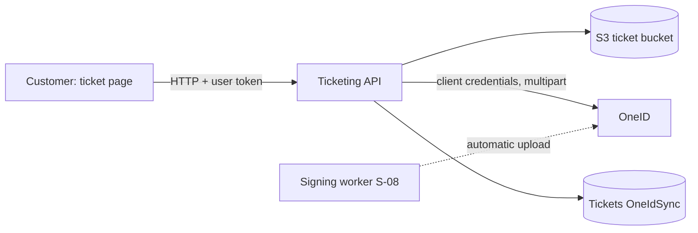

# P-10 · OneID ticket sync

> **Bangla name:** OneID টিকিট সিঙ্ক
>
> [← 20 · User portal](README.md) · [Contents](../README.md) · [Open queries](../99-open-queries.md)

## 1. Name and purpose

**OneID ticket sync.** Customers who signed in with OneID ([X-08](../60-cross-cutting/X-08-oneid-sso.md)) can have their signed ticket PDFs stored in their OneID wallet. The platform does this automatically when a ticket is signed ([S-08](../50-system-initiated/S-08-ticket-signing.md)); the customer can repeat it by hand with **Sync with OneID** when the automatic upload failed.

## 2. Trigger and actor

Signed-in customer whose profile `sso_provider` is `oneid`, on the ticket page of a `Generated` order ([P-09](P-09-ticket-details-downloads.md)); the button shows only while not all tickets are synced.

## 3. Business flow

The customer presses **Sync with OneID**; the page reloads and the My bookings list ([P-07](P-07-my-bookings.md)) shows the sync state per order.

## 4. Technical flow

1. **[HTTP + user token]** `POST {services.tickets}/ticketing/api/v1/booking-order-ticket/sync-order-to-oneid/{orderPublicId}` (no body; `BookingApiService.syncOrderToOneId`). `[Authorize(User)]`, but `SyncOrderTicketsToOneIdAsync` does not compare the caller with the order owner.
2. For every ticket of the order, `SyncTicketToOneIdAsync(ticketNumber)`: already synced → success "already synced"; no `SignedTicketUrl` → failure "Ticket has not been generated yet"; the order has no `OneIdUserId` → failure; otherwise reads the signed PDF from the ticket bucket and calls `OneIdManager.SyncDocumentWithVdsQrAsync`.
3. **[HTTP, static credentials] → OneID:** token by `POST {OneIdSettings:TokenUrl}` (client credentials, Basic `AuthorizationToken`), cached in Redis `OneId:AuthToken`; document by multipart `POST {OneIdSettings:DocumentSyncUrl}` with `one_id`, `document_type=pdf`, `document_id` (ticket number), `file`, and `vds_qr` only when present. A 401 refreshes the token once and retries. The VDS QR value is hard-coded `null` (marked TODO), so it is never sent.
4. On success the ticket gets `OneIdSync = true` and `OneIdSyncedAt`. The answer is `OneIdOrderSyncResponse {success, message, totalTickets, syncedTickets, failedTickets, alreadySyncedTickets, results[]}` (HTTP 200 even when `success` is false).
5. The portal ignores `success`: on any HTTP success it reloads the details; on an HTTP error it only logs to analytics.
6. The single-ticket endpoint `POST .../sync-to-oneid/{ticketNumber}` exists with no portal caller.

## 5. Components

| Kind | Component |
|---|---|
| Client | `tickets/components/ticket-preview` (`syncWithOneId`), `booking-api.service.ts:254-259` |
| Service | Ticketing (`BookingOrderTicketController`, `TicketManager`, `OneIdManager`) |
| Tables / Redis | `Tickets` (`OneIdSync`, `OneIdSyncedAt`); `OneId:AuthToken` |
| External | OneID token and document-sync APIs |

## 6. API contracts

| Method | Path | Auth | Response |
|---|---|---|---|
| POST | `/ticketing/api/v1/booking-order-ticket/sync-order-to-oneid/{orderPublicId}` | User | `OneIdOrderSyncResponse` |
| POST | `/ticketing/api/v1/booking-order-ticket/sync-to-oneid/{ticketNumber}` | User | `OneIdSyncResponse` (404 `Ticket not found`) |

Primary sample, response (values illustrative):

```json
{ "success": true, "message": "Successfully synced 2 ticket(s). 0 ticket(s) were already synced.",
  "totalTickets": 2, "syncedTickets": 2, "failedTickets": 0, "alreadySyncedTickets": 0, "results": [] }
```

## 7. Data and side effects

`Tickets.OneIdSync`, a PDF stored at OneID, a Redis token.

## 8. Code references

| What | Where |
|---|---|
| Portal | `rvl-gobcb-user-portal/ETP-Web/src/app/modules/featured/tickets/components/ticket-preview/ticket-preview.component.ts:260-285` |
| Controller | `rvl-gobcb-backend/Services/Ticketing/ETP.Ticketing.Service/Api/BookingOrderTicketController.cs:534-565` |
| Manager | `.../ETP.Ticketing.Domain/Managers/TicketManager.cs:2575-2800`; `.../OneIdManager.cs:36-330` |

## 9. Handover notes

1. **No owner check:** any signed-in customer can trigger the sync of any order or ticket id they know; the PDF still goes to the order's own OneID account, so the impact is limited to unwanted uploads `[UNCONFIRMED: Q-41]`.
2. **Failures are silent for the customer** (HTTP 200 with `success: false`).
3. **No VDS QR is sent** (TODO in code), although the call supports it.
4. **OneID endpoints and credentials are not in the repo** (`[see User Secrets]`); locally OneID is a dummy, so the real sync cannot be tested `[UNCONFIRMED: Q-06]`.

## 10. Component relationships



**Depends on:** [X-08](../60-cross-cutting/X-08-oneid-sso.md), [P-08](P-08-ticket-generation-request.md), [S-08](../50-system-initiated/S-08-ticket-signing.md). **Affects:** [P-07](P-07-my-bookings.md).

## 11. Developer test guide

**Local testability: Not locally** (OneID is a dummy; the fake OneID at `/p/oneid` covers login only, `docs/user-portal-local.md`).

| Item | Detail |
|---|---|
| Test data and accounts | fake OneID login for `+8801700000011` |
| Browser | ticket page of a `Generated` order; button visible for OneID users |
| Emulator | — |
| Postman | `postman/services/etp-ticketing.postman_collection.json`: "POST /api/v1/booking-order-ticket/sync-order-to-oneid/{orderPublicId}", "POST /api/v1/booking-order-ticket/sync-to-oneid/{ticketNumber}" |
| Visual Studio debug | `TicketManager.SyncTicketToOneIdAsync`, `OneIdManager.ExecuteWithRetryAsync` |
| Verify | SQL on `Tickets."OneIdSync"`; `redis-cli GET OneId:AuthToken` |
