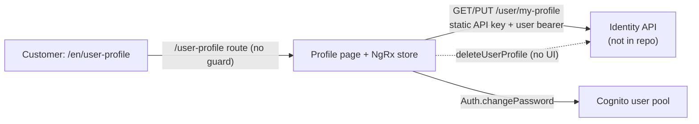

# P-11 · Profile view and update

> **Bangla name:** প্রোফাইল দেখা ও আপডেট
>
> [← 20 · User portal](README.md) · [Contents](../README.md) · [Open queries](../99-open-queries.md)

## 1. Name and purpose

**Profile view and update.** A signed-in customer sees the personal data held for them, and can correct the fields the platform lets them correct: date of birth, identity document, and address. Name, phone and email are shown read-only. The same page carries the **Change password** form ([X-09](../60-cross-cutting/X-09-user-forgot-password.md) covers the forgot-password path; change-password here is the Cognito call).

The profile itself lives in the **identity API**, which is not in this repository ([X-06](../60-cross-cutting/X-06-user-registration.md) explains the split) `[UNCONFIRMED: Q-01]`.

## 2. Trigger and actor

Customer on `/en/user-profile` (a `:lang` segment is always present, [P-13](P-13-language-switch.md)). The route has **no AuthGuard** — `app-routing.module.ts:41-46` lists `canActivate` for `tickets` and `issues` but not for `user-profile`. In practice the page still needs a valid session, because the component renders `user_data.name` straight from the NgRx store; an anonymous visit throws in the template rather than redirecting.

## 3. Business flow

1. The page opens on the **Profile** tab: name, phone, email (read-only) plus the editable fields.
2. For a OneID customer (`sso_provider === 'oneid'`) the DOB, identity-document and address fields are hidden and not validated, because OneID already supplies that data.
3. Editing DOB / identity document / address and saving sends the update; the page shows a green banner `user_updated_and_verified` or a red banner mapped from the server's status code.
4. The **Change password** tab (hidden for OneID users) asks for the old and new password and calls Cognito directly.

## 4. Technical flow

1. **[HTTP + user token] → identity API:** `GET {services.identity}/user/my-profile` (`IdentityApiService.fetchUserProfile`, `identity-api.service.ts:66-71`). Two headers apply: the static API key from `environment.headerkey` (set once on the service, `:30-32`) and the Cognito bearer added by `TokenInterceptor`. The response is `UserProfile { user_data }`.
2. The component maps `user_data` into a reactive form (`user-profile-pages.component.ts:78-86`). Controls: `fullName`, `phoneNumber`, `email`, `dob`, `verification_type`, `verification_id`, `address`.
3. **[HTTP + user token] → identity API:** `PUT {services.identity}/user/my-profile` (`updateUserProfile`, `:100-105`) with `UpdateProfile { verification_id, verification_type, address, dob }` — only these four. Name, phone and email cannot be changed from here. Dispatched through NgRx: `updateUserProfileInit` → effect `updateUserProfile$` (`identity.effects.ts:346-371`).
4. The PUT passes **no explicit headers object**; it relies entirely on `TokenInterceptor`, whose allow-list matches on the substring `/user/my-profile` (`token.interceptor.ts:152, 189-193`). The consequence is that the static `headerkey` present on the GET is *not* applied to the PUT `[UNCONFIRMED: Q-42]`.
5. **Change password:** `CognitoService.changePassword(old, new)` (`user-profile-pages.component.ts:319`) → Amplify `Auth.changePassword(cognitoUser, oldPassword, newPassword)` (`cognito.service.ts:182-198`). No GoBCB service is involved, so the result never reaches the platform's own tables.
6. **Delete account has no UI in the portal.** `deleteUserProfile()` (`identity-api.service.ts:91-98`) and the `deleteProfile$` effect (`identity.effects.ts:514-543`) exist but no component dispatches them; the action is reachable only from the user app ([X-11](../60-cross-cutting/X-11-delete-account-force-update.md)).

## 5. Components

| Kind | Component |
|---|---|
| Client | `featured/profile/pages/user-profile-pages.component.ts` + `.html`, `featured/profile/profile-routing.module.ts` |
| Client services | `core/services/api/identity-api.service.ts`, `shared/services/cognito.service.ts`, `core/services/identity-store.service.ts`, NgRx `identity.effects.ts` |
| Service | Identity API (not in this repo) for the profile; Cognito user pool for the password |
| Tables | Identity API's own user table (not in this repo) |
| Redis | none |

## 6. API contracts

| Method | Path | Auth | Request | Response / errors |
|---|---|---|---|---|
| GET | `{services.identity}/user/my-profile` | Static API key + user bearer | — | `UserProfile`; 404 `user_not_found` |
| PUT | `{services.identity}/user/my-profile` | User bearer (via interceptor) | `UpdateProfile` | `user_updated_and_verified`, `user_update_and_verification_failed`, `invalid_request`, `server_error` |
| DELETE | `{services.identity}/user/delete-my-profile` | User bearer | — | not reachable from the portal |
| — | Cognito `ChangePassword` | user pool session | `oldPassword`, `newPassword` | `IncorrectUsernameOrPasswordException`, `PasswordResetRequiredException`, … (mapped, see §9) |

Sample, GET response (values illustrative; the interesting part is `UserProfile.user_data`):

```json
{
  "user_data": {
    "registration_datetime": "2026-03-14T09:22:31Z",
    "address": "House 42, Road 7, Dhanmondi, Dhaka-1209",
    "email": "rafiq.hasan@example.com",
    "name": "Rafiq Hasan",
    "user_id": "a1c9f0de-6b2e-4a71-9f30-2c9d5b8e77aa",
    "role": "user",
    "dob": "1994-07-21T00:00:00Z",
    "temp_user_id": "b7e31044-2f5a-4c9d-8e11-77a0b3c1d902",
    "phone": "+8801700000011",
    "verified": true,
    "isProfileCompleted": true,
    "sso_provider": "oneid",
    "one_id": "8812345678901234",
    "nonsensitive_data": { "verification": { "verification_id": "1994567890123", "verification_type": "nid" } },
    "sensitive_data": null
  }
}
```

Sample, PUT request body — exactly the four editable fields:

```json
{ "verification_id": "1994567890123", "verification_type": "nid", "address": "House 42, Road 7, Dhanmondi, Dhaka-1209", "dob": "1994-07-21T00:00:00" }
```

## 7. Data and side effects

Only the identity API's user row is touched (`dob`, address, verification fields). The change-password call writes the Cognito pool's password. Nothing is written to the `etp` schema, no queue message is published, no file is stored.

## 8. Code references

| What | Where |
|---|---|
| Route | `rvl-gobcb-user-portal/ETP-Web/src/app/app-routing.module.ts:41-46`, `:67-71` |
| Component | `rvl-gobcb-user-portal/ETP-Web/src/app/modules/featured/profile/pages/user-profile-pages.component.ts:36-370` |
| Template | `.../user-profile-pages.component.html:11, 80-95, 187-286, 328-329, 410` |
| API service | `rvl-gobcb-user-portal/ETP-Web/src/app/core/services/api/identity-api.service.ts:23-152` |
| Models | `rvl-gobcb-user-portal/ETP-Web/src/app/core/models/user-profile.ts:3-68` |
| NgRx | `.../core/services/identity-store.service.ts:99-101`, `.../store/identity.effects.ts:346-371, 514-543` |
| Interceptor | `.../core/interceptors/token.interceptor.ts:152, 189-193` |
| Cognito | `.../shared/services/cognito.service.ts:182-198` |

## 9. Handover notes

1. **No AuthGuard on `/user-profile`.** An anonymous visit is not redirected; it renders and throws on an empty store. Consistent with [X-17](../60-cross-cutting/X-17-authz-client-side.md) note 1.
2. **Name, phone and email are read-only.** The UI renders them disabled and the PUT body has no such fields, so a customer cannot correct a mistyped phone number from the portal `[UNCONFIRMED: Q-43]`.
3. **Static API key header asymmetry.** GET sends `environment.headerkey`; PUT does not (interceptor only). It works today because the allow-list matches, but a stricter identity API would break the update `[UNCONFIRMED: Q-42]`.
4. **Identity-document validation is custom.** `nid` must be digits of length 10, 13 or 17; `passport` must be alphanumeric (`user-profile-pages.component.ts:215-237`). No field has a maximum length.
5. **Minimum age 12** is enforced client-side by the date picker's `[max]` (`:209-213`); whether the identity API re-checks is unknown `[UNCONFIRMED: Q-01]`.
6. **OneID customers skip DOB / address / verification** entirely (validators cleared and fields hidden, `:122-128` and `html:94`).
7. **Raw status strings are matched, not displayed.** The effect reads `success.status_message` / `error.error.status_message` but the template renders translated keys (`MESSAGES.SOMETHING_WRONG`), so a new server status code silently produces the generic message. The password tab does `{{ error | translate }}`, so an unmapped Cognito error surfaces as the raw key string (`html:410`).
8. **A second, stale `User`/`UserData` interface** exists at `featured/profile/models/user.ts:1-30` (with `ekyc` and `payment` fields) and is used by the Issues module; it is not the profile model's contract.

## 10. Component relationships



**Depends on:** [X-06](../60-cross-cutting/X-06-user-registration.md) (the account must exist), [X-07](../60-cross-cutting/X-07-user-password-login.md) (the session), [P-13](P-13-language-switch.md) (the `/en` segment). **Affects:** nothing downstream — no platform table is read from the profile, so a DOB or address change never reaches the ticket holder data ([P-09](P-09-ticket-details-downloads.md) keeps its own copy).

## 11. Developer test guide

**Local testability: Partial.** The page runs fully against the local identity stub at `/p/identity` (`docs/user-portal-local.md`); OTP is stubbed with `123456`.

| Item | Detail |
|---|---|
| Test data and accounts | seeded user `+8801700000011`; the `/p/identity` stub returns a fixed `user_data` — edit DOB/address and confirm in DevTools that the PUT body has exactly the four fields |
| Browser | `http://localhost:4200/en/user-profile`; Network tab: `GET` then `PUT /user/my-profile`, check `Authorization` and the static key; confirm the success banner with a valid NID (10/13/17 digits) and the error banner with a 5-digit one |
| Emulator | — |
| Postman | not in any collection — `services.identity` is an external API with no GoBCB Postman collection `[UNCONFIRMED: Q-01]` |
| Visual Studio debug | no local breakpoint target: the identity API is not in this solution. Use the Aspire AppHost only to watch the portal's HTTP traffic (`docs/local-dev.md` §6) |
| Verify | the stub's received PUT body in the Floci console log; the password change in the Cognito user pool console |