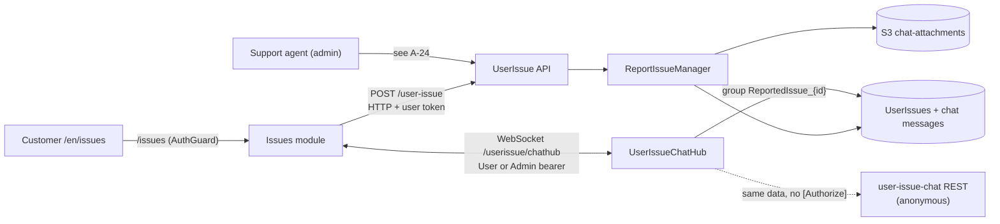

# P-12 · Report an issue and chat with support

> **Bangla name:** ইস্যু রিপোর্ট খ সাপোর্টের সাথে চ্যাট
>
> [← 20 · User portal](README.md) · [Contents](../README.md) · [Open queries](../99-open-queries.md)

## 1. Name and purpose

**Report an issue and chat with support.** A customer raises a problem against one of their orders. The description becomes the **first chat message**, so raising an issue and chatting with support are one continuous conversation: the customer's text opens the thread, support replies over SignalR, and the thread can carry image or PDF attachments. The admin side of the same conversation is [A-24](../10-admin-portal/A-24-user-issues-admin.md).

Rules the platform enforces: **one issue per order** and **600 characters per description**.

## 2. Trigger and actor

Customer on `/en/issues`, a route that **does** have `AuthGuard` (`app-routing.module.ts:25-31`). Three child screens (`featured/Issues/issue-routing.module.ts:6-8`):

| Route | Screen | Id in the URL |
|---|---|---|
| `/issues` | My issue list | — |
| `/issues/issue/:id` | Report a new issue | booking order id |
| `/issues/issue-details/:id` | Chat thread for one issue | `publicOrderId` |

## 3. Business flow

1. From **My bookings** ([P-07](P-07-my-bookings.md)) the customer opens *Report an issue* for an order; the portal prefetches the profile and the order, then shows a 600-character text area with an optional file.
2. On submit the description becomes message 1 of the chat, the issue number is generated, the status is `Open`, and the customer is taken to the chat screen.
3. In the chat thread the customer sends text over the SignalR hub, or sends text plus a file over REST (multipart), and sees support's replies, typing indicators and read state.
4. The list shows each issue's status. Support resolves it on the admin side; the status becomes `Resolved` and the resolution time is shown. Anything not `Resolved` displays as `Open`.

## 4. Technical flow

1. **[HTTP + user token]** `POST {services.userissue}/userissue/api/v1/user-issue` (`BookingApiService.createReportIssue`, `booking-api.service.ts:143-148`) with `CreateReportIssue { publicOrderId, programId, description }`. `[Authorize(Policy = AuthScheme.User)]` (`ReportIssueController.cs:32`).
2. `ReportIssueManager.CreateAsync` (`ReportIssueManager.cs:62-66`) validates **in the manager, not by attribute**: description over 600 characters throws `ArgumentException("Description character should not be more than 600")`; then `GetByOrderIdAsync` throws `ArgumentException("You cannot create multiple issues per order")` if the order already has one.
3. The manager generates an `IssueNumber` with a retry loop (`:71-78`), sets `Status = "Open"` (`:87`) and seeds chat message 1 with `SenderType = "USER"` and `Message = request.Description` (`:97-109`). Response is `ReportedUserIssue`.
4. **[HTTP + user token]** the list: `GET …/user-issue/user/{userId}` (`booking-api.service.ts:150-154`) → `ReportIssue[]`. Detail: `GET …/user-issue/user-detail/{orderId}` → `IssueDetails`, which adds `eventName` and `paymentInfo`.
5. **[SignalR]** the chat. Portal service `SignalRChatService` (`core/services/signalr-chat.service.ts:11`) builds the URL `{services.userissuehub}/userissue/chathub` with `https→wss` / `http→ws` (`:73`), authenticates with a Cognito `accessTokenFactory` (`:80-87`), and connects with **`skipNegotiation: true` + WebSockets only** (`:88-89`) and `withAutomaticReconnect([0,2000,10000,30000])` (`:91`). On connect it calls `invoke('JoinUserIssueChat', issueId.toString())` (`:101`).
6. The hub `UserIssueChatHub` (`Services/UserIssue/ETP.UserIssue.Service/Hubs/UserIssueChatHub.cs:14`) is `[Authorize(AuthenticationSchemes = AuthScheme.User + "," + AuthScheme.Admin)]` (`:13`). `JoinUserIssueChat` joins the SignalR group `ReportedIssue_{id}` (`:103`) and broadcasts `"UserJoined"` with the `username` claim (`:107`). `"NewMessage"` is **server-to-client only** — it is sent with `Clients.Group(...).SendAsync("NewMessage", savedMessage)` (`:37`, `:52`), never invoked by the browser. The invocable methods are `SendMessage(CreateChatMessage)` (`:28`), `BroadcastNewMessage(object, string)` (`:49`), `LeaveUserIssueChat` (`:115`), `SendTypingIndicator` (`:132`) and `StopTyping` (`:150`). The portal also handles `UserLeft`, `UserTyping` and `UserStoppedTyping` (`signalr-chat.service.ts:133-155`).
7. **Sending is split by content.** Text only → the hub, `sendMessage` (`:212`), with **PascalCase** field names because they bind to the C# DTO: `UserIssueId`, `Message`, `SenderType`, `SenderId`, `SenderName` (`:205-211`). With an attachment → REST `sendChatMessage()` and then `broadcastNewMessage()` (`:174-190`), because a hub call cannot carry the file.
8. **[HTTP, no auth] → chat REST** (`ReportIssueChatController`, `[Route("api/v1/user-issue-chat")]`, `ReportIssueChatController.cs:12`): the portal uses `…/user-issue-chat/{issueId}/messages`, `…/user-issue-chat/send` (multipart) and `…/user-issue-chat/message/{messageId}/attachment/download` (`booking-api.service.ts:192-193, 234-236, 246-248`). **This controller has no `[Authorize]` on the class or on any action**, unlike the hub, and `senderId`, `senderName` and `senderType` are client-supplied form fields — see §9 note 1.
9. Attachments: multipart fields `UserIssueId`, `SenderType`, `Message`, `SenderId`, `SenderName`, `AttachmentFile` (`booking-api.service.ts:215-232`; `CreateChatMessage.cs`). Stored in S3 under the folder `chat-attachments` with `ReportedIssueId` as the key segment (`ReportIssueChatManager.cs:212`), with `AttachmentFileSize = file.Length` (`:218`).

## 5. Components

| Kind | Component |
|---|---|
| Client | `featured/Issues/pages/report-issue-list`, `report-issue`, `report-issue-details` (`.ts` + `.html`), `core/services/signalr-chat.service.ts` |
| Client API | `booking-api.service.ts:143-154, 192-248`, `featured/Issues/models/report-issue.ts`, `.../chat-message.ts`, `.../issue-details.ts` |
| Service | UserIssue (`ReportIssueController`, `ReportIssueChatController`, `UserIssueChatHub`, `ReportIssueManager`, `ReportIssueChatManager`) |
| Tables | `UserIssues` (`UserIssueDbContext`), chat messages |
| S3 | `chat-attachments/{reportedIssueId}/…` |
| External | none |

## 6. API contracts

| Method | Path | Auth | Request → Response |
|---|---|---|---|
| POST | `/userissue/api/v1/user-issue` | User | `CreateReportIssue { publicOrderId, programId, description }` → `ReportedUserIssue`; `ArgumentException` on >600 chars or a second issue |
| GET | `/userissue/api/v1/user-issue/user/{userId}` | User | — → `ReportIssue[]` |
| GET | `/userissue/api/v1/user-issue/user-detail/{orderId}` | User | — → `IssueDetails` (adds `eventName`, `paymentInfo`) |
| WS | `/userissue/chathub` | User or Admin bearer | client → `JoinUserIssueChat`, `SendMessage`, `BroadcastNewMessage`, `LeaveUserIssueChat`, `SendTypingIndicator`, `StopTyping`; server → `NewMessage`, `UserJoined`, `UserLeft`, `UserTyping`, `UserStoppedTyping` |
| GET | `/userissue/api/v1/user-issue-chat/{id}/messages` | **none** | — → `ChatMessagesListResponse { totalCount, items[], message }` |
| POST | `/userissue/api/v1/user-issue-chat/send` | **none** | multipart `UserIssueId`, `SenderType`, `Message`, `SenderId`, `SenderName`, `AttachmentFile` → `ChatMessage` |
| GET | `/userissue/api/v1/user-issue-chat/message/{messageId}/attachment/download` | **none** | — → file stream |
| GET | `/userissue/api/v1/user-issue-chat/{id}/unread-count`, `/unread`, `/last`, `/recent` | **none** | not called by the portal |

Sample, POST create (primary):

```json
{ "publicOrderId": "3f9a1c77-52e8-4b16-9d70-8a41c2f0b6d3", "programId": 12, "description": "Two seats in Block C, Row 4 were booked but the ticket shows a different row. Please check." }
```

Sample, chat message as stored and rendered (`ChatMessage`, values illustrative):

```json
{ "userIssueId": 47, "senderId": "a1c9f0de-6b2e-4a71-9f30-2c9d5b8e77aa", "senderName": "Rafiq Hasan",
  "senderType": "USER", "message": "Attaching the screenshot of the booking confirmation.",
  "isRead": false, "attachmentContentType": "image/png", "attachmentFileName": "confirmation.png",
  "attachmentFileSize": 284113, "attachmentFilePath": "chat-attachments/47/47-x1a2b3.png",
  "createdAt": "2026-09-02T06:41:12Z", "isDeleted": false }
```

## 7. Data and side effects

`UserIssues` row (status, `IssueNumber`, `ResolvedAt`/`ResolvedBy` when support closes it), chat message rows (message 1 seeded at creation, later ones added by REST or the hub), an S3 object per attachment, and a SignalR group membership. No queue message, no email, no push.

## 8. Code references

| What | Where |
|---|---|
| Routes | `rvl-gobcb-user-portal/ETP-Web/src/app/app-routing.module.ts:25-31`; `.../modules/featured/Issues/issue-routing.module.ts:6-8` |
| Components | `.../modules/featured/Issues/pages/report-issue-list/report-issue-list.component.ts:62-90, 166-188`, `report-issue.component.ts:57, 85-89`, `report-issue-details.component.ts:126-127, 174-190` |
| Portal API | `rvl-gobcb-user-portal/ETP-Web/src/app/core/services/api/booking-api.service.ts:28, 143-154, 192-248` |
| SignalR client | `rvl-gobcb-user-portal/ETP-Web/src/app/core/services/signalr-chat.service.ts:11-155, 174-212` |
| Models | `.../modules/featured/Issues/models/report-issue.ts:1-24`, `chat-message.ts`, `issue-details.ts` |
| Controller | `rvl-gobcb-backend/Services/UserIssue/ETP.UserIssue.Service/Api/ReportIssueController.cs:14-72` |
| Chat controller | `.../ETP.UserIssue.Service/Api/ReportIssueChatController.cs:12-168` |
| Hub | `.../ETP.UserIssue.Service/Hubs/UserIssueChatHub.cs:13-150` |
| Managers | `.../ETP.UserIssue.Domain/Managers/ReportIssueManager.cs:62-111`; `ReportIssueChatManager.cs:185-218` |
| DTOs / enums | `.../ETP.UserIssue.Domain/Models/CreateUserIssue.cs`, `CreateChatMessage.cs`, `.../Enums/Enums.cs:5-9` |
| DbContext | `.../ETP.UserIssue.Data/UserIssueDbContext.cs:90, 105` |

## 9. Handover notes

1. **The chat REST API is completely unauthenticated.** `ReportIssueChatController` carries no `[Authorize]` at class or action level, so `POST /user-issue-chat/send`, `GET /…/messages` and `GET /…/attachment/download` are reachable without a token. Because `senderId`, `senderName` and `senderType` are **client-supplied form fields**, an anonymous caller can post a message into any issue thread and label it `ADMIN`. The SignalR twin of the same data *is* authorized, so this is an inconsistency rather than a deliberate design. **The legacy `Admin/UserIssueChatController` — same route, same eight endpoints — has the same gap**, so both copies need fixing, not just the live one (see [Appendix A](../90-appendix-a-legacy.md)) `[UNCONFIRMED: Q-46]`.
2. **Any authenticated user can join any issue's chat group.** `JoinUserIssueChat` takes the issue id as a string and does not compare it with the caller's issues (`UserIssueChatHub.cs:98-108`); the only barrier is not knowing the id.
3. **"One issue per order" is a manager check, not a database constraint.** `UserIssueDbContext.cs:105` has `HasIndex(p => p.PublicOrderId)` **without `IsUnique()`**, and the check-then-act at `ReportIssueManager.cs:64-66` has a race: two simultaneous submits both pass `[UNCONFIRMED: Q-47]`.
4. **The 600-character limit is also only in the manager**, while the column is `HasMaxLength(2000)` (`:90`). A longer value inserted by any other path would be stored; the portal's own validator matches at 600 (`report-issue.component.ts:57`).
5. **Attachment size limit mismatch: 10 MB on the server, 5 MB in the portal** (`ReportIssueChatManager.cs:185-186` vs `report-issue-details.component.ts:127`). The client also restricts MIME to `image/jpeg`, `image/png`, `image/jpg`, `application/pdf`, and no server-side MIME allowlist was found in the reviewed code `[UNCONFIRMED: Q-48]`.
6. **`skipNegotiation: true` means WebSockets only.** Behind a proxy or gateway that does not forward WebSocket upgrades the chat cannot connect at all; the fallback to Server-Sent Events or long polling is disabled by that flag `[UNCONFIRMED: Q-49]`.
7. **Chat failures degrade silently.** `signalr-chat.service.ts:84, 120, 180, 189` swallow errors — two are literally empty `catch` blocks — and the service drops to a "basic mode" (`:105`). The customer sees no message when the connection fails.
8. **The prefetch calls ignore errors:** `report-issue.component.ts:85, 89` use empty error callbacks for the profile and order lookups, so the page renders with missing data rather than an error.
9. **Status values are `Open` and `Resolved` only** (`Enums.cs:5-9`), and the UI collapses anything else to `Open` (`report-issue-list.component.ts:169-177`). A leftover `'Pending'` branch in `getStatusColor` (`:181-182`) can therefore never trigger.
10. **Send uses PascalCase keys.** The hub message object uses `UserIssueId`/`Message`/`SenderType`/… so it binds to the C# DTO, while the rendered `ChatMessage` model is camelCase. Both forms exist in the same file; do not normalise them without checking both ends.
11. **Issue-resolved notification is not implemented.** The push for a resolved issue exists only in the legacy Admin-service copy ([A-24](../10-admin-portal/A-24-user-issues-admin.md) note), so a customer never learns that support answered `[UNCONFIRMED: Q-50]`.

## 10. Component relationships



**Depends on:** [P-07](P-07-my-bookings.md) (the order being complained about), [P-11](P-11-profile.md) (the prefetched user), [A-02](../10-admin-portal/A-02-programs.md) (`programId`). **Affects:** [A-24](../10-admin-portal/A-24-user-issues-admin.md), which is the other end of the same thread.

## 11. Developer test guide

**Local testability: Full for issues and REST chat; Partial for the SignalR hub** — the hub needs the UserIssue service's WebSocket route to be reachable, and `skipNegotiation` removes the long-polling fallback.

| Item | Detail |
|---|---|
| Test data and accounts | seeded user `+8801700000011` with at least one paid order from `scripts/seed/*.sql`; the portal prefetches the profile and the order, so both must exist |
| Browser | `http://localhost:4200/en/issues`; DevTools → Network → WS to see the `/userissue/chathub` frames (`JoinUserIssueChat`, then `NewMessage`); test a 601-character description (expect the 600 error), a second issue on the same order (expect the "multiple issues" error), an 11 MB file (expect the 5 MB client-side rejection) |
| Emulator | — (the user app has its own copy of this flow, [U-08](../30-user-app/U-08-issues-chat.md)) |
| Postman | `postman/services/etp-userissue.postman_collection.json`: "POST /api/v1/user-issue", "GET /api/v1/user-issue/user/{userId}", "GET /api/v1/user-issue/user-detail/{orderId}", "GET /api/v1/user-issue-chat/{reportedIssueId}/messages", "POST /api/v1/user-issue-chat/send"; set `{{access_token_user}}` |
| Visual Studio debug | `ReportIssueManager.CreateAsync` (break on the 600-char and duplicate branches), `ReportIssueChatManager.SendMessageAsync`, `UserIssueChatHub.JoinUserIssueChat`; to exercise the hub without the browser, start the service and connect from the SignalR client tool with the user-pool token |
| Verify | SQL `SELECT "IssueNumber","Status","Description" FROM etp."UserIssues"`; the chat rows in the same database; the S3 object under `chat-attachments/{id}/` in Floci; the Aspire log lines of the UserIssue service for the hub joins |