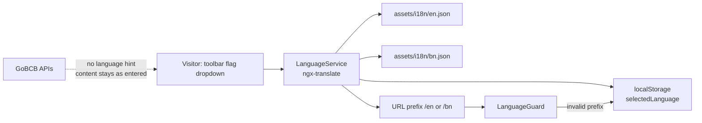

# P-13 · Language switch (EN / BN)

> **Bangla name:** ভাষা পরিবর্তন (EN / BN)
>
> [← 20 · User portal](README.md) · [Contents](../README.md) · [Open queries](../99-open-queries.md)

## 1. Name and purpose

**Language switch (EN / BN).** Every user-portal URL carries a language prefix — `/en/…` or `/bn/…` — and the toolbar has a language dropdown that switches the whole interface. The choice is remembered in the browser and is **purely client-side**: nothing is stored server-side and no request carries a language hint, so the choice follows the browser, not the account.

## 2. Trigger and actor

Any visitor, signed in or not. Control: the flag dropdown in the toolbar, available in both the desktop and mobile layouts (`layout/components/toolbar/toolbar.component.html`, `toolbar.component.ts:61-63, 92-93, 126-127, 283-289`).

## 3. Business flow

1. The customer picks a flag from the toolbar dropdown.
2. All visible text switches immediately, a snackbar confirms the switch, the `<html lang>` attribute is updated, and the URL prefix is rewritten so the link can be shared in that language.
3. On the next visit the saved language is applied: the URL prefix decides, and if the URL has no valid prefix, `LanguageGuard` redirects to the saved language.

## 4. Technical flow

1. The language is the `:lang` **parent route segment**: `{ path: ':lang', component: DefaultLayoutComponent, canActivate: [LanguageGuard], children: appRoutes }` (`app-routing.module.ts:67-71`). `''` redirects to `/en` (`:53`) and the wildcard `**` also redirects to `/en` (`:75`).
2. `LanguageGuard` accepts only `en` or `bn`; anything else redirects to `/${selectedLanguage}${currentPath}` (`language.guard.ts:16-28`).
3. `LanguageService.switchLanguage(lang, showConfirmation = true, updateUrl = true)` (`:55-86`) calls `translate.use(lang)`, shows the `MESSAGES.LANGUAGE_SWITCHED` snackbar (`:61-67`), sets `document.documentElement.setAttribute('lang', lang)` (`:76`) and rewrites the URL (`:88-102`). `translate.setDefaultLang('en')` is set once at construction (`:34`).
4. The URL language is also watched, so a hand-edited prefix or a pasted link switches the interface on `NavigationEnd` (`:38-47`).
5. **The only persistence is `localStorage['selectedLanguage']`**, written at `:73` and read at `:31` and in `language.guard.ts:24`, defaulting to `en`.
6. The payment-return path is the one place that reads the key directly instead of going through the service: `app-routing.module.ts:60` uses it to rebuild the post-payment URL with the right prefix.

## 5. Components

| Kind | Component |
|---|---|
| Client | `shared/services/language.service.ts`, `shared/guards/language.guard.ts`, `layout/components/toolbar/toolbar.component.ts` + `.html` |
| Router | `app-routing.module.ts` (`:lang` parent route) |
| Assets | `src/assets/i18n/en.json`, `src/assets/i18n/bn.json` (loaded by `ngx-translate` with `CommonModule`) |
| Service / Tables / Redis | none — no backend call is language-dependent |

## 6. API contracts

None. No backend endpoint is involved, and **no request carries `Accept-Language` or a locale field** — the API services and interceptors do not set either. Content that comes from the database (event names, descriptions, notices, promo names) is therefore shown in whatever language it was entered in the admin portal, not in the reader's language. `[UNCONFIRMED: Q-44]`

## 7. Data and side effects

`localStorage['selectedLanguage']`, the `lang` attribute on `<html>`, and the URL prefix. No server state, no `etp` table, no queue message.

## 8. Code references

| What | Where |
|---|---|
| Service | `rvl-gobcb-user-portal/ETP-Web/src/app/shared/services/language.service.ts:11-102` |
| Guard | `rvl-gobcb-user-portal/ETP-Web/src/app/shared/guards/language.guard.ts:16-28` |
| Routing | `rvl-gobcb-user-portal/ETP-Web/src/app/app-routing.module.ts:53-75` |
| Toolbar | `rvl-gobcb-user-portal/ETP-Web/src/app/layout/components/toolbar/toolbar.component.ts:61-63, 126-127, 283-289` and `.html` |
| Translation assets | `rvl-gobcb-user-portal/ETP-Web/src/assets/i18n/en.json`, `.../bn.json` |
| Language-aware formatting | `.../modules/featured/Issues/pages/report-issue-list/report-issue-list.component.ts:62-90` (paginator range text, Bengali-specific format) |

## 9. Handover notes

1. **The supported languages are hard-coded** in `LanguageService` (`:15-18`) as `en` and `bn`. Adding a third language needs both this list and a new `assets/i18n/<code>.json`.
2. **English is the fallback language** (`setDefaultLang('en')`, `:34`), so any key missing from `bn.json` renders in English rather than as a raw key — this is why the two files need not match exactly.
3. **Key counts differ:** `en.json` has 560 leaf keys, `bn.json` has 587 (both over the same 26 top-level namespaces). `bn.json` carries the extra keys, so a handful of English strings are untranslated, and the untranslated ones fall back silently `[UNCONFIRMED: Q-45]`.
4. **The choice is per browser, not per account.** Two devices can show different languages for the same customer, and a shared link carries its own language prefix.
5. **Content from the database is never translated** — only the chrome is. This is the single biggest gap for a Bangla-first launch and needs a decision from BS23 (per-language columns, a translation table, or per-program content) `[UNCONFIRMED: Q-44]`.
6. **The payment redirect reads `localStorage` directly** (`app-routing.module.ts:60`) rather than using `LanguageService`. If the guard rewrites the prefix between the redirect and the read, the customer can land on the other language `[UNCONFIRMED: Q-44]`.
7. **Paginator labels are recomputed per language**, including a Bengali range format `` `${length} এর মধ্যে ${start}+1-${end}` `` (`report-issue-list.component.ts:62-90`) — an example of the kind of string that must be translated with care, not word-for-word.

## 10. Component relationships

**Depends on:** nothing in the backend. **Affects:** every user-portal feature's display text — [P-01](P-01-home-content.md), [P-02](P-02-browse-events.md), [P-03](P-03-info-pages.md), [P-04](P-04-seat-selection.md), [P-07](P-07-my-bookings.md), [P-11](P-11-profile.md), [P-12](P-12-issues-chat.md) — because all of them render through `ngx-translate`. Admin-portal and app clients have their own language handling and are out of scope here.

## 11. Developer test guide

**Local testability: Full.** It is entirely client-side; no stub is involved.

| Item | Detail |
|---|---|
| Test data and accounts | none — works signed out |
| Browser | `http://localhost:4200/` redirects to `/en`; switch to Bangla from the toolbar and confirm the URL becomes `/bn/...`, `localStorage.selectedLanguage === 'bn'`, and `<html lang="bn">`; reload and confirm the choice sticks; then open `/fr/booking` and confirm the guard redirects to `/bn/booking` |
| Emulator | — |
| Postman | not applicable |
| Visual Studio debug | no backend involved; breakpoint in `LanguageService.switchLanguage` if you need to trace a redirect |
| Verify | `localStorage.getItem('selectedLanguage')`; a deliberately broken key in `bn.json` to confirm the English fallback; compare the key sets of `en.json` and `bn.json` (`jq '[paths(scalars)] \| length'`) |