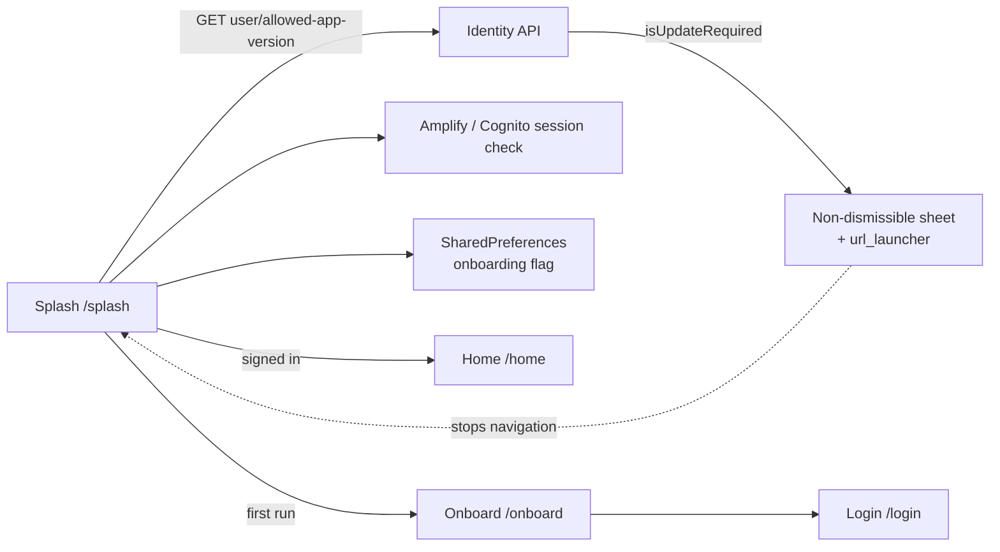

# U-01 · Splash, version gate and onboarding

> **Bangla name:** স্প্ল্যাশ, ভার্সন গেট খ অনবোর্ডিং
>
> [← 30 · User app](README.md) · [Contents](../README.md) · [Open queries](../99-open-queries.md)

## 1. Name and purpose

**Splash, version gate and onboarding.** The first screen after launch. It checks whether the installed app version is still allowed, decides whether the customer is already signed in, shows the onboarding carousel to a first-time user, and then routes to Home or Login. This is also the app's force-update gate — the only place the app can refuse to run.

## 2. Trigger and actor

Every cold start. Route `/splash` (`RoutePath.splash`); `SplashViewModel` is constructed by the splash `binding` through the DI container (`data/lib/di/data_module.dart`).

## 3. Business flow

1. The splash appears and immediately asks the backend whether this app version is still allowed.
2. If an update is required, a **non-dismissible** bottom sheet appears with an **Update now** button that opens `appInfo.appLink` in the browser. Navigation stops here — the app does not continue to Home or Login.
3. Otherwise the app checks whether a Cognito session exists.
4. Signed in → **Home**, and a background call caches the user information.
5. Not signed in and onboarding not completed → **Onboard** after a 1-second delay, then **Login**.
6. Not signed in but onboarding already completed → **Login** immediately.

## 4. Technical flow

1. `SplashViewModel._onInit()` (`splash_view_model.dart:56-62`) runs its steps in order: `_checkAppVersion()`, `_getLoginStatus()`, `_getOnboardingStatus()`, `analyticsRepository.setAnalyticsUser()`, then `_navigateToNextScreen()`.
2. **[HTTP + user token if present] → identity API:** `GET user/allowed-app-version` (`app_version_api_service_impl.dart:14`) → `AppInfo { isUpdateRequired, appLink, … }`.
3. When `appInfo.isUpdateRequired == true` it sets `_shouldUpdateApp` and shows a bottom sheet with `isDismissible: false` (`:76-95`). The button opens the link with `url_launcher`, and only for `http`/`https` schemes and only when not on web (`:88-91`). `_navigateToNextScreen()` returns immediately if `_shouldUpdateApp` is set (`:105`).
4. `authRepository.isLoggedIn()` checks the Amplify/Cognito session; `appRepository.isOnBoardingCompleted()` checks local storage.
5. **[UNCONFIRMED: Q-51]** — the version check is wrapped in `try/catch` and **swallows the error** (`:82-84`); a customer with no network at launch therefore passes the gate silently instead of being blocked, which is the desirable behaviour but means an outdated app can run offline.
6. Navigation uses `navigateToScreen(destination: …, isClearBackStack: true)` — Home (`:107-114`), Onboard after `Future.delayed(const Duration(seconds: 1))` (`:116-122`), or Login.

## 5. Components

| Kind | Component |
|---|---|
| Client | `lib/presentation/feature/splash/splash_view_model.dart`, `splash_adaptive_ui.dart`, `screen/`, `binding/` |
| Client | `lib/presentation/feature/onboard/onboard_view_model.dart`, `onboard_adaptive_ui.dart`, `screen/`, `widgets/` |
| Client service | `data/lib/remote/api_service/app_version_api_service/`, `data/lib/repository/app_repository_impl.dart` |
| Router | `lib/presentation/navigation/route_path.dart` (`splash`, `onboard`, `home`, `login`) |
| Service | Identity API (`user/allowed-app-version`) |
| Tables / Redis | none |

## 6. API contracts

| Method | Path | Auth | Request → Response |
|---|---|---|---|
| GET | `{AUTH_API_BASE_URL}/user/allowed-app-version` | user bearer if signed in, otherwise effectively anonymous | — → `AppInfo { appVersion, isUpdateRequired, appLink, … }` |

This is the same identity API as [X-06](../60-cross-cutting/X-06-user-registration.md) and [P-11](../20-user-portal/P-11-profile.md), reached through a different client (`auth_api_client.dart:6`, base URL `dotenv.env['AUTH_API_BASE_URL']`) `[UNCONFIRMED: Q-01]`.

## 7. Data and side effects

Local storage only: the onboarding-completed flag, via `SharedPreferences` behind `AppRepository`. No `etp` table is written.

## 8. Code references

| What | Where |
|---|---|
| View model | `rvl-gobcb-user-app/lib/presentation/feature/splash/splash_view_model.dart:56-124` |
| Onboarding | `rvl-gobcb-user-app/lib/presentation/feature/onboard/onboard_view_model.dart:11-17` |
| Version API | `rvl-gobcb-user-app/data/lib/remote/api_service/app_version_api_service/app_version_api_service_impl.dart:14` |
| Auth client | `rvl-gobcb-user-app/data/lib/remote/api_client/auth_api_client.dart:6` |
| Routes | `rvl-gobcb-user-app/lib/presentation/navigation/route_path.dart` |
| App repository | `rvl-gobcb-user-app/data/lib/repository/app_repository_impl.dart:15` |
| Model | `rvl-gobcb-user-app/domain/lib/model/app_info.dart` |

## 9. Handover notes

1. **The force-update gate is client-side only.** It is enforced by the app refusing to navigate, not by any API check, so a customer who never re-opens the app keeps the old version indefinitely `[UNCONFIRMED: Q-52]`.
2. **A failed version check is swallowed**, so offline launches always pass (§4 note 5).
3. **The update bottom sheet cannot be dismissed** (`isDismissible: false`), which is the intent — but there is also no "remind me later", so the app is unusable until updated.
4. **The link is opened with `url_launcher`, not a store SDK**, and only when the scheme is `http`/`https`. A `market://` or `itms-apps://` link in `appLink` is ignored `[UNCONFIRMED: Q-52]`.
5. **Analytics is initialised after the checks**, so a blocked customer is never registered in analytics.
6. **The 1-second delay before onboarding** is a cosmetic pause, not a loading gate; onboarding is only needed after the first launch.
7. **`AppInfo.appLink` must be set by the identity API.** The request itself takes no version parameter — `app_version_api_service_impl.dart:14` sends a bare `get`, so the version must be sent as a header or query by `ApiClient`; verify which, because a version-less check cannot work `[UNCONFIRMED: Q-01]`.

## 10. Component relationships

**Depends on:** [X-11](../60-cross-cutting/X-11-delete-account-force-update.md) (the same force-update behaviour, documented from the API side). **Affects:** everything — every other U-xx entry starts from the session this screen establishes.

## 11. Developer test guide

**Local testability: Full**, except that the version check needs the identity stub. There is no dedicated stub for `allowed-app-version`, so point `AUTH_API_BASE_URL` at the `/p/identity` stub or a local Serverless deployment (`docs/mobile-local.md`).

| Item | Detail |
|---|---|
| Test data and accounts | none for onboarding; the version response is read from the stub |
| Browser | — |
| Emulator | run the app (`scripts/Setup-MobileApps.ps1`); the log shows `Started Firebase Initialization` then the splash transition; set `isUpdateRequired: true` in the stub response to see the blocking sheet |
| Postman | "GET /user/allowed-app-version" is not in any GoBCB collection — it belongs to the identity API `[UNCONFIRMED: Q-01]` |
| Visual Studio debug | the call is out of process; break at `SplashViewModel._checkAppVersion` and `_navigateToNextScreen` in the Flutter debugger |
| Verify | the `.env` value of `AUTH_API_BASE_URL`; clear app storage to force the onboarding path again |