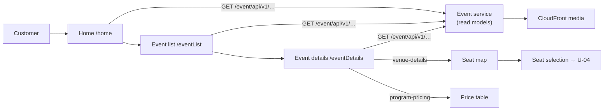

# U-02 · Home and browse events

> **Bangla name:** হোম ও ইভেন্ট ব্রাউজ
>
> [← 30 · User app](README.md) · [Contents](../README.md) · [Open queries](../99-open-queries.md)

## 1. Name and purpose

**Home and browse events.** The customer's landing screen shows the programs they can book, the header/footer content and the landing-page banners; from there they open the event list, browse events and open an event's details. The backend is exactly the one the web portal uses ([P-01](../20-user-portal/P-01-home-content.md), [P-02](../20-user-portal/P-02-browse-events.md)) — the difference here is presentation, not contract.

## 2. Trigger and actor

Signed-in customer. Home is only reachable from [U-01](U-01-splash-onboarding.md) when a session exists. Routes `/home`, `/eventList`, `/eventDetails`.

## 3. Business flow

1. Home loads the public landing-page images (banners), the program list and the header/footer content, and shows the customer's programs.
2. Tapping a program opens the event list for it.
3. The event list is paged and supports pull-to-refresh; each row shows the event image, name, venue, date and starting price.
4. Tapping an event opens the details screen, which loads the event, its venue map and its pricing.

## 4. Technical flow

1. **[HTTP + user token]** `GET event/api/v1/landing-page-image/public` — used by **both** `EventApiServiceImpl:36` and `GalleryApiServiceImpl:13`, i.e. the gallery reuses the landing-page endpoint rather than having its own.
2. **[HTTP + user token]** `GET event/api/v1/events/programs` (`:46`) for the program list.
3. **[HTTP + user token]** `GET event/api/v1/header-footer` (`:56`) for the header/footer content.
4. **[HTTP + user token]** `GET event/api/v1/events/list` with query parameters (`:16-19`) for the paged event list.
5. **[HTTP + user token]** `GET event/api/v1/events/{eventId}` (`:26`) for event details.
6. **[HTTP + user token]** `GET event/api/v1/events/venue-details/{eventId}` (`venue_details_api_service_impl.dart:16`) for the seat map, which the details screen renders before the customer proceeds to seat selection ([U-04](U-04-seat-selection-promo.md)).
7. **[HTTP + user token]** `GET event/api/v1/ticket-pricing/program-pricing` (`event_api_service_impl.dart:66`) for the price table shown on the details screen.
8. Images come through CloudFront URLs and are cached on device with `cached_network_image`; nothing is written to a local database.

## 5. Components

| Kind | Component |
|---|---|
| Client | `lib/presentation/feature/home/`, `feature/event_list/`, `feature/event_details/` (each with `route/`, `binding/`, `screen/`, `widgets/`, `*_view_model.dart`) |
| Client services | `EventRepositoryImpl`, `GalleryRepositoryImpl`, `VenueDetailsRepositoryImpl`, `TicketPricingRepositoryImpl` (`data/lib/repository/`) |
| API services | `data/lib/remote/api_service/event_api_service/`, `gallery_api_service/`, `venue_details_api_service_impl.dart` |
| Services | Event, Admin (read models) |
| External | CloudFront for media |

## 6. API contracts

| Method | Path | Auth | Notes |
|---|---|---|---|
| GET | `/event/api/v1/landing-page-image/public` | User | banners and gallery items |
| GET | `/event/api/v1/events/programs` | User | program list |
| GET | `/event/api/v1/header-footer` | User | header/footer |
| GET | `/event/api/v1/events/list` | User | paged; query parameters `programId`, page, size |
| GET | `/event/api/v1/events/{eventId}` | User | event details |
| GET | `/event/api/v1/events/venue-details/{eventId}` | User | seat map for [U-04](U-04-seat-selection-promo.md) |
| GET | `/event/api/v1/ticket-pricing/program-pricing` | User | price table |

All are **reads against the Event service's read models** ([X-25](../60-cross-cutting/X-25-redis.md) for the caching model). Request/response shapes are identical to the portal's — see [P-02](../20-user-portal/P-02-browse-events.md) for the full JSON.

## 7. Data and side effects

None beyond device-level image caching. No `etp` table is written from the client; the data originates in the Admin service ([A-07](../10-admin-portal/A-07-events.md), [A-28](../10-admin-portal/A-28-media-configuration.md)).

## 8. Code references

| What | Where |
|---|---|
| Event API | `rvl-gobcb-user-app/data/lib/remote/api_service/event_api_service/event_api_service_impl.dart:16-66` |
| Gallery API | `rvl-gobcb-user-app/data/lib/remote/api_service/gallery_api_service/gallery_api_service_impl.dart:13` |
| Venue API | `rvl-gobcb-user-app/data/lib/remote/api_service/venue_details_api_service_impl.dart:16` |
| Repositories | `rvl-gobcb-user-app/data/lib/repository/event_repository_impl.dart:10`, `gallery_repository_impl.dart:6`, `venue_details_repository_impl.dart:6`, `ticket_pricing_repository_impl.dart:6` |
| Features | `rvl-gobcb-user-app/lib/presentation/feature/home/`, `feature/event_list/`, `feature/event_details/` |
| Routes | `rvl-gobcb-user-app/lib/presentation/navigation/route_path.dart` (`home`, `eventList`, `eventDetails`) |

## 9. Handover notes

1. **The gallery and the home banners call the same endpoint.** `landing-page-image/public` is invoked from two services (`event_api_service_impl.dart:36` and `gallery_api_service_impl.dart:13`); the gallery is distinguished by image type, so a wrong filter would leak banner images into the gallery `[UNCONFIRMED: Q-53]`.
2. **The app reads `program-pricing`, not `ticket-pricing/list`** — the same endpoint the portal uses. This confirms the corrected finding on [A-14](../10-admin-portal/A-14-ticket-pricing-content.md): `ticket-pricing/list` has no reader in any client.
3. **No event-list caching on disk.** `cached_network_image` caches images only; the JSON lists are refetched, so the event list is unavailable offline `[UNCONFIRMED: Q-54]`.
4. **Same "list assumes venue/segments" assumption as the portal** ([Q-36](../20-user-portal/P-02-browse-events.md)) — the list model expects venue and segment objects to be present.
5. **The app has no program-switch UI** the way the admin portal does; the program list comes straight from `events/programs`, so a customer with many programs gets a flat list.

## 10. Component relationships

**Depends on:** [U-01](U-01-splash-onboarding.md) (session), [A-07](../10-admin-portal/A-07-events.md) and [A-28](../10-admin-portal/A-28-media-configuration.md) (the content shown), [A-09](../10-admin-portal/A-09-event-level-pricing.md) (the prices). **Affects:** [U-04](U-04-seat-selection-promo.md), [U-05](U-05-booking-webview-payment.md).

## 11. Developer test guide

**Local testability: Full.** The Event service runs under Aspire and the app reads the same endpoints as the portal.

| Item | Detail |
|---|---|
| Test data and accounts | seeded user `+8801700000011`; `scripts/seed/01-catalog.sql` creates programs, events, venues and galleries |
| Browser | the equivalent check in the portal at `/en/` — see [P-02](../20-user-portal/P-02-browse-events.md) |
| Emulator | run the app (`scripts/Setup-MobileApps.ps1`); the app must reach the backend through `scripts/mobile-gateway.js`. The app does **not** use `dart-define` — set the base URL in `.env` (`env/README.md`) |
| Postman | `postman/services/etp-event.postman_collection.json`: "GET /api/v1/events/list", "GET /api/v1/events/{eventId}", "GET /api/v1/events/venue-details/{eventId}", "GET /api/v1/events/programs", "GET /api/v1/landing-page-image/public", "GET /api/v1/header-footer" |
| Visual Studio debug | client: `EventRepositoryImpl` in the Flutter debugger. Server: `EventController` in the Event service |
| Verify | the `Events`, `Programs` and `LandingPageImages` tables; the app's HTTP log lines |