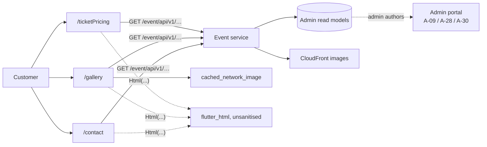

# U-03 · Information pages (pricing, gallery, contact)

> **Bangla name:** তথ্য পেজ (দাম, গ্যালারি, যোগাযোগ)
>
> [← 30 · User app](README.md) · [Contents](../README.md) · [Open queries](../99-open-queries.md)

## 1. Name and purpose

**Information pages.** Three read-only screens reachable from the Home menu: the **ticket-pricing** table for a program, the **gallery** of event images, and the **contact** page. They carry the static, admin-authored content a customer needs before deciding to book. The authoring side is [A-09](../10-admin-portal/A-09-event-level-pricing.md), [A-28](../10-admin-portal/A-28-media-configuration.md) and [A-30](../10-admin-portal/A-30-header-footer-social.md).

## 2. Trigger and actor

Signed-in customer. Routes `/ticketPricing`, `/gallery`, `/contact`.

## 3. Business flow

1. **Pricing:** the customer opens a program and sees the per-gallery / per-level price table before choosing an event.
2. **Gallery:** a swipeable list of images for the selected event or venue.
3. **Contact:** the contact details from the header/footer configuration, shown as text and links.

## 4. Technical flow

1. **[HTTP + user token]** `GET event/api/v1/ticket-pricing/program-pricing` (`event_api_service_impl.dart:66`) via `TicketPricingRepositoryImpl` → the `/ticketPricing` screen.
2. **[HTTP + user token]** `GET event/api/v1/landing-page-image/public` (`gallery_api_service_impl.dart:13`) via `GalleryRepositoryImpl` → the `/gallery` screen. As noted in [U-02](U-02-home-browse-events.md), this is the **same endpoint** the home banners use; the gallery is a filtered view of the same media set.
3. **[HTTP + user token]** `GET event/api/v1/header-footer` (`event_api_service_impl.dart:56`) supplies the contact details. There is no dedicated contact endpoint.
4. Images load from CloudFront through `cached_network_image`, which caches on disk; the text content is refetched per screen open with no local persistence.
5. **HTML rendering:** two widgets render admin-authored HTML with `flutter_html` — `booking_details/widgets/ticket_guideline.dart:56` (the ticket guideline on the booking details screen) and `event_list/widgets/warning_message.dart:87` (the event warning message). `[UNCONFIRMED: Q-55]` — `flutter_html` 3.0.0 is used with no sanitisation configuration, making this the app's counterpart to the portal's `bypassSecurityTrustHtml` ([Q-33](../20-user-portal/P-03-info-pages.md)). Admin-authored HTML is rendered as-is.

## 5. Components

| Kind | Component |
|---|---|
| Client | `lib/presentation/feature/ticket_pricing/`, `feature/gallery/`, `feature/contact/` |
| Client | `feature/booking_details/widgets/ticket_guideline.dart`, `feature/event_list/widgets/warning_message.dart` |
| Client services | `TicketPricingRepositoryImpl`, `GalleryRepositoryImpl`, `EventRepositoryImpl` |
| API services | `event_api_service/`, `gallery_api_service/` |
| Service | Event (read models over Admin's tables) |
| External | CloudFront |

## 6. API contracts

| Method | Path | Auth | Screen |
|---|---|---|---|
| GET | `/event/api/v1/ticket-pricing/program-pricing` | User | `/ticketPricing` |
| GET | `/event/api/v1/landing-page-image/public` | User | `/gallery` |
| GET | `/event/api/v1/header-footer` | User | `/contact` |

Response shapes are identical to the portal's — see [P-03](../20-user-portal/P-03-info-pages.md).

## 7. Data and side effects

None written. Images cached on device by `cached_network_image`; nothing in `etp` is modified.

## 8. Code references

| What | Where |
|---|---|
| Pricing API | `rvl-gobcb-user-app/data/lib/remote/api_service/event_api_service/event_api_service_impl.dart:66` |
| Gallery API | `rvl-gobcb-user-app/data/lib/remote/api_service/gallery_api_service/gallery_api_service_impl.dart:13` |
| Header/footer API | `rvl-gobcb-user-app/data/lib/remote/api_service/event_api_service/event_api_service_impl.dart:56` |
| HTML widgets | `rvl-gobcb-user-app/lib/presentation/feature/booking_details/widgets/ticket_guideline.dart:3, 56`; `feature/event_list/widgets/warning_message.dart:3, 87` |
| Repositories | `rvl-gobcb-user-app/data/lib/repository/ticket_pricing_repository_impl.dart:6`, `gallery_repository_impl.dart:6` |
| Packages | `rvl-gobcb-user-app/pubspec.yaml` (`flutter_html: 3.0.0`, `cached_network_image: 3.4.1`) |

## 9. Handover notes

1. **No contact-specific endpoint** — the contact screen reads the header/footer configuration, so contact details cannot be edited independently of the site header ([Q-34](../20-user-portal/P-13-language-switch.md) applies here too).
2. **The gallery shares the landing-page endpoint** with the home banners; see [U-02](U-02-home-browse-events.md) note 1 `[UNCONFIRMED: Q-53]`.
3. **Admin HTML is rendered unfiltered** by `flutter_html` in two places (§4 note 5) `[UNCONFIRMED: Q-55]`. A compromised or careless admin account could inject markup reaching every customer's device.
4. **`flutter_html` 3.0.0 is pinned** — it is no longer the maintained package for Flutter, which is a maintenance risk independent of the security point.
5. **No offline content:** all three screens are empty without a network.

## 10. Component relationships

**Depends on:** [U-02](U-02-home-browse-events.md) (navigation), [A-09](../10-admin-portal/A-09-event-level-pricing.md), [A-28](../10-admin-portal/A-28-media-configuration.md), [A-30](../10-admin-portal/A-30-header-footer-social.md). **Affects:** nothing downstream — all three screens are terminal reads.

## 11. Developer test guide

**Local testability: Full.**

| Item | Detail |
|---|---|
| Test data and accounts | seeded user `+8801700000011`; seeded gallery images and header/footer rows from `scripts/seed/*.sql` |
| Browser | portal equivalents at `/en/pricing` and `/en/gallery` — see [P-03](../20-user-portal/P-03-info-pages.md) |
| Emulator | run the app; open `/ticketPricing`, `/gallery`, `/contact` from the Home menu |
| Postman | `postman/services/etp-event.postman_collection.json`: "GET /api/v1/ticket-pricing/program-pricing", "GET /api/v1/landing-page-image/public", "GET /api/v1/header-footer" |
| Visual Studio debug | `EventController` in the Event service; client side `GalleryRepositoryImpl` |
| Verify | the `TicketPricingContent`, `LandingPageImages` and `HeaderFooters` tables; to test the HTML risk, put a `<script>` tag in a seeded guideline field and confirm the app renders it |