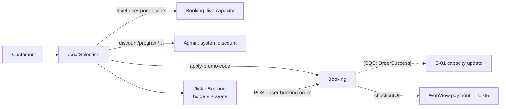

# U-04 · Seat selection and promo code

> **Bangla name:** সিট নির্বাচন ও প্রোমো কোড
>
> [← 30 · User app](README.md) · [Contents](../README.md) · [Open queries](../99-open-queries.md)

## 1. Name and purpose

**Seat selection and promo code.** On the seat-selection screen the customer sees the live availability of a level, picks their seats, sees the system discount that applies to that level, optionally applies a promo code, enters the ticket-holder names and phone numbers, and proceeds to payment. The backend and the rules are shared with the web portal ([P-04](../20-user-portal/P-04-seat-selection.md), [P-05](../20-user-portal/P-05-apply-promo-code.md)); this entry records the app's own behaviour.

## 2. Trigger and actor

Signed-in customer, from the event details screen ([U-02](U-02-home-browse-events.md)). Routes `/seatSelection`, then `/ticketBooking` for the checkout.

## 3. Business flow

1. The venue map comes from `venue-details`; selecting a block/level opens the live seat list for that level.
2. The customer taps free seats; the running total updates.
3. Any **system discount** configured for that program/event/gallery is shown and applied automatically — the customer does nothing.
4. A promo code may be applied on top.
5. The customer enters a name and phone number for **each** ticket, then taps through to payment ([U-05](U-05-booking-webview-payment.md)).

## 4. Technical flow

1. **[HTTP + user token]** `GET booking/api/v1/capacity/level-user-portal-seats?eventId=…&galleryId=…&blockId=…&levelId=…` (`ticket_api_service_impl.dart:267`) — the live seat state for one level. This is the same endpoint the portal's seat map uses.
2. **No polling.** `[UNCONFIRMED: Q-54]` — the app fetches the level's seats **once** when the level is opened; there is no `Timer` and no refresh loop in `seat_selection_view_model.dart`. The portal refreshes on interaction, so a customer who leaves the seat map open in the app can act on stale availability and be refused at checkout `[UNCONFIRMED: Q-56]`.
3. **[HTTP + user token]** `GET admin/api/v1/discount/program/{programId}/{eventId}/{galleryId}` (`:247`) — the system discount for the selection. Note this is served by the **Admin** service, not Booking.
4. **[HTTP + user token]** `POST booking/api/v1/user-booking-order/apply-promo-code` (`:222`) → `ApplyPromoCodeRequest/Response`, identical to [P-05](../20-user-portal/P-05-apply-promo-code.md).
5. **[HTTP + user token]** `POST booking/api/v1/user-booking-order` (`ticket_api_service_impl.dart:65`) creates the order. The request carries the selected seats, the ticket-holder names and phone numbers (`ticket_booking_view_model.dart:521-528`), and the response is `CheckOutResponse { checkoutUrl }` (`response/check_out_response.dart`).
6. Client-side guard: `showTicketHolderInputBoxes()` refuses to continue unless `galleryId`, `blockId`, `levelId` are set and `numberOfSeats > 0`, showing "Please select all the boxes" (`ticket_booking_view_model.dart:566-573`).

## 5. Components

| Kind | Component |
|---|---|
| Client | `lib/presentation/feature/seat_selection/`, `feature/ticket_booking/` (each with `route/`, `binding/`, `screen/`, `widgets/`, `*_view_model.dart`) |
| Client services | `VenueDetailsRepositoryImpl`, `TicketBookingRepositoryImpl`, `TicketPricingRepositoryImpl` |
| API service | `data/lib/remote/api_service/ticket_api_service/ticket_api_service_impl.dart:65, 222, 247, 267` |
| Services | Booking, Admin (discount), Event (venue details) |
| Queues | none from the client; the order triggers `OrderSuccess` server-side ([S-01](../50-system-initiated/S-01-level-capacity-update.md)) |
| Redis | live capacity keys written by the workers, read through `level-user-portal-seats` |

## 6. API contracts

| Method | Path | Auth | Request → Response |
|---|---|---|---|
| GET | `/booking/api/v1/capacity/level-user-portal-seats?eventId&galleryId&blockId&levelId` | User | — → seat list with availability flags |
| GET | `/admin/api/v1/discount/program/{programId}/{eventId}/{galleryId}` | User | — → system discount |
| POST | `/booking/api/v1/user-booking-order/apply-promo-code` | User | `ApplyPromoCodeRequest` → `ApplyPromoCodeResponse` |
| POST | `/booking/api/v1/user-booking-order` | User | booking + holders → `CheckOutResponse { checkoutUrl }` |

The full JSON for the create-order and promo requests is in [P-06](../20-user-portal/P-06-booking-payment.md) and [P-05](../20-user-portal/P-05-apply-promo-code.md); the app posts the same shapes.

## 7. Data and side effects

`UserBookingOrders` and the seat rows are written by the Booking service; capacity is decremented through the `OrderSuccess` queue ([S-01](../50-system-initiated/S-01-level-capacity-update.md)). The app itself writes only device state (selected seats, holder names).

## 8. Code references

| What | Where |
|---|---|
| Seat / discount / promo API | `rvl-gobcb-user-app/data/lib/remote/api_service/ticket_api_service/ticket_api_service_impl.dart:222, 247, 267` |
| Create order | `rvl-gobcb-user-app/data/lib/remote/api_service/ticket_api_service/ticket_api_service_impl.dart:65` |
| Booking view model | `rvl-gobcb-user-app/lib/presentation/feature/ticket_booking/ticket_booking_view_model.dart:517-585` |
| Seat selection | `rvl-gobcb-user-app/lib/presentation/feature/seat_selection/seat_selection_view_model.dart` |
| Checkout response | `rvl-gobcb-user-app/data/lib/remote/response/check_out_response.dart:3-13` |
| Repository | `rvl-gobcb-user-app/data/lib/repository/ticket_booking_repository_impl.dart:15` |

## 9. Handover notes

1. **No live refresh of seats** (§4 note 2) — the most important app-vs-portal difference in the booking flow `[UNCONFIRMED: Q-56]`.
2. **The system discount comes from the Admin service** (`admin/api/v1/discount/program/…`), not Booking. If the Admin service is down but Booking is up, checkout fails on this call.
3. **The promo-code rules are shared with the portal**, including the finding that a code's `IsActive` flag is not part of the check ([Q-18](../20-user-portal/P-05-apply-promo-code.md)).
4. **The order is created before payment.** If the customer backs out of the WebView, the order exists as pending and is cancelled later by [S-05](../50-system-initiated/S-05-pending-failed-revalidation.md); the app offers no "resume payment" path, unlike the portal's status polling `[UNCONFIRMED: Q-57]`.
5. **Seat-holding is server-side by 12 minutes**, so an abandoned checkout in the app holds those seats just as the portal does ([Q-37](../20-user-portal/P-04-seat-selection.md)).

## 10. Component relationships

**Depends on:** [U-02](U-02-home-browse-events.md) (event and venue data), [A-10](../10-admin-portal/A-10-capacity-adjustment.md), [A-15](../10-admin-portal/A-15-promo-codes.md), [A-16](../10-admin-portal/A-16-discounts.md). **Affects:** [U-05](U-05-booking-webview-payment.md), [S-01](../50-system-initiated/S-01-level-capacity-update.md).

## 11. Developer test guide

**Local testability: Full** for the reads and the promo check; **Partial** for payment (needs a dummy DgePay or gateway sandbox).

| Item | Detail |
|---|---|
| Test data and accounts | seeded user `+8801700000011`; a published event with a block/level and free seats; a promo code from `scripts/seed/01-catalog.sql:190` |
| Browser | portal equivalent at `/en/events/:id/seats` — see [P-04](../20-user-portal/P-04-seat-selection.md) |
| Emulator | run the app; open an event → seat selection; watch the app's HTTP log for `level-user-portal-seats` firing **once** per level open |
| Postman | `postman/services/etp-booking.postman_collection.json`: "GET /api/v1/capacity/level-user-portal-seats", "POST /api/v1/user-booking-order/apply-promo-code", "POST /api/v1/user-booking-order"; `postman/services/etp-admin.postman_collection.json`: "GET /api/v1/discount/program/{programId}/{eventId}/{galleryId}" |
| Visual Studio debug | `UserBookingOrderManager` in the Booking service; client: `TicketBookingViewModel` around line 521 |
| Verify | `SELECT` on the booking order and its seats; the Redis capacity keys behind `level-user-portal-seats` |