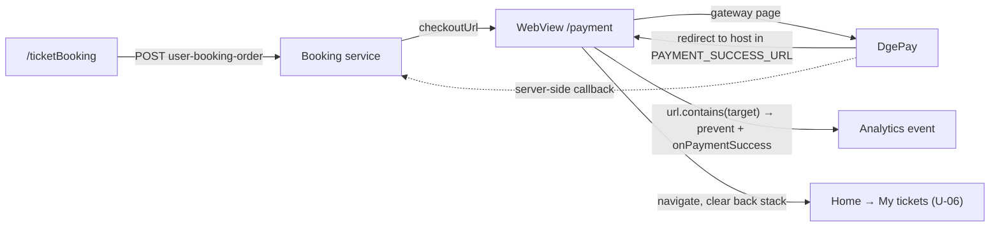

# U-05 · Booking and WebView payment

> **Bangla name:** বুকিং ও WebView পেমেন্ট
>
> [← 30 · User app](README.md) · [Contents](../README.md) · [Open queries](../99-open-queries.md)

## 1. Name and purpose

**Booking and WebView payment.** The final step of a purchase. The app posts the order to Booking, receives a `checkoutUrl`, opens it in an in-app **WebView**, and decides the payment succeeded purely by **watching which URL the WebView navigates to**. There is no gateway callback from the app's point of view and no polling loop — this is the central difference from the web portal, which polls a payment-status endpoint ([P-06](../20-user-portal/P-06-booking-payment.md)).

## 2. Trigger and actor

Signed-in customer completing [U-04](U-04-seat-selection-promo.md). Route `/payment` (`RoutePath.payment`), with `PaymentArgument { paymentUrl, targetUrl, onPaymentSuccess }`.

## 3. Business flow

1. The app posts the order; Booking returns `checkoutUrl` (the DgePay page).
2. The WebView loads it and shows a progress bar while loading.
3. The customer pays on the gateway page.
4. On success the gateway redirects to a known host. The WebView sees that URL, calls `onPaymentSuccess`, and the app navigates to **My tickets**.
5. If the customer cancels or backs out, nothing happens — the order stays pending until [S-05](../50-system-initiated/S-05-pending-failed-revalidation.md) expires it.

## 4. Technical flow

1. **[HTTP + user token]** `POST booking/api/v1/user-booking-order` (`ticket_api_service_impl.dart:65`) → `CheckOutResponse { checkoutUrl }` (`response/check_out_response.dart:13`). Called from `ticket_booking_view_model.dart:521-528` with the seats and the ticket-holder names and phones.
2. `if (paymentUrl != null)` the app navigates to `/payment` with `PaymentArgument(paymentUrl, targetUrl, onPaymentSuccess)` (`:530-553`). `targetUrl` comes from **`.env`**: `dotenv.env['PAYMENT_SUCCESS_URL'] ?? 'ticket-bangla.com/tickets'` (`:535-536`) — a **hard-coded production fallback** `[UNCONFIRMED: Q-58]`.
3. `PaymentViewModel` creates a `WebViewController` (`payment_view_model.dart:44-52`) from `webview_flutter` 4.13.0 (+ `webview_flutter_android` 4.10.1, `webview_flutter_wkwebview` 3.23.0), with **JavaScript enabled** (`setJavaScriptMode(JavaScriptMode.unrestricted)`), a white background, iOS inline-media params (`:54-62`) and Android debugging plus gesture-free media playback (`:64-70`).
4. **Success detection** is `_onNavigationRequest` (`:109-126`):
   - if the URL starts with `http://` or `https://` **and** contains `targetUrlHostName`, then — guarded by a one-shot `_hasPopped` flag — it calls `argument.onPaymentSuccess(request.url)` and pops the screen, returning `NavigationDecision.prevent`;
   - other http/https URLs navigate normally;
   - **any other scheme is blocked** with `NavigationDecision.prevent` and logged (`:122-125`) — this is what stops the gateway handing off to a bank app.
5. `onPaymentSuccess` fires a `ticket_booking_success` analytics event carrying `payment_success_url`, `event_id`, `gallery_id`, `block_id`, `level_id`, `number_of_seats`, `price_per_seat` and `total_charge` (`:537-551`), then calls `_navigateToMyTicketPage()`.
6. That method does **not** open the order. It clears the back stack and goes to `HomeRoute(initialNavigationItemType: NavigationItemType.myTickets)` (`:556-565`).
7. Server-side the order payment is completed by the DgePay callback and the `OrderSuccess` message; see [P-06](../20-user-portal/P-06-booking-payment.md) and [S-01](../50-system-initiated/S-01-level-capacity-update.md).

## 5. Components

| Kind | Component |
|---|---|
| Client | `lib/presentation/feature/payment/payment_view_model.dart`, `payment_argument.dart`, `feature/ticket_booking/` |
| Client | `.env` key `PAYMENT_SUCCESS_URL` |
| API service | `data/lib/remote/api_service/ticket_api_service/ticket_api_service_impl.dart:65` |
| Services | Booking (order), Admin (payment-gateway config read model) |
| External | **DgePay** gateway page inside the WebView |
| Analytics | `AnalyticsRepository.logCustomEvent` |

## 6. API contracts

| Method | Path | Auth | Request → Response |
|---|---|---|---|
| POST | `/booking/api/v1/user-booking-order` | User | booking + seats + holders → `CheckOutResponse { checkoutUrl }` |
| — | WebView navigation | — | the app inspects `request.url`; **no API call is made on success** |

Sample, response (values illustrative):

```json
{ "checkoutUrl": "https://dgpay.dhaka-payment.com/checkout/8f2c1d4e-77aa-4b2e-9c31-55de9a0b1f22" }
```

## 7. Data and side effects

The Booking service writes the order and its seats; the gateway reports payment through its own callback (not from the app). One analytics event is logged locally. No S3 object, no queue message from the client.

## 8. Code references

| What | Where |
|---|---|
| Payment view model | `rvl-gobcb-user-app/lib/presentation/feature/payment/payment_view_model.dart:44-142` |
| Argument | `rvl-gobcb-user-app/lib/presentation/feature/payment/route/payment_argument.dart:4-12` |
| Booking + navigation | `rvl-gobcb-user-app/lib/presentation/feature/ticket_booking/ticket_booking_view_model.dart:517-565` |
| Create-order API | `rvl-gobcb-user-app/data/lib/remote/api_service/ticket_api_service/ticket_api_service_impl.dart:65` |
| Response model | `rvl-gobcb-user-app/data/lib/remote/response/check_out_response.dart:3-13` |
| Packages | `rvl-gobcb-user-app/pubspec.yaml` (`webview_flutter: 4.13.0`) |

## 9. Handover notes

1. **Success is inferred from the redirect URL, not confirmed with the server.** The app never calls a payment-status endpoint, so a customer whose gateway page redirects but whose webhook has not yet landed sees "success" while the order is still unpaid `[UNCONFIRMED: Q-59]`. This is the app-vs-portal difference called out in the plan.
2. **The success host is matched with `String.contains`** (`:113`), not an exact prefix. Any gateway URL containing that string — including a look-alike host — is treated as success `[UNCONFIRMED: Q-58]`.
3. **The fallback is the production domain** `'ticket-bangla.com/tickets'` (`:536`), so a missing `.env` key makes a development build treat production as its success URL `[UNCONFIRMED: Q-58]`.
4. **A null `checkoutUrl` fails silently.** `if (paymentUrl != null)` guards the navigation (`:530`) but there is no `else` — no toast, no error state. The customer taps pay and nothing happens, which is the same defect recorded for the portal ([P-06](../20-user-portal/P-06-booking-payment.md)).
5. **No cancel or timeout handling.** Backing out of the WebView leaves the order pending until [S-05](../50-system-initiated/S-05-pending-failed-revalidation.md), and the app offers no way to resume payment `[UNCONFIRMED: Q-57]`.
6. **JavaScript is unrestricted** in the WebView, which the gateway requires; combined with note 2 it means any page loaded inside the WebView can trigger the success callback.
7. **Non-http schemes are blocked** (`:122-125`), which prevents bank-app hand-off. If a future gateway requires a custom scheme, that check must change.
8. **Android WebView debugging is enabled unconditionally** (`AndroidWebViewController.enableDebugging(true)`, `:66`), including in release builds.
9. **`_hasPopped` makes the callback one-shot**, so a redirect chain that visits the success host twice only navigates once.

## 10. Component relationships



**Depends on:** [U-04](U-04-seat-selection-promo.md) (seats and holders), [X-19](../60-cross-cutting/X-19-service-to-service.md) (gateway configuration), [A-03](../10-admin-portal/A-03-program-settings.md) (which gateway a program uses). **Affects:** [U-06](U-06-my-bookings-tickets.md), [S-01](../50-system-initiated/S-01-level-capacity-update.md), [S-05](../50-system-initiated/S-05-pending-failed-revalidation.md).

## 11. Developer test guide

**Local testability: Partial.** The order POST works locally, but the real DgePay page cannot be reached from a local build. Use a stub gateway or the dummy described below.

| Item | Detail |
|---|---|
| Test data and accounts | seeded user `+8801700000011`; an event with free seats |
| Browser | portal equivalent at `/en/checkout` — see [P-06](../20-user-portal/P-06-booking-payment.md) |
| Emulator | run the app; set `PAYMENT_SUCCESS_URL` in `.env` to the host of a local stub page that redirects to itself on "pay"; Android WebView debugging lets you inspect the live page over `chrome://inspect` |
| Postman | `postman/services/etp-booking.postman_collection.json`: "POST /api/v1/user-booking-order" |
| Visual Studio debug | client: `PaymentViewModel._onNavigationRequest`; server: `UserBookingOrderController` and the DgePay callback handler in the Booking service |
| Verify | `SELECT` on `UserBookingOrders` for `PaymentStatus`; the app log line `WebView is loading (progress : …%)`; to reproduce note 4, stub a `checkoutUrl` of `null` |