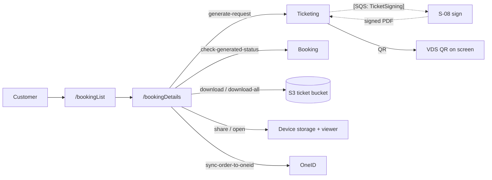

# U-06 · My bookings and tickets

> **Bangla name:** আমার বুকিং ও টিকিট
>
> [← 30 · User app](README.md) · [Contents](../README.md) · [Open queries](../99-open-queries.md)

## 1. Name and purpose

**My bookings and tickets.** The customer sees their orders, opens one to see its tickets, requests generation when the availability date arrives, watches the generation state, and then opens, shares or downloads the ticket PDFs. This is the app counterpart of [P-07](../20-user-portal/P-07-my-bookings.md), [P-08](../20-user-portal/P-08-ticket-generation-request.md), [P-09](../20-user-portal/P-09-ticket-details-downloads.md) and [P-10](../20-user-portal/P-10-oneid-ticket-sync.md).

## 2. Trigger and actor

Signed-in customer. Routes `/bookingList`, `/bookingDetails`, `/paymentDetails`. Also the landing target after a successful payment ([U-05](U-05-booking-webview-payment.md) navigates here with `NavigationItemType.myTickets`).

## 3. Business flow

1. **Bookings list:** paged list of the customer's orders with event name, order number, status and date.
2. **Booking details:** the order's tickets; each ticket shows its number, holder, block/level/seat and a QR code.
3. **Generate tickets:** when the event's ticket-availability date has passed and the order is paid, a **Generate** button appears; tapping it starts the generation pipeline ([S-07](../50-system-initiated/S-07-initiate-user-ticket-generation.md), [S-08](../50-system-initiated/S-08-ticket-signing.md)).
4. **Watch generation:** the app calls the generation-status endpoint while the order is `Requested`/`Processing`.
5. **Use the ticket:** open the PDF in a viewer, share it, or download all tickets of the order; for OneID customers, sync to the OneID wallet.

## 4. Technical flow

1. **[HTTP + user token]** `GET booking/api/v1/user-booking-order/list?…` (`booking_api_service_impl.dart:19`) — the paged list.
2. **[HTTP + user token]** `GET booking/api/v1/user-booking-order/{orderId}` (`:32`) — one order.
3. **[HTTP + user token]** `POST ticketing/api/v1/booking-order-ticket/generate-request/{publicId}` (`booking_api_service_impl.dart:43`, also `ticket_api_service_impl.dart:127`) — starts generation. Anonymous on the server side, which is recorded as [Q-40](../20-user-portal/P-08-ticket-generation-request.md).
4. **[HTTP + user token]** `GET booking/api/v1/user-booking-order/check-generated-status/?id={publicId}` (`ticket_api_service_impl.dart:143`) — the generation state. The app calls this while the order is not yet `Generated`; `[UNCONFIRMED: Q-54]` — no `Timer` is used, so the customer must pull to refresh or reopen the screen rather than seeing a live count.
5. **[HTTP + user token]** `POST ticketing/api/v1/booking-order-ticket/details` (`ticket_api_service_impl.dart:96`) — the ticket list for an order; `GET ticketing/api/v1/booking-order-ticket` (`:112`) for one ticket.
6. **[HTTP + user token]** `GET ticketing/api/v1/booking-order-ticket/download?ticketNumber={id}` (`:150`) — a single PDF, fetched as a full URL (`${apiClient.baseUrl}/…`) rather than through the JSON client, then handed to `DownloadService`.
7. **[HTTP + user token]** `GET ticketing/api/v1/booking-order-ticket/download-all/{publicId}` (`:166`) — all tickets as one file.
8. **[HTTP + user token]** `POST ticketing/api/v1/booking-order-ticket/sync-order-to-oneid/{publicOrderId}` — OneID sync, as in [P-10](../20-user-portal/P-10-oneid-ticket-sync.md).
9. **[HTTP + user token]** `GET ticketing/api/v1/booking-order-ticket/download-invoice/{paymentId}` via `ticketBanglaApiClient` (`:193`) — the invoice, fetched from a **second base URL** (`ticket_bangla_api_client.dart`).
10. **Opening and sharing:** `openFile(fileName: '${ticket.uniqueTicketNumber}.pdf')` (`booking_details_view_model.dart:230`, `open_file` 3.5.10) opens the downloaded PDF; `SharePlus.instance.share(...)` (`:264`, `share_plus` 12.0.0) shares it. `DownloadService` supports `openFileFromNotification` (`download_service.dart:186`), so a download that completes in the background opens automatically.
11. **QR display:** the ticket QR is rendered from data the Ticketing service returns; the QR itself is the VDS-signed payload produced during signing ([S-08](../50-system-initiated/S-08-ticket-signing.md)).

## 5. Components

| Kind | Component |
|---|---|
| Client | `lib/presentation/feature/booking_list/`, `feature/booking_details/` (incl. `widgets/ticket_guideline.dart`), `feature/payment_details/` |
| Client services | `BookingListRepositoryImpl`, `BookingDetailsRepositoryImpl`, `TicketBookingRepositoryImpl`, `DownloadService` |
| API services | `booking_api_service/booking_api_service_impl.dart`, `ticket_api_service/ticket_api_service_impl.dart`, `ticket_bangla_api_client.dart` |
| Services | Booking, Ticketing |
| Queues | `TicketSigning`, `TicketProcessing` — triggered by the generate request |
| S3 / CloudFront | ticket bucket and merged ZIP ([X-20](../60-cross-cutting/X-20-file-storage.md)) |
| External | OneID (sync), TSP (signature) |

## 6. API contracts

| Method | Path | Auth | Notes |
|---|---|---|---|
| GET | `/booking/api/v1/user-booking-order/list?…` | User | paged |
| GET | `/booking/api/v1/user-booking-order/{orderId}` | User | order detail |
| GET | `/booking/api/v1/user-booking-order/check-generated-status/?id={publicId}` | User | generation state |
| POST | `/ticketing/api/v1/booking-order-ticket/generate-request/{publicId}` | **anonymous** ([Q-40](../20-user-portal/P-08-ticket-generation-request.md)) | starts generation |
| POST | `/ticketing/api/v1/booking-order-ticket/details` | User | ticket list |
| GET | `/ticketing/api/v1/booking-order-ticket` | User | one ticket |
| GET | `/ticketing/api/v1/booking-order-ticket/download?ticketNumber=` | User | PDF stream |
| GET | `/ticketing/api/v1/booking-order-ticket/download-all/{publicId}` | User | ZIP — **no owner check** ([Q-41](../20-user-portal/P-09-ticket-details-downloads.md)) |
| GET | `/ticketing/api/v1/booking-order-ticket/download-invoice/{paymentId}` | User | invoice, second base URL |
| POST | `/ticketing/api/v1/booking-order-ticket/sync-order-to-oneid/{publicOrderId}` | User | OneID — **no owner check** ([Q-41](../20-user-portal/P-10-oneid-ticket-sync.md)) |

## 7. Data and side effects

Reads the Ticketing service's order and ticket tables; the generate request writes `Tickets` rows and publishes to `TicketSigning`; downloads write a PDF into device storage; the OneID sync stores the PDF in the customer's OneID wallet.

## 8. Code references

| What | Where |
|---|---|
| Booking API | `rvl-gobcb-user-app/data/lib/remote/api_service/booking_api_service/booking_api_service_impl.dart:19, 32, 43` |
| Ticket API | `rvl-gobcb-user-app/data/lib/remote/api_service/ticket_api_service/ticket_api_service_impl.dart:96, 112, 127, 143, 150, 166, 184, 193` |
| Booking details | `rvl-gobcb-user-app/lib/presentation/feature/booking_details/booking_details_view_model.dart:230, 264` |
| Download service | `rvl-gobcb-user-app/data/lib/service/download_service.dart:186` |
| Invoice client | `rvl-gobcb-user-app/data/lib/remote/api_client/ticket_bangla_api_client.dart` |
| Repositories | `rvl-gobcb-user-app/data/lib/repository/booking_list_repository_impl.dart:10`, `booking_details_repository_impl.dart:7` |
| Packages | `rvl-gobcb-user-app/pubspec.yaml` (`open_file: 3.5.10`, `share_plus: 12.0.0`) |

## 9. Handover notes

1. **Generation status needs a manual refresh** (§4 note 4) `[UNCONFIRMED: Q-54]`. The portal polls; the app does not, so a customer waiting for tickets must re-open the screen.
2. **`download-all` and `sync-to-oneid` have no owner check** — inherited from the server, and equally exploitable from the app ([Q-41](../20-user-portal/P-09-ticket-details-downloads.md)).
3. **The invoice comes from a second base URL** (`ticketBanglaApiClient`), which is configured separately from the main API client; a misconfigured invoice URL breaks only the invoice.
4. **`openFileFromNotification: true`** (`download_service.dart:186`) means a download started in the background pops the file open when it completes — surprising behaviour if the customer has moved on.
5. **Ticket PDFs are cached in device public storage** and opened with `open_file`; the path is derived from the ticket number.
6. **The generate request is anonymous server-side**, so anyone who knows a `publicId` can start generation for that order ([Q-40](../20-user-portal/P-08-ticket-generation-request.md)).
7. **The OneID sync button depends on the profile's `sso_provider`**; for a non-OneID customer the call is never made.

## 10. Component relationships

**Depends on:** [U-05](U-05-booking-webview-payment.md) (the orders to show), [S-06](../50-system-initiated/S-06-booking-status-generated.md), [S-07](../50-system-initiated/S-07-initiate-user-ticket-generation.md). **Affects:** [C-02](../40-checker-app/C-02-offline-ticket-download.md) — these tickets are what the checker validates.

## 11. Developer test guide

**Local testability: Full** for the list and details; **Partial** for PDF download (needs the ticket bucket, which Floci can serve) and **Not locally** for TSP signing and OneID.

| Item | Detail |
|---|---|
| Test data and accounts | seeded user `+8801700000011` with a paid order (`scripts/seed/*.sql`) |
| Browser | portal equivalents — see [P-07](../20-user-portal/P-07-my-bookings.md) and [P-09](../20-user-portal/P-09-ticket-details-downloads.md) |
| Emulator | run the app; open My tickets; to reach the Generate button set the seeded event's ticket-availability date in the past |
| Postman | `postman/services/etp-ticketing.postman_collection.json`: "PATCH /api/v1/booking-order-ticket/generate-request/{publicId}", "GET /api/v1/booking-order-ticket/details", "GET /api/v1/booking-order-ticket/download", "GET /api/v1/booking-order-ticket/download-all/{orderPublicId}"; `postman/services/etp-booking.postman_collection.json`: "GET /api/v1/user-booking-order/list", "GET /api/v1/user-booking-order/check-generated-status" |
| Visual Studio debug | `TicketManager.TicketGenerateRequest` and the `TicketSigning` worker ([S-08](../50-system-initiated/S-08-ticket-signing.md)); client: `BookingDetailsViewModel` around line 230 |
| Verify | `SELECT` on `Tickets` for `SignedTicketUrl`; the S3 object in Floci under the ticket bucket; the merged ZIP from [S-09](../50-system-initiated/S-09-ticket-merge-zip.md) |