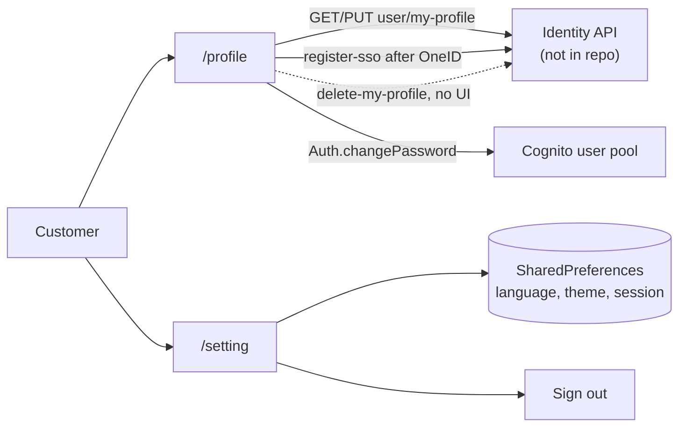

# U-07 · Profile and settings

> **Bangla name:** প্রোফাইল ও সেটিংস
>
> [← 30 · User app](README.md) · [Contents](../README.md) · [Open queries](../99-open-queries.md)

## 1. Name and purpose

**Profile and settings.** The app's account screen: personal data, the fields the customer may edit, a change-password form, and app-level settings such as language and theme. It is the app counterpart of [P-11](../20-user-portal/P-11-profile.md), and it is also the only client that offers **delete account** ([X-11](../60-cross-cutting/X-11-delete-account-force-update.md)).

## 2. Trigger and actor

Signed-in customer, from the Home drawer or profile tab. Routes `/profile`, `/setting`, and the auth sub-routes `/forgetPassword`, `/confirmNewPassword`, `/forgetPasswordSuccess`.

## 3. Business flow

1. The profile screen loads the customer's data and shows name, phone, email and the editable fields.
2. Editing date of birth, identity document or address and saving updates the identity API.
3. The **Change password** form validates the new password and the confirmation match, then calls Cognito.
4. Settings hold language, theme and sign-out.
5. **Delete account** asks for confirmation and calls the identity API — the portal has no equivalent.

## 4. Technical flow

1. **[HTTP + user token] → identity API:** `GET user/my-profile?user_id={userId}` (`profile_api_service_impl.dart:17-22`) → `UserDataResponse`. Note the app sends `user_id` as a **query parameter**, which the portal's call does not ([P-11](../20-user-portal/P-11-profile.md) §4) `[UNCONFIRMED: Q-60]`.
2. **[HTTP + user token] → identity API:** `PUT user/my-profile` (`:32-38`) with `verification_type`, `verification_id`, `address` and **`dob` formatted as `DateFormat("yyyy-MM-dd")`** — a date-only string, where the portal sends a full ISO timestamp. Errors are mapped to typed exceptions: `user_update_and_verification_failed` → `UserUpdateAndVerificationFailedException`, anything else → `UserProfileUpdateFailedException` (`:39-44`).
3. `[UNCONFIRMED: Q-61]` — **`delete-my-profile` has no caller.** `auth_api_service_impl.dart:296` implements `apiClient.delete('user/delete-my-profile')`, but no view model or screen invokes it: a search across `lib/` and `domain/` finds no caller and no route. So the API is wired in the data layer and the delete-account **UI is missing**, contradicting [X-11](../60-cross-cutting/X-11-delete-account-force-update.md), which describes it as app-only. Either the screen was removed or never built.
4. **Change password** goes through Amplify/Cognito from the auth repository (`auth_repository_impl.dart`), not through the identity API. The form validates a minimum length of 8 and the confirmation field in `profile_view_model.dart` (`confirmNewPasswordTextFieldChecker`, `:323-325`, with `password_tab_states.dart`).
5. **Register SSO user** (`POST user/register-sso`, `:49-54`) is used after a successful OneID sign-in, with body `{"name": "", "cognito_sub": …}` — the name is sent **empty**, so OneID users get a blank profile name until they fill it in.
6. Settings state (language, theme, location, country) is held in `SharedPreferences` entities under `data/lib/local/shared_preference/entity/`; sign-out clears the Amplify session.

## 5. Components

| Kind | Component |
|---|---|
| Client | `lib/presentation/feature/profile/` (incl. `state/password_tab_states.dart`), `feature/settings/` |
| Client services | `ProfileRepositoryImpl`, `AuthRepositoryImpl`, `ProfileApiServiceImpl`, `AuthApiServiceImpl` |
| API clients | `profile_api_client.dart`, `auth_api_client.dart` (base URL from `.env` `AUTH_API_BASE_URL`) |
| Service | Identity API (profile, delete), Cognito user pool (password) |
| Tables | identity API's own user table |
| Local | `SharedPreferences`: language, theme, session |

## 6. API contracts

| Method | Path | Auth | Request → Response |
|---|---|---|---|
| GET | `{AUTH_API_BASE_URL}/user/my-profile?user_id={userId}` | user bearer | — → `UserDataResponse` |
| PUT | `{AUTH_API_BASE_URL}/user/my-profile` | user bearer | `{ verification_type, verification_id, address, dob }` |
| POST | `{AUTH_API_BASE_URL}/user/register-sso` | — | `{ name: "", cognito_sub }` |
| DELETE | `{AUTH_API_BASE_URL}/user/delete-my-profile` | user bearer | **implemented, no caller** ([Q-61](../20-user-portal/P-11-profile.md)) |
| — | Cognito change-password | user pool session | old and new password |

Sample, PUT request as the app sends it (note the date-only `dob`):

```json
{ "verification_type": "nid", "verification_id": "1994567890123",
  "address": "House 42, Road 7, Dhanmondi, Dhaka-1209", "dob": "1994-07-21" }
```

## 7. Data and side effects

The identity API's user row (`dob`, address, verification); the Cognito password; local `SharedPreferences` for settings. Nothing in `etp` is written — as in the portal, a profile change never reaches the ticket holder data ([U-06](U-06-my-bookings-tickets.md)).

## 8. Code references

| What | Where |
|---|---|
| Profile API | `rvl-gobcb-user-app/data/lib/remote/api_service/profile_api_service/profile_api_service_impl.dart:17-54` |
| Delete account | `rvl-gobcb-user-app/data/lib/remote/api_service/auth_api_service/auth_api_service_impl.dart:296` |
| Profile repository | `rvl-gobcb-user-app/data/lib/repository/profile_repository_impl.dart:17` |
| Auth repository | `rvl-gobcb-user-app/data/lib/repository/auth_repository_impl.dart:12` |
| Profile view model | `rvl-gobcb-user-app/lib/presentation/feature/profile/profile_view_model.dart:323-325` |
| Password state | `rvl-gobcb-user-app/lib/presentation/feature/profile/state/password_tab_states.dart:8-39` |
| Settings entities | `rvl-gobcb-user-app/data/lib/local/shared_preference/entity/` (`language_`, `app_theme_mode_`, `user_session_`) |
| Clients | `rvl-gobcb-user-app/data/lib/remote/api_client/profile_api_client.dart`, `auth_api_client.dart:6` |

## 9. Handover notes

1. **`delete-my-profile` is implemented but unreachable** (§4 note 3) `[UNCONFIRMED: Q-61]`. This contradicts [X-11](../60-cross-cutting/X-11-delete-account-force-update.md) and must be corrected there: today no client can delete an account through the UI. The endpoint exists, so the gap is purely the missing screen.
2. **`dob` is sent as `yyyy-MM-dd`**, the portal as a full ISO timestamp. If the identity API parses both, fine; if it validates strictly, one of the two clients will fail `[UNCONFIRMED: Q-60]`.
3. **`user_id` is passed as a query parameter** on the app's GET but not on the portal's — an inconsistency in how the same endpoint is called ([Q-60](../20-user-portal/P-11-profile.md)).
4. **OneID registration sends an empty name** (`:51`), so the profile name is blank after a OneID sign-in until the customer edits it.
5. **The same four editable fields as the portal** — name, phone and email remain read-only in both clients, so a mistyped phone number cannot be corrected anywhere in the product `[UNCONFIRMED: Q-43](../20-user-portal/P-11-profile.md)`.
6. **Settings live in `SharedPreferences`**, so language and theme are per device and are lost when the app is reinstalled.
7. **The identity API is not in this repository** `[UNCONFIRMED: Q-01]`, so none of these calls can be verified from the code in the workspace.

## 10. Component relationships



**Depends on:** [X-06](../60-cross-cutting/X-06-user-registration.md), [X-07](../60-cross-cutting/X-07-user-password-login.md), [X-08](../60-cross-cutting/X-08-oneid-sso.md). **Affects:** [U-09](U-09-device-token.md) — the token is stored per signed-in user in the PushNotification service.

## 11. Developer test guide

**Local testability: Partial.** The screens run fully against the `/p/identity` stub; the Cognito calls need a real or local user pool.

| Item | Detail |
|---|---|
| Test data and accounts | seeded user `+8801700000011`; the `/p/identity` stub returns a fixed profile |
| Browser | portal equivalent at `/en/user-profile` — see [P-11](../20-user-portal/P-11-profile.md) |
| Emulator | run the app; open `/profile`; edit DOB and address and watch the app log the PUT body — confirm `dob` is `yyyy-MM-dd`; sign in with OneID to see the empty name |
| Postman | not in any GoBCB collection — these are identity-API calls `[UNCONFIRMED: Q-01]` |
| Visual Studio debug | client only (`ProfileRepositoryImpl`); the identity API is out of process |
| Verify | the stub's received PUT body in the Floci console log; `SharedPreferences` contents for language and theme |