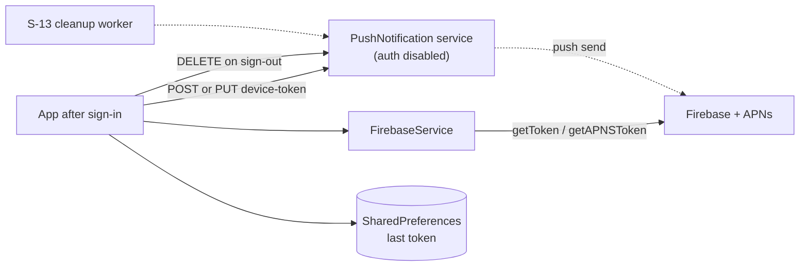

# U-09 · Push device-token registration

> **Bangla name:** পুশ ডিভাইস-টোকেন রেজিস্ট্রেশন
>
> [← 30 · User app](README.md) · [Contents](../README.md) · [Open queries](../99-open-queries.md)

## 1. Name and purpose

**Push device-token registration.** So the platform can send push notifications to a customer's phone, it must register the device's Firebase token against the signed-in user. This entry covers obtaining the token (including the iOS-specific APNs step), registering it, updating it when Firebase rotates it, and removing it on sign-out. It is the client half of [X-23](../60-cross-cutting/X-23-push-firebase.md).

## 2. Trigger and actor

Any signed-in customer, once per token value. No route of its own — it runs as part of the session lifecycle.

## 3. Business flow

1. After sign-in the app asks Firebase for a push token and sends it to the platform, which stores it against the user.
2. If Firebase later rotates the token (reinstall, restore, token refresh), the app sends the new value so the platform stops sending to the dead one.
3. On sign-out the app removes its token so the old device does not keep receiving the previous user's notifications.

## 4. Technical flow

1. **Firebase initialisation** — `FirebaseService.initialize()` (`firebase_service.dart:20-30`) calls `Firebase.initializeApp(options: DefaultFirebaseOptions.currentPlatform)` inside a `try/catch` that logs and continues on failure. The options come from `.env` keys (`data/lib/firebase_options.dart:51-64`): `FIREBASE_ANDROID_API_KEY`, `FIREBASE_ANDROID_APP_ID`, `FIREBASE_ANDROID_MESSAGING_SENDER_ID`, `FIREBASE_ANDROID_PROJECT_ID`, `FIREBASE_ANDROID_STORAGE_BUCKET`, and the `FIREBASE_IOS_*` equivalents plus `FIREBASE_IOS_BUNDLE_ID`.
2. **Token acquisition** — `setupFCMToken({required Function(String) onTokenRefresh})` (`:99-125`):
   - **iOS only:** waits 2 seconds (`Future.delayed(const Duration(seconds: 2))`), then calls `getAPNSToken()`; if it is still null it logs `APNs token not yet available` and **returns without registering anything** (`:101-110`);
   - `FirebaseMessaging.instance.getToken()` → `onTokenRefresh(token)` (`:112-115`);
   - `onTokenRefresh.listen(...)` keeps listening for rotations; `.onError` only logs (`:117-121`);
   - the whole method is wrapped in `try/catch` that logs and swallows (`:122-124`).
3. **[HTTP + user token] → PushNotification:** `POST pushnotification/api/v1/device-token` with `{"fcmToken": <token>}` (`firebase_api_service_impl.dart:17-21`). The user id is taken from the token server-side.
4. **[HTTP + user token] → PushNotification:** `PUT pushnotification/api/v1/device-token` — the update path, used when the stored token differs from the new one (`firebase_repository_impl.dart:69-77` compares `savedToken != fcmToken` and then calls the update before saving).
5. **The new token is persisted locally first** (`_saveFirebaseFCMToken`, `:65`, `:77`) so a later launch can compare without refetching.
6. **[HTTP + user token] → PushNotification:** `DELETE pushnotification/api/v1/device-token` with `{"userId": …, "fcmToken": …}` (`firebase_api_service_impl.dart:44-48`) — sign-out cleanup.

## 5. Components

| Kind | Component |
|---|---|
| Client | `data/lib/service/firebase_service.dart`, `data/lib/repository/firebase_repository_impl.dart:10-77` |
| Client | `data/lib/firebase_options.dart` (from `.env`), `data/lib/remote/api_service/firebase_api_service/` |
| Service | **PushNotification** (see [X-18](../60-cross-cutting/X-18-endpoints-without-auth.md) — this service has `UseAuthentication`/`UseAuthorization` commented out) |
| Tables | PushNotification's own device-token table |
| External | Firebase Cloud Messaging, APNs |
| Server | `S-13` cleans up stale tokens ([S-13](../50-system-initiated/S-13-device-token-cleanup.md)) |

## 6. API contracts

| Method | Path | Auth | Request → Response |
|---|---|---|---|
| POST | `/pushnotification/api/v1/device-token` | **none enforced** | `{ fcmToken }` |
| PUT | `/pushnotification/api/v1/device-token` | **none enforced** | `{ … }` update |
| DELETE | `/pushnotification/api/v1/device-token` | **none enforced** | `{ userId, fcmToken }` |

All three live on the PushNotification service, whose authentication middleware is disabled ([X-18](../60-cross-cutting/X-18-endpoints-without-auth.md)), so `[UNCONFIRMED: Q-62]` — on paper the app sends a user bearer, but the server does not verify it, and `POST` derives the user from the request body/token only.

## 7. Data and side effects

A row in PushNotification's device-token table per (user, token); local `SharedPreferences` for the last token; and, on iOS, an APNs token read from the device.

## 8. Code references

| What | Where |
|---|---|
| Firebase service | `rvl-gobcb-user-app/data/lib/service/firebase_service.dart:20-125` |
| Repository | `rvl-gobcb-user-app/data/lib/repository/firebase_repository_impl.dart:35-77` |
| API service | `rvl-gobcb-user-app/data/lib/remote/api_service/firebase_api_service/firebase_api_service_impl.dart:12-48` |
| Options | `rvl-gobcb-user-app/data/lib/firebase_options.dart:51-64` |
| Env keys | `rvl-gobcb-user-app/env/README.md` |
| Packages | `rvl-gobcb-user-app/pubspec.yaml` (`firebase_core`, `firebase_messaging`, `flutter_local_notifications`) |

## 9. Handover notes

1. **On iOS the token is often not registered at all.** The 2-second wait plus a null `getAPNSToken()` returns early (`:106-110`), and the outer `catch` swallows the error — so an iOS customer can go a long time with no push capability and no visible symptom. This is the practical face of the "dummy Firebase locally" gap recorded in the plan `[UNCONFIRMED: Q-63]`.
2. **All Firebase errors are swallowed** (`catch (e) { Logger.debug(...) }` at `:26-28`, `:122-124`), so a misconfigured `FIREBASE_*` key produces a silently push-less app.
3. **`.env` is required for Firebase to work at all** and is gitignored; every `dotenv.env[...]!` in `firebase_options.dart` will throw if the key is absent, which is caught by the initialise `catch` — so a missing key and a bad key look identical (no push).
4. **The comparison in `firebase_repository_impl.dart:69` is what decides POST vs PUT**; a customer who clears app storage re-POSTs the same token instead of updating it.
5. **Sign-out sends DELETE with `userId` in the body** (`:46`), while POST takes only `fcmToken` — asymmetric, and the server-side identity differs between the two calls `[UNCONFIRMED: Q-62]`.
6. **The device token is not deleted when the account is deleted**, because delete-account has no UI at all ([Q-61](U-07-profile-settings.md)) — a deleted customer's phone would keep its token until [S-13](../50-system-initiated/S-13-device-token-cleanup.md) removes it.
7. **The server-side cleanup worker calls `Services:Admin` without the `/pushnotification` prefix** ([Q-16](../50-system-initiated/S-13-device-token-cleanup.md)), which is a separate defect in the same area.

## 10. Component relationships

**Depends on:** [X-07](../60-cross-cutting/X-07-user-password-login.md) (a signed-in user to attach the token to), [U-07](U-07-profile-settings.md). **Affects:** [U-10](U-10-push-receipt.md), [S-11](../50-system-initiated/S-11-firebase-notification.md), [S-12](../50-system-initiated/S-12-ticket-generated-notification.md), [S-13](../50-system-initiated/S-13-device-token-cleanup.md).

## 11. Developer test guide

**Local testability: Partial.** Firebase is a dummy locally, so a real token is only obtainable against a real Firebase project — the local path exercises the code but not the delivery.

| Item | Detail |
|---|---|
| Test data and accounts | seeded user `+8801700000011` |
| Browser | not applicable (mobile only) |
| Emulator | run the app with real `FIREBASE_*` keys in `.env`; check the app log for `Started Firebase Initialization` and, on iOS, for `APNs token not yet available` |
| Postman | `postman/collections` — the device-token calls are not in a GoBCB collection; call them by hand against the local PushNotification service `[UNCONFIRMED: Q-62]` |
| Visual Studio debug | `PushNotificationController` and the device-token manager; client: `FirebaseRepositoryImpl.sendFirebaseFCMToken` |
| Verify | `SELECT` on the PushNotification device-token table; `adb logcat` for the FCM token; with `adb shell dumpsys firebase` or the Firebase console to confirm delivery |