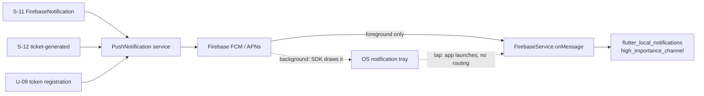

# U-10 · Receiving push notifications

> **Bangla name:** পুশ নোটিফিকেশন গ্রহণ
>
> [← 30 · User app](README.md) · [Contents](../README.md) · [Open queries](../99-open-queries.md)

## 1. Name and purpose

**Receiving push notifications.** How a notification sent by the platform reaches the customer's phone and what the app does with it. Notifications tell a customer that their tickets are ready ([S-12](../50-system-initiated/S-12-ticket-generated-notification.md)) or that something changed on an event. This is the client half of [X-23](../60-cross-cutting/X-23-push-firebase.md).

## 2. Trigger and actor

Any signed-in customer with a registered device token ([U-09](U-09-device-token.md)). No route; the app listens in the background.

## 3. Business flow

1. The platform publishes to `FirebaseNotification` ([S-11](../50-system-initiated/S-11-firebase-notification.md)) and Firebase delivers the message to the device.
2. **While the app is in the foreground**, the app shows the notification itself with a high-priority Android channel.
3. **While the app is in the background**, Firebase's own notification display is used — the SDK draws it, not the app.
4. Tapping the notification opens the app. `[UNCONFIRMED: Q-64]` — see note 1: there is no in-app navigation handler, so a tap only launches the app to whatever screen it was on.

## 4. Technical flow

1. **Initialisation** — `FirebaseService.initialize()` (`firebase_service.dart:20-30`) and, in the singleton constructor, `_setupForegroundNotifications()` (`:32-43`).
2. **Foreground presentation is disabled at the SDK level** — `setForegroundNotificationPresentationOptions(alert: false, badge: false, sound: false)` (`:33-38`), so the OS does not draw it; the app draws it instead.
3. **Local notifications are initialised** with an Android channel `@mipmap/ic_launcher` and default Darwin settings (`:45-52`).
4. **Permissions** are requested for alert, badge and sound (`:54-60`).
5. **The listener** — `FirebaseMessaging.onMessage.listen(...)` (`:62-67`) fires **only for foreground messages** and delegates to `_handleForegroundMessage` (`:69-97`):
   - if `message.notification == null` it returns immediately (`:70`) — a data-only message is silently dropped;
   - it builds `AndroidNotificationDetails('high_importance_channel', …)` with `Importance.max`, `Priority.high`, vibration and sound (`:72-80`), plus Darwin details with alert, badge and sound (`:84-88`);
   - it displays the notification through `flutter_local_notifications`, using `message.hashCode` as the notification id and `notification.title`/`notification.body` as the text (`:91-96`).
6. **No background handler is registered.** There is no `FirebaseMessaging.onBackgroundMessage(...)` anywhere in the app, so a data-only or background message has no custom handling `[UNCONFIRMED: Q-64]`.
7. **No navigation-on-tap handler.** No `getNotificationAppLaunchDetails` or `onMessageOpenedApp` listener was found, so tapping a notification opens the app but does not route to the related order or event `[UNCONFIRMED: Q-64]`.
8. **No receipt is recorded.** The app makes no API call when a notification arrives — there is no read-receipt endpoint in the app's request set, and the platform's notification endpoints are unauthenticated ([X-18](../60-cross-cutting/X-18-endpoints-without-auth.md)). This corrects the plan's earlier assumption that a push-receipt call exists `[UNCONFIRMED: Q-65]`.

## 5. Components

| Kind | Component |
|---|---|
| Client | `data/lib/service/firebase_service.dart` (singleton), `data/lib/firebase_options.dart` |
| Client | `.env` keys `FIREBASE_ANDROID_*`, `FIREBASE_IOS_*`, `FIREBASE_IOS_BUNDLE_ID` |
| Service | PushNotification (send path), Firebase FCM (delivery) |
| Queues | `FirebaseNotification` ([S-11](../50-system-initiated/S-11-firebase-notification.md)) |
| Tables | none written by the app |
| External | Firebase Cloud Messaging, APNs |

## 6. API contracts

**None.** Receiving a notification involves no HTTP call in either direction. The only related calls are the registration endpoints in [U-09](U-09-device-token.md).

## 7. Data and side effects

A local OS notification entry. Nothing in `etp` or in the PushNotification service is written when a notification is displayed, and no delivery or read state is recorded `[UNCONFIRMED: Q-65]`.

## 8. Code references

| What | Where |
|---|---|
| Firebase service | `rvl-gobcb-user-app/data/lib/service/firebase_service.dart:8-126` |
| Foreground handler | `rvl-gobcb-user-app/data/lib/service/firebase_service.dart:62-97` |
| Options | `rvl-gobcb-user-app/data/lib/firebase_options.dart:51-64` |
| Registration | `rvl-gobcb-user-app/data/lib/repository/firebase_repository_impl.dart:53-77` |
| Packages | `rvl-gobcb-user-app/pubspec.yaml` (`firebase_core`, `firebase_messaging`, `flutter_local_notifications`) |
| Send path | [S-11](../50-system-initiated/S-11-firebase-notification.md), [S-12](../50-system-initiated/S-12-ticket-generated-notification.md) |

## 9. Handover notes

1. **Tapping a notification does not navigate anywhere** (§4 note 7). For a "your tickets are ready" message the customer still has to find My tickets themselves — the single most valuable notification in the product has no deep link `[UNCONFIRMED: Q-64]`.
2. **Data-only messages are dropped in the foreground** (`:70`) and have no background handler at all (note 6), so only `notification`-payload messages work. Any future feature relying on silent data pushes will not work without adding a background handler.
3. **No read receipts** (note 8) `[UNCONFIRMED: Q-65]`. The platform cannot tell whether a customer saw the ticket-ready notification, which matters for the S-12 support workflow.
4. **Foreground notifications are re-drawn by the app**, so the text comes from `notification.title`/`body` — if the server sends an empty title the customer sees a blank notification with no error.
5. **The Android channel is high importance with sound and vibration** (`:72-80`), which requires the Android 13+ notification permission; without it the notification is silently not shown.
6. **iOS delivery depends on APNs having a token first** — see [U-09](U-09-device-token.md) note 1; the two features fail together.
7. **`message.hashCode` as the notification id** (`:92`) means two different notifications can collide or a re-delivery can overwrite a previous one, depending on hash stability across launches.

## 10. Component relationships

**Depends on:** [U-09](U-09-device-token.md) (without a token nothing is delivered), [S-11](../50-system-initiated/S-11-firebase-notification.md), [S-12](../50-system-initiated/S-12-ticket-generated-notification.md). **Affects:** the customer's awareness of [U-06](U-06-my-bookings-tickets.md) and of event changes.

## 11. Developer test guide

**Local testability: Not locally** with real delivery — Firebase is a dummy in the local stack. The foreground rendering path can be exercised with a manual local notification, and the receive path only against a real Firebase project.

| Item | Detail |
|---|---|
| Test data and accounts | a real Firebase project in `.env`; a customer with a registered token ([U-09](U-09-device-token.md)) |
| Browser | not applicable |
| Emulator | run the app on a device (not the emulator without Google Play services); send a message from the Firebase console with a `notification` payload and watch it appear while the app is foregrounded; then background the app and confirm the SDK draws it |
| Postman | the send endpoints are on PushNotification, whose authentication is disabled ([X-18](../60-cross-cutting/X-18-endpoints-without-auth.md)); `postman` has no push collection for them `[UNCONFIRMED: Q-65]` |
| Visual Studio debug | `FirebaseService._handleForegroundMessage`; server side `PushNotificationController` and the [S-11](../50-system-initiated/S-11-firebase-notification.md) worker |
| Verify | `adb logcat` for the `Received foreground message: <id>` line; `adb shell dumpsys notification` for the posted notification; a data-only message should produce **no** notification (note 2) |