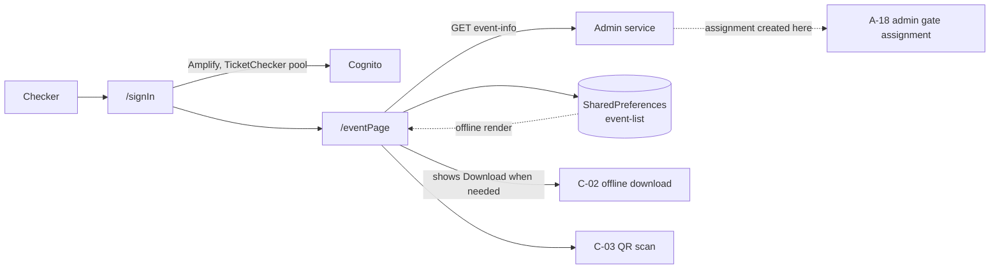

# C-01 · Assigned event and gate

> **Bangla name:** নির্ধারিত ইভেন্ট ও গেট
>
> [← 40 · Checker app](README.md) · [Contents](../README.md) · [Open queries](../99-open-queries.md)

## 1. Name and purpose

**Assigned event and gate.** After signing in, a checker sees which event and which gate they are assigned to. This assignment is created from the admin portal ([A-18](../10-admin-portal/A-18-gate-assignment.md)); the app only reads it. The screen also decides whether the checker still needs to download tickets ([C-02](C-02-offline-ticket-download.md)) and is the app's **offline entry point** — the assignment is cached in `SharedPreferences` under `event-list`, so it can be shown without a network.

## 2. Trigger and actor

A ticket checker in the **TicketChecker** Cognito pool ([X-12](../60-cross-cutting/X-12-checker-login.md)). Routes `/signIn` → `/eventPage`.

## 3. Business flow

1. The checker signs in with their checker username and password.
2. The app loads their assignment. If they have several, the **first** is taken (`eventList.first`).
3. The screen shows the event name and the gate name, plus a **Download tickets** button when a download is needed.
4. The Download button is shown when: nothing is saved yet, **or** the saved assignment's `eventId`/`ticketCheckerGateId` differ from the current one, **or** the local database is empty. It is hidden only when the same event and gate are already downloaded.
5. From here the checker proceeds to the QR screen ([C-03](C-03-qr-scan-validation.md)).

## 4. Technical flow

1. **Sign-in** — `signInUser()` (`sign_in_view_model.dart:71`) → `AuthRepositoryImpl` (`:50-77`) calls `awsAmplifyService.login(...)` against the **TicketChecker** pool; on success it reads the Cognito user name (`getCognitoUserName()`, `:22`, `:65`); on failure it logs `Cognito Login Failed` (`:77`).
2. **[HTTP + checker bearer] → Admin service:** `GET admin/api/v1/ticket-checker-gate/event-info` (`ticket_api_service_impl.dart:59-62`).
3. **The response is cached before use** (`ticket_api_service_impl.dart:44-68`):
   ```dart
   final json = await ticketApiClient.get('admin/api/v1/ticket-checker-gate/event-info');
   await sharedPrefManager.saveValue('event-list', jsonEncode(json));
   ```
   On a later launch, the cached JSON is read first and handed to the optional `onGetOfflineData` callback (`:47-56`) **before** the network call, so the screen can render offline. The online response then overwrites the cache.
4. **Two failure modes are mapped to typed exceptions** (`ticket_api_service_impl.dart:29-38`): the server message `user_disabled_for_this_gate` → `TicketCheckerDisabledException`, and `ticket_checker_event_not_found` → `TicketCheckerEventNotFoundException`. These are the two ways an admin can strand a checker: disable them at the gate, or unassign the event.
5. The selected assignment is persisted via `saveCurEvent(eventLongId:, ticketCheckerGateId:)` (`event_page_view_model.dart:171-189`).
6. `_getDownloadStatus()` (`:97-118`) implements the button rule of §3 note 4.

## 5. Components

| Kind | Component |
|---|---|
| Client | `lib/presentation/feature/sign_in/`, `feature/event_page/` (with `event_page_view_model.dart`, `screen/`, `widgets/`) |
| Client services | `AuthRepositoryImpl`, `EventRepository`/`VenueRepository` layer, `SharedPrefManager` |
| API service | `data/lib/remote/api_service/ticket_api_service/ticket_api_service_impl.dart:40-68` |
| API client | `data/lib/remote/api_client/ticket_api_client.dart` (adds `Authorization: Bearer <Cognito accessToken>`, `:17-27`) |
| Service | **Admin** service (`ticket-checker-gate`) — the assignment lives in Admin's tables, not in TicketChecker |
| Local | `SharedPreferences` key `event-list`; `EventSharedPrefEntity` |
| Tables | Admin's ticket-checker gate assignment tables (read model) |

## 6. API contracts

| Method | Path | Auth | Request → Response |
|---|---|---|---|
| GET | `/admin/api/v1/ticket-checker-gate/event-info` | checker bearer | — → `EventResponseList[]` with `eventId`, `eventLongId`, `ticketCheckerGateId`, event name, gate name |

Errors surfaced to the user: `user_disabled_for_this_gate`, `ticket_checker_event_not_found`.

## 7. Data and side effects

`SharedPreferences` (`event-list` and the saved event/gate pair). No `etp` table is written — the assignment is read-only here.

## 8. Code references

| What | Where |
|---|---|
| Event page | `rvl-gobcb-checker-app/lib/presentation/feature/event_page/event_page_view_model.dart:60, 97-118, 171-189` |
| Sign-in | `rvl-gobcb-checker-app/lib/presentation/feature/sign_in/sign_in_view_model.dart:71`; `data/lib/repository/auth_repository_impl.dart:22, 50-77` |
| API service | `rvl-gobcb-checker-app/data/lib/remote/api_service/ticket_api_service/ticket_api_service_impl.dart:40-68` |
| API client | `rvl-gobcb-checker-app/data/lib/remote/api_client/ticket_api_client.dart:17-27` |
| Local cache | `rvl-gobcb-checker-app/data/lib/local/shared_preference/shared_pref_manager.dart`, `entity/event_shared_pref_entity.dart` |
| Routes | `rvl-gobcb-checker-app/lib/presentation/navigation/route_path.dart` (`signIn`, `eventPage`) |
| Admin side | [A-18](../10-admin-portal/A-18-gate-assignment.md), [A-17](../10-admin-portal/A-17-ticket-checker-users.md) |

## 9. Handover notes

1. **The assignment endpoint is on the Admin service, not TicketChecker** (`admin/api/v1/…`). A checker therefore depends on Admin being up to learn their assignment, which is the opposite of what the app's offline story implies.
2. **Multiple assignments are silently collapsed to the first** (`eventList.first`, `qr_page_view_model.dart:154` and `event_page_view_model.dart:60`). A checker assigned to two events can only work the first, with no way to switch `[UNCONFIRMED: Q-66]`. This matters because the admin portal allows many-to-many assignment ([A-18](../10-admin-portal/A-18-gate-assignment.md)).
3. **The offline cache is refreshed from the server on every launch and overwrites the cache** (`ticket_api_service_impl.dart:59-67`); if the network call fails the exception propagates, and the offline callback has already fired — so the screen can show stale data and then error.
4. **A disabled checker is reported as `user_disabled_for_this_gate`**, which is the server's gate-level disable ([A-18](../10-admin-portal/A-18-gate-assignment.md)), not a Cognito-level disable.
5. **Sign-in failure is only logged** (`auth_repository_impl.dart:77`); confirm what the view model surfaces to the user before assuming it is distinguishable from a network error.
6. **The route enum still uses leftover "movie" names** (`movieList`, `movieDetails`, `movieSearch`, `movieBookmark` in `route_path.dart`) from a template. `movieList`/`movieDetails`/`movieBookmark` have no feature folder behind them. This is dead navigation code, not live functionality `[UNCONFIRMED: Q-67]`.

## 10. Component relationships



**Depends on:** [X-12](../60-cross-cutting/X-12-checker-login.md), [A-17](../10-admin-portal/A-17-ticket-checker-users.md), [A-18](../10-admin-portal/A-18-gate-assignment.md). **Affects:** [C-02](C-02-offline-ticket-download.md), [C-03](C-03-qr-scan-validation.md), [C-05](C-05-ticket-sync.md).

## 11. Developer test guide

**Local testability: Full** for the API call; the Cognito pool must be reachable or seeded locally.

| Item | Detail |
|---|---|
| Test data and accounts | a seeded checker account from `scripts/Seed-EtpCognitoUsers.ps1` or `scripts/generate-postman.py` (TicketChecker pool); assign that checker to an event and a gate from the admin portal first, or seed the `TicketCheckerGates` rows |
| Browser | the same assignment is visible in the admin portal at the gate-assignment screen (see [A-18](../10-admin-portal/A-18-gate-assignment.md)) |
| Emulator | run the app (`scripts/Setup-MobileApps.ps1`); sign in; the app must reach the Admin service through `scripts/mobile-gateway.js`. Confirm the Download button appears on a fresh install and disappears after a download |
| Postman | `postman/services/etp-admin.postman_collection.json`: "GET /api/v1/ticket-checker-gate/event-info"; set `{{access_token_checker}}` |
| Visual Studio debug | `TicketCheckerGateController` and its manager in the Admin service; client: `EventPageViewModel` |
| Verify | `SELECT` on the gate-assignment tables; clear app data and relaunch with the API stopped to see the offline cache path (note 3) |