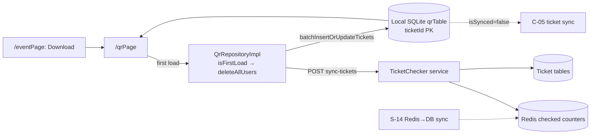

# C-02 · Ticket download for offline checking

> **Bangla name:** অফলাইন চেকিংয়ের জন্য টিকিট ডাউনলোড
>
> [← 40 · Checker app](README.md) · [Contents](../README.md) · [Open queries](../99-open-queries.md)

## 1. Name and purpose

**Ticket download for offline checking.** Before a gate opens, the checker downloads the ticket set for their assigned event into a local SQLite database. After that the phone can validate QR codes **with no network at all**, which is the whole point of this app: event venues routinely have no usable connectivity. The download is also the first call that populates the local drift database.

## 2. Trigger and actor

A checker at [C-01](C-01-assigned-event-gate.md) with a known event and gate. Route `/eventPage` (the Download button) and the initial load of `/qrPage`.

## 3. Business flow

1. The checker presses **Download tickets** while they still have connectivity.
2. The app asks the server for the full ticket set of the event with their scanned counts, and stores every ticket in the local database.
3. The screen then shows the total number of tickets and how many are still un-scanned.
4. A **Delete** button wipes the local database, so a checker can re-download or move to another event.

## 4. Technical flow

1. **[HTTP + checker bearer] → TicketChecker service:** `POST ticketchecker/api/v1/tickets/sync-tickets` (`ticket_api_service_impl.dart:24-27`).
2. **The request body is the whole map of the checker's scanned tickets**, encoded as `{ticketId: 1 | -1}` — `qr_repository_impl.dart:24-26`:
   ```dart
   final mappedTickets = tickets.map(
     (ticketId, state) => MapEntry(ticketId, state.isManual ? -1 : 1),
   );
   ```
   so a normal scan counts as `1` and a **manual** entry as `-1`. `[UNCONFIRMED: Q-68]` — the sign convention is not documented anywhere in the backend; confirm with BS23 what `-1` means to the server before changing it.
3. **This is one request with no paging and no signed payload.** The response is the complete `{ticketId: checkedNumber}` map for the event; there is no cursor and no second page `[UNCONFIRMED: Q-69]` — a very large event will produce one very large response, and there is no chunking.
4. **First load clears the local database** — `if (isFirstLoad) qrDao.deleteAllUsers();` (`qr_repository_impl.dart:20`) — so the download always represents the server's current truth.
5. The response is written with **`batchInsertOrUpdateTickets`** (`:34`), an upsert, rather than row-by-row inserts.
6. **Reading it back** — `getTicketList()` (`:36-54`) loads every row and builds `Map<String, TicketState>`:
   | Drift column | Dart type | Meaning |
   |---|---|---|
   | `ticketId` | `TextColumn` | primary key |
   | `checkNumber` | `IntColumn` | times scanned; `0` = not yet used |
   | `isSynced` | `BoolColumn`, default `false` | changed locally, not yet sent |
   | `isScannedFromOurApp` | `BoolColumn`, default `false` | scanned on this phone |
   | `isManual` | `BoolColumn`, default `false` | entered by hand, not scanned |
   `TicketState { count, isSynced, isScannedFromOurApp, isManual }` (`:40-46`).
7. **Counters on screen** (`qr_page_view_model.dart:166-184`): `_totalTicketNumber` = row count; `_remainingTickets` = rows where `count == 0`; `_scannedTicket` = rows where `isScannedFromOurApp` is true.
8. **Delete** — `onTapDeleteButton()` (`qr_page_view_model.dart:374-380`) calls `qrRepository.deleteAllData()` → `deleteAllUsers()` (`qr_dao.dart:59-61`), then reloads and navigates back.

## 5. Components

| Kind | Component |
|---|---|
| Client | `lib/presentation/feature/event_page/`, `feature/qr_page/qr_page_view_model.dart` |
| Client | `data/lib/repository/qr_repository_impl.dart`, `data/lib/remote/api_service/ticket_api_service/` |
| Local DB | **drift** over SQLite: `data/lib/local/drift_database/app_database.dart`, `qr_database/qr_table.dart`, `qr_database/qr_dao.dart` (+ generated `.g.dart`) |
| Service | TicketChecker (`sync-tickets`) |
| Redis | the checked-ticket counters the endpoint reads, and the ones [S-14](../50-system-initiated/S-14-checked-ticket-sync.md) flushes to the database |
| Tables | TicketChecker's ticket tables |

## 6. API contracts

| Method | Path | Auth | Request → Response |
|---|---|---|---|
| POST | `/ticketchecker/api/v1/tickets/sync-tickets` | checker bearer | `{ "<ticketId>": 1 \| -1 }` → `{ "<ticketId>": <checkedNumber> }` |

Errors: `user_disabled_for_this_gate`, `ticket_checker_event_not_found` (`ticket_api_service_impl.dart:29-38`).

Sample, request after two scans and one manual entry:

```json
{ "TKT-0000000001": 1, "TKT-0000000002": 1, "TKT-0000000003": -1 }
```

Sample, response (a slice — the server returns the whole event):

```json
{ "TKT-0000000001": 1, "TKT-0000000002": 1, "TKT-0000000003": 0, "TKT-0000000004": 0 }
```

## 7. Data and side effects

The local SQLite `qrTable` is replaced on a first load and upserted afterwards. The server-side effect is only the counters for the tickets in the request — the download itself does not mark anything as checked.

## 8. Code references

| What | Where |
|---|---|
| Repository | `rvl-gobcb-checker-app/data/lib/repository/qr_repository_impl.dart:17-60` |
| Table | `rvl-gobcb-checker-app/data/lib/local/drift_database/qr_database/qr_table.dart:3-12` |
| DAO | `rvl-gobcb-checker-app/data/lib/local/drift_database/qr_database/qr_dao.dart:12-81` |
| Database | `rvl-gobcb-checker-app/data/lib/local/drift_database/app_database.dart` |
| API service | `rvl-gobcb-checker-app/data/lib/remote/api_service/ticket_api_service/ticket_api_service_impl.dart:21-38` |
| Counters | `rvl-gobcb-checker-app/lib/presentation/feature/qr_page/qr_page_view_model.dart:166-184, 374-380` |
| Domain model | `rvl-gobcb-checker-app/domain/lib/model/ticket_state.dart` |
| Packages | `rvl-gobcb-checker-app/pubspec.yaml` (`drift`, `sqflite` via drift) |

## 9. Handover notes

1. **No paging on the download** (§4 note 3) `[UNCONFIRMED: Q-69]`. A stadium event with 50,000 tickets produces a single 50,000-entry request and response; there is no chunking and no progress reporting beyond a generic loading flag.
2. **The `-1` manual convention is undocumented** `[UNCONFIRMED: Q-68]`; it is the only place manual entries are distinguished on the wire.
3. **`isFirstLoad` wipes the local database** (`:20`), so a first load that fails halfway leaves the checker with a partial set and no way to tell — the UI's `_isDatabaseEmpty` check ([C-01](C-01-assigned-event-gate.md) note 4) would still see rows.
4. **The local set is per event, not per gate**, but `getTicketList()` returns everything in the table. Correctness therefore depends on the download having wiped the previous event's rows.
5. **`checkNumber` is an `IntColumn` and `0` means unused**, so a ticket cannot distinguish "never scanned" from "scanned an unknown number of times"; the platform only needs the zero/non-zero distinction.
6. **There is no storage-size guard**: nothing checks free space before a large download `[UNCONFIRMED: Q-69]`.
7. **The drift database has no visible migration story** — `app_database.dart` plus generated `.g.dart` files and no `migration` steps, so a schema change on an already-installed app needs explicit handling `[UNCONFIRMED: Q-70]`.

## 10. Component relationships



**Depends on:** [C-01](C-01-assigned-event-gate.md) (event and gate), [A-19](../10-admin-portal/A-19-gate-reports.md) (the reports that depend on these counts). **Affects:** [C-03](C-03-qr-scan-validation.md), [C-04](C-04-manual-entry.md), [C-05](C-05-ticket-sync.md).

## 11. Developer test guide

**Local testability: Full.** Everything runs against the local TicketChecker service and a local SQLite file.

| Item | Detail |
|---|---|
| Test data and accounts | a checker assigned to an event ([C-01](C-01-assigned-event-gate.md)); seed sold tickets for that event from `scripts/seed/*.sql` |
| Browser | the equivalent counts appear in the admin portal's gate report (see [A-19](../10-admin-portal/A-19-gate-reports.md)) |
| Emulator | run the app, press **Download tickets**, then watch the log for `POST ticketchecker/api/v1/tickets/sync-tickets`; afterwards the QR screen shows the total and remaining counts |
| Postman | `postman/services/etp-ticketchecker.postman_collection.json`: "POST /api/v1/tickets/sync-tickets"; set `{{access_token_checker}}` |
| Visual Studio debug | `TicketCheckerController` sync action in the TicketChecker service; client: `QrRepositoryImpl.getTicketFromServer` |
| Verify | `SELECT * FROM qrTable` in the app's SQLite file; the Redis counters behind the endpoint; the ticket rows in TicketChecker's tables |