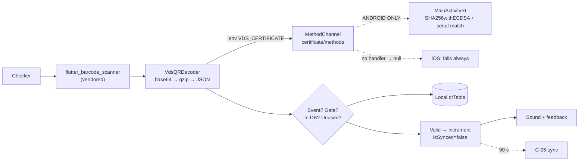

# C-03 · QR scan validation

> **Bangla name:** QR স্ক্যান যাচাই
>
> [← 40 · Checker app](README.md) · [Contents](../README.md) · [Open queries](../99-open-queries.md)

## 1. Name and purpose

**QR scan validation.** The screen a checker spends the whole event on. It scans a ticket's QR code, verifies the **VDS digital signature** so the ticket is genuine, checks that the ticket belongs to this event and this gate, and checks that it has not been used yet. All of it works **offline** from the database downloaded in [C-02](C-02-offline-ticket-download.md). Each result is shown on screen and announced with a distinct sound.

## 2. Trigger and actor

A checker at the gate, route `/qrPage`.

## 3. Business flow

1. The checker taps scan; the camera opens; a QR code is read.
2. The app verifies the signature and the event/gate match.
3. The outcome is one of: **valid**, **already checked**, **wrong event**, **wrong gate**, **invalid ticket**, **incorrect QR**, or a confirmation dialog for an **offline-purchased** ticket.
4. On success the ticket is marked used locally, the remaining count drops, and a sound plays.
5. The checker taps to scan the next ticket.

## 4. Technical flow

1. **Scanning** — `scanBarcode()` (`qr_page_view_model.dart:232-242`) calls `FlutterBarcodeScanner.scanBarcode('#FF0000', 'Cancel', true, ScanMode.QR)`. The package is a **vendored path dependency** (`pubspec.yaml`: `flutter_barcode_scanner: path: flutter_barcode_scanner`), **not** `mobile_scanner` or `qr_code_scanner`. A cancel returns the string `'-1'`, which is ignored (`:238`).
2. **Verification** — `onQRCodeDetected` (`:244-251`) calls `certificateRepository.getQRObjects(qrCodeString: detectedCode)`, which is `VdsQRDecoder.verifyQrData` (`data/lib/service/vds_qr_decoder.dart:35-65`):
   - the QR string is **base64-decoded**; if the first two bytes are `0x1F 0x8B` it is **gzip-decompressed** (`_isCompressed`, `:67-71`; `GZipDecoder`, `:73-76`);
   - the result is JSON with four fields: `payload`, `signature`, `certSN`, `issuerDN` (`:19-22`);
   - `payload` is itself base64 and decoded to UTF-8 (`:24-27`);
   - the certificate comes from **`.env` key `VDS_CERTIFICATE`** (`:40`) and is handed to the platform with `platform.invokeMethod('verifyCertificate', …)` on the **method channel `certificate/methods`** (`:9, 43-51`);
   - the payload is returned **only** when `verifiedData['verificationStatus'] == 'true'` (`:58-60`), otherwise `null`.
3. **The crypto is on the Android side** — `MainActivity.kt`:
   ```kotlin
   private val CHANNEL = "certificate/methods"
   Security.removeProvider("BC"); Security.addProvider(BouncyCastleProvider())
   ...
   val verifier = Signature.getInstance("SHA256withECDSA", "BC")
   verifier.initVerify(certificate.publicKey)
   verifier.update(payloadRawBytes)
   val isValid = verifier.verify(signatureBytes)
   val serialNumber = certificate.serialNumber.toString(16).lowercase()
   ```
   (`MainActivity.kt:16, 21-22, 52-72`). So the algorithm is **`SHA256withECDSA` via BouncyCastle**, not RSA-SHA1, and there are **two** conditions in `verificationStatus`: the signature must verify **and** the certificate serial number must equal the QR's `certSN` (`:64-72`). The result map also carries `serialNumber`, `issuer`, `signatureValid` and `isSerialNumberMatch`.
4. **The business checks** — `_getTicketStatus` (`:282-344`), reading three labels out of the payload by exact string:
   | Label | Used for |
   |---|---|
   | `Event ID` | must equal `_eventLongId` → else `WrongEventQrCheckState` (`:293-297`) |
   | `Entry Gate` | must equal `_entryGate` → else `WrongGateQrCheckState(entryGate)` (`:299-303`) |
   | `Ticket ID` | looked up in the local map (`:305`) |
   Each is fetched with `.where((e) => e.label == "…").toList().single.value`, so a payload missing a label **throws** rather than producing a friendly message `[UNCONFIRMED: Q-71]`.
5. Then, in order: ticket not in the local map → `WrongEventQrCheckState` (`:311-314`); `ticketState.count > 0` → `AlreadyCheckedQrCheckState` (`:316-320`).
6. **Offline-purchased tickets get a confirmation dialog** (`:322-341`): "This ticket was purchased offline. Does the ticket credential include a physical ticket?" — confirm marks it used and reports valid; cancel reports `null`, which `_setNewStateInQrStatus` treats as "show nothing" (`:255-257`).
7. **Otherwise** `_updateTicketStatus(ticketId)` (`:342-343`) increments the count, sets `isScannedFromOurApp: true`, `isSynced: false` and writes through to the local database (`:347-372`).
8. **Sound** — `_playSound(state)` (`:275-280`) stops the current player and plays `qrCheckStatus.soundAsset` through `audioplayers`, then `qrCheckStatus.playFeedback()`; the scanner also calls `qrCheckStatus.playFeedback()` for vibration/haptics (`_getTicketStatus`, `:211-225`).

## 5. Components

| Kind | Component |
|---|---|
| Client | `lib/presentation/feature/qr_page/qr_page_view_model.dart`, `screen/`, `widgets/` |
| Client | `data/lib/service/vds_qr_decoder.dart`, `data/lib/repository/certificate_repository_impl.dart` |
| Client | `domain/lib/repository/certificate_repository.dart` |
| Android | `android/app/src/main/kotlin/com/mahfuznow/hello_flutter/MainActivity.kt` (BouncyCastle ECDSA verify) |
| Local DB | drift `qrTable` ([C-02](C-02-offline-ticket-download.md)) |
| Env | `.env` key **`VDS_CERTIFICATE`** (the PEM certificate the signatures are checked against) |
| Service | none at scan time — validation is entirely local |

## 6. API contracts

**None.** A scan makes no HTTP call. This is the point of the app. The next server contact is the 90-second sync in [C-05](C-05-ticket-sync.md).

## 7. Data and side effects

One local row updated per successful scan (`checkNumber + 1`, `isScannedFromOurApp = true`, `isSynced = false`). The ticket PDF is never downloaded and the QR is never re-verified against a server.

## 8. Code references

| What | Where |
|---|---|
| Scan + validation | `rvl-gobcb-checker-app/lib/presentation/feature/qr_page/qr_page_view_model.dart:232-372` |
| VDS decoder | `rvl-gobcb-checker-app/data/lib/service/vds_qr_decoder.dart:8-77` |
| Certificate repository | `rvl-gobcb-checker-app/data/lib/repository/certificate_repository_impl.dart:1-5` |
| Android crypto | `rvl-gobcb-checker-app/android/app/src/main/kotlin/com/mahfuznow/hello_flutter/MainActivity.kt:16, 21-22, 26-51, 52-79` |
| iOS (missing channel) | `rvl-gobcb-checker-app/ios/Runner/AppDelegate.swift:1-13` |
| Vendored scanner | `rvl-gobcb-checker-app/flutter_barcode_scanner/`, `pubspec.yaml` |
| Packages | `rvl-gobcb-checker-app/pubspec.yaml` (`audioplayers: 6.5.0`, `permission_handler: 12.0.1`, `archive`) |
| DI | `rvl-gobcb-checker-app/data/lib/di/data_module.dart:126, 161` |
| Admin side | [A-13](../10-admin-portal/A-13-ticket-layouts.md) (where the QR position is decided), [S-08](../50-system-initiated/S-08-ticket-signing.md) (where the signature is created) |

## 9. Handover notes

1. **iOS cannot verify any QR code.** `AppDelegate.swift` (`:1-13`) only registers plugins — there is **no `certificate/methods` handler and no Swift implementation at all**. Every `verifyQrData` call on iOS therefore throws, is caught at `vds_qr_decoder.dart:61-63`, returns `null`, and every ticket is reported `IncorrectQrCheckState`. This is the "iOS QR channel gap" recorded in the plan; it is **not** a barcode-scanner limitation, because the scanner itself is fully implemented on iOS `[UNCONFIRMED: Q-72]`. The checker app is therefore **Android-only for real validation** until a Swift `verifyCertificate` is written.
2. **The trust anchor is a single PEM certificate in `.env`** (`:40`). Rotating or adding a VDS certificate is an app re-release, and any ticket signed by a previous certificate fails `[UNCONFIRMED: Q-73]`.
3. **`SHA256withECDSA`, not RSA-SHA1** (§4 note 3) — the CloudFront `CloudfrontTicketValidator` / RSA-SHA1 / signed-cookie mechanism belongs to the **admin portal's** S3 download protection ([X-20](../60-cross-cutting/X-20-file-storage.md)) and has nothing to do with this verification. The checker never reads S3 and never sees a signed cookie.
4. **Duplicate scanning is detected only locally**, by `count > 0`. Two devices at the same gate with the same download can both accept the same ticket; the server is only told later by [C-05](C-05-ticket-sync.md) `[UNCONFIRMED: Q-74]`.
5. **A missing label throws** (§4 note 4) `[UNCONFIRMED: Q-71]`: `.toList().single` raises on zero or multiple matches, so a malformed or third-party QR produces an unhandled exception rather than the "incorrect QR" message.
6. **Gate matching is by the `Entry Gate` label against the local `_entryGate`**, which came from the assignment ([C-01](C-01-assigned-event-gate.md)). If the assignment is stale, every ticket is reported as the wrong gate — and note 2 of [C-01](C-01-assigned-event-gate.md) (first assignment only) makes a wrong gate easy to hit.
7. **gzip detection is a 2-byte magic-number check** (`0x1F 0x8B`, `:67-71`) — correct for gzip, and any other compression would be mis-parsed.
8. **Errors inside `verifyQrData` are swallowed** with `debugPrint` (`:61-63`), so a certificate problem and a bad QR are indistinguishable to the checker.
9. **`_playSound` plays a distinct asset per state** (`qrCheckStatus.soundAsset`), which is what lets a checker work by ear — worth preserving in any redesign.
10. **The confirmation dialog for offline-purchased tickets exists because those tickets may also exist on paper**; cancelling reports nothing, which means a mistaken scan leaves no trace.

## 10. Component relationships



**Depends on:** [C-02](C-02-offline-ticket-download.md) (the local ticket set), [C-01](C-01-assigned-event-gate.md) (event and gate), [S-08](../50-system-initiated/S-08-ticket-signing.md) and [A-13](../10-admin-portal/A-13-ticket-layouts.md) (how a scannable, correctly positioned QR is produced). **Affects:** [C-05](C-05-ticket-sync.md), [A-19](../10-admin-portal/A-19-gate-reports.md).

## 11. Developer test guide

**Local testability: Full on Android; Not locally on iOS** (note 1 — there is no iOS implementation to test).

| Item | Detail |
|---|---|
| Test data and accounts | a checker with a downloaded event containing at least one signed ticket ([C-02](C-02-offline-ticket-download.md)); a signed QR can be taken from a seeded ticket PDF |
| Browser | n/a |
| Emulator | run on an Android device (the emulator camera can be awkward — feeding a QR image is easier); test each outcome: valid, re-scan the same ticket, scan a ticket from another event, scan at the wrong gate; for note 5, feed a base64 blob with a missing `Event ID` label |
| Postman | no endpoint is involved — fetch `sync-tickets` only to confirm the local set |
| Visual Studio debug | `VdsQRDecoder.verifyQrData`; `MainActivity.kt:52` `verifyCertificate`; `QrPageViewModel._getTicketStatus` |
| Verify | `SELECT * FROM qrTable WHERE "isSynced" = 0` after a scan; the `verificationStatus` map in the log; a ticket signed with a different certificate should return `null` (note 2) |