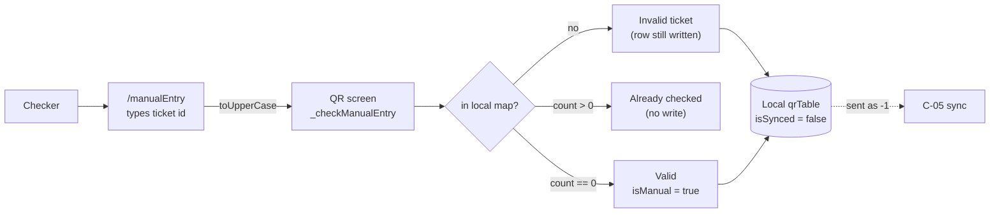

# C-04 · Manual entry

> **Bangla name:** ম্যানুয়াল এন্ট্রি
>
> [← 40 · Checker app](README.md) · [Contents](../README.md) · [Open queries](../99-open-queries.md)

## 1. Name and purpose

**Manual entry.** The fallback when a ticket will not scan: damaged print, a smudged QR, or a customer reading out the number. The checker types the ticket ID and the app applies the same "is this ticket in my set and still unused?" test as the scanner — but **without** signature verification, because there is nothing to verify. That difference is the important handover point: a manual entry is a human assertion, not a cryptographic one.

## 2. Trigger and actor

A checker on the QR screen ([C-03](C-03-qr-scan-validation.md)), via the manual-entry icon. Route `/manualEntry`.

## 3. Business flow

1. The checker taps the manual-entry icon on the QR screen and types the ticket ID.
2. The ID is upper-cased and handed back to the QR screen, which looks it up in the local map.
3. Three outcomes: **not in my set** → invalid ticket; **already checked** (`count > 0`) → already checked; otherwise → **valid**, the remaining count drops and the ticket is marked used.

## 4. Technical flow

1. `onTapManualEntryIcon()` (`qr_page_view_model.dart:187-196`) navigates to `ManualEntryRoute` with a callback.
2. `ManualEntryViewModel.onClickSubmit(ticketId)` (`manual_entry_view_model.dart:26-32`) **pops the screen first** and then calls back:
   ```dart
   navigateBack();
   argument?.onReceivedTicketId(ticketId.toUpperCase());
   ```
3. **The input is upper-cased before the lookup** (`:32`), so ticket IDs are compared case-insensitively by folding the input — the stored values are not lower-cased to match.
4. `_checkManualEntry({required String ticketId})` (`qr_page_view_model.dart:198-231`):
   - `_allTicketList[ticketId] == null` → `_updateTicketStatus(ticketId: ticketId, isManual: true)`, then `InvalidTicket()` with a sound (`:200-208`). **The row is still written** even though the ticket is unknown, which is how a manual attempt on a ticket that was never in the download reaches the server later;
   - `ticketState.count > 0` → `AlreadyCheckedTicket()` with a sound, and **deliberately no write** — the code comments this: "If we know this ticket is already checked, we don't need to send it to backend" (`:210-220`);
   - otherwise → decrement `_remainingTickets`, `_updateTicketStatus(ticketId: ticketId, isManual: true)`, then `ValidTicket()` with a sound (`:222-230`).
5. `_updateTicketStatus` writes `isManual: true` and `isSynced: false` (`:347-372`), which is what makes [C-05](C-05-ticket-sync.md) send it as `-1`.
6. `checkTextFieldText` (`manual_entry_view_model.dart:22-24`) calls `_manualEntryState.value.validateTicketId(text)` as the checker types.

## 5. Components

| Kind | Component |
|---|---|
| Client | `lib/presentation/feature/manual_entry/manual_entry_view_model.dart` + screen |
| Client | `lib/presentation/feature/qr_page/qr_page_view_model.dart:187-231` |
| Local DB | drift `qrTable` ([C-02](C-02-offline-ticket-download.md)) |
| Service | none at entry time — local only |

## 6. API contracts

**None.** A manual entry makes no HTTP call; it is synced later by [C-05](C-05-ticket-sync.md).

## 7. Data and side effects

One local row per manual attempt: `checkNumber + 1`, `isScannedFromOurApp = true`, **`isManual = true`**, `isSynced = false`. For an unknown ticket ID a **new row is created** (`:200-208`), so the local table can grow with IDs that were never in the event.

## 8. Code references

| What | Where |
|---|---|
| Manual entry view model | `rvl-gobcb-checker-app/lib/presentation/feature/manual_entry/manual_entry_view_model.dart:22-32` |
| Entry check | `rvl-gobcb-checker-app/lib/presentation/feature/qr_page/qr_page_view_model.dart:187-231` |
| Status write | `rvl-gobcb-checker-app/lib/presentation/feature/qr_page/qr_page_view_model.dart:347-372` |
| Manual encoding on the wire | `rvl-gobcb-checker-app/data/lib/repository/qr_repository_impl.dart:24-26` |
| Routes | `rvl-gobcb-checker-app/lib/presentation/navigation/route_path.dart` (`manualEntry`) |
| Admin side | [A-11](../10-admin-portal/A-11-seat-reservation.md), [X-13](../60-cross-cutting/X-13-agent-pool.md) (the agent offline-sold ticket flow, which is what makes offline tickets exist) |

## 9. Handover notes

1. **A manual entry skips VDS signature verification entirely.** The signature path is only in `onQRCodeDetected` ([C-03](C-03-qr-scan-validation.md)); manual entry goes straight to the local-map lookup. A checker can therefore accept any ticket ID that exists in the downloaded set, printed or not `[UNCONFIRMED: Q-75]`.
2. **An unknown ticket ID is still written to the local database** (§4 note 4), so a typo becomes a new row that is later reported to the server as a `-1` manual check for a ticket that does not exist `[UNCONFIRMED: Q-75]`.
3. **The length validation is commented out** (`manual_entry_view_model.dart:27-30` — the `if (ticketId.length < 13)` block is commented out), so the field accepts anything; the only gate is whether the string exists in the local map.
4. **Only the input is upper-cased**, so a lower-case ticket id on the printed ticket will match a mixed-case stored value, but the stored values themselves are untouched — an asymmetry worth remembering when debugging case-related misses.
5. **The screen pops before the lookup**, so the result appears on the QR screen rather than on the entry screen; if the checker navigates back quickly they may miss the result.
6. **Manual entries are indistinguishable from scans on the server except by the `-1` convention** ([Q-68](C-02-offline-ticket-download.md)), so gate reports mix the two unless the sign is honoured `[UNCONFIRMED: Q-68]`.

## 10. Component relationships



**Depends on:** [C-02](C-02-offline-ticket-download.md) (the local set), [C-03](C-03-qr-scan-validation.md) (the screen it is opened from). **Affects:** [C-05](C-05-ticket-sync.md), [A-19](../10-admin-portal/A-19-gate-reports.md).

## 11. Developer test guide

**Local testability: Full** — no network is involved.

| Item | Detail |
|---|---|
| Test data and accounts | a checker with a downloaded event; one unused ticket id and one already-scanned ticket id |
| Browser | n/a |
| Emulator | open the QR screen, tap the manual-entry icon; type a valid unused id (expect Valid), the same id again (expect Already checked), an unknown id (expect Invalid), and a lower-case valid id (expect Valid because of `toUpperCase`) |
| Postman | no endpoint involved |
| Visual Studio debug | `ManualEntryViewModel.onClickSubmit`, `QrPageViewModel._checkManualEntry` |
| Verify | `SELECT * FROM qrTable WHERE "isManual" = 1`; then trigger the 90-second sync ([C-05](C-05-ticket-sync.md)) and confirm those rows leave as `-1` |