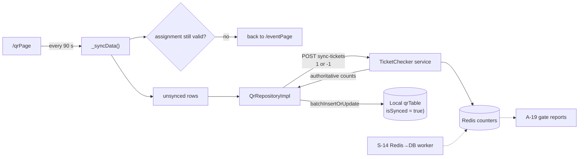

# C-05 · Scan sync

> **Bangla name:** স্ক্যান সিঙ্ক
>
> [← 40 · Checker app](README.md) · [Contents](../README.md) · [Open queries](../99-open-queries.md)

## 1. Name and purpose

**Scan sync.** The bridge between the checker's offline decisions and the platform's records. Every 90 seconds the app sends the scans it has made to the TicketChecker service, receives the authoritative counts back, writes them to the local database and marks those rows synced. It also re-checks that the checker's assignment is still valid. Everything else in this app is offline; this is the one part that needs a network, and it is designed to degrade quietly when there is none.

## 2. Trigger and actor

Automatic, on the QR screen ([C-03](C-03-qr-scan-validation.md)). Route `/qrPage`.

## 3. Business flow

1. The QR screen runs a countdown from **90 seconds**.
2. On expiry the app uploads every scan not yet synced, receives the counts, and records the time of the last successful sync.
3. It also asks the server whether the checker is still assigned to this event and gate. If not, the app sends the checker back to the event page and stops scanning.
4. If there is no network, the countdown restarts, the scans stay marked unsynced, and nothing is lost.

## 4. Technical flow

1. **The interval** — `static const _refreshInterval = Duration(seconds: 90)` (`qr_page_view_model.dart:22`), with `_remainingTime`, a one-second `Timer.periodic` (`:86-97`) and a `_lastSyncTime` value for the UI. `_startTimer()` is called from the view's ready path (`:81`).
2. **`_syncData()`** (`:102-140`):
   - **first** calls `_checkEventValidity()` (`:103`); if that fails it navigates to `EventPageRoute` with `isClearBackStack: true` and returns (`:105-111`);
   - builds `notSynced` from `_scannedTicket` where `!value.isSynced` (`:113-119`);
   - `loadData(() => qrRepository.getTicketFromServer(tickets: notSynced, isFirstLoad: false), showLoading: false)` (`:121-127`) — **no spinner**, so scanning continues during a sync;
   - records `_lastSyncTime.value = DateTime.now().toLocal()` (`:129`);
   - marks every entry in `notSynced` as `isSynced: true` in the in-memory map and refreshes the UI (`:131-138`).
3. **[HTTP + checker bearer] → TicketChecker:** `POST ticketchecker/api/v1/tickets/sync-tickets` (`ticket_api_service_impl.dart:24-27`) — the same endpoint as [C-02](C-02-offline-ticket-download.md), with the body built by `qr_repository_impl.dart:24-26` as `{ticketId: 1 | -1}`.
4. **The response is upserted locally** with `batchInsertOrUpdateTickets` (`:34`), and its length is returned.
5. **`_checkEventValidity()`** (`:142-161`) calls `eventRepository.getTheEvents(onGetOfflineData: …)` and compares:
   ```dart
   if (_checkerEvent.eventLongId != _eventLongId ||
       _checkerEvent.ticketCheckerGateId != _ticketCheckerGateId) return false;
   ```
   so an admin who unassigns or moves the checker stops the scan loop at the next tick, within 90 seconds. The `onGetOfflineData` body is effectively empty — its only statement is commented out (`:145-148`), so a cached assignment is not used for this decision.
6. **Failure is non-destructive**: `loadData` catches, and because `notSynced` is only flipped to `isSynced: true` after a successful call (`:131-134`), unsent scans remain unsent and are retried on the next tick. `[UNCONFIRMED: Q-76]` — `_lastSyncTime` is set unconditionally at `:129`, so after a failed sync it can show a time that never actually synced.
7. Server-side, the counters live in Redis and are flushed to the database by [S-14](../50-system-initiated/S-14-checked-ticket-sync.md).

## 5. Components

| Kind | Component |
|---|---|
| Client | `lib/presentation/feature/qr_page/qr_page_view_model.dart:22, 81-161` |
| Client | `data/lib/repository/qr_repository_impl.dart:17-35` |
| API service | `data/lib/remote/api_service/ticket_api_service/ticket_api_service_impl.dart:21-38` |
| Service | TicketChecker (`sync-tickets`), Admin (`event-info` for the assignment check) |
| Redis | checked-ticket counters written by the endpoint |
| Queues / workers | [S-14](../50-system-initiated/S-14-checked-ticket-sync.md) moves Redis → database |
| Local DB | drift `qrTable`, `isSynced` column |

## 6. API contracts

| Method | Path | Auth | Request → Response |
|---|---|---|---|
| POST | `/ticketchecker/api/v1/tickets/sync-tickets` | checker bearer | `{ "<ticketId>": 1 \| -1 }` for unsynced rows → `{ "<ticketId>": <checkedNumber> }` |
| GET | `/admin/api/v1/ticket-checker-gate/event-info` | checker bearer | assignment check ([C-01](C-01-assigned-event-gate.md)) |

## 7. Data and side effects

Local: `isSynced` flips to `true` for rows whose upload succeeded, and the server's counts are written over the local values. Server: Redis counters for the synced tickets, later persisted by [S-14](../50-system-initiated/S-14-checked-ticket-sync.md). The gate report ([A-19](../10-admin-portal/A-19-gate-reports.md)) is only as complete as this sync.

## 8. Code references

| What | Where |
|---|---|
| Interval and countdown | `rvl-gobcb-checker-app/lib/presentation/feature/qr_page/qr_page_view_model.dart:22-23, 32, 81-97` |
| Sync | `rvl-gobcb-checker-app/lib/presentation/feature/qr_page/qr_page_view_model.dart:102-140` |
| Event validity | `rvl-gobcb-checker-app/lib/presentation/feature/qr_page/qr_page_view_model.dart:142-161` |
| Repository | `rvl-gobcb-checker-app/data/lib/repository/qr_repository_impl.dart:17-35` |
| API service | `rvl-gobcb-checker-app/data/lib/remote/api_service/ticket_api_service/ticket_api_service_impl.dart:21-38` |
| DAO upsert | `rvl-gobcb-checker-app/data/lib/local/drift_database/qr_database/qr_dao.dart:26-36` |
| Server worker | [S-14](../50-system-initiated/S-14-checked-ticket-sync.md) |

## 9. Handover notes

1. **A sync failure still updates "last sync time"** (§4 note 6) `[UNCONFIRMED: Q-76]`, so the UI can claim a successful sync that never happened. The scans themselves are safe — only the displayed time lies.
2. **There is no retry backoff and no failure counter**: every 90 seconds the app tries again regardless, which is fine for a venue but means a long outage produces repeated failed calls `[UNCONFIRMED: Q-76]`.
3. **The sync shares the endpoint with the download** ([C-02](C-02-offline-ticket-download.md)), distinguished only by `isFirstLoad`. The server therefore cannot tell a download from an incremental sync — it is the same POST.
4. **Unassignment takes up to 90 seconds to take effect** (§4 note 5), and only if the app has network. A checker who is unassigned at a gate offline keeps scanning until they regain signal.
5. **`onGetOfflineData` is effectively disabled for this check** (`:145-148`, body commented out), so an offline sync attempt cannot validate the assignment and will simply fail on the network call.
6. **The in-memory `_scannedTicket` map is the source of truth for "unsynced"**, and it is rebuilt from the database in `_getTicketList()` (`:166-184`) filtered on `isScannedFromOurApp`. A row created without that flag would never sync.
7. **Manual entries go out as `-1`** ([Q-68](C-02-offline-ticket-download.md)) — confirm with BS23 how the server aggregates a negative count before reporting on it.
8. **`isSynced` has no expiry**, matching the related server-side flag finding ([Q-17](../50-system-initiated/S-14-checked-ticket-sync.md)).

## 10. Component relationships



**Depends on:** [C-02](C-02-offline-ticket-download.md), [C-03](C-03-qr-scan-validation.md), [C-04](C-04-manual-entry.md). **Affects:** [S-14](../50-system-initiated/S-14-checked-ticket-sync.md), [A-19](../10-admin-portal/A-19-gate-reports.md).

## 11. Developer test guide

**Local testability: Full.**

| Item | Detail |
|---|---|
| Test data and accounts | a checker with a downloaded event and at least one scan pending ([C-02](C-02-offline-ticket-download.md)) |
| Browser | n/a |
| Emulator | run the app, scan a ticket, then watch the countdown and the log for `POST ticketchecker/api/v1/tickets/sync-tickets` at the 90-second mark; then stop the TicketChecker service and confirm the scans stay unsynced and are retried |
| Postman | `postman/services/etp-ticketchecker.postman_collection.json`: "POST /api/v1/tickets/sync-tickets"; `etp-admin.postman_collection.json`: "GET /api/v1/ticket-checker-gate/event-info"; set `{{access_token_checker}}` |
| Visual Studio debug | `TicketCheckerController` sync action; client: `QrPageViewModel._syncData` |
| Verify | `SELECT * FROM qrTable WHERE "isSynced" = 0` before and after a sync; the Redis counters; unassign the checker in the admin portal and confirm the app returns to `/eventPage` within 90 seconds (note 4) |