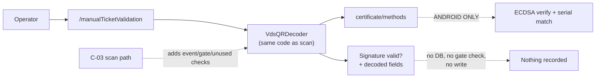

# C-06 · Signature-only ticket validation

> **Bangla name:** শুধু-সিগনেচার টিকিট যাচাই
>
> [← 40 · Checker app](README.md) · [Contents](../README.md) · [Open queries](../99-open-queries.md)

## 1. Name and purpose

**Signature-only ticket validation.** A diagnostic screen that answers one question: *is this QR string a genuine, correctly signed GoBCB ticket?* It runs the VDS signature verification on a value the checker pastes in, **without** consulting the local ticket database, without checking the event or gate, and without recording anything. It answers "was this ticket printed by us and not altered?" — and nothing else. It is a support and troubleshooting tool, not an admission check.

The difference from [C-03](C-03-qr-scan-validation.md) is exactly this: scanning proves signature **plus** event **plus** gate **plus** unused; this screen proves the signature alone.

## 2. Trigger and actor

A checker or a support engineer, route `/manualTicketValidation`. Reached from the settings screen.

## 3. Business flow

1. The operator pastes or types the QR string — the full base64 blob exactly as it appears in the ticket's QR code.
2. The app decodes and verifies it with the same code path the scanner uses.
3. It reports whether the signature is valid and, on success, shows the decoded ticket fields.
4. **Nothing is stored and no ticket is marked used**, whatever the result.

## 4. Technical flow

1. `ManualTicketValidationViewModel` (`:34`) calls the same repository method as the scanner:
   ```dart
   final ticketCredential = await _certificateRepository.getQRObjects(qrCodeString: …);
   ```
   i.e. `VdsQRDecoder.verifyQrData` ([C-03](C-03-qr-scan-validation.md) §4): base64-decode → gzip-decompress if the header is `0x1F 0x8B` → parse `payload` / `signature` / `certSN` / `issuerDN` → verify through the `certificate/methods` channel with the `.env` certificate.
2. **The only difference from the scan path is what happens next**: there is no lookup in `_allTicketList`, no event or gate comparison, no `_updateTicketStatus`, no sound, and no sync. A valid signature here does **not** mean the ticket belongs to this event, and a used ticket will still report as valid.
3. The result is shown with its sound/haptic feedback, as in the scanner.
4. `getQRObjects` returns `null` for anything that fails to decode or verify, and the screen shows the incorrect-QR state — on iOS it **always** fails ([C-03](C-03-qr-scan-validation.md) note 1).

## 5. Components

| Kind | Component |
|---|---|
| Client | `lib/presentation/feature/manual_ticket_validation/manual_ticket_validation_view_model.dart` + screen |
| Client | `data/lib/repository/certificate_repository_impl.dart`, `data/lib/service/vds_qr_decoder.dart` |
| Android | `MainActivity.kt` (`certificate/methods`, `SHA256withECDSA`) |
| Local DB | **not used** — this screen reads nothing |
| Service | none |

## 6. API contracts

**None.** Entirely local, like the scan itself.

## 7. Data and side effects

**None.** No row is written, no scan is recorded, nothing is synced. This is the only checker-app screen that cannot affect a gate report.

## 8. Code references

| What | Where |
|---|---|
| View model | `rvl-gobcb-checker-app/lib/presentation/feature/manual_ticket_validation/manual_ticket_validation_view_model.dart:34` |
| Shared decoder | `rvl-gobcb-checker-app/data/lib/service/vds_qr_decoder.dart:8-77` |
| Android crypto | `rvl-gobcb-checker-app/android/app/src/main/kotlin/com/mahfuznow/hello_flutter/MainActivity.kt:52-79` |
| iOS gap | `rvl-gobcb-checker-app/ios/Runner/AppDelegate.swift:1-13` |
| Scan path for comparison | `rvl-gobcb-checker-app/lib/presentation/feature/qr_page/qr_page_view_model.dart:244-251, 282-344` |
| Routes | `rvl-gobcb-checker-app/lib/presentation/navigation/route_path.dart` (`manualTicketValidation`) |

## 9. Handover notes

1. **A "valid" result here proves only authenticity, not entitlement.** It does not check the event, the gate, or whether the ticket was already used. Anyone using this screen for admissions would admit an already-used or wrong-gate ticket `[UNCONFIRMED: Q-77]`.
2. **It shares the whole crypto path with the scanner**, so the iOS failure ([C-03](C-03-qr-scan-validation.md) note 1) applies identically: on iOS this screen always reports an incorrect QR, which makes it useless there for diagnosing anything.
3. **The trust anchor is the `.env` `VDS_CERTIFICATE`**, so a signature failure may mean a rotated certificate rather than a forged ticket ([Q-73](C-03-qr-scan-validation.md)).
4. **The screen is the practical way to test the certificate** after a rotation: paste a freshly issued ticket's QR string and confirm it verifies before blaming the scanner.
5. **Decode errors and signature failures are indistinguishable** to the user, because `vds_qr_decoder.dart:61-63` swallows the exception and returns `null`.

## 10. Component relationships



**Depends on:** [C-03](C-03-qr-scan-validation.md) (it reuses the same decoder and the same `.env` certificate). **Affects:** nothing — it is read-only by design.

## 11. Developer test guide

**Local testability: Full on Android; always fails on iOS** (note 2).

| Item | Detail |
|---|---|
| Test data and accounts | a genuine signed QR string from a seeded ticket, plus a tampered copy (change one character of the base64 payload) and a QR from a different certificate |
| Browser | n/a |
| Emulator | open `/manualTicketValidation`, paste the genuine string (expect valid with decoded fields), then the tampered one (expect incorrect), then a random base64 blob (expect incorrect) |
| Postman | no endpoint involved |
| Visual Studio debug | `ManualTicketValidationViewModel`, `VdsQRDecoder.verifyQrData`, `MainActivity.kt:52` |
| Verify | the `verificationStatus` / `signatureValid` / `isSerialNumberMatch` values in the log; to reproduce the certificate-rotation case, change `VDS_CERTIFICATE` in `.env` and re-run (note 4) |