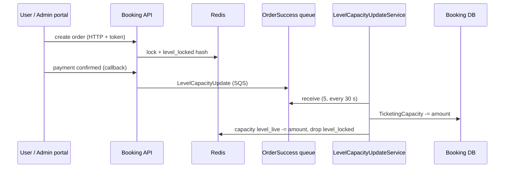

# S-01 · Level capacity update (OrderSuccess queue)

> **Bangla name:** লেভেল ধারণক্ষমতা হালনাগাদ (OrderSuccess কিউ)
>
> [← 50 · System-initiated](README.md) · [Contents](../README.md) · [Open queries](../99-open-queries.md)

## 1. Name and purpose

**Level capacity update.** A seat level (one gallery, block and level of an event) has a capacity in the database and a *live* capacity in Redis. When a paid order or an admin action changes the number of seats, the change is put on the `OrderSuccess` queue; the Booking worker `LevelCapacityUpdateService` reads it, writes the new capacity to the database, and finishes the Redis bookkeeping. Concepts: [queue-driven processing](../00-platform-primer.md#explainer-queue-driven), [Redis live capacity](../00-platform-primer.md#explainer-redis-live-capacity), [background workers](../00-platform-primer.md#explainer-background-workers), [distributed locks](../00-platform-primer.md#explainer-distributed-locks).

## 2. Trigger and actor

- **Producer (user order):** Booking, when a payment is confirmed: DgePay callback `HandleDgePayment`, the re-check job `RevaildateRecentPendingBookingsAsync` ([S-05](S-05-pending-failed-revalidation.md)), and the handler behind the anonymous `GET payment-status-bypass`, which marks the order `Paid` without asking the gateway (`HandleDgePaymentBypass`, see [X-18](../60-cross-cutting/X-18-endpoints-without-auth.md)). The SSLCommerz handler publishes the same message but is inactive ([Appendix A](../90-appendix-a-legacy.md)).
- **Producer (admin):** `CapacityManager.BookLevelCapacity` for admin capacity adjustments and seat reservations ([A-10](../10-admin-portal/A-10-capacity-adjustment.md), [A-11](../10-admin-portal/A-11-seat-reservation.md)).
- **Consumer:** Booking service, `LevelCapacityUpdateService` (no user; no token).

## 3. Business flow

A customer reserves seats; the seats are held in a short "locked" list for 12 minutes while they pay. When the payment succeeds, the seats are permanently removed from the level's availability. If the customer is an admin (complimentary or partner tickets), the live count is changed at once and the database follows through the queue.

## 4. Technical flow

1. **Hold at order creation** **[HTTP + user token]** `UserBookingOrderManager.CreateAsync` takes the locks `user_booking:{userId}` and `level_booking_{event}_{gallery}_{block}_{level}` ([X-25](../60-cross-cutting/X-25-redis.md)) and calls `CapacityManager.BookLevelCapacity`. For a **user** order this only writes the order to the Redis hash `level_locked:{event}_{gallery}_{block}_{level}` (field = order id); expired entries (older than 12 minutes) are removed first, and the call fails with `no_seats_available`, `order_limit_exceeded` or `seat_limit_exceeded` when the numbers do not fit.
2. **Publish on success** **[SQS: OrderSuccess]** with a `LevelCapacityUpdate` message: `orderType`, `amount`, `hasSeats`, `seats`, `isIncrease`, `groupId` (`{event}_{gallery}_{block}_{level}`), `orderId`, `capacityAction` (`Booking`, `Allocation` or `Reservation`). For user orders the message is sent only if the payment is `Paid` (DgePay callback: only when the order is no more than 12 minutes old).
3. **For an admin action** `BookLevelCapacity` changes the Redis hash `capacity` field `level_live:{...}` directly (atomic increment/decrement, no lock needed), updates the live seat string, then publishes the same message so the database catches up.
4. **Worker** **[Worker: 1 min start delay, then every 30 s; RedLock `level_capacity_updater_{0..49}`, expiry 30 s, wait 10 s]**: `LevelCapacityUpdateService` takes one random slot lock and runs `LevelCapacityUpdateTaskManager` once. The task manager long-reads the queue (`MaxNumberOfMessages` 5, `WaitTimeSeconds` 0, visibility 60 s) and, per message:
   - `CapacityManager.UpdateLevelCapacityAsync` takes the lock `database_update_{event}_{gallery}_{block}_{level}` (expiry 5 s, wait 30 s), adds or subtracts `amount` on `TicketingCapacity` in the database (error if it would go below 0), and adjusts the stored seat lists when `hasSeats`;
   - for `orderType = User`: `HashDecrement capacity level_live:{groupId}` by `amount`, `HashDelete level_locked:{groupId}` for the order id, and, with seats, remove the seats from the live seat string;
   - the message is deleted only after success. On an exception the message is **not** deleted; it becomes visible again after 60 s.
5. In parallel, `BookLevelCapacity` also publishes an `EventCapacity` message ([S-02](S-02-event-live-capacity.md)).

## 5. Components

| Kind | Component |
|---|---|
| Services | Booking (API, worker); consumer and producer are the same service |
| Queue | `OrderSuccess` (`AWS:Queue:OrderSuccess`) |
| Tables | `Capacities` rows of the Booking schema (`TicketingCapacity`, `Seats`, `LockedSeats`), `UserBookingOrder` |
| Redis | `capacity` hash (`level_live:*`, `level_live_seats:*`), `level_locked:*` hashes, `refresh` set, locks |
| Code | `Services/Booking/ETP.Booking.Service/Workers/BackgroundServices/LevelCapacityUpdateService.cs`, `.../TaskManagers/LevelCapacityUpdateTaskManager.cs`, `Services/Booking/ETP.Booking.Domain/Managers/CapacityManager.cs` |
| Config | `AWS:Queue:OrderSuccess`, `Cache:Redis:*`, `DistributedLock:Redis:*` ([X-26](../60-cross-cutting/X-26-configuration.md)) |

## 6. API contracts

No endpoint of its own. The queue message (`Core/ETP.Core/Queue/Messages/LevelCapacityUpdate.cs`), serialised with `System.Text.Json` defaults (PascalCase property names, enums as numbers):

```json
{
  "OrderType": 0,
  "Amount": 2,
  "HasSeats": false,
  "Seats": null,
  "IsIncrease": false,
  "GroupId": "101_5_12_33",
  "OrderId": "<order public id>",
  "CapacityAction": 0
}
```

(illustrative values; `OrderType` and `CapacityAction` are enum numbers whose names come from `Enums.OrderType` and `CapacityAction`). The queue is a FIFO queue only when its configured name ends with `fifo`; then `GroupId` is the `MessageGroupId` (so one level is processed in order) and `OrderId` is the de-duplication id (`SqsPublisher`).

## 7. Data and side effects

- Database: `TicketingCapacity` (and seat columns) of one level row.
- Redis: live capacity decremented, locked order removed, live seats trimmed.
- Failure handling: failed messages are retried after the visibility timeout; there is no dead-letter handling in code `[UNCONFIRMED: Q-09]`.

## 8. Code references

| What | Where |
|---|---|
| Worker loop | `rvl-gobcb-backend/Services/Booking/ETP.Booking.Service/Workers/BackgroundServices/LevelCapacityUpdateService.cs:25-66` |
| Message handling | `rvl-gobcb-backend/Services/Booking/ETP.Booking.Service/Workers/TaskManagers/LevelCapacityUpdateTaskManager.cs:45-118` |
| Hold and publish | `rvl-gobcb-backend/Services/Booking/ETP.Booking.Domain/Managers/CapacityManager.cs:35-262` |
| Database update | `rvl-gobcb-backend/Services/Booking/ETP.Booking.Domain/Managers/CapacityManager.cs:539-715` |
| Payment publishers | `rvl-gobcb-backend/Services/Booking/ETP.Booking.Domain/Managers/UserBookingOrderManager.cs:345, 514, 1072, 1361` |
| Publisher class | `rvl-gobcb-backend/Core/ETP.Core/Queue/Services/SqsPublisher.cs` |

## 9. Handover notes

1. **Throughput is bounded by the polling design.** Each instance runs one 5-message batch (no long polling), then sleeps 30 s. At most 10 messages per minute per instance, so a burst of paid orders reaches the database with a delay (derived from the constants above; observe in your environment).
2. **Two sources of truth for a level.** Between the Redis decrement and the database update the two disagree; the lock-and-queue design accepts that. A Redis flush loses the live counters ([X-25](../60-cross-cutting/X-25-redis.md)).
3. **The 12-minute rule appears in three places** (callback age check, `BookLevelCapacity`, the refresh worker). A DgePay callback that arrives after 12 minutes neither changes the order status nor publishes `OrderSuccess`; the comment in code says such an order "is cancelled by BG service" ([S-05](S-05-pending-failed-revalidation.md)).
4. **Key mismatch in the bypass handler.** On `Failed`, `HandleDgePaymentBypass` deletes the field from `level_locked_{EventId}_...` (underscore, public event id) while the rest of the code uses `level_locked:{EventLongId}_...`; the entry is therefore not removed there and lapses by the 12-minute rule `[UNCONFIRMED: Q-10]`.
5. **No dead-letter queue is visible in code**; a poison message is retried forever each minute. Queue configuration (redrive policy) is in AWS, not in the repository.
6. If the message body cannot be deserialised (`null`), the task manager skips it with `continue` and does not delete it, so it also returns to the queue.

## 10. Component relationships



**Depends on:** order creation ([P-06](../20-user-portal/P-06-booking-payment.md)), published event and levels ([A-07](../10-admin-portal/A-07-events.md)). **Affects:** seat availability shown to every customer ([P-04](../20-user-portal/P-04-seat-selection.md)), [S-02](S-02-event-live-capacity.md), [S-04](S-04-scheduler-capacity-update.md), the capacity reports.

## 11. Developer test guide

**Local testability: Full.** Booking, Redis and the Floci queue run locally.

| Item | Detail |
|---|---|
| Test data and accounts | `pwsh ./scripts/Seed-EtpData.ps1`; user phone …11 (`Passw0rd!23`) for a user token ([X-07](../60-cross-cutting/X-07-user-password-login.md)) |
| Browser | User portal `http://localhost:4201`: pick seats and start a booking; payment is dummy (DgePay) so the success callback must be simulated (Postman) |
| Emulator | Not locally (sign-in is not possible, known gap in `docs/mobile-local.md` §8) |
| Postman | `postman/services/etp-booking.postman_collection.json`: create the order request, then the DgePay callback/bypass request with the order's transaction id; for admin: the capacity-adjust request with `{{access_token_admin}}` |
| Visual Studio debug | Breakpoints: `CapacityManager.BookLevelCapacity`, then `LevelCapacityUpdateTaskManager.ExecuteAsync` (starts about 1 minute after the service; the next cycle comes every 30 s) |
| Verify | `aws --endpoint-url http://localhost:4566 sqs receive-message --queue-url <OrderSuccess url>` before the worker picks it up; `redis-cli HGET capacity "level_live:<e>_<g>_<b>_<l>"`; SQL on the Capacity table's `TicketingCapacity` |
