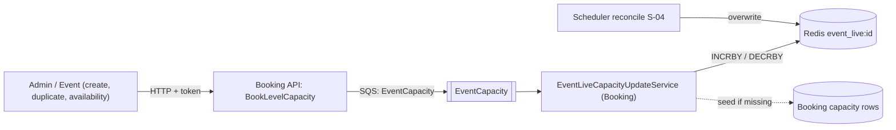

# S-02 · Event live capacity (EventCapacity queue)

> **Bangla name:** ইভেন্ট লাইভ ক্যাপাসিটি (EventCapacity কিউ)
>
> [← 50 · System-initiated](README.md) · [Contents](../README.md) · [Open queries](../99-open-queries.md)

## 1. Name and purpose

**Event live capacity.** For each event Redis keeps one number, `event_live:{eventId}`, the seats still available in the whole event. Every capacity change publishes a small message to the `EventCapacity` queue; the Booking worker `EventLiveCapacityUpdateService` applies it with an atomic Redis increment or decrement. Concepts: [queue-driven processing](../00-platform-primer.md#explainer-queue-driven), [Redis live capacity](../00-platform-primer.md#explainer-redis-live-capacity).

## 2. Trigger and actor

- **Producer:** Booking `CapacityManager.BookLevelCapacity`, on every call, for both **user** orders (at order creation) and **admin** actions ([S-01](S-01-level-capacity-update.md) step 1 and 3).
- **Consumer:** Booking service worker; no user, no token.

## 3. Business flow

Customers and admins see the remaining seats of an event. That total is kept in one counter so it can be read cheaply, instead of summing every level each time.

## 4. Technical flow

1. `BookLevelCapacity` publishes `EventLiveCapacityUpdate {EventId, Amount, IsIncrease, GroupId = eventId, OrderId}` **[SQS: EventCapacity]**. It is published after the user lock is written **or** the admin change is applied, so a user order decrements the event total **when the order is created**, while the level's live capacity falls only after payment ([S-01](S-01-level-capacity-update.md)).
2. `EventLiveCapacityUpdateService` **[Worker: 1 min start delay, then every 30 s; RedLock `event_capacity_updater_{0..19}`, expiry 30 s, no wait]** takes a random slot lock and runs `EventLiveCapacityUpdateTaskManager` once.
3. The task manager reads up to 10 messages (`WaitTimeSeconds` 0, visibility 30 s). For each message it calls `CapacityManager.GetEventLiveCapacity(eventId)` first, which **creates the counter from the database** (`GetEventCapacityCount`) when `event_live:{eventId}` does not exist, then runs `INCRBY` or `DECRBY` by `Amount`, then deletes the message. On an exception the message is kept and reappears after 30 s.
4. Readers: `GET /booking/api/v1/capacity/event-live-capacity?eventId=` returns the counter (the same method), and Admin calls it through `IBookingClient` when an event is created or duplicated, and Event when it works out an event's availability status, which seeds the counter if missing ([A-07](../10-admin-portal/A-07-events.md)).

## 5. Components

| Kind | Component |
|---|---|
| Services | Booking (producer, consumer, API); Admin and Event (seed through `IBookingClient`) |
| Queue | `EventCapacity` (`AWS:Queue:EventCapacity`) |
| Redis | `event_live:{eventId}` (string), locks `event_capacity_updater_{n}` |
| Tables | read of the Booking capacity rows to seed the counter |
| Code | `Services/Booking/ETP.Booking.Service/Workers/BackgroundServices/EventLiveCapacityUpdateService.cs`, `.../TaskManagers/EventLiveCapacityUpdateTaskManager.cs`, `Services/Booking/ETP.Booking.Domain/Managers/CapacityManager.cs:241-282` |

## 6. API contracts

| Method | Path | Auth | Request | Response |
|---|---|---|---|---|
| GET | `/booking/api/v1/capacity/event-live-capacity` | none (`CapacityController` has no `[Authorize]`, see [X-18](../60-cross-cutting/X-18-endpoints-without-auth.md)) | query `eventId` (long) | `int` |

Queue message (`Core/ETP.Core/Queue/Messages/EventLiveCapacityUpdate.cs`, `System.Text.Json` defaults):

```json
{ "EventId": 0, "Amount": 2, "IsIncrease": false, "GroupId": "101", "OrderId": "<order public id>" }
```

(`EventId` is declared but `BookLevelCapacity` does not set it; the consumer uses `GroupId`.)

## 7. Data and side effects

Redis only: `event_live:{eventId}` changes. The database is not written by this worker.

## 8. Code references

| What | Where |
|---|---|
| Producer | `rvl-gobcb-backend/Services/Booking/ETP.Booking.Domain/Managers/CapacityManager.cs:246-256` |
| Worker | `rvl-gobcb-backend/Services/Booking/ETP.Booking.Service/Workers/BackgroundServices/EventLiveCapacityUpdateService.cs:26-58` |
| Task manager | `rvl-gobcb-backend/Services/Booking/ETP.Booking.Service/Workers/TaskManagers/EventLiveCapacityUpdateTaskManager.cs:46-90` |
| Read and seed | `rvl-gobcb-backend/Services/Booking/ETP.Booking.Domain/Managers/CapacityManager.cs:270-282` |
| Endpoint | `rvl-gobcb-backend/Services/Booking/ETP.Booking.Service/Api/CapacityController.cs:66-76` |
| Seed callers | `rvl-gobcb-backend/Services/Admin/ETP.Admin.Domain/Managers/EventManager.cs:294` (`CreateAsync`), `:986` (`DuplicateAsync`); `Services/Event/ETP.Event.Domain/Managers/EventManager.cs:759` (`DetermineAvailabilityStatus`) |

## 9. Handover notes

1. **A failed or cancelled payment does not restore the event total through this queue.** The only publisher of `EventCapacity` is `BookLevelCapacity`, and releasing a lock (`ReleaseLockedCapacity`, expiry) only edits the `level_locked` hash. The event counter is corrected by the periodic reconcile in [S-04](S-04-scheduler-capacity-update.md), which re-sums the levels every 15 minutes.
2. **Comment and code disagree**: the worker's comment says "50 capacity updater services" can run at the same time, but the slot range is 0 to 19 (20 slots).
3. The task manager calls `GetEventLiveCapacity` for its side effect (create if missing) but ignores the returned value.
4. Same polling limits as [S-01](S-01-level-capacity-update.md): up to 10 messages per 30 s cycle per instance; no dead-letter handling is visible `[UNCONFIRMED: Q-09]`.

## 10. Component relationships



**Depends on:** [S-01](S-01-level-capacity-update.md) (same trigger), event creation ([A-07](../10-admin-portal/A-07-events.md)). **Affects:** the remaining-seats number on event pages ([P-02](../20-user-portal/P-02-browse-events.md)), [S-04](S-04-scheduler-capacity-update.md).

## 11. Developer test guide

**Local testability: Full.**

| Item | Detail |
|---|---|
| Test data and accounts | `pwsh ./scripts/Seed-EtpData.ps1`; user phone …11 for a booking, admin …01 for a capacity change |
| Browser | User portal `http://localhost:4201`: start a booking, then watch `event_live:*` change |
| Emulator | Not locally (known sign-in gap, `docs/mobile-local.md` §8) |
| Postman | `postman/services/etp-booking.postman_collection.json`: "GET /api/v1/capacity/event-live-capacity" (set `base_url` with the `/booking` prefix, see Appendix D) and the order-create request |
| Visual Studio debug | Breakpoint in `EventLiveCapacityUpdateTaskManager.ExecuteAsync` after the worker's 1-minute start delay |
| Verify | `redis-cli GET event_live:<eventId>`; SQS `ApproximateNumberOfMessages` on `EventCapacity` (`aws --endpoint-url http://localhost:4566 sqs get-queue-attributes ...`) |
