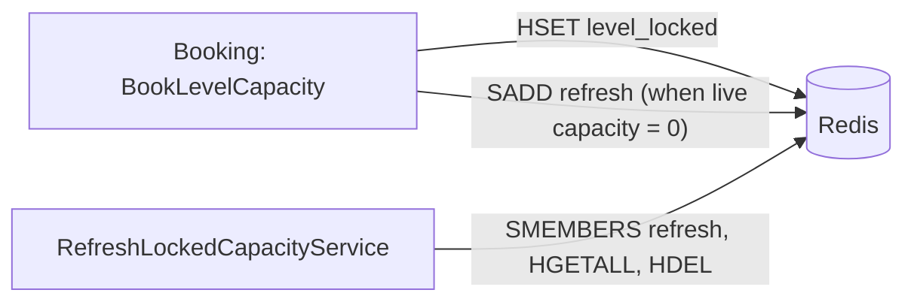

# S-03 · Locked-capacity refresh

> **Bangla name:** লকড ক্যাপাসিটি রিফ্রেশ
>
> [← 50 · System-initiated](README.md) · [Contents](../README.md) · [Open queries](../99-open-queries.md)

## 1. Name and purpose

**Locked-capacity refresh.** While a customer pays, the seats are held in a Redis hash `level_locked:{event}_{gallery}_{block}_{level}` for 12 minutes. The Booking worker `RefreshLockedCapacityService` is meant to clear expired holds on levels that were sold out when the hold was taken, so that the seats become bookable again. Concepts: [Redis live capacity](../00-platform-primer.md#explainer-redis-live-capacity), [background workers](../00-platform-primer.md#explainer-background-workers), [distributed locks](../00-platform-primer.md#explainer-distributed-locks).

## 2. Trigger and actor

- **Producer of work:** `CapacityManager.BookLevelCapacity` adds a key to the Redis set `refresh` when the level's live capacity is `0` after the booking step.
- **Consumer:** Booking worker, timer-driven; no user, no token.

## 3. Business flow

Unpaid orders must not keep seats forever. After 12 minutes a hold no longer counts, and the seats return to the pool. Normally this happens lazily on the next booking attempt for that level (see step 1); this worker is the safety net for levels where nobody tries again.

## 4. Technical flow

1. **Lazy clean-up (works).** Each call to `BookLevelCapacity` reads `level_locked:{...}`, deletes entries older than 12 minutes and counts only younger ones as locked (`CapacityManager.cs:100-110`).
2. **Marking.** At the end of `BookLevelCapacity`, if `liveLevelCapacity == 0` the code runs `SADD refresh {liveLevelCapacityKey}` (`CapacityManager.cs:256-260`).
3. **Worker** **[Worker: 1 min start delay; then lock `locked_order_refresher_{0..4}` with expiry 15 min and no wait; sleeps 30 min between runs, 5 min extra after an error]**: `RefreshLockedCapacityTaskManager` reads all members of `refresh`; for each key it takes the lock `refresh_level_locks_{key}` (expiry 30 s), reads the hash of that key as `LockedCapacity` entries, deletes entries older than 12 minutes, and, if it deleted any, removes the key from `refresh`.

## 5. Components

| Kind | Component |
|---|---|
| Services | Booking |
| Redis | `refresh` (set), `level_locked:*` (hash), locks `locked_order_refresher_{n}`, `refresh_level_locks_{key}` |
| Code | `Services/Booking/ETP.Booking.Service/Workers/BackgroundServices/RefreshLockedCapacityService.cs`, `.../TaskManagers/RefreshLockedCapacityTaskManager.cs`, `Services/Booking/ETP.Booking.Domain/Managers/CapacityManager.cs` |
| Config | `DistributedLock:Redis:*` ([X-26](../60-cross-cutting/X-26-configuration.md)) |

## 6. API contracts

None.

## 7. Data and side effects

Redis only (`level_locked:*` entries removed, `refresh` entries removed).

## 8. Code references

| What | Where |
|---|---|
| Loop | `rvl-gobcb-backend/Services/Booking/ETP.Booking.Service/Workers/BackgroundServices/RefreshLockedCapacityService.cs:26-58` |
| Work | `rvl-gobcb-backend/Services/Booking/ETP.Booking.Service/Workers/TaskManagers/RefreshLockedCapacityTaskManager.cs:30-62` |
| Marking | `rvl-gobcb-backend/Services/Booking/ETP.Booking.Domain/Managers/CapacityManager.cs:256-260` |
| Lazy clean-up | `rvl-gobcb-backend/Services/Booking/ETP.Booking.Domain/Managers/CapacityManager.cs:100-110` |

## 9. Handover notes

1. **The worker appears to act on the wrong key.** `BookLevelCapacity` stores `level_live:{...}` in `refresh`, but live capacity is a *field* of the hash `capacity`, not a Redis key of its own; the locked holds are in `level_locked:{...}`. The worker then calls `HGETALL` on the `level_live:{...}` key, which does not exist, so it finds nothing, deletes nothing, and never removes the entry from `refresh`. From the code the set only grows and the clean-up in step 1 is what actually works `[UNCONFIRMED: Q-10]`. Verify in a live Redis (`SMEMBERS refresh`, `TYPE level_live:...`).
2. **Run frequency is low**: one run every 30 minutes per instance, against a 12-minute hold.
3. The 12-minute constant is duplicated (`CapacityManager`, payment callback, this worker); keep them equal if you change it ([S-01](S-01-level-capacity-update.md)).
4. `ReservationStatusUpdateService` is a different worker class that is not registered ([Appendix A](../90-appendix-a-legacy.md)).

## 10. Component relationships

**Depends on:** [S-01](S-01-level-capacity-update.md). **Affects:** seat availability on sold-out levels ([P-04](../20-user-portal/P-04-seat-selection.md)).

## 11. Developer test guide

**Local testability: Full.**

| Item | Detail |
|---|---|
| Test data and accounts | `pwsh ./scripts/Seed-EtpData.ps1`; user …11 |
| Browser | User portal: book the last seat of a level and abandon the payment |
| Emulator | Not locally (known sign-in gap) |
| Postman | `etp-booking` collection: create-order request without completing payment |
| Visual Studio debug | Breakpoint in `RefreshLockedCapacityTaskManager.ExecuteAsync`; the first run comes 1 minute after the service starts and later runs 30 minutes apart, so restart the service to trigger it again |
| Verify | `redis-cli SMEMBERS refresh`; `redis-cli HGETALL level_locked:<e>_<g>_<b>_<l>`; `redis-cli TYPE level_live:<e>_<g>_<b>_<l>` (expect `none`, which supports note 1) |
