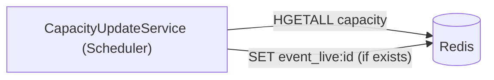

# S-04 · Scheduler capacity reconcile

> **Bangla name:** Scheduler ক্যাপাসিটি রিকনসাইল
>
> [← 50 · System-initiated](README.md) · [Contents](../README.md) · [Open queries](../99-open-queries.md)

## 1. Name and purpose

**Scheduler capacity reconcile.** Every 15 minutes the Scheduler service recalculates each event's live capacity as the **sum of its levels' live capacities** and writes it over `event_live:{eventId}`. It corrects drift left by the queue-based updates in [S-02](S-02-event-live-capacity.md). Concepts: [Redis live capacity](../00-platform-primer.md#explainer-redis-live-capacity), [background workers](../00-platform-primer.md#explainer-background-workers), [distributed locks](../00-platform-primer.md#explainer-distributed-locks).

## 2. Trigger and actor

A timer in the Scheduler service (`CapacityUpdateService`); no user, no token. It does not call any other service; it only reads and writes Redis.

## 3. Business flow

The "seats left" number of an event should match its levels. Because a user order lowers the event total at order creation while the level total falls only after payment, abandoned and failed orders leave the event total too low until this job runs.

## 4. Technical flow

**[Worker: 1 min start delay, then every 15 min; RedLock `event_live_capacity_refresher`, expiry 15 min, no wait; extra 15 min delay after an error]**

1. `CapacityUpdateService` takes the lock; if it gets it, `CapacityUpdateTaskManager.ExecuteAsync` runs once.
2. Read the whole Redis hash `capacity` (`HGETALL`). Entries whose value is not an integer are skipped with a warning (the live-seat strings are in the same hash and trigger this warning on every run).
3. Keep keys that split on `_` into exactly 5 parts (`level_live:{event}_{gallery}_{block}_{level}`); the second part (`live:{event}`) names the event, so the target key is `event_live:{event}`. Sum the level values per event.
4. For each target key that **already exists** (`EXISTS`), overwrite it with the sum (`SET`). Missing keys are not created.

## 5. Components

| Kind | Component |
|---|---|
| Services | Scheduler |
| Redis | hash `capacity`, strings `event_live:{eventId}`, lock `event_live_capacity_refresher` |
| Code | `Services/Scheduler/ETP.Scheduler.Service/Workers/BackgroundServices/CapacityUpdateService.cs`, `.../TaskManagers/CapacityUpdateTaskManager.cs` |
| Config | `Cache:Redis:*`, `DistributedLock:Redis:*` ([X-26](../60-cross-cutting/X-26-configuration.md)) |

## 6. API contracts

None.

## 7. Data and side effects

Redis only: `event_live:{eventId}` overwritten. No database access.

## 8. Code references

| What | Where |
|---|---|
| Loop | `rvl-gobcb-backend/Services/Scheduler/ETP.Scheduler.Service/Workers/BackgroundServices/CapacityUpdateService.cs:26-52` |
| Work | `rvl-gobcb-backend/Services/Scheduler/ETP.Scheduler.Service/Workers/TaskManagers/CapacityUpdateTaskManager.cs:19-70` |
| Registration | `rvl-gobcb-backend/Services/Scheduler/ETP.Scheduler.Service/Configurations/DependencyConfig.cs:63` |

## 9. Handover notes

1. **It overwrites with an unsynchronised value.** The job does not take the per-level booking locks, and the queue worker of [S-02](S-02-event-live-capacity.md) can apply a decrement between the read and the write. The next run corrects any difference.
2. **Only live level capacity is summed**, not locked holds, and the event total is therefore the "free seats" number without subtracting seats currently held by unpaid orders; contrast with the order-creation decrement of S-02.
3. The key parsing depends on the string format `level_live:{e}_{g}_{b}_{l}` (exactly four numbers); a format change breaks it silently (keys that do not match are ignored).
4. The service's comment says it updates "booking status pending/failed to cancel" (copied from [S-05](S-05-pending-failed-revalidation.md)); it does not.
5. Because it only updates existing `event_live` keys, an event that nobody has read yet is not touched.

## 10. Component relationships

**Depends on:** [S-01](S-01-level-capacity-update.md), [S-02](S-02-event-live-capacity.md). **Affects:** the remaining-seats number on event pages ([P-02](../20-user-portal/P-02-browse-events.md)).

## 11. Developer test guide

**Local testability: Full.** Scheduler runs on port 5106 under Aspire.

| Item | Detail |
|---|---|
| Test data and accounts | `pwsh ./scripts/Seed-EtpData.ps1` |
| Browser | None (no endpoint); check the effect on an event page in the user portal |
| Emulator | — |
| Postman | None (no endpoint) |
| Visual Studio debug | Start Scheduler and set a breakpoint in `CapacityUpdateTaskManager.ExecuteAsync`; the first run is 1 minute after start, then every 15 minutes |
| Verify | `redis-cli HGETALL capacity` and `redis-cli GET event_live:<id>`; Scheduler logs `Invalid Redis value for key ...` for the seat keys |
