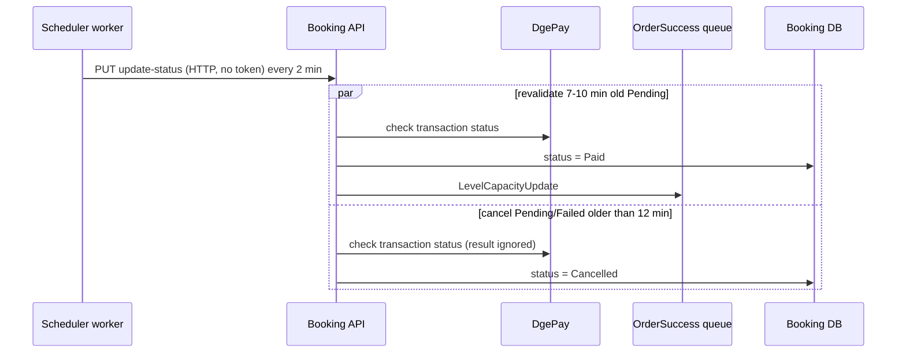

# S-05 · Pending/failed payment revalidation

> **Bangla name:** পেন্ডিং/ব্যর্থ পেমেন্ট পুনঃযাচাই
>
> [← 50 · System-initiated](README.md) · [Contents](../README.md) · [Open queries](../99-open-queries.md)

## 1. Name and purpose

**Pending/failed payment revalidation.** Every 2 minutes the Scheduler calls the Booking service, which (a) re-checks recently pending orders with the payment gateway DgePay and marks the paid ones, and (b) cancels orders that stayed `Pending` or `Failed` for more than 12 minutes. This covers customers who paid but whose callback never arrived, and orders that were abandoned. Concepts: [background workers](../00-platform-primer.md#explainer-background-workers), [token forwarding](../00-platform-primer.md#explainer-token-forwarding) (here: no token), [distributed locks](../00-platform-primer.md#explainer-distributed-locks).

## 2. Trigger and actor

Timer in the Scheduler (`PendingOrFailedBookingStatusUpdateService`); calls Booking `PUT /booking/api/v1/user-booking-order/update-status` without a token **[HTTP, no token / internal]**.

## 3. Business flow

An order is created as `Pending` and the customer has 12 minutes to pay. If the DgePay callback does not arrive, the platform asks DgePay for the transaction status between 7 and 10 minutes after creation and completes the order if it is paid. After 12 minutes an order that is still `Pending` or `Failed` is cancelled.

## 4. Technical flow

1. **[Worker: 1 min start delay, then every 2 min; RedLock `pending_cancel_booking_status_updater`, expiry 2 min, no wait; extra 2 min after an error]** `PendingOrFailedBookingStatusUpdateTaskManager` computes `cutoffTime = UtcNow - 12 min` and calls `IBookingClient.UpdatePendingOrFailedBookingStatusToCancelAsync` → `PUT /booking/api/v1/user-booking-order/update-status` with body `{ "CutoffTime": "<UTC time>" }`.
2. The endpoint (no `[Authorize]`; the comment says "don't expose to gateway") starts **two tasks in parallel**, each in its own DI scope:
   - **`RevaildateRecentPendingBookingsAsync`**: loads orders with status `Pending` created between `cutoff + 2 min` and `cutoff + 5 min` (that is 10 to 7 minutes ago). For each, `dgePayPaymentManager.GetPaymentStatus(PaymentTransactionId)` asks DgePay; if the gateway says `Paid`, the order becomes `Paid`, the payment info is stored, an `OrderSuccess` message is published **[SQS: OrderSuccess]** ([S-01](S-01-level-capacity-update.md)) and the change is saved. Any exception skips that order silently.
   - **`CancelBookingAsync`**: loads orders with status `Pending` or `Failed` created before `cutoff`. For each it asks DgePay for the status, stores the returned payment info, sets `Cancelled` and `CancelledAt = now`, and saves. The gateway's paid/failed result is **discarded** (`var (_, paymentInfo)`).
3. The two tasks are awaited together and the endpoint returns `true`.

## 5. Components

| Kind | Component |
|---|---|
| Services | Scheduler (timer), Booking (logic) |
| External | DgePay `check_transaction_status` ([P-06](../20-user-portal/P-06-booking-payment.md)) |
| Queue | `OrderSuccess` |
| Tables | `UserBookingOrder` (`Status`, `PaymentInfo`, `CancelledAt`) |
| Redis | lock `pending_cancel_booking_status_updater`; DgePay auth token cache `dgepay_auth_token` |
| Code | `Services/Scheduler/ETP.Scheduler.Service/Workers/*/PendingOrFailedBookingStatusUpdate*.cs`, `Core/ETP.Core/ServiceClient/BookingClient/BookingClient.cs:196`, `Services/Booking/ETP.Booking.Service/Api/UserBookingOrderController.cs:392-417`, `Services/Booking/ETP.Booking.Domain/Managers/UserBookingOrderManager.cs:1044-1140` |

## 6. API contracts

| Method | Path | Auth | Request | Response |
|---|---|---|---|---|
| PUT | `/booking/api/v1/user-booking-order/update-status` | none | `UpdateBookingStatusRequest { cutoffTime }` | `true` |

```json
{ "CutoffTime": "2026-10-22T10:48:00Z" }
```

(the Scheduler sends the property as `CutoffTime`; the value is illustrative.) Order statuses: `Pending`, `Paid`, `Failed`, `Cancelled`, and the later `Requested`, `Generated`.

## 7. Data and side effects

- `UserBookingOrder`: status to `Paid` or `Cancelled`, `PaymentInfo`, `CancelledAt`.
- Queue message `OrderSuccess` for orders found paid.
- Locked seats are **not** released here; they lapse by the 12-minute rule ([S-03](S-03-locked-capacity-refresh.md)).

## 8. Code references

| What | Where |
|---|---|
| Worker loop | `rvl-gobcb-backend/Services/Scheduler/ETP.Scheduler.Service/Workers/BackgroundServices/PendingOrFailedBookingStatusUpdateService.cs:26-52` |
| Task manager | `rvl-gobcb-backend/Services/Scheduler/ETP.Scheduler.Service/Workers/TaskManagers/PendingOrFailedBookingStatusUpdateTaskManager.cs:24-39` |
| Client | `rvl-gobcb-backend/Core/ETP.Core/ServiceClient/BookingClient/BookingClient.cs:196-210` |
| Endpoint | `rvl-gobcb-backend/Services/Booking/ETP.Booking.Service/Api/UserBookingOrderController.cs:392-417` |
| Revalidate and cancel | `rvl-gobcb-backend/Services/Booking/ETP.Booking.Domain/Managers/UserBookingOrderManager.cs:1044-1112` |

## 9. Handover notes

1. **Cancelling ignores the gateway result.** `CancelBookingAsync` asks DgePay but throws the status away and sets `Cancelled` for every `Pending` or `Failed` order older than 12 minutes. A customer who paid after the 7-10 minute check window (or whose check failed) can end with a cancelled order and a successful payment. Whether this is reconciled by hand is not visible in the repository `[UNCONFIRMED: Q-11]`.
2. **The revalidation window is only 3 minutes wide** (7 to 10 minutes after creation) and runs every 2 minutes, so an order is looked at once or twice; a gateway error skips it silently (`catch { continue; }`).
3. **A late callback is ignored too**: the DgePay callback does not update an order older than 12 minutes ([S-01](S-01-level-capacity-update.md) note 3).
4. **The endpoint is anonymous and expensive.** Anyone who can reach it can trigger a cancel run with any `cutoffTime` (for example the current time, which would cancel every `Pending` or `Failed` order, including ones created seconds ago, as long as DgePay answers). It must not be exposed through the gateway ([X-18](../60-cross-cutting/X-18-endpoints-without-auth.md) category C; architecture §2.3 B).
5. The two tasks run in parallel and can touch the same order only if its creation time falls in both ranges, which the ranges prevent; there is no lock between them.
6. `Failed` orders are cancelled after 12 minutes, but a `Failed` status can come from the callback or the bypass handler ([P-06](../20-user-portal/P-06-booking-payment.md)).
7. **Cancelling depends on DgePay being reachable.** `GetPaymentStatus` runs before the status is changed; if DgePay is down or returns a non-200 reply (after 2 retries, 3 s apart, 5 s timeout), the exception skips the order, and it stays `Pending` until a later run succeeds.

## 10. Component relationships



**Depends on:** order creation and payment ([P-06](../20-user-portal/P-06-booking-payment.md)). **Affects:** [S-01](S-01-level-capacity-update.md), [S-06](S-06-booking-status-generated.md), my bookings ([P-07](../20-user-portal/P-07-my-bookings.md)).

## 11. Developer test guide

**Local testability: Partial.** The worker and endpoint run; DgePay is dummy locally (`docs/local-dev.md`), so `GetPaymentStatus` cannot succeed (it throws `ArgumentException("Unknown error occurred in DGePay")` on any non-200 reply). Because the call sits inside `try { ... } catch { continue; }`, revalidation does nothing and `CancelBookingAsync` also skips each order, so locally orders stay `Pending` (see note 7).

| Item | Detail |
|---|---|
| Test data and accounts | `pwsh ./scripts/Seed-EtpData.ps1`; a `Pending` order from the booking flow |
| Browser | User portal: start a booking and do not pay; after 12 minutes check "my bookings" |
| Emulator | Not locally (known sign-in gap) |
| Postman | `postman/services/etp-booking.postman_collection.json`: "PUT /api/v1/user-booking-order/update-status" with `{"CutoffTime": "<time>"}` (no token needed) |
| Visual Studio debug | Breakpoints: `PendingOrFailedBookingStatusUpdateTaskManager.ExecuteAsync` (Scheduler), then `UserBookingOrderManager.RevaildateRecentPendingBookingsAsync` and `CancelBookingAsync` (Booking); start both services |
| Verify | SQL on the booking order table: `Status`, `CancelledAt`; Aspire logs of both services |
