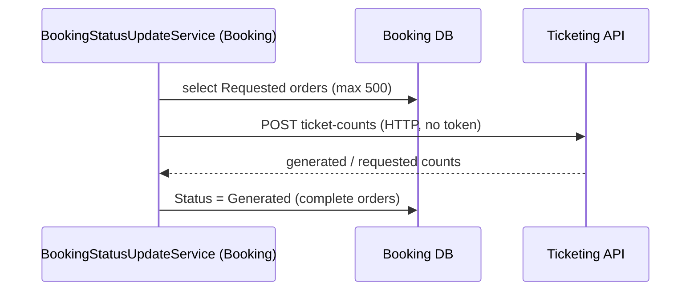

# S-06 · Booking status → Generated

> **Bangla name:** বুকিং স্ট্যাটাস → Generated
>
> [← 50 · System-initiated](README.md) · [Contents](../README.md) · [Open queries](../99-open-queries.md)

## 1. Name and purpose

**Booking status to Generated.** After a customer asks for their tickets, an order is in status `Requested`. This Booking worker, every 2 minutes, asks Ticketing how many tickets exist for those orders and moves the orders whose tickets are all generated to `Generated`. The status is what the customer's "my bookings" screen polls to know that tickets are ready. Concepts: [background workers](../00-platform-primer.md#explainer-background-workers), [token forwarding](../00-platform-primer.md#explainer-token-forwarding) (here: no token).

## 2. Trigger and actor

Timer in the Booking service (`BookingStatusUpdateService`); calls Ticketing over HTTP without a token **[HTTP, no token / internal]**.

## 3. Business flow

Order life: `Pending` → `Paid` → (customer requests tickets) `Requested` → (all tickets signed) `Generated`. The customer sees a "tickets ready" state only after `Generated` ([P-07](../20-user-portal/P-07-my-bookings.md), [P-08](../20-user-portal/P-08-ticket-generation-request.md)).

## 4. Technical flow

**[Worker: 1 min start delay, then every 2 min; RedLock `booking_status_updater`, expiry 2 min, no wait]**

1. `BookingStatusUpdateTaskManager` takes the lock, then `GetRequestedBookingsAsync` selects up to **500** orders with `Status == Requested` (the date range arguments are ignored; the date condition is commented out in the repository).
2. `ITicketingClient.GetTicketsCountAsync(ids, onlyGenerated: true, createdBy: "user")` → `POST /ticketing/api/v1/booking-order-ticket/ticket-counts?createdBy=user` with the list of booking ids **[HTTP, no token / internal]**. Ticketing answers a dictionary `bookingId → { generatedCount, requestedCount }`.
3. Orders where `generatedCount == NumberOfSeats` are updated in one statement: `UPDATE ... SET Status = Generated WHERE Id IN (...) AND Status = Requested` (`ExecuteUpdateAsync`).
4. Any exception is logged and the manager waits 1 minute and tries again.

The status change is also what the [ticket-generated notification](S-12-ticket-generated-notification.md) uses: S-12 selects orders that are `Generated` and not yet notified.

## 5. Components

| Kind | Component |
|---|---|
| Services | Booking (worker, data), Ticketing (counts) |
| Tables | `UserBookingOrder.Status`; Ticketing tickets (read) |
| Redis | lock `booking_status_updater` |
| Code | `Services/Booking/ETP.Booking.Service/Workers/BackgroundServices/BookingStatusUpdateService.cs`, `.../TaskManagers/BookingStatusUpdateTaskManager.cs`, `Services/Booking/ETP.Booking.Storage/Repositories/UserBookingOrderRepository.cs:97-127`, `Core/ETP.Core/ServiceClient/TicketingClient/TicketingClient.cs:83` |

## 6. API contracts

| Method | Path | Auth | Request | Response |
|---|---|---|---|---|
| POST | `/ticketing/api/v1/booking-order-ticket/ticket-counts?onlyGenerated=true&createdBy=user` | none | JSON array of booking ids (`[12, 13]`) | `{ "<bookingId>": { "generatedCount": n, "requestedCount": n } }` |

(the shape comes from `TicketCount` in `BookingOrderTicketController.cs:126-139`; the id values are examples). The endpoint has no `[Authorize]` ([X-18](../60-cross-cutting/X-18-endpoints-without-auth.md) category C).

## 7. Data and side effects

`UserBookingOrder.Status` goes from `Requested` to `Generated` for completed orders.

## 8. Code references

| What | Where |
|---|---|
| Loop | `rvl-gobcb-backend/Services/Booking/ETP.Booking.Service/Workers/BackgroundServices/BookingStatusUpdateService.cs:22-33` |
| Work | `rvl-gobcb-backend/Services/Booking/ETP.Booking.Service/Workers/TaskManagers/BookingStatusUpdateTaskManager.cs:28-62` |
| Queries | `rvl-gobcb-backend/Services/Booking/ETP.Booking.Storage/Repositories/UserBookingOrderRepository.cs:97-106, 121-127` |
| Ticket counts | `rvl-gobcb-backend/Services/Ticketing/ETP.Ticketing.Service/Api/BookingOrderTicketController.cs:126-139` |
| Client | `rvl-gobcb-backend/Core/ETP.Core/ServiceClient/TicketingClient/TicketingClient.cs:83-110` |

## 9. Handover notes

1. **Only the first 500 `Requested` orders are examined per run**, in no defined order (no `OrderBy`). If more than 500 stay `Requested`, some wait; and orders whose tickets are not complete are examined again every run and use up the 500.
2. A partial order stays `Requested` until all seats have tickets; there is no timeout or alert for orders stuck in `Requested` `[UNCONFIRMED: Q-12]`.
3. The success log prints `bookingIds.Count` (orders examined), not the number updated.
4. The date-range parameters of `GetRequestedBookingsAsync` are accepted but unused (the filter is commented out); the interface suggests a time window that does not exist.
5. Two instances of Booking can run this loop at once; the lock `booking_status_updater` and the guarded `UPDATE ... WHERE Status = Requested` keep it safe.

## 10. Component relationships

**Depends on:** [S-07](S-07-initiate-user-ticket-generation.md) and [S-08](S-08-ticket-signing.md) (tickets exist). **Affects:** [P-07](../20-user-portal/P-07-my-bookings.md), [S-12](S-12-ticket-generated-notification.md), [S-10](S-10-vat-challan.md) (VAT runs on paid orders, independently).

## 11. Developer test guide

**Local testability: Partial.** The worker and Ticketing run locally; real ticket signing needs the TSP (dummy), so orders do not reach `Generated` unless signing is simulated `[UNCONFIRMED: Q-06]`.

| Item | Detail |
|---|---|
| Test data and accounts | `pwsh ./scripts/Seed-EtpData.ps1` may include orders; user …11 |
| Browser | User portal: my bookings; the generation status is polled ([P-07](../20-user-portal/P-07-my-bookings.md)) |
| Emulator | Not locally (known sign-in gap) |
| Postman | `postman/services/etp-ticketing.postman_collection.json` "POST /api/v1/booking-order-ticket/ticket-counts" with body `[<id>]` |
| Visual Studio debug | Breakpoint in `BookingStatusUpdateTaskManager.ExecuteAsync` (Booking) and `GetTicketCountsAsync` (Ticketing) |
| Verify | SQL: count of orders by `Status` in the booking order table; Aspire logs "Booking status: Updated N bookings to generated" |
