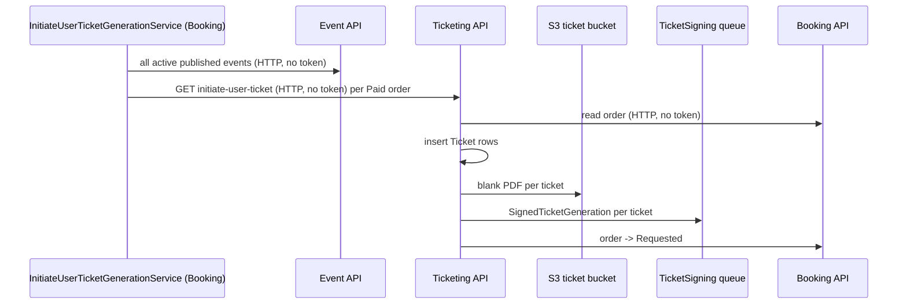

# S-07 · Initiate user ticket generation

> **Bangla name:** ইউজার টিকিট জেনারেশন শুরু করা
>
> [← 50 · System-initiated](README.md) · [Contents](../README.md) · [Open queries](../99-open-queries.md)

## 1. Name and purpose

**Initiate user ticket generation.** A paid order only becomes tickets when somebody asks Ticketing to create them. Customers can ask from the portal or app ([P-08](../20-user-portal/P-08-ticket-generation-request.md)); this Booking worker does it automatically for paid orders that nobody has asked for. It creates the ticket rows, renders a blank PDF per ticket, stores it in S3 and puts one signing job per ticket on the `TicketSigning` queue ([S-08](S-08-ticket-signing.md)). Concepts: [background workers](../00-platform-primer.md#explainer-background-workers), [queue-driven processing](../00-platform-primer.md#explainer-queue-driven), [distributed locks](../00-platform-primer.md#explainer-distributed-locks).

## 2. Trigger and actor

Timer in the Booking service (`InitiateUserTicketGenerationService`). The same Ticketing call `initiate-user-ticket` is also made right away from the DgePay callback when a payment is confirmed (`UserBookingOrderManager.HandleDgePayment`, about line 388; a failure there is only logged), so the worker mainly catches orders for which that call did not happen or failed. It calls the Event service and the Ticketing service over HTTP without a token **[HTTP, no token / internal]**.

## 3. Business flow

When ticket sales for an event have opened (`TicketAvailabilityStartDateTime` passed), every `Paid` order of that event gets tickets, whether or not the customer opens the app. Tickets are numbered `{TicketNumberPrefix}{unique code}` and carry the holder name and phone given at booking.

## 4. Technical flow

1. **[Worker: first run 10 min after start, then every 15 min; RedLock `user_ticket_generator_{eventId}`, expiry 12 min, no wait]** `InitiateUserTicketGenerationTaskManager.ExecuteAsync` asks `IEventClient.GetAllActivePublishedEvents()` for all active, published events and keeps those whose `TicketAvailabilityStartDateTime` is not in the future.
2. For each such event it takes the lock and loads up to **200** orders with status `Paid` for that event (`GetPaidBookingsAsync`).
3. For every order it calls `ITicketingClient.InitiateUserTicket(publicId)` → `GET /ticketing/api/v1/booking-order-ticket/initiate-user-ticket?orderId={publicId}` **[HTTP, no token / internal]**.
4. Ticketing `TicketManager.InitiateUserTicket`: reads the order from Booking (**[HTTP, no token]** `IBookingClient`); requires status `Paid` or `Requested`; for `Paid` it takes the lock `create_user_ticket_{orderId}` (30 s) and
   - if no ticket exists, **`InitiateBulkTicketForNewlyPaidOrder`** inserts one `Ticket` per seat (status `Active`, type `User`, number from `eventSettings.TicketNumberPrefix` + a unique code, holder from the booking's user records);
   - then **`TicketGenerateRequest`**: renders the blank PDF per ticket (`GetBlankPdf`) and uploads it to `{BlankBase}/user/{userId}/{orderPublicId}/{ticketNumber}.pdf` in the ticket bucket ([X-20](../60-cross-cutting/X-20-file-storage.md)), sets the ticket to `Requested`, publishes one `SignedTicketGeneration` message per ticket **[SQS: TicketSigning]** (QR position by layout size, fields such as `Platform=user-ticket`, name, phone, date, ticket id, gallery, block, level, gates, seat), and tells Booking to move the order to `Requested` (**[HTTP, no token]** `IBookingClient.TicketGenerateRequest`).
5. [S-08](S-08-ticket-signing.md) signs the tickets; [S-06](S-06-booking-status-generated.md) moves the order to `Generated`.

The same Ticketing code path is reached from the customer button: `PATCH /ticketing/api/v1/booking-order-ticket/generate-request/{publicId}` runs `TicketGenerateRequest` directly ([P-08](../20-user-portal/P-08-ticket-generation-request.md)).

## 5. Components

| Kind | Component |
|---|---|
| Services | Booking (worker), Event (list of events), Ticketing (creation), Admin/Event data for venue and layout |
| Queue | `TicketSigning` |
| Tables | Booking order (`Status`), Ticketing `Tickets` (`TicketNumber`, `Status`, `BlankTicketUrl`, `BackPageTicketUrl`) |
| Storage | S3 ticket bucket (blank PDFs), templates ([X-20](../60-cross-cutting/X-20-file-storage.md)) |
| Redis | locks `user_ticket_generator_{eventId}`, `create_user_ticket_{orderId}` |
| Code | `Services/Booking/ETP.Booking.Service/Workers/*/InitiateUserTicketGeneration*.cs`, `Services/Ticketing/ETP.Ticketing.Domain/Managers/TicketManager.cs:79-143, 261-356, 2105-2133` |

## 6. API contracts

| Method | Path | Auth | Request | Response |
|---|---|---|---|---|
| GET | `/ticketing/api/v1/booking-order-ticket/initiate-user-ticket?orderId=` | none | query `orderId` (Guid) | `UserBooking` of the order |
| GET | `/ticketing/api/v1/booking-order-ticket/initiate?orderId=` | none | query `orderId` | `200` empty; creates tickets only (`InitiateBulkTicketForNewlyPaidOrder`) |
| PATCH | `/ticketing/api/v1/booking-order-ticket/generate-request/{publicId}` | none | path | order with its tickets |

Queue message `SignedTicketGeneration`: `FileName`, `GateId`, `OrderId` (the ticket id), `QRPosition` (3 numbers), `UnsignedTicketUrl`, `Data` (dictionary of `label`/`value` fields). See [S-08](S-08-ticket-signing.md) for the consumer.

## 7. Data and side effects

- New `Ticket` rows; blank PDFs in S3; one message per ticket on `TicketSigning`; the order status moves `Paid` → `Requested`.
- Heavy work: one PDF render and one S3 upload per ticket, run inside the HTTP call.

## 8. Code references

| What | Where |
|---|---|
| Loop | `rvl-gobcb-backend/Services/Booking/ETP.Booking.Service/Workers/BackgroundServices/InitiateUserTicketGenerationService.cs:21-36` |
| Work | `rvl-gobcb-backend/Services/Booking/ETP.Booking.Service/Workers/TaskManagers/InitiateUserTicketGenerationTaskManager.cs:42-120` |
| Endpoints | `rvl-gobcb-backend/Services/Ticketing/ETP.Ticketing.Service/Api/BookingOrderTicketController.cs:37-64, 112-117` |
| Ticket creation | `rvl-gobcb-backend/Services/Ticketing/ETP.Ticketing.Domain/Managers/TicketManager.cs:79-143` |
| Generation request | `rvl-gobcb-backend/Services/Ticketing/ETP.Ticketing.Domain/Managers/TicketManager.cs:261-356` |
| Client | `rvl-gobcb-backend/Core/ETP.Core/ServiceClient/TicketingClient/TicketingClient.cs:40-54` |

## 9. Handover notes

1. **Probable busy loop when no event qualifies.** In `ExecuteAsync`, if no active published event has started ticketing, the code logs "No active and published events available for ticketing." and runs `continue` inside the `while` loop, which skips the 15-minute `Task.Delay` at the end of the loop body, so the loop repeats immediately. Check the Booking logs for that message repeating; this is read from the code, not observed `[UNCONFIRMED: Q-12]`.
2. **Dead code in the task manager.** `ProcessVatInvoice` and its injected dependencies (NBR manager, notification client, event data) are not called from this class; VAT is done by [S-10](S-10-vat-challan.md).
3. **Idempotence.** `InitiateBulkTicketForNewlyPaidOrder` called on its own throws "Ticket is already generated." if tickets exist; `InitiateUserTicket` avoids that by checking for existing tickets first. A repeated call after the order is `Requested` does nothing more.
4. **Anonymous endpoints.** `initiate`, `initiate-user-ticket` and `generate-request/{publicId}` have no `[Authorize]`; anyone who knows an order's public id can trigger generation ([X-18](../60-cross-cutting/X-18-endpoints-without-auth.md)). Combined with the anonymous `payment-status-bypass` ([S-01](S-01-level-capacity-update.md)) this lets an unpaid order become tickets.
5. **Lock expiry shorter than the work.** The per-event lock expires after 12 minutes, while up to 200 orders are processed one after the other with PDF rendering; if the run takes longer, a second instance could start the same event (the per-order lock `create_user_ticket_*` and the existing-ticket check limit the damage).
6. Orders are processed in database order without sorting; with more than 200 `Paid` orders per event, the rest wait for the next run.
7. The 10-minute first-run delay means the automatic path never runs in the first 10 minutes after a Booking restart.

## 10. Component relationships

**Depends on:** paid orders ([P-06](../20-user-portal/P-06-booking-payment.md), [S-05](S-05-pending-failed-revalidation.md)), ticket layouts ([A-13](../10-admin-portal/A-13-ticket-layouts.md)), event settings with `TicketNumberPrefix` ([A-08](../10-admin-portal/A-08-event-settings.md)). **Affects:** [S-08](S-08-ticket-signing.md), [S-06](S-06-booking-status-generated.md), [P-07](../20-user-portal/P-07-my-bookings.md), [P-09](../20-user-portal/P-09-ticket-details-downloads.md).

## 11. Developer test guide

**Local testability: Partial.** Tickets and blank PDFs are created locally (S3 in Floci); the signing step needs the TSP, which is dummy ([S-08](S-08-ticket-signing.md)).

| Item | Detail |
|---|---|
| Test data and accounts | `pwsh ./scripts/Seed-EtpData.ps1`; a `Paid` order of an event whose `TicketAvailabilityStartDateTime` is past |
| Browser | User portal: my bookings → generate tickets; Network shows `PATCH .../generate-request/{id}` |
| Emulator | Not locally (known sign-in gap) |
| Postman | `postman/services/etp-ticketing.postman_collection.json`: "GET /api/v1/booking-order-ticket/initiate-user-ticket?orderId=" (no token needed) |
| Visual Studio debug | Booking: `InitiateUserTicketGenerationTaskManager.ExecuteAsync` (first run after 10 min); Ticketing: `TicketManager.InitiateUserTicket`, `TicketGenerateRequest` |
| Verify | SQL: rows in the Ticketing tickets table for the order, `Status = Requested`; `aws --endpoint-url http://localhost:4566 s3 ls s3://etp-local/blank/ --recursive`; SQS `TicketSigning` message count |
