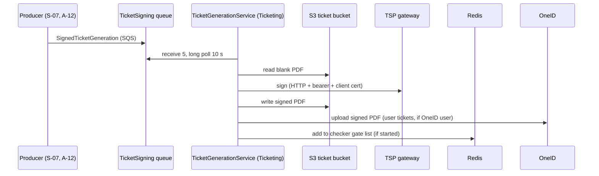

# S-08 · Ticket signing via TSP (TicketSigning queue)

> **Bangla name:** TSP-এর মাধ্যমে টিকিট সাইনিং (TicketSigning কিউ)
>
> [← 50 · System-initiated](README.md) · [Contents](../README.md) · [Open queries](../99-open-queries.md)

## 1. Name and purpose

**Ticket signing.** Each ticket PDF carries a QR code that the checker app verifies offline. The code is produced by a **trust service provider (TSP)** that signs the PDF and embeds a visible digital seal (VDS) QR. The Ticketing worker `TicketGenerationService` reads signing jobs from the `TicketSigning` queue, sends each blank PDF to the TSP gateway, stores the signed PDF in S3 and marks the ticket `Generated`. Concepts: [queue-driven processing](../00-platform-primer.md#explainer-queue-driven), [background workers](../00-platform-primer.md#explainer-background-workers), [distributed locks](../00-platform-primer.md#explainer-distributed-locks).

## 2. Trigger and actor

- **Producers:** Ticketing `TicketManager`: user tickets ([S-07](S-07-initiate-user-ticket-generation.md) and the customer button, `TicketGenerateRequest`) and reserved tickets (`PublishBulkTicketToSign`, `CreateReservationTicketsAsync`; [A-12](../10-admin-portal/A-12-reserved-tickets.md)).
- **Consumer:** Ticketing service worker; no user, no token.

## 3. Business flow

A customer's ticket is usable at the gate only when it is signed. Until then the ticket is `Requested` and the order is `Requested`; once all tickets of the order are `Generated` the order becomes `Generated` ([S-06](S-06-booking-status-generated.md)) and the customer can download.

## 4. Technical flow

**[Worker: first run 1 min after start, then continuous; RedLock `signed_ticket_generator_{0..9}`, expiry 1 min, no wait]** `TicketGenerationService` loops without a pause: take a random slot lock, run `TicketGenerationTaskManager` once, repeat. The task manager long-polls `TicketSigning` (`MaxNumberOfMessages` 5, `WaitTimeSeconds` 10, visibility 60 s); an empty reply waits 10 s and returns.

For each message (the 5 are handled **in parallel**) with a `SignedTicketGeneration` body:

1. `IsTicketSigned(OrderId)`: `OrderId` holds the **ticket id**. If already signed, delete the message and stop.
2. Download the blank PDF from S3 (`UnsignedTicketUrl`), base64-encode it, and build the `TicketSigningPayload`: `DigitalIdentityId` and `UserId` from `TSP:*`, one `Document { Data, FileName, VdsData { QrCodeData = Data, QrCodeSize, QrCodeXPosition, QrCodeYPosition } }` (position values from `QRPosition[0..2]`).
3. `TspSignedTicketProvider.GetSignedBase64TicketAsync` **[HTTP, static key / client certificate]**: `POST {TSP:SignUrl}`. The client adds a bearer token from `TspAuthProvider` (`GET {TSP:AuthUrl}` with the client certificate, cached in Redis as `tsp_token` for 1 minute). Failure when the status is not 2xx, or when `Data.SignedData` is empty.
4. `TicketManager.GenerateSignedTicketAsync(ticketId, signedBase64, complimentaryType, gateId)`:
   - **user ticket** (no `Complimentary` field): upload to `{SignedBase}/user/{createdBy}/{orderPublicId}/{ticketNumber}.pdf`;
   - **reserved ticket** (`Complimentary` field present): draw the ticket info on the PDF (`DrawTicketInfo`, using layout and ticket attributes) and upload to `{SignedBase}/reserved/{createdBy}/{orderPublicId}/{ticketNumber}-{type}.pdf`;
   - set the ticket to `Generated` with `SignedTicketUrl`;
   - **user tickets only:** if the order has a OneID user id, upload the signed PDF to OneID (`SyncDocumentWithVdsQrAsync`; the VDS QR argument is hard-coded `null`, marked TODO), and set `OneIdSync = true` on success; errors are logged and ignored ([P-10](../20-user-portal/P-10-oneid-ticket-sync.md));
   - if the ticket's gate is mapped and the checker download list for that gate already exists in Redis, add the ticket number to `ticket_checker_tickets:event_{e}_gate_{g}` so offline checkers get it on their next sync ([C-02](../40-checker-app/C-02-offline-ticket-download.md), [C-05](../40-checker-app/C-05-ticket-sync.md)).
5. Delete the message. On any exception the message is **not** deleted and returns after 60 s.

## 5. Components

| Kind | Component |
|---|---|
| Services | Ticketing |
| Queue | `TicketSigning` |
| External | TSP gateway (auth URL and sign URL), OneID document sync ([P-10](../20-user-portal/P-10-oneid-ticket-sync.md)) |
| Storage | S3 ticket bucket (blank in, signed out) |
| Tables | Ticketing `Tickets` (`Status`, `SignedTicketUrl`, `OneIdSync`, `OneIdSyncedAt`) |
| Redis | `signed_ticket_generator_{n}` locks, `tsp_token`, `ticket_checker_tickets:*`, `TicketCheckerLevelGateMap` |
| Code | `Services/Ticketing/ETP.Ticketing.Service/Workers/*`, `Services/Ticketing/ETP.Ticketing.Domain/TspClient/*`, `.../Managers/TicketManager.cs:375-513` |
| Config | `TSP:AuthUrl`, `TSP:SignUrl`, `TSP:UserId`, `TSP:DigitalIdentityId`, `AWS:Queue:TicketSigning`, `AWS:Ticket:*`; client certificate file `Cert/tspgw_client.pfx` ([X-26](../60-cross-cutting/X-26-configuration.md)) |

## 6. API contracts

No endpoint of its own. Queue message `SignedTicketGeneration` (`Core/ETP.Core/Queue/Messages`): `FileName`, `GateId`, `OrderId` (ticket id as text), `QRPosition` `[x, y, size]`, `UnsignedTicketUrl`, `Data` (map name → `{ Label, Value }`, for example `Platform`, `Name`, `Phone`, `Date`, `Time`, `Ticket ID`, `Event ID`, `Gallery`, `Block`, `Level`, `Entry Gate`, `Mini Gate`, optional `Seat`, and `Complimentary` for reserved tickets). For user tickets `TicketGenerateRequest` sets `QRPosition` to `[900, 650, 650]` (default and vertical layouts), `[1650, 915, 650]` (A4) or `[2494, 1055, 650]` (horizontal).

The TSP request and response bodies are in `TicketSigningPayload.cs` and `TspResponse` (`Data.Token`, `Data.SignedData[]`, `Code`, `Message`).

## 7. Data and side effects

Signed PDFs in S3, ticket rows updated, optional OneID upload, Redis checker list update. Orders move on through [S-06](S-06-booking-status-generated.md).

## 8. Code references

| What | Where |
|---|---|
| Loop | `rvl-gobcb-backend/Services/Ticketing/ETP.Ticketing.Service/Workers/BackgroundServices/TicketGenerationService.cs:27-52` |
| Message handling | `rvl-gobcb-backend/Services/Ticketing/ETP.Ticketing.Service/Workers/TaskManagers/TicketGenerationTaskManager.cs:46-128` |
| TSP client | `rvl-gobcb-backend/Services/Ticketing/ETP.Ticketing.Domain/TspClient/TspSignedTicketProvider.cs`, `TspAuthProvider.cs`, `TspTokenHandler.cs` |
| Client registration (certificate) | `rvl-gobcb-backend/Services/Ticketing/ETP.Ticketing.Service/Configurations/DependencyConfig.cs:177-225` |
| After-sign handling | `rvl-gobcb-backend/Services/Ticketing/ETP.Ticketing.Domain/Managers/TicketManager.cs:380-513` |
| Producers | `.../TicketManager.cs:346` (user), `:1421`, `:1520` (reserved) |

## 9. Handover notes

1. **The TSP client certificate is not in the repository.** The clients load `Cert/tspgw_client.pfx` from the service's output folder; no project or Dockerfile entry copies it, and no document says how it reaches the pod `[UNCONFIRMED: Q-13]`. Without it the Ticketing service fails when the TSP client is first created.
2. **Server certificate validation is switched off** for both TSP clients (`ServerCertificateCustomValidationCallback` returns `true`), so the connection is encrypted but the TSP's identity is not checked.
3. **Retries are blind and unbounded.** A failed signing leaves the message in the queue; it comes back after 60 s, forever, with no dead-letter handling visible `[UNCONFIRMED: Q-09]`. A ticket that can never be signed (for example a bad PDF) blocks one of five slots each cycle.
4. **Five signing calls in parallel, one per message**, and up to 10 lock slots, so throughput depends on TSP latency. The message waits in the queue otherwise.
5. **`OrderId` in this message is a ticket id**, not an order id (the producer sets `OrderId = ticket.Id`). On a FIFO queue this is also the de-duplication id ([S-01](S-01-level-capacity-update.md)).
6. **Signed user tickets lose the back page.** The user path uploads the signed PDF as is (the back-page merge is commented out: "skipping ticket back for now"); the back page is added when downloading or emailing (`GetUserTicketStreamAsync`, `GetZippedTicketStreamAsync`).
7. When a checker download list already exists for the ticket's gate, `GenerateSignedTicketAsync` waits two times 1 second before adding the ticket to it; the code gives no reason for the waits.
8. The `tsp_token` Redis key is shared by all Ticketing instances; with a 1-minute lifetime a busy system asks the TSP for a token about once a minute.

## 10. Component relationships

**Depends on:** [S-07](S-07-initiate-user-ticket-generation.md), ticket layouts ([A-13](../10-admin-portal/A-13-ticket-layouts.md)). **Affects:** [S-06](S-06-booking-status-generated.md), [P-09](../20-user-portal/P-09-ticket-details-downloads.md), the checker app ([C-03](../40-checker-app/C-03-qr-scan-validation.md)), [S-09](S-09-ticket-merge-zip.md) for reserved tickets.

## 11. Developer test guide

**Local testability: Partial / not locally for the real signing.** `TSP:AuthUrl` and `TSP:SignUrl` are `https://tsp.invalid/...`, and the certificate file is not provided, so signing cannot succeed locally; everything before it (ticket rows, blank PDFs, the queue message) can be tested (`docs/local-dev.md` lists TSP as dummy).

| Item | Detail |
|---|---|
| Test data and accounts | A `Paid` order; see [S-07](S-07-initiate-user-ticket-generation.md) |
| Browser | None directly |
| Emulator | — |
| Postman | Trigger via `GET /api/v1/booking-order-ticket/initiate-user-ticket?orderId=` in the `etp-ticketing` collection |
| Visual Studio debug | Breakpoint in `TicketGenerationTaskManager.ExecuteAsync`; the first poll is 1 minute after the service starts |
| Verify | `aws --endpoint-url http://localhost:4566 sqs receive-message --queue-url <TicketSigning url>` shows a pending job; the Ticketing log shows `Ticket generation: signing exception ...` when TSP is unreachable; SQL: ticket `Status` stays `Requested` |
