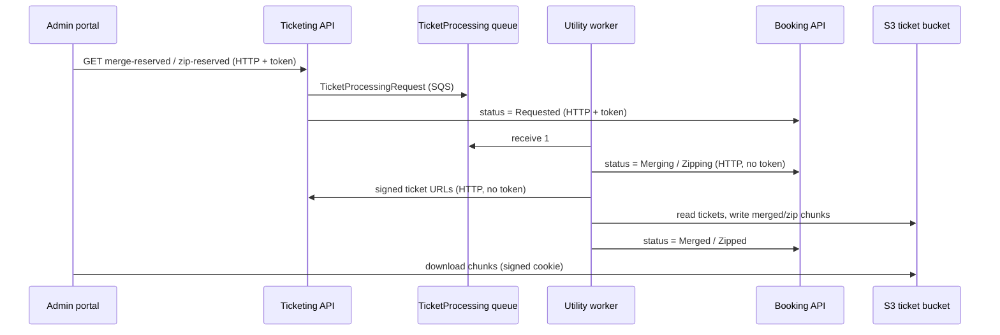

# S-09 · Reserved ticket merge/zip (TicketProcessing queue)

> **Bangla name:** রিজার্ভড টিকিট merge/zip (TicketProcessing কিউ)
>
> [← 50 · System-initiated](README.md) · [Contents](../README.md) · [Open queries](../99-open-queries.md)

## 1. Name and purpose

**Reserved ticket merge/zip.** A reservation (complimentary or partner tickets) can hold hundreds of signed tickets. The admin asks for them as merged PDFs (many tickets per PDF) or as zip files. The work is slow, so Ticketing puts a job on the `TicketProcessing` queue and the **Utility** service worker `TicketProcessingService` builds the files in S3, reporting progress to Booking. Concepts: [queue-driven processing](../00-platform-primer.md#explainer-queue-driven), [background workers](../00-platform-primer.md#explainer-background-workers), [distributed locks](../00-platform-primer.md#explainer-distributed-locks).

## 2. Trigger and actor

- **Producer:** an admin (**admin** pool) through Ticketing `GET /ticketing/api/v1/booking-order-ticket/merge-reserved?reservationId=` or `zip-reserved?reservationId=` ([A-12](../10-admin-portal/A-12-reserved-tickets.md)).
- **Consumer:** Utility service worker; no user, no token. Utility is the only service whose main job is this worker.

## 3. Business flow

After reserved tickets are signed, the admin chooses "merge" or "zip" for a reservation, waits while the status goes `Requested` → `Merging`/`Zipping` → `Merged`/`Zipped`, then downloads the chunks with the signed token and cookie ([X-20](../60-cross-cutting/X-20-file-storage.md)).

## 4. Technical flow

1. **Request** **[HTTP + user token]** `RequestMergeTicketsAsync` / `RequestZipTicketsAsync` check that every ticket of the reservation is signed (ticket count equals the reservation's `TicketCount`, else "Some tickets are not signed yet."), that the output file does not already exist, then publish `TicketProcessingRequest { ReservationId, ProcessingType = Merge | Zip, GroupId = "{id}_{type}", OrderId = "{id}_{type}" }` **[SQS: TicketProcessing]** and set the reservation's status to `Requested` in Booking (**[HTTP + user token]** `UpdateReservationMergeStatusAsync` / `UpdateReservationZipStatusAsync`).
2. **Worker** **[Worker: first run 1 min after start; the task manager then loops forever; RedLock `ticket_processing_service_{reservationId}`, expiry 1 hour]**: `TicketProcessingService` starts `TicketProcessingTaskManager`, which receives **one message at a time** (`MaxNumberOfMessages` 1; no wait time or visibility timeout set in the request, so the queue's defaults apply) and sleeps 10 s when the queue is empty. The outer loop only repeats (after 1 minute) if the task manager throws.
3. For each message: take the lock; `ShouldSkipProcessing` asks Booking for the current status and skips when it is already `Merged`/`Merging` (or `Zipped`/`Zipping`); else:
   - **Merge:** status `Merging` → `UtilityService.MergeTicketsAsync` → status `Merged`;
   - **Zip:** status `Zipping` → `UtilityService.ZipTicketsAsync` → status `Zipped`.
4. `MergeTicketsAsync` reads the signed ticket URLs from Ticketing (**[HTTP, no token]** `GetTicketUrlsAsync`), then for each chunk of `AWS:Ticket:MergeSize` tickets builds one PDF with PdfSharp (`PdfReader.Open` import of every page), saves it to a temp file and uploads `{MergeBase}/{reservationId}/{reservationNumber}_Merged_PDF_{i}.pdf`. Chunks that already exist in S3 are skipped, so a retry continues where it stopped. `ZipTicketsAsync` does the same with `ZipFile.CreateFromDirectory` and uploads `..._Individual_Zipped_{i}.zip`.
5. **Success** deletes the message. **Failure** sets the status to `Failed` in Booking and leaves the message (comment: "let it go to dead letter queue"). Failure to get the lock leaves the message for a later attempt.

## 5. Components

| Kind | Component |
|---|---|
| Services | Ticketing (request), Utility (worker), Booking (status) |
| Queue | `TicketProcessing` |
| Storage | S3 ticket bucket (`MergeBase/{reservationId}/...`) ([X-20](../60-cross-cutting/X-20-file-storage.md)) |
| Tables | Booking reservation status columns (`MergeStatus`, `ZipStatus`) |
| Redis | lock `ticket_processing_service_{reservationId}` |
| Code | `Services/Ticketing/ETP.Ticketing.Domain/Managers/TicketManager.cs:1707-1743, 1825-1861`, `Services/Utility/ETP.Utility.Service/Workers/*`, `Services/Utility/ETP.Utility.Domain/Managers/UtilityService.cs` |
| Config | `AWS:Queue:TicketProcessing`, `AWS:Ticket:MergeBase`, `AWS:Ticket:MergeSize` (`MergeBuffer` is declared in `AwsOptions` but not used anywhere), `Services:Booking`, `Services:Ticketing`, `Services:Admin` ([X-26](../60-cross-cutting/X-26-configuration.md)) |

## 6. API contracts

| Method | Path | Auth | Request | Response |
|---|---|---|---|---|
| GET | `/ticketing/api/v1/booking-order-ticket/merge-reserved` | `admin` policy | query `reservationId` (Guid) | `202 Accepted` "Pdf merge request accepted." |
| GET | `/ticketing/api/v1/booking-order-ticket/zip-reserved` | `admin` policy | query `reservationId` | `202 Accepted` "Zip request accepted." |
| GET | `/ticketing/api/v1/booking-order-ticket/merged-ticket-number`, `zipped-ticket-number` | `admin` policy | query `reservationId` | last chunk index |
| GET | `/booking/api/v1/seat-reservation/merge-status/{publicId}`, `zip-status/{publicId}` | see [X-18](../60-cross-cutting/X-18-endpoints-without-auth.md) | path | status |
| PATCH | `/booking/api/v1/seat-reservation/update-merge-status/{publicId}`, `update-zip-status/{publicId}` | see X-18 | status | updated |

Statuses: `MergeStatus` = `None`, `Requested`, `Merging`, `Merged`, `Failed`; `ZipStatus` = `None`, `Requested`, `Zipping`, `Zipped`, `Failed`. Queue message (`TicketProcessingRequest`, System.Text.Json defaults): `ReservationId`, `ProcessingType` (enum number), `GroupId`, `OrderId`.

## 7. Data and side effects

S3 chunks, Booking status columns, temp files on the Utility pod (`pdfs_merge_{id}`, `pdfs_{id}` in the temp folder, removed in `finally`).

## 8. Code references

| What | Where |
|---|---|
| Request | `rvl-gobcb-backend/Services/Ticketing/ETP.Ticketing.Domain/Managers/TicketManager.cs:1707-1743` (merge), `:1825-1861` (zip) |
| Endpoints | `rvl-gobcb-backend/Services/Ticketing/ETP.Ticketing.Service/Api/BookingOrderTicketController.cs:262-310` |
| Worker | `rvl-gobcb-backend/Services/Utility/ETP.Utility.Service/Workers/BackgroundServices/TicketProcessingService.cs:23-43` |
| Task manager | `rvl-gobcb-backend/Services/Utility/ETP.Utility.Service/Workers/TaskManagers/TicketProcessingTaskManager.cs:41-170` |
| Merge and zip | `rvl-gobcb-backend/Services/Utility/ETP.Utility.Domain/Managers/UtilityService.cs:26-190` |
| Status endpoints | `rvl-gobcb-backend/Services/Booking/ETP.Booking.Service/Api/SeatReservationController.cs:182-225` |

## 9. Handover notes

1. **Chunk index mismatch in the request check.** `RequestMergeTicketsAsync` and `RequestZipTicketsAsync` compute the last chunk index from `reservationCounts.Count` (the number of reservations of the level) while `UtilityService` uses the number of tickets of this reservation. The "already generated" test in the request therefore looks for a different file name than the one the worker writes, so it can wrongly pass or fail `[UNCONFIRMED: Q-14]`. Check with a reservation of more tickets than `MergeSize`.
2. **Memory.** Merging loads each source PDF and calls `GC.Collect(... Aggressive)` every 50 tickets; a large `MergeSize` increases pod memory. Utility has its own deployment (`deployment/k8s/<env>/utility_service.yaml`); its limits are in that file.
3. **One message at a time** per Utility instance, and the lock (1 hour) is per reservation. Several instances work on different reservations in parallel.
4. **Retries.** A failed job sets the status to `Failed` but the message returns after the queue's visibility timeout and is processed again; `ShouldSkipProcessing` only skips `Merged`/`Merging`, so a `Failed` job is retried until the queue's redrive policy stops it, which is not visible in the repository `[UNCONFIRMED: Q-09]`.
5. **Stuck `Merging`.** If the pod dies while status is `Merging`, the status stays `Merging`, and `ShouldSkipProcessing` then skips the retried message as "already in progress", leaving the reservation stuck until the status is reset by hand.
6. `GetVenueDetailsAsync` in the Utility service is commented out; file names use the reservation number only.
7. The status endpoints in Booking are used internally by the worker (no token), see [X-18](../60-cross-cutting/X-18-endpoints-without-auth.md).

## 10. Component relationships

**Depends on:** [S-08](S-08-ticket-signing.md), seat reservation ([A-11](../10-admin-portal/A-11-seat-reservation.md)), reserved tickets ([A-12](../10-admin-portal/A-12-reserved-tickets.md)). **Affects:** admin downloads ([X-20](../60-cross-cutting/X-20-file-storage.md)).

## 11. Developer test guide

**Local testability: Partial.** Utility runs on port 5111 under Aspire; reserved tickets must be signed first, and signing needs the TSP (dummy, [S-08](S-08-ticket-signing.md)), so a full run is only possible if you place signed PDFs in S3 by hand `[UNCONFIRMED: Q-06]`.

| Item | Detail |
|---|---|
| Test data and accounts | Admin …01, a reservation with signed tickets |
| Browser | Admin portal `http://localhost:4200` → event → reserved tickets → merge / zip |
| Emulator | — |
| Postman | `postman/services/etp-ticketing.postman_collection.json`: merge and zip requests with `{{access_token_admin}}` and `reservationId` |
| Visual Studio debug | Utility: `TicketProcessingTaskManager.ExecuteAsync`, `UtilityService.MergeTicketsAsync`; start Utility, Ticketing and Booking |
| Verify | `aws --endpoint-url http://localhost:4566 s3 ls s3://etp-local/merge/ --recursive`; status call `GET .../seat-reservation/merge-status/{id}`; Utility logs "Completed Merge processing for reservation ..." |
