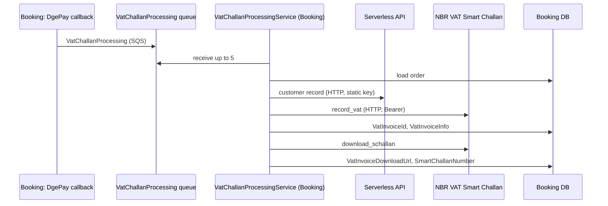

# S-10 · VAT challan with NBR (VatChallanProcessing queue)

> **Bangla name:** NBR-এ VAT চালান (VatChallanProcessing কিউ)
>
> [← 50 · System-initiated](README.md) · [Contents](../README.md) · [Open queries](../99-open-queries.md)

## 1. Name and purpose

**VAT challan with NBR.** For each paid order the platform records the sale as a VAT invoice with the Bangladesh National Board of Revenue (NBR) "VAT Smart Challan" open API, then downloads the smart challan (a download link and a challan number) and stores both on the order. The Booking worker `VatChallanProcessingService` does this from the `VatChallanProcessing` queue. Concepts: [queue-driven processing](../00-platform-primer.md#explainer-queue-driven), [background workers](../00-platform-primer.md#explainer-background-workers), [distributed locks](../00-platform-primer.md#explainer-distributed-locks).

## 2. Trigger and actor

- **Producer:** Booking `UserBookingOrderManager.HandleDgePayment` (the DgePay callback) publishes one message when the payment is confirmed; the inactive SSLCommerz handler publishes the same ([Appendix A](../90-appendix-a-legacy.md)).
- **Consumer:** Booking worker; no user, no token.

## 3. Business flow

The business must report VAT on every ticket sale. After a customer pays, the platform sends invoice number (`OrderNumber`), time, payment transaction reference, customer id and contact, amount, discount, VAT and the event name with the seat count to NBR, and keeps NBR's invoice id and smart challan link on the order.

## 4. Technical flow

1. **Publish** **[SQS: VatChallanProcessing]** `VatChallanProcessing` message: `GroupId = "vat_processing_{eventLongId}"`, `OrderId = bookingPublicId`, `BookingPublicId`, `UserId`, `EventLongId`, `EventId`, `EventName`, `OrderNumber`, `PaymentTransactionId`, `TotalCharge`, `PricePerSeat`, `NumberOfSeats`, `Vat`, `Discount`, `PromoDiscount`, `IsVatInclusive`, `CreatedAt`, `RetryCount`, `LastErrorMessage`. A failure to publish is logged and ignored.
2. **Worker** **[Worker: 1 min start delay, then every 45 s; RedLock `vat_challan_processor_{0..9}`, expiry 5 min, wait 10 s, retry every 1 s]** takes a random slot lock and runs `VatChallanProcessingTaskManager` once: receive up to 5 messages (`WaitTimeSeconds` 0, visibility 300 s), and sleep 30 s when empty.
3. For each message, `ProcessVatChallan`:
   - load the order; if `VatInvoiceDownloadUrl` is already set, finish (success);
   - read the customer from the Serverless API (**[HTTP, static key]** `GetUserByIdAsync`) and the event name from the Event service;
   - **if the order already has `VatInvoiceId` but no download URL:** only call `DownloadSChallanAsync`;
   - **else (no invoice yet):** build `NBRVatInvoiceRequest` (invoice number, date as Unix seconds, buyer name, email, phone normalised to `0...` with dial code `+88`, amounts, discount percentage and amount, `VatInclusive`, `ServiceTypeId`, `RetailerId` from settings) and call `RecordVatInvoiceAsync` **[HTTP, static key]**; save `VatInvoiceId` and `VatInvoiceInfo` (the response as JSON); then call `DownloadSChallanAsync` and save `VatInvoiceDownloadUrl` and `SmartChallanNumber`.
4. **Outcome:** success deletes the message. A `false` result increments `RetryCount` on the in-memory copy; below 3 the message visibility is set to `2^RetryCount × 60` s; at 3 the message is deleted with an error log. An exception leaves the message to reappear after the visibility timeout.

NBR access (`NBROpenApiManager`): `POST {BaseUrl}/vschallan/v3/integration/vendor_authenticate` with Basic auth from the vendor client id and secret; the access token is cached in Redis as `NBR:AuthToken`; `record_vat` and `download_schallan` send `Authorization: Bearer <token>` and the header `companyID`; a 401 triggers one token refresh and retry.

## 5. Components

| Kind | Component |
|---|---|
| Services | Booking (producer, worker); Event (event name); no Ticketing involvement |
| Queue | `VatChallanProcessing` |
| External | NBR VAT Smart Challan open API; Serverless API for the customer record |
| Tables | Booking order columns `VatInvoiceId`, `VatInvoiceInfo`, `VatInvoiceDownloadUrl`, `SmartChallanNumber` |
| Redis | lock `vat_challan_processor_{n}`, token `NBR:AuthToken` |
| Code | `Services/Booking/ETP.Booking.Service/Workers/BackgroundServices/VatChallanProcessingService.cs`, `.../TaskManagers/VatChallanProcessingTaskManager.cs`, `Services/Booking/ETP.Booking.Domain/Managers/NBROpenApiManager.cs` |
| Config | `AWS:Queue:VatChallanProcessing`, `PaymentSettings:NBROpenApi:{BaseUrl, CompanyId, RetailerId, ServiceTypeId, client id and secret}` ([X-26](../60-cross-cutting/X-26-configuration.md)) |

## 6. API contracts

No endpoint of its own. NBR calls (outgoing):

| Method | Path under `NBROpenApi:BaseUrl` | Auth | Purpose |
|---|---|---|---|
| POST | `/vschallan/v3/integration/vendor_authenticate` | Basic (client id:secret) | access token |
| POST | `/vschallan/v3/integration/record_vat` | Bearer + `companyID` | record the invoice |
| POST | `/vschallan/v3/integration/download_schallan` | Bearer + `companyID` | smart challan link |

Request body classes: `NBRVatInvoiceRequest`, `NBRDownloadChallanRequest` (`VatInvoiceId`), in `Services/Booking/ETP.Booking.Domain/Models/NBR/`.

## 7. Data and side effects

Four order columns (above). The raw NBR response is stored in `VatInvoiceInfo`. The full request and response bodies, which contain customer name, email and phone, are written to the application log.

## 8. Code references

| What | Where |
|---|---|
| Loop | `rvl-gobcb-backend/Services/Booking/ETP.Booking.Service/Workers/BackgroundServices/VatChallanProcessingService.cs:26-62` |
| Message handling and retry | `rvl-gobcb-backend/Services/Booking/ETP.Booking.Service/Workers/TaskManagers/VatChallanProcessingTaskManager.cs:44-117` |
| NBR calls | `rvl-gobcb-backend/Services/Booking/ETP.Booking.Service/Workers/TaskManagers/VatChallanProcessingTaskManager.cs:119-267` |
| NBR client | `rvl-gobcb-backend/Services/Booking/ETP.Booking.Domain/Managers/NBROpenApiManager.cs` |
| Publisher | `rvl-gobcb-backend/Services/Booking/ETP.Booking.Domain/Managers/UserBookingOrderManager.cs:398-436` |
| Message | `rvl-gobcb-backend/Core/ETP.Core/Queue/Messages/VatChallanProcessing.cs` |

## 9. Handover notes

1. **The retry limit never triggers.** `RetryCount` is incremented on the deserialised copy only; the message is not re-published with the new count, so every redelivery starts again at the original value (0). `MAX_RETRY_COUNT = 3` is never reached, and a message that keeps failing is retried with the 2 minute back-off forever (until the queue's redrive rule, if any, stops it `[UNCONFIRMED: Q-09]`).
2. **A half-finished invoice is not retried.** After `record_vat` succeeds, if `download_schallan` returns nothing, the code still returns `true`: the message is deleted, `VatInvoiceId` is stored but `VatInvoiceDownloadUrl` stays empty. Only a new message for the same order (none is published) would resume it.
3. **The "catch-up" is not there.** The publisher's comment says a background service will catch up with unprocessed VAT records; the only candidate (`ProcessVatInvoice` in the ticket-initiation task manager, [S-07](S-07-initiate-user-ticket-generation.md)) is never called. Orders whose message was lost or failed to publish have no VAT record, and nothing in the repository finds them.
4. **Personal data in logs.** Request and response bodies, including customer contact data, are logged at information level.
5. **Placeholders when data is missing**: customer name `Customer`, email `customer@email.com` and phone `00000000000` are sent to NBR when the Serverless lookup returns nothing.
6. **Only DgePay-confirmed orders publish.** Orders marked paid by the re-check ([S-05](S-05-pending-failed-revalidation.md)) or by the anonymous `payment-status-bypass` do not publish a VAT message `[UNCONFIRMED: Q-15]` (the callback path at `UserBookingOrderManager.cs:398-436` is the only active publisher; the SSLCommerz handler is inactive).
7. **A late callback still reports VAT.** In `HandleDgePayment` the order status is changed only when the order is at most 12 minutes old, but the VAT message is published whenever the callback says `Paid`, regardless of age. A late `Paid` callback therefore sends a VAT record for an order that stays `Pending` or is later cancelled ([S-05](S-05-pending-failed-revalidation.md)) `[UNCONFIRMED: Q-15]`.
8. The worker takes up to 5 messages per 45 s cycle per instance and its slot count is 10, matching the queue's `GroupId` per event if the queue is FIFO.

## 10. Component relationships

**Depends on:** payment confirmation ([P-06](../20-user-portal/P-06-booking-payment.md)). **Affects:** the customer's VAT challan link in "my bookings" ([P-07](../20-user-portal/P-07-my-bookings.md)), reports ([A-22](../10-admin-portal/A-22-reports.md)).

## 11. Developer test guide

**Local testability: Partial.** The queue, worker and the database part run locally; NBR and Serverless are dummy (`https://*.invalid`), so `RecordVatInvoiceAsync` fails and the message is retried forever `[UNCONFIRMED: Q-06]`.

| Item | Detail |
|---|---|
| Test data and accounts | A paid order (DgePay callback simulation, see [S-01](S-01-level-capacity-update.md)) |
| Browser | None |
| Emulator | — |
| Postman | `postman/services/etp-booking.postman_collection.json`: the DgePay callback request |
| Visual Studio debug | Breakpoints: `UserBookingOrderManager` publish block (line ~430), `VatChallanProcessingTaskManager.ProcessVatChallan` |
| Verify | `aws --endpoint-url http://localhost:4566 sqs get-queue-attributes --queue-url <VatChallanProcessing url> --attribute-names All`; SQL on the order's `VatInvoiceId`; Booking log lines "Sending VAT invoice request for booking ..." |
