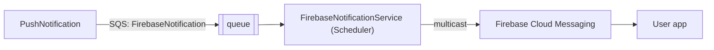

# S-11 · Push delivery to FCM (FirebaseNotification queue)

> **Bangla name:** FCM-এ পুশ ডেলিভারি (FirebaseNotification কিউ)
>
> [← 50 · System-initiated](README.md) · [Contents](../README.md) · [Open queries](../99-open-queries.md)

## 1. Name and purpose

**Push delivery to FCM.** The worker half of the push-notification feature: the Scheduler service reads batches of device tokens from the `FirebaseNotification` queue and sends each batch to Firebase Cloud Messaging as one multicast. The whole feature, including token registration and the sender side, is described in [X-23](../60-cross-cutting/X-23-push-firebase.md); this entry covers the worker. Concepts: [queue-driven processing](../00-platform-primer.md#explainer-queue-driven), [background workers](../00-platform-primer.md#explainer-background-workers).

## 2. Trigger and actor

- **Producer:** PushNotification `NotificationManager` (after Admin calls `send-to-all` on event publish, [A-07](../10-admin-portal/A-07-events.md)).
- **Consumer:** Scheduler `FirebaseNotificationService`; no user, no token, no lock.

## 3. Business flow

App users receive "New Event Available!" on their phones. Delivery is best effort.

## 4. Technical flow

**[Worker: 1 min start delay, then loops every 1 min; no distributed lock]**

1. `FirebaseNotificationService` creates a scope and runs `FirebaseNotificationTaskManager.ExecuteAsync`; after it returns (or throws) it waits 1 minute.
2. The task manager loops forever inside one call: `ReceiveMessage` (5 messages, 10 s long poll, visibility 60 s); if the reply is empty it waits 10 s and polls again.
3. For each message, in order: deserialise `FirebaseNotificationRequest { Title, Body, Data, DeviceTokens, CreatedAt, GroupId, OrderId }`; a body that cannot be read is logged and deleted.
4. `IPushNotificationService.SendNotificationToMultipleAsync(tokens, title, body, data)` → `FirebaseMessaging.SendEachForMulticastAsync`. It returns `true` when at least one token succeeded; any exception returns `false` (swallowed).
5. The message is **always deleted** in `finally`, whether the send worked or not.

Firebase is initialised once per process from `FirebasePushNotificationConfig:*` (service-account fields), created in the constructor of `FirebasePushNotificationService`.

## 5. Components

| Kind | Component |
|---|---|
| Services | Scheduler |
| Queue | `FirebaseNotification` |
| External | Firebase Cloud Messaging |
| Code | `Services/Scheduler/ETP.Scheduler.Service/Workers/BackgroundServices/FirebaseNotificationService.cs`, `.../TaskManagers/FirebaseNotificationTaskManager.cs`, `Core/ETP.Core/PushNotification/FirebasePushNotificationService.cs` |
| Config | `FirebasePushNotificationConfig:*`, `AWS:Queue:FirebaseNotification` ([X-26](../60-cross-cutting/X-26-configuration.md)) |

## 6. API contracts

No endpoint. Queue message: see [X-23](../60-cross-cutting/X-23-push-firebase.md) §6.

## 7. Data and side effects

FCM messages to devices. No database writes, and no record of what was sent.

## 8. Code references

| What | Where |
|---|---|
| Loop | `rvl-gobcb-backend/Services/Scheduler/ETP.Scheduler.Service/Workers/BackgroundServices/FirebaseNotificationService.cs:26-48` |
| Consumer | `rvl-gobcb-backend/Services/Scheduler/ETP.Scheduler.Service/Workers/TaskManagers/FirebaseNotificationTaskManager.cs:40-112` |
| FCM sender | `rvl-gobcb-backend/Core/ETP.Core/PushNotification/FirebasePushNotificationService.cs:35-104` |
| Registration | `rvl-gobcb-backend/Services/Scheduler/ETP.Scheduler.Service/Configurations/DependencyConfig.cs:46-55` |

## 9. Handover notes

1. **No retry.** A message is deleted even when sending failed or only some tokens worked; there is no redelivery, no dead-letter queue and no cleanup of tokens that FCM reports as invalid ([X-23](../60-cross-cutting/X-23-push-firebase.md) note 3).
2. **Errors are invisible.** `SendNotificationToMultipleAsync` catches every exception without logging; the task manager logs only "Failed to send Firebase notification for group ..." when it receives `false`.
3. **Multiple instances.** There is no lock, which is safe here because SQS hands each message to one consumer; several Scheduler pods share the queue.
4. **Batch size.** Each queue message carries up to 200 tokens; FCM's multicast limit is a separate, external limit (not visible in the repository).
5. The Scheduler hosts this worker although it only talks to SQS and FCM.
6. Locally there is no Firebase: `docs/local-dev.md` ("Some log noise is expected") says the Scheduler logs Firebase warnings and keeps running.

## 10. Component relationships

**Depends on:** [X-23](../60-cross-cutting/X-23-push-firebase.md) (producer), [U-09](../30-user-app/U-09-device-token.md). **Affects:** [U-10](../30-user-app/U-10-push-receipt.md).

## 11. Developer test guide

**Local testability: Partial / not locally for delivery.** The queue and the worker run (Scheduler port 5106); Firebase is dummy, so no push is delivered (`docs/local-dev.md`, `docs/mobile-local.md` §8).

| Item | Detail |
|---|---|
| Test data and accounts | A registered token row (`POST /pushnotification/api/v1/device-token`) |
| Browser | `http://localhost:5105/pushnotification/swagger` → `send-to-all` |
| Emulator | Dummy Firebase: no push arrives |
| Postman | `etp-pushnotification` collection: `POST /api/v1/push-notification/send-to-all` |
| Visual Studio debug | Scheduler: `FirebaseNotificationTaskManager.ExecuteAsync` (after the 1-minute delay) |
| Verify | SQS message count on `FirebaseNotification` drops to 0; Scheduler logs "Processing Firebase notification for group ..." |
