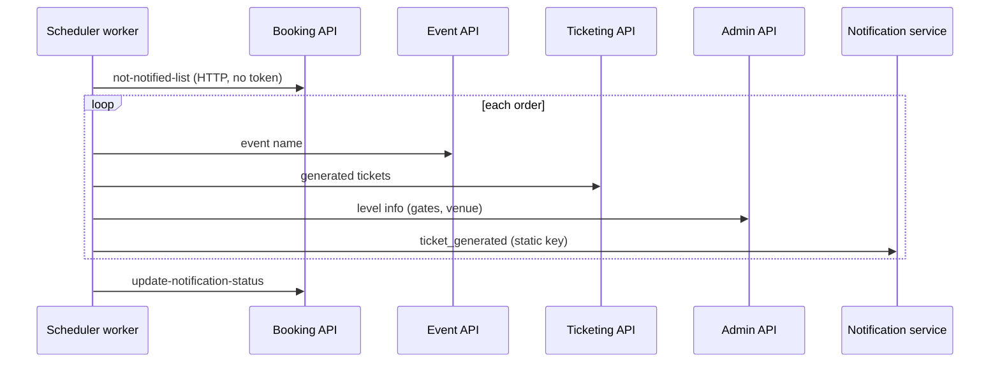

# S-12 · Ticket-generated notification

> **Bangla name:** টিকিট তৈরি হওয়ার নোটিফিকেশন
>
> [← 50 · System-initiated](README.md) · [Contents](../README.md) · [Open queries](../99-open-queries.md)

## 1. Name and purpose

**Ticket-generated notification.** After all tickets of an order exist (order status `Generated`, [S-06](S-06-booking-status-generated.md)), the Scheduler tells the customer through the external notification service (`ticket_generated`, see [X-22](../60-cross-cutting/X-22-sms-notification.md)), then flags the order as notified so it is not sent twice. Concepts: [background workers](../00-platform-primer.md#explainer-background-workers), [distributed locks](../00-platform-primer.md#explainer-distributed-locks), [token forwarding](../00-platform-primer.md#explainer-token-forwarding) (here: none).

## 2. Trigger and actor

Timer in the Scheduler service (`SendNotificationAfterGeneratedTicketService`). It calls Booking, Event, Ticketing and Admin over HTTP without a token, and the notification service with a static key.

## 3. Business flow

The customer receives one message per order: order number, event name, venue, gallery, block, level, ticket numbers, entry gate and mini gate, so they know where to go. The text and channel (SMS, in-app, push) are decided by the external service `[UNCONFIRMED: Q-05]`.

## 4. Technical flow

**[Worker: 1 min start delay, then every 3 min; RedLock `notification_for_ticket_generated`, expiry 3 min, wait 30 s, retry 1 s; extra 3 min delay after an error]**

1. Take the lock, then `IBookingClient.GetNotNotifiedUserBookings(100)` → `GET /booking/api/v1/user-booking-order/not-notified-list?limit=100` **[HTTP, no token / internal]**. The repository returns orders with `Status = Generated` and `IsTicketStatusNotified = false`.
2. For each order, sequentially:
   - `IEventClient.GetEventByPublicId` for the event name (skip when empty);
   - `ITicketingClient.GetGeneratedTicketByOrderId` for the ticket numbers (skip when none), joined with commas;
   - `IAdminClient.GetEventLevelInfoAsync(eventLongId, levelId)` for venue, gallery, block, level, entry gate, mini gate (skip when none);
   - `INotificationClient.SendTicketGeneratedNotification` → `POST {Notification:Endpoint}/notification/request` **[HTTP, static key]**; on success the order id is collected.
3. Finally `IBookingClient.UpdateNotifiedUserBookings(ids)` → `PUT /booking/api/v1/user-booking-order/update-notification-status` with the list of order public ids, which sets `IsTicketStatusNotified = true` for them.

## 5. Components

| Kind | Component |
|---|---|
| Services | Scheduler (worker); Booking, Event, Ticketing, Admin (data) |
| External | notification service ([X-22](../60-cross-cutting/X-22-sms-notification.md)) |
| Tables | Booking order `IsTicketStatusNotified` |
| Redis | lock `notification_for_ticket_generated` |
| Code | `Services/Scheduler/ETP.Scheduler.Service/Workers/BackgroundServices/SendNotificationAfterGeneratedTicketService.cs`, `.../TaskManagers/SendNotificationAfterGeneratedTicketServiceTaskManager.cs`, `Services/Booking/ETP.Booking.Storage/Repositories/UserBookingOrderRepository.cs:162-178` |

## 6. API contracts

| Method | Path | Auth | Request | Response |
|---|---|---|---|---|
| GET | `/booking/api/v1/user-booking-order/not-notified-list?limit=` | none | query `limit` | list of `UserBooking` |
| PUT | `/booking/api/v1/user-booking-order/update-notification-status` | none | JSON array of order public ids | `200` |
| POST | `{Notification:Endpoint}/notification/request` | static `Authorization` | `TicketGeneratedNotification` (snake_case, see [X-22](../60-cross-cutting/X-22-sms-notification.md)) | status only |

## 7. Data and side effects

One external notification per order; `IsTicketStatusNotified` set to true for those that succeeded.

## 8. Code references

| What | Where |
|---|---|
| Loop | `rvl-gobcb-backend/Services/Scheduler/ETP.Scheduler.Service/Workers/BackgroundServices/SendNotificationAfterGeneratedTicketService.cs:29-48` |
| Work | `rvl-gobcb-backend/Services/Scheduler/ETP.Scheduler.Service/Workers/TaskManagers/SendNotificationAfterGeneratedTicketServiceTaskManager.cs:24-125` |
| Booking endpoints | `rvl-gobcb-backend/Services/Booking/ETP.Booking.Service/Api/UserBookingOrderController.cs:424-436` |
| Client | `rvl-gobcb-backend/Core/ETP.Core/ServiceClient/BookingClient/BookingClient.cs:218-250` |
| Notification client | `rvl-gobcb-backend/Core/ETP.Core/ServiceClient/NotificationClient/NotificationClient.cs` |

## 9. Handover notes

1. **Anonymous internal endpoints.** `not-notified-list` returns customer order data and `update-notification-status` flips flags, both without authorization ([X-18](../60-cross-cutting/X-18-endpoints-without-auth.md) category C; architecture §2.3 B).
2. **Arbitrary batch.** The repository applies `Take(limit)` before `OrderBy(UpdatedAt)`, so the 100 rows are not the oldest 100. Orders that always fail (event or level missing) are skipped every run and are never marked, so they are re-read each time and can crowd out others if there are 100 or more.
3. **Duplicates are possible.** The flag is written only after the loop; if the process stops after sending but before the `PUT`, those customers get the message again on the next run. A failed `PUT` has the same effect.
4. **A slow notification service slows the whole run.** Orders are handled one after the other, and each external call is retried 3 times with exponential back-off (2, 4, 8 s) when it fails.
5. **Only user orders.** Reserved tickets are not announced (they are emailed on request by an admin, [X-21](../60-cross-cutting/X-21-email-ses.md)).

## 10. Component relationships

**Depends on:** [S-06](S-06-booking-status-generated.md), [S-08](S-08-ticket-signing.md). **Affects:** customer awareness of ready tickets ([P-07](../20-user-portal/P-07-my-bookings.md)).

## 11. Developer test guide

**Local testability: Partial.** The worker and the Booking endpoints run; `Notification:Endpoint` is dummy, so the send fails and nothing is marked (logs `Failed to send notification for BookingId ...`).

| Item | Detail |
|---|---|
| Test data and accounts | An order with `Status = Generated` (SQL update or seeded data) |
| Browser | None |
| Emulator | — |
| Postman | `postman/services/etp-booking.postman_collection.json`: "GET /api/v1/user-booking-order/not-notified-list?limit=5" |
| Visual Studio debug | Scheduler: `SendNotificationAfterGeneratedTicketServiceTaskManager.ExecuteAsync` |
| Verify | SQL: `IsTicketStatusNotified` of the order; Scheduler log "Successfully updated notification status for N bookings" |
