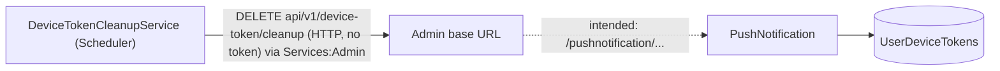

# S-13 · Device-token cleanup

> **Bangla name:** ডিভাইস টোকেন ক্লিনআপ
>
> [← 50 · System-initiated](README.md) · [Contents](../README.md) · [Open queries](../99-open-queries.md)

## 1. Name and purpose

**Device-token cleanup.** The PushNotification service keeps one row per FCM device token ([X-23](../60-cross-cutting/X-23-push-firebase.md)). A Scheduler worker is meant to delete tokens that have not been created or updated for 30 days, so push messages are not sent to dead installs. Concepts: [background workers](../00-platform-primer.md#explainer-background-workers), [distributed locks](../00-platform-primer.md#explainer-distributed-locks).

## 2. Trigger and actor

Timer in the Scheduler service (`DeviceTokenCleanupService`); no user. The call to delete is made with the shared `IEventClient` HTTP client **[HTTP, no token / internal]**.

## 3. Business flow

Mobile apps refresh their FCM token now and then ([U-09](../30-user-app/U-09-device-token.md)). A token that has not been refreshed for 30 days is treated as stale and removed.

## 4. Technical flow

**[Worker: 1 min start delay; then waits until 02:00 UTC; RedLock `device_token_cleanup`, expiry 2 h, no wait; sleeps 24 h after a run, 1 h after an error]**

1. `DeviceTokenCleanupService` computes the time to the next 02:00 UTC, waits, takes the lock, runs `DeviceTokenCleanupTaskManager`.
2. The task manager calls `IEventClient.CleanupOldDeviceTokensAsync(30)` → `DELETE api/v1/device-token/cleanup?retentionDays=30`, relative to the base address of that client, which in the Scheduler is **`Services:Admin`** ([X-19](../60-cross-cutting/X-19-service-to-service.md)).
3. On a non-success status it logs the error and throws (so the service logs it again and waits 1 hour before looping); on success it logs the response.
4. The intended receiver is PushNotification `DELETE /pushnotification/api/v1/device-token/cleanup?retentionDays=` (`DeviceTokenController.CleanupOldDeviceTokens`), which deletes rows whose `UpdatedAt ?? CreatedAt` is older than the cutoff and answers `{ message, deletedCount, cutoffDate, retentionDays }`.

## 5. Components

| Kind | Component |
|---|---|
| Services | Scheduler (timer); PushNotification (delete) |
| Tables | `UserDeviceTokens` |
| Redis | lock `device_token_cleanup` |
| Code | `Services/Scheduler/ETP.Scheduler.Service/Workers/BackgroundServices/DeviceTokenCleanupService.cs`, `.../TaskManagers/DeviceTokenCleanupTaskManager.cs`, `Core/ETP.Core/ServiceClient/EventClient/EventClient.cs:166-174`, `Services/PushNotification/ETP.PushNotification.Service/Api/DeviceTokenController.cs:75-100` |
| Config | `Services:Admin` (base URL used by the client), `Services:PushNotification` (not used by this call) |

## 6. API contracts

| Method | Path | Auth | Request | Response |
|---|---|---|---|---|
| DELETE | `/pushnotification/api/v1/device-token/cleanup?retentionDays=30` | none | query `retentionDays` (> 0) | `200 { message, deletedCount, cutoffDate, retentionDays }`; `400` if `<= 0`; `500` |

## 7. Data and side effects

Deletes device-token rows older than the cutoff (loaded into memory and removed in one `SaveChanges`).

## 8. Code references

| What | Where |
|---|---|
| Schedule | `rvl-gobcb-backend/Services/Scheduler/ETP.Scheduler.Service/Workers/BackgroundServices/DeviceTokenCleanupService.cs:26-80` |
| Call | `rvl-gobcb-backend/Services/Scheduler/ETP.Scheduler.Service/Workers/TaskManagers/DeviceTokenCleanupTaskManager.cs:24-52` |
| Client method | `rvl-gobcb-backend/Core/ETP.Core/ServiceClient/EventClient/EventClient.cs:166-174` |
| Client base address | `rvl-gobcb-backend/Services/Scheduler/ETP.Scheduler.Service/Configurations/DependencyConfig.cs:96-104` |
| Delete | `rvl-gobcb-backend/Services/PushNotification/ETP.PushNotification.Storage/Repositories/UserDeviceTokenRepository.cs:99-111` |

## 9. Handover notes

1. **The call appears to miss its target.** The client sends `api/v1/device-token/cleanup` to `Services:Admin`, with no `pushnotification/` prefix, while only the PushNotification service has this endpoint (neither Admin nor Event defines it, and every service adds its own prefix). Unless the base URL in the deployed settings maps this path to PushNotification, the daily call gets a 404 and nothing is deleted `[UNCONFIRMED: Q-16]`. Check the Scheduler log for "Device token cleanup failed. Status: ..." and the row count of `UserDeviceTokens`.
2. **It probably runs every second day, not daily.** After a run the loop sleeps 24 h, then calls `GetDelayUntilNextRun()`; at that moment it is just past 02:00, so the next run is scheduled for 02:00 on the following day, about 48 hours after the first. This is derived from the code, not observed.
3. The class that owns the method is named `IEventClient` although the method talks to PushNotification; the name is a leftover.
4. The endpoint is anonymous and deletes data on any call; callers can choose `retentionDays` (any positive number), so `retentionDays=1` removes almost every token ([X-23](../60-cross-cutting/X-23-push-firebase.md) note 1).
5. Tokens are loaded into memory before deletion; with many tokens the request is heavy.

## 10. Component relationships

**Depends on:** token registration ([U-09](../30-user-app/U-09-device-token.md)). **Affects:** [S-11](S-11-firebase-notification.md) (fewer dead tokens).

## 11. Developer test guide

**Local testability: Partial.** Locally `Services:Admin` is `http://localhost:5101/`, so the coded path reaches the Admin service, not PushNotification; you can call the PushNotification endpoint directly.

| Item | Detail |
|---|---|
| Test data and accounts | A token row older than 30 days (SQL update of `UpdatedAt` in `UserDeviceTokens`) |
| Browser | `http://localhost:5105/pushnotification/swagger` → `DELETE /api/v1/device-token/cleanup` |
| Emulator | — |
| Postman | `postman/services/etp-pushnotification.postman_collection.json`: "DELETE /api/v1/device-token/cleanup" |
| Visual Studio debug | Scheduler: `DeviceTokenCleanupTaskManager.ExecuteAsync`; the timer fires at 02:00 UTC, so set a breakpoint and run the task manager from a debug session, or call the PushNotification endpoint directly |
| Verify | SQL: `select count(*) from etp."UserDeviceTokens"` before and after; the Scheduler log "Device token cleanup failed. Status: NotFound" shows note 1 |
