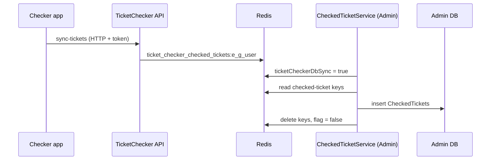

# S-14 · Checked-ticket sync (Redis → database)

> **Bangla name:** চেকড-টিকিট সিঙ্ক (Redis → ডাটাবেস)
>
> [← 50 · System-initiated](README.md) · [Contents](../README.md) · [Open queries](../99-open-queries.md)

## 1. Name and purpose

**Checked-ticket sync.** Checker apps report the tickets they scanned to the TicketChecker service ([C-05](../40-checker-app/C-05-ticket-sync.md)), which keeps them only in Redis. Every 30 minutes an **Admin** worker copies them into the `CheckedTickets` table, so that gate reports ([A-19](../10-admin-portal/A-19-gate-reports.md)) and duplicate-entry checks can read them. Concepts: [background workers](../00-platform-primer.md#explainer-background-workers), [distributed locks](../00-platform-primer.md#explainer-distributed-locks), [Redis live capacity](../00-platform-primer.md#explainer-redis-live-capacity).

## 2. Trigger and actor

Timer in the Admin service (`CheckedTicketService`); no user. It reads Redis and the database directly, with no HTTP calls.

## 3. Business flow

Entry counts per gate, manual entries and duplicate scans appear in the admin reports only after this job has run, so they lag by up to about 30 minutes.

## 4. Technical flow

**[Worker: 1 min start delay, then every 30 min; RedLock `checked_ticket`, expiry 20 min, no wait; extra 30 min after an error]**

1. Take the lock and run `CheckedTicketServiceTaskManager` once.
2. Set the Redis flag `ticketCheckerDbSync = true`, wait 10 seconds (so in-flight checker syncs can finish).
3. `GetEventDetailsAsyncForTicketChecker()` lists every event with its gates and the checker users per gate. For each (event, gate, user) read the Redis string `ticket_checker_checked_tickets:{eventLongId}_{gateId}_{userId}`, a JSON dictionary `ticketNumber → { Value (scan count), IsManual, EntryTime }`, and turn each entry into a `CheckedTicket` row (`EventLongId`, `EventId`, `TicketCheckerGateId`, `TicketCheckerGateName`, `TicketCheckerId`, `TicketCheckerName`, `TicketNumber`, `EntryCount`, `IsManualEntry`, `EntryTime`).
4. `CheckedTicketManager.SaveCheckedTicketsAsync` inserts all rows in bulk (batches of 100) with `CreatedBy = "System"`.
5. Delete the processed Redis keys; set `ticketCheckerDbSync = false`. On any exception, set the flag back to `false` and return (the keys stay).

While the flag is `true`, the checker sync in the TicketChecker service refuses requests with "Database sync is running.." ([C-05](../40-checker-app/C-05-ticket-sync.md)).

## 5. Components

| Kind | Component |
|---|---|
| Services | Admin (worker); TicketChecker (writes the Redis keys) |
| Tables | `CheckedTickets` (Admin schema: ticket number, gate, checker, entry count, manual flag, entry time) |
| Redis | `ticket_checker_checked_tickets:*`, flag `ticketCheckerDbSync`, lock `checked_ticket` |
| Code | `Services/Admin/ETP.Admin.Service/Workers/BackgroundServices/CheckedTicketService.cs`, `.../TaskManagers/CheckedTicketServiceTaskManager.cs`, `Services/Admin/ETP.Admin.Domain/Managers/CheckedTicketManager.cs:46-58`, `Services/TicketChecker/ETP.TicketChecker.Domain/Managers/TicketsManager.cs` |

## 6. API contracts

No endpoint. The data it produces is read through the report endpoints in [A-19](../10-admin-portal/A-19-gate-reports.md).

## 7. Data and side effects

New `CheckedTickets` rows per run (one row per ticket, gate and checker for that period); Redis keys removed; the flag toggled.

## 8. Code references

| What | Where |
|---|---|
| Loop | `rvl-gobcb-backend/Services/Admin/ETP.Admin.Service/Workers/BackgroundServices/CheckedTicketService.cs:22-49` |
| Work | `rvl-gobcb-backend/Services/Admin/ETP.Admin.Service/Workers/TaskManagers/CheckedTicketServiceTaskManager.cs:28-104` |
| Save | `rvl-gobcb-backend/Services/Admin/ETP.Admin.Domain/Managers/CheckedTicketManager.cs:46-58` |
| Writer of the keys | `rvl-gobcb-backend/Services/TicketChecker/ETP.TicketChecker.Domain/Managers/TicketsManager.cs:28-155` |

## 9. Handover notes

1. **Checker sync is blocked during each run.** While `ticketCheckerDbSync` is true (at least the 10 s wait plus the save), checker apps receive an error on sync; the app must retry. A failure that leaves the flag `true` is prevented by the `catch`, but a pod killed in the middle would leave it `true` with no expiry, blocking all syncs until the flag is cleared by hand (`SET ticketCheckerDbSync false`) `[UNCONFIRMED: Q-17]`.
2. **Lost scans are possible.** The checker sync reads and rewrites a user's whole JSON dictionary; the worker reads the keys, saves, then deletes them. A scan written between the read and the delete is lost; the flag and the 10-second wait narrow, but do not remove, this window.
3. **Duplicates in the table by design.** The Redis dictionary restarts after each run, so a ticket scanned in two periods appears in two rows; reports sum or compare rows ([A-19](../10-admin-portal/A-19-gate-reports.md)).
4. **No idempotence.** If the save succeeds but deleting the keys fails, the next run inserts the same rows again.
5. **Cost grows with all events.** `GetEventDetailsAsyncForTicketChecker` is not limited to active events; every run inspects every gate and user for keys.
6. The worker writes `CreatedBy = "System"`; the activity log shows these inserts as `System` ([X-24](../60-cross-cutting/X-24-activity-logging.md)).

## 10. Component relationships

**Depends on:** [C-05](../40-checker-app/C-05-ticket-sync.md), [A-18](../10-admin-portal/A-18-gate-assignment.md). **Affects:** [A-19](../10-admin-portal/A-19-gate-reports.md).

## 11. Developer test guide

**Local testability: Full for the worker; the checker app cannot sign in locally.**

| Item | Detail |
|---|---|
| Test data and accounts | Seeded checker …21 ([X-12](../60-cross-cutting/X-12-checker-login.md)); a gate assigned to the checker (admin portal, [A-18](../10-admin-portal/A-18-gate-assignment.md)) |
| Browser | Admin portal gate report after the run |
| Emulator | Checker app sign-in is a known local gap (`docs/mobile-local.md` §8) |
| Postman | `postman/services/etp-ticketchecker.postman_collection.json` sync request with `{{access_token_ticket_operator}}`, then wait for the worker |
| Visual Studio debug | Admin: `CheckedTicketServiceTaskManager.ExecuteAsync` (first run after 1 minute) |
| Verify | `redis-cli --scan --pattern 'ticket_checker_checked_tickets:*'` before and after; SQL: `select count(*) from etp."CheckedTickets"`; `redis-cli GET ticketCheckerDbSync` |
