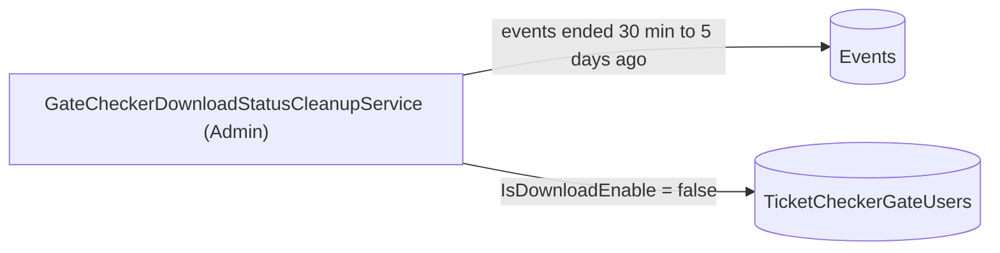

# S-15 · Gate download-status cleanup

> **Bangla name:** গেট ডাউনলোড-স্ট্যাটাস ক্লিনআপ
>
> [← 50 · System-initiated](README.md) · [Contents](../README.md) · [Open queries](../99-open-queries.md)

## 1. Name and purpose

**Gate download-status cleanup.** Checker users can download an event's ticket list to their phone only while "download" is enabled for them on a gate ([A-18](../10-admin-portal/A-18-gate-assignment.md), [C-02](../40-checker-app/C-02-offline-ticket-download.md)). An Admin worker switches this flag **off** for every checker on every gate of an event that has ended, so ticket lists cannot be downloaded after the event. Concepts: [background workers](../00-platform-primer.md#explainer-background-workers), [distributed locks](../00-platform-primer.md#explainer-distributed-locks).

## 2. Trigger and actor

Timer in the Admin service (`GateCheckerDownloadStatusCleanupService`); no user, no HTTP calls.

## 3. Business flow

After a match or show ends, checker accounts keep their gate assignment (for the reports) but lose the right to download the ticket list.

## 4. Technical flow

**[Worker: 30 s start delay, then every 15 min; RedLock `ticket_checker_status_reset`, expiry 5 min, no wait; 1 min pause after an error]**

1. `GateCheckerStatusCleanupTaskManager` takes the lock and calls `TicketCheckerGateManager.DisableDownloadAccessForPastEventsAsync`.
2. It loads published, not deleted events whose `EndDateTime` is at least **30 minutes ago and not more than 5 days ago** (`GetEventsEndedBeforeAsync(now - 30 min)` looks back 5 days).
3. For each event and each of its gates that has at least one user with `IsDownloadEnable`, it passes the gate's **same** user list with `IsDownloadEnable = false` to `TicketCheckerGateUserRepository.AddOrRemoveAsync`, which keeps the users and only updates the flag, and saves per event.

## 5. Components

| Kind | Component |
|---|---|
| Services | Admin |
| Tables | `TicketCheckerGateUsers` (`IsDownloadEnable`), `Events` (`EndDateTime`, `IsPublished`, `IsDeleted`) |
| Redis | lock `ticket_checker_status_reset` |
| Code | `Services/Admin/ETP.Admin.Service/Workers/BackgroundServices/GateCheckerDownloadStatusCleanupService.cs`, `.../TaskManagers/GateCheckerStatusCleanupTaskManager.cs`, `Services/Admin/ETP.Admin.Domain/Managers/TicketCheckerGateManager.cs:292-322`, `Services/Admin/ETP.Admin.Storage/Repositories/EventRepository.cs:319-331`, `.../TicketCheckerGateUserRepository.cs:12-42` |

## 6. API contracts

None.

## 7. Data and side effects

`TicketCheckerGateUsers.IsDownloadEnable` set to false.

## 8. Code references

| What | Where |
|---|---|
| Loop | `rvl-gobcb-backend/Services/Admin/ETP.Admin.Service/Workers/BackgroundServices/GateCheckerDownloadStatusCleanupService.cs:11-24` |
| Work | `rvl-gobcb-backend/Services/Admin/ETP.Admin.Service/Workers/TaskManagers/GateCheckerStatusCleanupTaskManager.cs:11-34` |
| Logic | `rvl-gobcb-backend/Services/Admin/ETP.Admin.Domain/Managers/TicketCheckerGateManager.cs:292-322` |
| Event filter | `rvl-gobcb-backend/Services/Admin/ETP.Admin.Storage/Repositories/EventRepository.cs:319-331` |

## 9. Handover notes

1. **The class comment says "polling every 2 mins" but the delay is 15 minutes.** The code wins; update the comment when you can.
2. **The five-day window.** An event that ended more than 5 days ago is never touched; a checker still enabled for such an event stays enabled.
3. **Events without an `EndDateTime`** (null) are never selected, so their gates are never closed by this job.
4. **Redis lists are not cleared.** The offline ticket list `ticket_checker_tickets:event_{e}_gate_{g}` and the gate map stay in Redis ([X-25](../60-cross-cutting/X-25-redis.md)); this job only blocks the next download.
5. The service class name says "download status"; the task manager and the manager method say "disable download access". They are the same feature.

## 10. Component relationships

**Depends on:** [A-18](../10-admin-portal/A-18-gate-assignment.md), event end time ([A-07](../10-admin-portal/A-07-events.md)). **Affects:** [C-02](../40-checker-app/C-02-offline-ticket-download.md) (download is refused afterwards).

## 11. Developer test guide

**Local testability: Full.**

| Item | Detail |
|---|---|
| Test data and accounts | Admin …01; an event with `EndDateTime` between 30 minutes and 5 days ago and a gate with a checker assigned |
| Browser | Admin portal → gate assignment: the "download" toggle is off after the run |
| Emulator | — |
| Postman | `etp-admin` collection: gate and assignment requests |
| Visual Studio debug | Admin: `GateCheckerStatusCleanupTaskManager.ExecuteAsync`, `TicketCheckerGateManager.DisableDownloadAccessForPastEventsAsync` (first run 30 s after start) |
| Verify | SQL: `select "IsDownloadEnable" from etp."TicketCheckerGateUsers"` for the gate |
