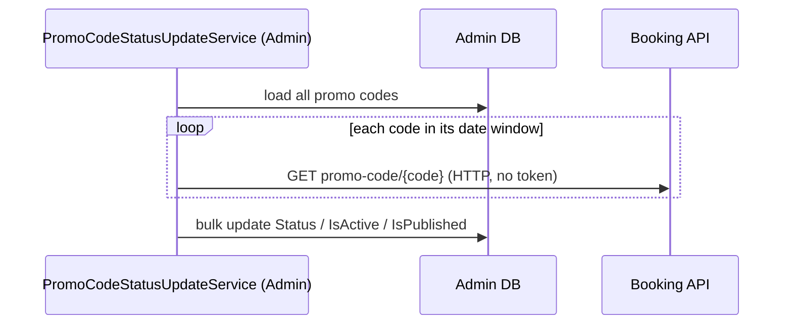

# S-16 · Promo-code status update

> **Bangla name:** প্রোমো কোডের স্ট্যাটাস হালনাগাদ
>
> [← 50 · System-initiated](README.md) · [Contents](../README.md) · [Open queries](../99-open-queries.md)

## 1. Name and purpose

**Promo-code status update.** Every 2 minutes an Admin worker recomputes the status of **every** promo code (`Upcoming`, `Active`, `Expired`, `LimitReached`) from its start and end time and its usage so far, and switches `IsActive` and `IsPublished` accordingly. The stored status is what admins see in the promo-code list ([A-15](../10-admin-portal/A-15-promo-codes.md)). The customer's *apply* step does not read it: `ValidateApplyPromoCodeAsync` checks the dates and counts the usage itself ([P-05](../20-user-portal/P-05-apply-promo-code.md)). Concepts: [background workers](../00-platform-primer.md#explainer-background-workers), [distributed locks](../00-platform-primer.md#explainer-distributed-locks), [token forwarding](../00-platform-primer.md#explainer-token-forwarding) (here: none).

## 2. Trigger and actor

Timer in the Admin service (`PromoCodeStatusUpdateService`); no user. It calls Booking over HTTP without a token **[HTTP, no token / internal]**.

## 3. Business flow

A promo code starts working at its start date, stops at its end date, and stops when the number of orders that used it reaches the total usage limit.

## 4. Technical flow

**[Worker: 1 min start delay, then every 2 min; RedLock `promo_code_status_updater`, expiry 2 min, no wait; 1 min pause after an error]**

1. `PromoCodeStatusUpdateTaskManager` takes the lock and calls `PromoCodeManager.UpdatePromoCodeStatusesAsync`.
2. Load all promo codes (with their assignments). For each, `GetPromoCodeStatusAsync(code, start, end, totalUsageLimit)`:
   - `now < StartDateTime` → `Upcoming`;
   - `now > EndDateTime` → `Expired`;
   - otherwise ask Booking `GET /booking/api/v1/user-booking-order/promo-code/{code}` **[HTTP, no token / internal]**, which returns the orders that used the code **with status `Paid`, `Requested` or `Generated`**; if their count is at least `TotalUsageLimit` → `LimitReached`;
   - else `Active`.
3. When the new status differs from the stored one, set `Status`, `IsActive = (status == Active)`, `IsPublished = (status == Active)`, `UpdatedAt`, and save the changed ones in one bulk update.

The same status function runs when an admin creates or updates a code (`CreateAsync`, `UpdateAsync`), so the stored status is correct immediately and the worker only keeps it current over time.

## 5. Components

| Kind | Component |
|---|---|
| Services | Admin (worker), Booking (usage count) |
| Tables | `PromoCodes` (`Status`, `IsActive`, `IsPublished`), read of Booking orders by code |
| Redis | lock `promo_code_status_updater` |
| Code | `Services/Admin/ETP.Admin.Service/Workers/BackgroundServices/PromoCodeStatusUpdateService.cs`, `.../TaskManagers/PromoCodeStatusUpdateTaskManager.cs`, `Services/Admin/ETP.Admin.Domain/Managers/PromoCodeManager.cs:288-318, 442-457`, `Core/ETP.Core/ServiceClient/BookingClient/BookingClient.cs:346`, `Services/Booking/ETP.Booking.Domain/Managers/UserBookingOrderManager.cs:1195-1202` |

## 6. API contracts

| Method | Path | Auth | Request | Response |
|---|---|---|---|---|
| GET | `/booking/api/v1/user-booking-order/promo-code/{code}` | none | path `code` | list of `UserBooking` (paid, requested or generated orders using the code) |

Status values (`PromoCodeStatus`): `Active` 1, `Expired` 2, `Upcoming` 3, `LimitReached` 4.

## 7. Data and side effects

Promo-code rows updated; activity log entries with user `System` ([X-24](../60-cross-cutting/X-24-activity-logging.md)).

## 8. Code references

| What | Where |
|---|---|
| Loop | `rvl-gobcb-backend/Services/Admin/ETP.Admin.Service/Workers/BackgroundServices/PromoCodeStatusUpdateService.cs:14-26` |
| Work | `rvl-gobcb-backend/Services/Admin/ETP.Admin.Service/Workers/TaskManagers/PromoCodeStatusUpdateTaskManager.cs:24-48` |
| Status rules | `rvl-gobcb-backend/Services/Admin/ETP.Admin.Domain/Managers/PromoCodeManager.cs:288-318, 442-457` |
| Usage count | `rvl-gobcb-backend/Services/Booking/ETP.Booking.Domain/Managers/UserBookingOrderManager.cs:1195-1202` |
| Enum | `rvl-gobcb-backend/Services/Admin/ETP.Admin.Domain/Enums/Enums.cs:67-73` |

## 9. Handover notes

1. **One HTTP call per live code every 2 minutes.** For each code inside its date window the worker calls Booking, which loads all orders for the code into memory; with many codes and orders this grows. A failed call returns an empty list (`BookingClient` returns `new List<UserBooking>()` on a non-success status), so a Booking outage makes `LimitReached` codes look `Active` again until the next successful run.
2. **The worker does not gate the apply step.** `UserBookingOrderManager.ValidateApplyPromoCodeAsync` loads the code (`!IsDeleted` only), compares the dates, recounts paid, requested and generated orders for the total and per-user limits, and checks program, event and gallery assignment. It never reads `Status`, `IsActive` or `IsPublished`, so those fields only affect what other screens or lists show `[UNCONFIRMED: Q-18]` (whether the user portal lists only published codes).
3. **Manual deactivation can be overwritten.** The worker sets `IsActive` and `IsPublished` from the computed status whenever the status changes, so a manual change to those flags may be reverted after the next status change.
4. **All codes are reloaded each cycle**, including expired and deleted ones if `GetAllAsync` returns them; there is no incremental query.
5. The Admin worker reads Booking data through HTTP instead of a shared table because the services own separate contexts, although the tables share the `etp` schema ([X-19](../60-cross-cutting/X-19-service-to-service.md), `[UNCONFIRMED: Q-02]`).

## 10. Component relationships

**Depends on:** promo-code setup ([A-15](../10-admin-portal/A-15-promo-codes.md)), paid orders ([P-06](../20-user-portal/P-06-booking-payment.md)). **Affects:** the status shown in [A-15](../10-admin-portal/A-15-promo-codes.md); [P-05](../20-user-portal/P-05-apply-promo-code.md) does not depend on it.

## 11. Developer test guide

**Local testability: Full.**

| Item | Detail |
|---|---|
| Test data and accounts | Admin …01; a promo code created in the admin portal (the seed script `scripts/seed/01-catalog.sql` also references promo codes) with a short date window |
| Browser | Admin portal → promo codes: the status column changes after the next run; user portal: apply the code at checkout |
| Emulator | Not locally (known sign-in gap) |
| Postman | `etp-admin` collection: promo-code requests; `etp-booking`: "GET /api/v1/user-booking-order/promo-code/{code}" |
| Visual Studio debug | Admin: `PromoCodeStatusUpdateTaskManager.ExecuteAsync`, `PromoCodeManager.GetPromoCodeStatusAsync` |
| Verify | SQL: `select "Code","Status","IsActive","IsPublished" from etp."PromoCodes"` |
