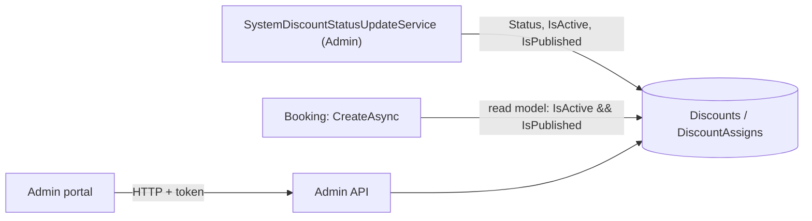

# S-17 · System-discount status update

> **Bangla name:** সিস্টেম ডিসকাউন্টের স্ট্যাটাস হালনাগাদ
>
> [← 50 · System-initiated](README.md) · [Contents](../README.md) · [Open queries](../99-open-queries.md)

## 1. Name and purpose

**System-discount status update.** A system discount (a price reduction an admin sets for an event or gallery, [A-16](../10-admin-portal/A-16-discounts.md)) has a start and an end time. Every 2 minutes an Admin worker recomputes each discount's status (`Upcoming`, `Active`, `Expired`) and switches `IsActive` and `IsPublished`. Unlike promo codes, this matters for pricing: when Booking creates an order it applies a discount **only if** `IsActive` and `IsPublished` are true. Concepts: [background workers](../00-platform-primer.md#explainer-background-workers), [distributed locks](../00-platform-primer.md#explainer-distributed-locks), [shared database](../00-platform-primer.md#explainer-shared-database).

## 2. Trigger and actor

Timer in the Admin service (`SystemDiscountStatusUpdateService`); no user, no HTTP calls.

## 3. Business flow

A discount starts working at its start time and stops at its end time without anyone pressing a button. The customer sees the reduced price at seat selection and in the order ([P-04](../20-user-portal/P-04-seat-selection.md), [P-06](../20-user-portal/P-06-booking-payment.md)).

## 4. Technical flow

**[Worker: 1 min start delay, then every 2 min; RedLock `system_discount_status_updater`, expiry 2 min, no wait; 1 min pause after an error]**

1. `SystemDiscountStatusUpdateTaskManager` takes the lock and calls `DiscountManager.UpdateSystemDiscountStatusesAsync`.
2. Load all discounts (with assignments). `GetDiscountStatus(start, end)`: `start > now` → `Upcoming`; `end < now` → `Expired`; else `Active`. (`DiscountStatus.LimitReached` exists in the enum but is not produced.)
3. For discounts whose status changed, set `Status`, `IsActive` and `IsPublished` (both true only for `Active`) and `UpdatedAt`, then bulk update.
4. **Used by Booking:** `UserBookingOrderManager.CreateAsync` calls `DiscountRepository.GetDiscountByIdsAsync(programId, eventId, galleryId)` in the Booking service, which reads the same `Discounts` table through its own read-model context and requires `!IsDeleted && IsActive && IsPublished` plus a matching program, and an event or gallery assignment. The discount value and type then feed the order's `Discount` amount.

## 5. Components

| Kind | Component |
|---|---|
| Services | Admin (worker, owner of the table); Booking (reads the table) |
| Tables | `Discounts`, `DiscountAssigns` (Admin-owned; Booking reads them as a read model) |
| Redis | lock `system_discount_status_updater` |
| Code | `Services/Admin/ETP.Admin.Service/Workers/BackgroundServices/SystemDiscountStatusUpdateService.cs`, `.../TaskManagers/SystemDiscountStatusUpdateTaskManager.cs`, `Services/Admin/ETP.Admin.Domain/Managers/DiscountManager.cs:245-273, 439-450`, `Services/Booking/ETP.Booking.Storage/Repositories/DiscountRepository.cs:14-31` |

## 6. API contracts

None for the worker.

## 7. Data and side effects

`Discounts.Status`, `IsActive`, `IsPublished` updated; activity log rows as `System` ([X-24](../60-cross-cutting/X-24-activity-logging.md)).

## 8. Code references

| What | Where |
|---|---|
| Loop | `rvl-gobcb-backend/Services/Admin/ETP.Admin.Service/Workers/BackgroundServices/SystemDiscountStatusUpdateService.cs:20-32` |
| Work | `rvl-gobcb-backend/Services/Admin/ETP.Admin.Service/Workers/TaskManagers/SystemDiscountStatusUpdateTaskManager.cs:24-48` |
| Status rules | `rvl-gobcb-backend/Services/Admin/ETP.Admin.Domain/Managers/DiscountManager.cs:245-273, 439-450` |
| Booking lookup | `rvl-gobcb-backend/Services/Booking/ETP.Booking.Storage/Repositories/DiscountRepository.cs:14-31`; used at `.../UserBookingOrderManager.cs:189` |

## 9. Handover notes

1. **Up to 2 minutes of drift in pricing.** Booking looks only at the flags, not the dates. A discount that has just ended is still applied until the next worker run flips the flags, and one that has just started is not applied until then.
2. **If the Admin worker stops, discounts stop changing state.** An expired discount keeps being applied; a new one never starts. Watch the worker (log "System discount status: Updated system discounts status.") and the lock `system_discount_status_updater`.
3. **`FirstOrDefault` picks one discount.** If two active discounts match the same event or gallery, `FirstOrDefault` returns an arbitrary one. The Admin side has an overlap check, `DiscountManager.DiscountExistsForEventIds`; whether every save path calls it is not checked here.
4. **Manual flags and the worker.** The worker rewrites `IsActive` and `IsPublished` whenever the computed status changes, so manual changes to those flags can be reverted.
5. **Cross-service table read.** Booking reads the Admin-owned `Discounts` tables through its own `DbContext` (mapped as read models, `ExcludeFromMigrations`). A schema change in Admin must be reflected in the Booking mapping `[UNCONFIRMED: Q-02]` (database layout).

## 10. Component relationships

**Depends on:** discount setup ([A-16](../10-admin-portal/A-16-discounts.md)). **Affects:** order price ([P-06](../20-user-portal/P-06-booking-payment.md)), the discount lines on the invoice PDF and in reports ([A-22](../10-admin-portal/A-22-reports.md)), and the VAT record ([S-10](S-10-vat-challan.md)).

## 11. Developer test guide

**Local testability: Full.**

| Item | Detail |
|---|---|
| Test data and accounts | Admin …01; a discount with `StartDateTime` in the near future, assigned to a seeded event (`scripts/seed/01-catalog.sql`) |
| Browser | Admin portal → discounts: status changes after the next run; user portal: the price at seat selection changes |
| Emulator | Not locally (known sign-in gap) |
| Postman | `etp-admin` collection: discount requests; `etp-booking`: order creation to see the discount |
| Visual Studio debug | Admin: `DiscountManager.UpdateSystemDiscountStatusesAsync`; Booking: `DiscountRepository.GetDiscountByIdsAsync` |
| Verify | SQL: `select "Status","IsActive","IsPublished" from etp."Discounts"` |
