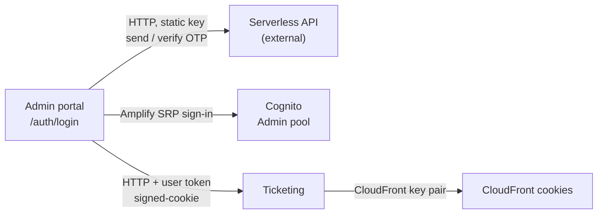

# X-01 · Admin login (phone OTP + password)

> **Bangla name:** অ্যাডমিন লগইন (ফোন OTP + পাসওয়ার্ড)
>
> [← 60 · Cross-cutting](README.md) · [Contents](../README.md) · [Open queries](../99-open-queries.md)

## 1. Name and purpose

**Admin login.** Lets BCB and BS23 staff (roles `admin`, `event_manager`, `ticket_manager`, `ticket_operator`,
`customer_support`) sign in to the admin portal. The screen asks for three things in turn: the 10-digit phone number, a
6-digit SMS code, and the Cognito password. A successful login gives the browser Cognito tokens from the **Admin** user pool,
which every admin API call then carries.

## 2. Trigger and actor

| Item | Value |
|---|---|
| Actor | Staff member with an account in the Admin Cognito pool (created by [X-05](X-05-admin-provisioning.md)) |
| Client and screen | Admin portal, route `/auth/login` (`LoginComponent`) |
| Cognito pool | Admin (`environment.aws.userPoolId` / `userPoolWebClientId`) |
| Role / program scope | None needed to log in; the role decides the landing page afterwards |

## 3. Business flow

1. The staff member types the phone number without `+880`.
2. The portal asks the "Serverless" API to send a 6-digit code by SMS. If the number is unknown, the message is "User not found."
3. The staff member types the code; the portal asks the Serverless API to verify it. A resend is allowed after 2 minutes.
4. After a valid code, the password field appears. The portal signs in to Cognito with `+880<phone>` and the password.
5. The portal reads the role (`custom:role`) and opens the landing page: `/program-management` for `admin`, `event_manager`
   (alone or with `ticket_manager`); `/home` for the others.
6. For the roles `admin`, `ticket_manager` and `ticket_operator` the portal also asks Ticketing for CloudFront signed cookies,
   so reserved-ticket files can be downloaded later ([A-12](../10-admin-portal/A-12-reserved-tickets.md)).

## 4. Technical flow

| # | From → To | Hop | What happens |
|---|---|---|---|
| 1 | Admin portal → Serverless API `POST {serverless.baseUrl}/admin/login-2fa-send-otp` | **[HTTP, static key]** | Body `{ otp_type: "sms", destination: "+880…" }`, header `Authorization: <environment.serverless.authorization>`. Success when `status_message == "otp_generated_and_enqueued_successfully"` |
| 2 | Admin portal → Serverless API `POST …/admin/login-2fa-verify-otp` | **[HTTP, static key]** | Body adds `otp`. Success when `status_message == "sms_otp_verified_successfully"`; `invalid_otp` otherwise |
| 3 | Admin portal → Cognito (Admin pool) | Amplify `Auth.signIn(phone, password)` | SRP sign-in (Amplify's default flow; locally the setup script enables `ALLOW_USER_SRP_AUTH`). Returns tokens, or a challenge |
| 3a | | challenge `NEW_PASSWORD_REQUIRED` | The portal answers with `Auth.completeNewPassword(response, <same password>)`, so the temporary password becomes permanent |
| 3b | | challenge `SMS_MFA` | Returned to the caller as a value, not handled (see notes) |
| 4 | Admin portal → Cognito | `Auth.currentSession()`, `Auth.currentUserInfo()` | Access token cached for 55 minutes; user attributes (including `custom:role`) cached for 55 minutes |
| 5 | Admin portal → Ticketing `GET /ticketing/api/v1/booking-order-ticket/signed-cookie` | **[HTTP + user token]** | Only for roles `admin`, `ticket_manager`, `ticket_operator`; the response's `CloudFront-*` cookies are written with `document.cookie` |

No backend service is involved in steps 1–4. The services see the user only on the next API call, when they validate the
Admin-pool access token ([X-14](X-14-authz-pool-policies.md)).

## 5. Components

| Kind | Component |
|---|---|
| Client | Admin portal: `LoginComponent`, `CognitoService`, `EventService.setSignedCookie()` |
| External | "Serverless" API (`environment.serverless.baseUrl`), source not in any repo `[UNCONFIRMED: Q-03]` |
| AWS | Cognito Admin user pool |
| Service | Ticketing (signed cookie only) |
| Data | Browser: Amplify token storage (local storage), `sessionStorage.lastKnownUserRole`, `localStorage.globalProgramId`, CloudFront cookies |

## 6. API contracts

| Method | Path | Auth | Request | Response | Main errors |
|---|---|---|---|---|---|
| POST | `{serverless}/admin/login-2fa-send-otp` | header `Authorization: <static key>` | `{ otp_type, destination }` | `{ status_message }` | `status_message: "user_not_found"` |
| POST | `{serverless}/admin/login-2fa-verify-otp` | same | `{ otp_type, destination, otp }` | `{ status_message, user_id? }` | `status_message: "invalid_otp"` |
| — | Cognito `InitiateAuth` / `RespondToAuthChallenge` (Amplify) | none (public client) | phone + password | Cognito tokens | `NotAuthorizedException`, `UserNotFoundException`, … (mapped to text in `getCognitoErrorMessage`) |
| GET | `/ticketing/api/v1/booking-order-ticket/signed-cookie` | `Policy = admin` | none | CloudFront cookie values | 401 |

The Serverless request and response shapes are what the portal sends and reads; the API itself is not in the repositories.

```json
// POST {serverless}/admin/login-2fa-send-otp
{ "otp_type": "sms", "destination": "+8801700000001" }

// 200
{ "status_message": "otp_generated_and_enqueued_successfully" }
```

```json
// POST {serverless}/admin/login-2fa-verify-otp
{ "otp_type": "sms", "destination": "+8801700000001", "otp": "123456" }

// 200
{ "status_message": "sms_otp_verified_successfully" }
```

## 7. Data and side effects

- Nothing is written by the GoBCB backend during login.
- The Serverless API sends an SMS (outside the repos).
- The browser stores Amplify's tokens, `sessionStorage.lastKnownUserRole` (used by role-change detection, [X-17](X-17-authz-client-side.md)),
  and for three roles the CloudFront cookies.

## 8. Code references

| What | Where |
|---|---|
| Login screen logic (3 steps, landing route, signed cookie) | `rvl-gobcb-admin-portal/src/app/modules/auth/login/login.component.ts:124-249` |
| Serverless OTP calls | `rvl-gobcb-admin-portal/src/app/core/services/cognito.service.ts:444-472` |
| Cognito sign-in and challenges | `rvl-gobcb-admin-portal/src/app/core/services/cognito.service.ts:213-246` |
| Token and user-info cache (55 min) | `rvl-gobcb-admin-portal/src/app/core/services/cognito.service.ts:261-302`, `:353-377` |
| Amplify configuration | `rvl-gobcb-admin-portal/src/app/core/config/aws-exports.ts` |
| Signed cookie request | `rvl-gobcb-admin-portal/src/app/features/events/services/event.service.ts:234` |
| Interceptors that skip the OTP URLs | `rvl-gobcb-admin-portal/src/app/core/interceptors/auth.interceptor.ts:19-29`, `src/app/interceptors/program-id.interceptor.ts:15` |

## 9. Handover notes

1. **The SMS code is checked only by the browser.** Step 3 sends just phone and password to Cognito; nothing from the OTP
   step reaches Cognito or the services. Anyone who knows a staff password can get Admin-pool tokens by calling Cognito
   directly (as the Postman request "Login as admin" does locally). Whether the Admin pool itself enforces MFA is not visible
   in the repos `[UNCONFIRMED: Q-03]`.
2. **The Serverless key is in the browser bundle.** `environment.serverless.authorization` is part of the generated
   `environment.ts`, so every visitor of the admin portal can read it.
3. **`NEW_PASSWORD_REQUIRED` silently re-uses the typed password.** Accounts created by the Admin service already get a
   permanent password ([X-05](X-05-admin-provisioning.md)), so this branch matters only for accounts created another way.
4. **`SMS_MFA` is not handled.** `signIn` resolves with `{ challengeName: 'SMS_MFA', … }`; `onLogin` treats that as success and
   then fails to read the role because the user is not signed in. `confirmMFA(user, code)` exists but no screen calls it.
5. **Signed-cookie roles use an exact match.** `allowedRoles.includes(role)` compares the whole `custom:role` string, so a user
   whose attribute holds two roles (for example `event_manager,ticket_manager`) gets no cookie at login. The top bar has a
   "refresh cookie" action (`RefreshCookie()` in `app.topbar.component.ts`).
6. **Role cache.** The role shown and used by the menu is cached for 55 minutes in the browser; a role change by an admin
   takes up to that long to be noticed ([X-17](X-17-authz-client-side.md)). The backend has its own cache ([X-15](X-15-authz-roles.md)).

## 10. Component relationships



**Depends on:** [X-05](X-05-admin-provisioning.md) (account exists), Serverless API, Cognito Admin pool.
**Affects:** every `A-xx` feature (token), [X-04](X-04-admin-session.md) (session), [X-17](X-17-authz-client-side.md) (menu by role),
[A-12](../10-admin-portal/A-12-reserved-tickets.md) (signed cookie).

## 11. Developer test guide

**Local testability: Partial.** The OTP step runs against a local stub (any phone, code `123456`); Cognito is Floci. Real SMS,
real MFA and CloudFront cookies cannot be tested locally.

| Item | Detail |
|---|---|
| Test data and accounts | Admin-pool users from `scripts/Seed-EtpCognitoUsers.ps1`: `+8801700000001` admin, `…02` event_manager, `…03` ticket_manager, `…04` ticket_operator, `…05` customer_support. Password `Passw0rd!23` (`docs/local-dev.md` Step 3) |
| Browser | Start the backend (`dotnet run --project aspire/Etp.AppHost`) and the portal copy (`pwsh ./scripts/Setup-AdminPortal.ps1 -Start`). Open `http://localhost:4200/auth/login`; phone `1700000001`, OTP `123456`, password `Passw0rd!23` (`docs/admin-portal-local.md` §5). In DevTools → Network, filter `p/`: you see `/p/serverless/admin/login-2fa-send-otp`, `…verify-otp`, then calls to `/p/cognito` and finally the first `/p/admin/...` call with `Authorization: Bearer …` |
| Emulator | Not applicable (admin portal is web only) |
| Postman | Collection `postman/etp-login-all-pools.postman_collection.json`, folder "Admin pool", request "Login as admin" (USER_PASSWORD_AUTH against Floci, environment `postman/etp-local-services.postman_environment.json`). It stores the token for the service collections. Negative cases: `postman/etp-cognito-auth.postman_collection.json` folder "02 - Cognito negative auth" |
| Visual Studio debug | Nothing to debug on the server for the login itself. To see the token arrive, attach to `ETP.Admin.Service` (`docs/local-dev.md` §6.1) and set a breakpoint in `OnTokenValidated` of the `admin` scheme, `rvl-gobcb-backend/Core/ETP.Core/Configuration/DefaultAuthenticationConfig.cs:101` |
| Verify | The landing page matches the role table in §3. `sessionStorage.lastKnownUserRole` holds the role. A protected call such as `GET /admin/api/v1/events` returns 200 (`pwsh ./scripts/Test-EtpLocal.ps1` checks 401 without and 200 with a token) |
