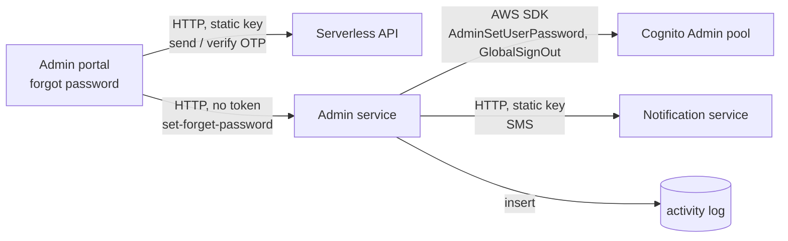

# X-02 · Admin forgot password

> **Bangla name:** অ্যাডমিন পাসওয়ার্ড ভুলে যাওয়া
>
> [← 60 · Cross-cutting](README.md) · [Contents](../README.md) · [Open queries](../99-open-queries.md)

## 1. Name and purpose

**Admin forgot password.** Lets a staff member who forgot the password set a new one after proving control of the phone
with an SMS code. The new password is written straight into the Admin Cognito pool by the Admin service and also sent to the
phone by SMS.

## 2. Trigger and actor

| Item | Value |
|---|---|
| Actor | Staff member with an Admin-pool account, not signed in |
| Client and screen | Admin portal, link on the login page → `ForgotPasswordComponent` (route `/auth/forgot-password`, also shown as a dialog from the login page) |
| Cognito pool | Admin |
| Role / program scope | None (anonymous) |

## 3. Business flow

1. The staff member enters the 10-digit phone number.
2. The portal sends an SMS code through the Serverless API (same call as login, [X-01](X-01-admin-login.md)).
3. The staff member enters the code; the Serverless API verifies it and returns the user's id.
4. The staff member enters and confirms the new password (minimum 8 characters, upper, lower, digit, one of `!@#$%^&*`).
5. The portal sends user id and password to the Admin service, which sets the password, signs the user out everywhere, and
   sends an SMS that contains the new password. The portal returns to the login page after 2 seconds.
6. "Resend" on this screen does something different: it calls Cognito's own forgot-password flow with delivery by email.

## 4. Technical flow

| # | From → To | Hop | What happens |
|---|---|---|---|
| 1 | Admin portal → Serverless `POST …/admin/login-2fa-send-otp` | **[HTTP, static key]** | Same as [X-01](X-01-admin-login.md) step 1 |
| 2 | Admin portal → Serverless `POST …/admin/login-2fa-verify-otp` | **[HTTP, static key]** | On `sms_otp_verified_successfully` the portal keeps `response.user_id` |
| 3 | Admin portal → Admin `POST /admin/api/v1/admin-users/set-forget-password` | **[HTTP, no token]** (`[AllowAnonymous]`; the portal's auth interceptor skips this URL) | Body `{ userId, password }` |
| 4 | Admin service → Cognito (Admin pool) | AWS SDK with static keys | `AdminGetUser(userId)` to read `phone_number`, `AdminUserGlobalSignOut`, `AdminSetUserPassword(Permanent = true)` |
| 5 | Admin service → Notification service `Notification:Endpoint` | **[HTTP, static key]** | SMS "Your password has been changed successfully.New Password is …" |
| 6 | Admin service → database | — | Activity log row `AdminUser / PasswordResetCompleted` ([X-24](X-24-activity-logging.md)) |
| R | (Resend) Admin portal → Cognito | Amplify `Auth.forgotPassword(phone, { DeliveryMedium: 'EMAIL' })` | Cognito sends its own code by email; this screen never submits that code (`confirmForgotPassword` is not called) |

## 5. Components

| Kind | Component |
|---|---|
| Client | Admin portal `ForgotPasswordComponent`, `CognitoService.submitPassword()` |
| External | Serverless API (OTP), Notification service (SMS) `[UNCONFIRMED: Q-05]` |
| Service | Admin: `AdminUsersController.ForgetSetPasswordAsync` → `AdminUserManager` → `AdminUserProvider` |
| AWS | Cognito Admin pool |
| Data | `etp` activity log table ([X-24](X-24-activity-logging.md)) |

## 6. API contracts

| Method | Path | Auth | Request DTO | Response | Main errors |
|---|---|---|---|---|---|
| POST | `/admin/api/v1/admin-users/set-forget-password` | none (`[AllowAnonymous]`) | `AdminForgetSetPassword { UserId, Password }` | `200` with body `200` | 400 `ArgumentException` (Cognito error text, e.g. password policy) |
| GET | `/admin/api/v1/admin-users/forget-password?phoneNo=` | none (`[AllowAnonymous]`) | query `phoneNo` | `true` / `false` | — (errors are swallowed and return `false`) |
| POST | `{serverless}/admin/login-2fa-send-otp`, `…/verify-otp` | static key | see [X-01](X-01-admin-login.md) | `{ status_message, user_id }` | `invalid_otp` |

`GET forget-password` is not called by the current portal (`CognitoService.sendOtp()` exists but has no caller); it is listed
because it is reachable: it runs Cognito `AdminResetUserPassword` for the account with that phone number.

```json
// POST /admin/api/v1/admin-users/set-forget-password
{ "userId": "3f6c2a8e-0000-4000-8000-000000000001", "password": "N3w!Passw0rd" }

// 200
200
```

```json
// 400 when Cognito rejects the password
{ "status": 400, "title": "Password did not conform with policy: Password must have symbol characters" }
```

The 400 title is the Cognito exception message passed through `ArgumentException`; the example text is illustrative of that
shape, the exact wording comes from Cognito.

## 7. Data and side effects

- Cognito: password replaced (permanent), all sessions of the user revoked (`AdminUserGlobalSignOut`).
- SMS with the new password in clear text, through the Notification service.
- Activity log entry `PasswordResetCompleted` with entity id = user id.
- `GET forget-password` (if called): Cognito marks the user `RESET_REQUIRED` and sends Cognito's own code; activity log entry
  `PasswordResetRequested` with the phone number as entity id.

## 8. Code references

| What | Where |
|---|---|
| Screen flow | `rvl-gobcb-admin-portal/src/app/modules/auth/forgot-password/forgot-password.component.ts:123-263` |
| Portal API call | `rvl-gobcb-admin-portal/src/app/core/services/cognito.service.ts:432-434` |
| Controller (anonymous endpoints) | `rvl-gobcb-backend/Services/Admin/ETP.Admin.Service/Api/AdminUsersController.cs:28-39`, `:185-196` |
| Manager | `rvl-gobcb-backend/Services/Admin/ETP.Admin.Domain/Managers/AdminUserManager.cs:197-231` |
| Cognito calls and SMS | `rvl-gobcb-backend/Services/Admin/ETP.Admin.Integration/Services/AdminUserProvider.cs:508-586` |

## 9. Handover notes

1. **The backend does not check the OTP.** `set-forget-password` is anonymous and trusts the `userId` in the body. The OTP is
   verified only between the browser and the Serverless API. Any caller who knows or guesses an admin's Cognito user id
   (the `sub`, or the username, which is the phone number) can set that admin's password. The local Postman collection
   demonstrates it ("Set known password (set-forget-password)"). Whether something in front of the service (API Gateway)
   blocks this route is not in the repos `[UNCONFIRMED: Q-04]`.
2. **Passwords travel by SMS.** The new password is sent back in clear text. The same pattern is used when accounts are
   created and when an admin resets someone's password ([X-05](X-05-admin-provisioning.md)).
3. **"Resend" is inconsistent.** It starts Cognito's email-based flow, whose code this screen cannot accept. In practice the
   user has to start again with "Send OTP".
4. **`GET forget-password` is an unused but open endpoint** that can force any admin account into `RESET_REQUIRED`
   (it needs only the phone number). Candidate for removal; listed in [X-18](X-18-endpoints-without-auth.md).
5. **Response body.** Both admin-user write endpoints return the literal number `200` as the body (`Ok(200)`), not an object.

## 10. Component relationships



**Depends on:** [X-05](X-05-admin-provisioning.md), Serverless API, Notification service.
**Affects:** [X-01](X-01-admin-login.md) (old sessions revoked; new password needed).

## 11. Developer test guide

**Local testability: Partial.** The local OTP stub does not return `user_id`, so the browser flow stops at "User ID and
password are required." The backend endpoint itself works against Floci. SMS is sent to the dummy `Notification:Endpoint`
(`https://notification.invalid/`, `scripts/user-secrets.example.json`), so the SMS step fails and the endpoint returns 400 after
the password has already been changed.

| Item | Detail |
|---|---|
| Test data and accounts | Admin-pool users from `scripts/Seed-EtpCognitoUsers.ps1`; for a throw-away account use the Postman variable `tmp_phone` (`+8801700009999`) |
| Browser | `http://localhost:4200/auth/login` → "Forgot password", phone `1700000001`, OTP `123456`. Expect the stop described above; DevTools shows the two `/p/serverless/...` calls |
| Emulator | Not applicable |
| Postman | `postman/etp-cognito-auth.postman_collection.json`, folder "06 - Admin user lifecycle (creates and deletes tmp_phone)", request "Set known password (set-forget-password)"; then "Login as new user" proves the change. Environment `postman/etp-local-floci.postman_environment.json`. Note: the collection's `admin_base_url` is `http://localhost:5101` and the request path is `/api/v1/...`; add the `/admin` prefix if you get 404 ([Appendix D](../93-appendix-d-local-test-reference.md)) |
| Visual Studio debug | Attach to `ETP.Admin.Service`; breakpoints at `AdminUsersController.cs:194` and `AdminUserProvider.cs:541` |
| Verify | `aws --endpoint-url http://localhost:4566 cognito-idp admin-get-user --user-pool-id <AdminPoolId> --username +8801700009999` shows `UserStatus: CONFIRMED`; a USER_PASSWORD_AUTH login with the new password succeeds; SQL `select * from etp."ActivityLogs" order by "Id" desc limit 5;` shows `PasswordResetCompleted` (table name: see [X-24](X-24-activity-logging.md)) |
