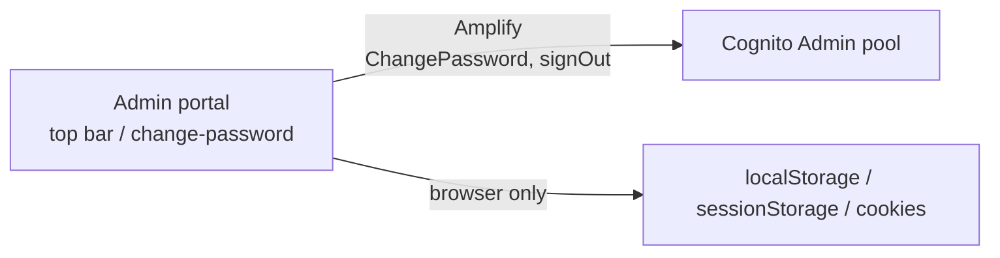

# X-03 · Admin change password and logout

> **Bangla name:** অ্যাডমিন পাসওয়ার্ড পরিবর্তন ও লগআউট
>
> [← 60 · Cross-cutting](README.md) · [Contents](../README.md) · [Open queries](../99-open-queries.md)

## 1. Name and purpose

**Change password** lets a signed-in staff member replace the password, after which the portal signs out.
**Logout** ends the session in the browser and clears the program selection and the CloudFront cookies.
Both run entirely between the browser and Cognito; no GoBCB service is called.

## 2. Trigger and actor

| Item | Value |
|---|---|
| Actor | Any signed-in admin-portal user |
| Client and screen | Admin portal top bar → profile menu → "Change Password" (route `/change-password`, `ChangePasswordComponent`) and "Logout" (`AppTopBarComponent.logout()`) |
| Cognito pool | Admin |
| Role / program scope | Any role; no program needed |

## 3. Business flow

**Change password**
1. The user types the current password and the new password twice (new password at least 8 characters, must differ from the old one).
2. On success the portal shows "Your password has been successfully updated.", signs out and opens the login page after one second.
3. If the current password is wrong the message is "Current password is wrong."

**Logout**
1. The user confirms "Are you sure you want to log out?".
2. The portal signs out of Cognito, resets the selected program to 0 (global menu), expires the three `CloudFront-*` cookies and opens `/auth/login`.

## 4. Technical flow

| # | From → To | Hop | What happens |
|---|---|---|---|
| C1 | Admin portal → Cognito | Amplify `Auth.currentAuthenticatedUser()` then `Auth.changePassword(user, old, new)` | Cognito `ChangePassword` with the user's access token |
| C2 | Admin portal → Cognito | Amplify `Auth.signOut()` | Local sign-out (Amplify default, not global) |
| L1 | Admin portal → Cognito | `CognitoService.signOut()` → `Auth.signOut()` | Clears Amplify storage, token cache, user-info cache and `sessionStorage.lastKnownUserRole` |
| L2 | Admin portal (browser only) | `ProgramService.setProgramId(0)`; `clearSignedCookie()` | `localStorage.globalProgramId = 0`; `CloudFront-Policy`, `CloudFront-Signature`, `CloudFront-Key-Pair-Id` expired |

## 5. Components

| Kind | Component |
|---|---|
| Client | Admin portal `ChangePasswordComponent`, `AppTopBarComponent`, `CognitoService`, `ProgramService` |
| AWS | Cognito Admin pool |
| Service | none |

## 6. API contracts

No GoBCB endpoint is used. Cognito APIs called through Amplify: `ChangePassword`, and the token revocation Amplify performs on
sign-out.

The backend has a server-side change-password implementation for admins (`AdminUserManager.ChangePasswordAsync`, which calls
Cognito `ChangePassword` with an access token) but **no controller exposes it**. The portal's `ChangePasswordService` calls
`PUT /admin/api/v1/Users/change-password`, which does not exist; that service is not used by the screen. Both are listed in
[Appendix A](../90-appendix-a-legacy.md).

## 7. Data and side effects

- Cognito: password changed. Existing refresh tokens remain valid until they expire or are revoked; the portal only signs out locally.
- Browser: tokens, caches, program selection and CloudFront cookies removed on logout.

## 8. Code references

| What | Where |
|---|---|
| Change-password screen | `rvl-gobcb-admin-portal/src/app/modules/auth/change-password/change-password.component.ts:50-85` |
| Cognito change password and sign-out | `rvl-gobcb-admin-portal/src/app/core/services/cognito.service.ts:303-352` |
| Logout and cookie clean-up | `rvl-gobcb-admin-portal/src/app/layout/app.topbar.component.ts:80-120` |
| Unused server-side change password | `rvl-gobcb-backend/Services/Admin/ETP.Admin.Domain/Managers/AdminUserManager.cs:181-195` |
| Unused portal service with a wrong URL | `rvl-gobcb-admin-portal/src/app/modules/auth/change-password/change-password.service.ts:20-22` |

## 9. Handover notes

1. **Sign-out is local.** Amplify's `Auth.signOut()` without `{ global: true }` does not revoke other sessions. To end every
   session of a user, an admin must disable the account or reset its password ([X-05](X-05-admin-provisioning.md)), which call
   `AdminUserGlobalSignOut`.
2. **The program selection survives in `localStorage`** across reloads; logout resets it to 0 so the next user starts in the
   global menu ([A-01](../10-admin-portal/A-01-program-selection.md)).
3. **Cookie clean-up may miss the real cookies.** The cookies were written with `domain=environment.cloudFront.mainDomain`
   ([X-01](X-01-admin-login.md)); `clearSignedCookie()` expires them without a `domain` attribute. Browsers treat a cookie set
   with a `Domain` attribute and a host-only cookie of the same name as different cookies, so the CloudFront cookies can
   survive logout until they expire. Check in DevTools → Application → Cookies on a deployed environment.

## 10. Component relationships

**Depends on:** [X-01](X-01-admin-login.md). **Affects:** [X-04](X-04-admin-session.md), [A-01](../10-admin-portal/A-01-program-selection.md).

## 11. Developer test guide

**Local testability: Full** for logout; **Partial** for change password (Floci's Cognito emulation of `ChangePassword` is not
verified in the workspace docs, which list change-password flows as "untested here", `docs/admin-portal-local.md` "Limits").

| Item | Detail |
|---|---|
| Test data and accounts | Any Admin-pool user, e.g. `+8801700000005` / `Passw0rd!23`. Prefer a throw-away user so the shared test password is not changed |
| Browser | `http://localhost:4200`, log in ([X-01](X-01-admin-login.md)), profile menu → Change Password. DevTools → Network shows a call to `/p/cognito` with header `X-Amz-Target: AWSCognitoIdentityProviderService.ChangePassword`. Logout: Application tab → Local Storage `globalProgramId` becomes `0`; Session Storage `lastKnownUserRole` disappears |
| Emulator | Not applicable |
| Postman | Session revocation behaviour: `postman/etp-cognito-auth.postman_collection.json` folder "08 - Session revocation (run last)" (GlobalSignOut, then refresh fails) |
| Visual Studio debug | Not applicable (no backend call) |
| Verify | After change password, a USER_PASSWORD_AUTH login (Postman "Login as …") with the old password fails with `NotAuthorizedException` |
