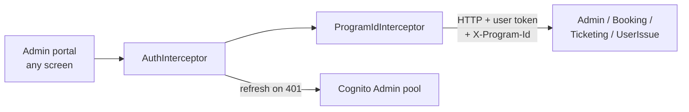

# X-04 · Admin session handling (token attach and refresh)

> **Bangla name:** অ্যাডমিন সেশন ব্যবস্থাপনা (টোকেন সংযুক্তি ও রিফ্রেশ)
>
> [← 60 · Cross-cutting](README.md) · [Contents](../README.md) · [Open queries](../99-open-queries.md)

## 1. Name and purpose

**Admin session handling.** Explains how the admin portal puts the Cognito access token and the program id on every API
call, how it refreshes the token before or after it expires, and when it gives up and sends the user back to the login page.
Every `A-xx` feature relies on this.

## 2. Trigger and actor

| Item | Value |
|---|---|
| Actor | Any signed-in admin-portal user; triggered by every HTTP call the portal makes |
| Client | Admin portal: `AuthInterceptor`, `ProgramIdInterceptor`, `LoaderInterceptor` (registered in `app.module.ts`) |
| Cognito pool | Admin |
| Role / program scope | `X-Program-Id` is added to every request ([X-16](X-16-authz-program-scope.md)) |

## 3. Business flow

The user notices nothing while the session is valid. If the refresh token is no longer valid (expired, revoked by a password
reset or account disable), the next call fails, the portal signs out and the login page opens.

## 4. Technical flow

| # | Step | Detail |
|---|---|---|
| 1 | Skip list | URLs containing `/admin-users/forget-password`, `admin/login-2fa-send-otp`, `admin/login-2fa-verify-otp`, `/admin-users/set-forget-password` get no token |
| 2 | Get token | `CognitoService.getAccessToken()`: returns the cached access token if it is younger than 55 minutes and more than 2 minutes from its `exp`; otherwise refreshes |
| 3 | Attach | `Authorization: Bearer <access token>` on the cloned request |
| 4 | Program header | `ProgramIdInterceptor` adds `X-Program-Id: <localStorage.globalProgramId>` to every request except `/admin/login-2fa*`. The value is `0` in the global menu |
| 5 | Call | **[HTTP + user token]** to Admin, Booking, Ticketing or UserIssue |
| 6 | On 401 | One refresh at a time (`isRefreshing` flag + `BehaviorSubject`): `Auth.currentSession()` refreshes with the refresh token; the failed request is retried once with the new token; requests that arrive meanwhile wait for it |
| 7 | Refresh fails | `handleRefreshFailure()`: clear caches and `lastKnownUserRole`, `Auth.signOut()`, navigate to `/auth/login` |

Interceptor order in `app.module.ts`: `AuthInterceptor`, `LoaderInterceptor`, `ProgramIdInterceptor`.

## 5. Components

| Kind | Component |
|---|---|
| Client | `AuthInterceptor`, `ProgramIdInterceptor`, `CognitoService` (token cache, refresh), `ProgramService` |
| AWS | Cognito Admin pool (token refresh) |
| Service | every service the admin portal calls; they validate the token ([X-14](X-14-authz-pool-policies.md)) |

## 6. API contracts

Not a feature with its own endpoint. Headers added to every admin-portal API call:

| Header | Value | Read by |
|---|---|---|
| `Authorization` | `Bearer <Cognito access token>` | JWT bearer handler of each service ([X-14](X-14-authz-pool-policies.md)) |
| `X-Program-Id` | selected program id, `0` = none | Admin service `ProgramIdMiddleware` and `[AuthorizeProgram]` ([X-16](X-16-authz-program-scope.md)); ignored by other services |

## 7. Data and side effects

Browser only: Amplify token storage, in-memory token cache (`cachedAccessToken`, 55 minutes), user-info cache (55 minutes).

## 8. Code references

| What | Where |
|---|---|
| Token attach, 401 handling, skip list | `rvl-gobcb-admin-portal/src/app/core/interceptors/auth.interceptor.ts:14-102` |
| Program header | `rvl-gobcb-admin-portal/src/app/interceptors/program-id.interceptor.ts:14-29` |
| Token cache and refresh | `rvl-gobcb-admin-portal/src/app/core/services/cognito.service.ts:88-211`, `:261-302` |
| Interceptor registration | `rvl-gobcb-admin-portal/src/app/app.module.ts:22-33` |

## 9. Handover notes

1. **Two refresh guards.** Both `AuthInterceptor` and `CognitoService` keep their own `isRefreshing` flag and subject. They work
   together today, but a change to one must keep the other in mind.
2. **The SignalR chat connection is outside the interceptor.** It passes the token in the query string ([A-24](../10-admin-portal/A-24-user-issues-admin.md)).
3. **`X-Program-Id` goes to every service.** Only the Admin service reads it; Booking, Ticketing and UserIssue ignore it.
4. **No idle timeout.** The session lasts as long as Cognito's refresh token is valid (pool setting, not in the repos).

## 10. Component relationships

**Depends on:** [X-01](X-01-admin-login.md), [A-01](../10-admin-portal/A-01-program-selection.md) (program id). **Affects:** every `A-xx` feature.

## 11. Developer test guide

**Local testability: Full.**

| Item | Detail |
|---|---|
| Test data and accounts | Any Admin-pool user (`docs/admin-portal-local.md` §5) |
| Browser | Log in at `http://localhost:4200`. DevTools → Network → any `/p/admin/...` request → Request Headers show `Authorization: Bearer …` and `X-Program-Id`. Select a program ([A-01](../10-admin-portal/A-01-program-selection.md)) and watch `X-Program-Id` change. To force the 401 path, revoke the session with Postman (below) and click any menu item: the portal signs out and opens the login page |
| Emulator | Not applicable |
| Postman | `postman/etp-cognito-auth.postman_collection.json` folder "03 - Token lifecycle" ("Refresh token -> new access token") and "08 - Session revocation (run last)" |
| Visual Studio debug | Attach to `ETP.Admin.Service`; breakpoint in `ProgramIdMiddleware.InvokeAsync` (`rvl-gobcb-backend/Services/Admin/ETP.Admin.Service/Middleware/ProgramIdMiddleware.cs:12`) to see the header arrive |
| Verify | Aspire dashboard → Admin → Structured logs: requests after the refresh succeed with 200 |
