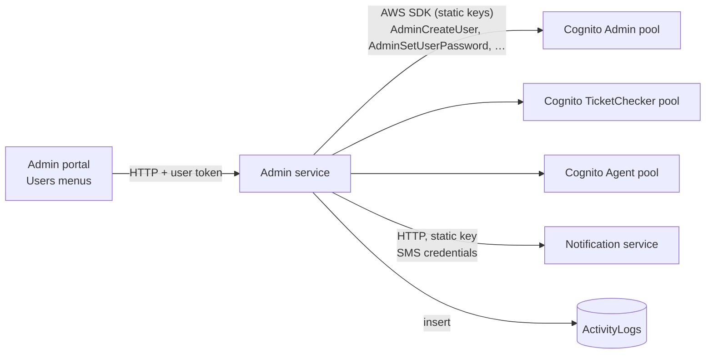

# X-05 · Staff account provisioning

> **Bangla name:** স্টাফ অ্যাকাউন্ট তৈরি
>
> [← 60 · Cross-cutting](README.md) · [Contents](../README.md) · [Open queries](../99-open-queries.md)

## 1. Name and purpose

**Staff account provisioning.** Staff never sign up themselves. An administrator creates every admin, ticket-checker and
agent account from the admin portal; the Admin service then creates the user directly in the matching Cognito pool, sets a
generated **permanent** password, and sends the username and password to the phone by SMS. The same service disables,
enables, deletes and resets those accounts. This file describes the shared mechanics; the screens are in
[A-25](../10-admin-portal/A-25-admin-users.md) (admins), [A-17](../10-admin-portal/A-17-ticket-checker-users.md) (checkers) and
[A-26](../10-admin-portal/A-26-agent-users.md) (agents).

## 2. Trigger and actor

| Item | Value |
|---|---|
| Actor | Admin-portal user in the global menu (program 0). Admin accounts: role `admin`. Checker accounts: `admin`, `event_manager`, `ticket_manager`, `ticket_operator` (controller roles). Agent accounts: no server-side restriction (see notes) |
| Client and screen | Admin portal → Users → "Regular Admins" (`/users`), "Ticket Checkers" (`/ticket-checker`), "Seller Agents" (`/agent-user`); menu shown for `admin` only ([X-17](X-17-authz-client-side.md)) |
| Cognito pools written | Admin, TicketChecker, Agent |

## 3. Business flow

1. The administrator fills in name, phone (the form adds `+880`), email and, for admins, one or more roles and the programs the user may work on.
2. The account is created and the new user receives an SMS: "Your account has been created successfully. Your user name is
   <phone> and password is <password>".
3. Later the administrator can edit name/role/programs, disable or enable the account, delete it, or "Set Password", which
   generates a new password and sends it by SMS.
4. Disabling an account (and resetting its password) signs the user out on every device.

## 4. Technical flow

| # | From → To | Hop | What happens |
|---|---|---|---|
| 1 | Admin portal → Admin `POST /admin/api/v1/admin-users` (or `/ticket-checker`, `/agent-users`) | **[HTTP + user token]** | Body with name, phone, email, role(s), program ids |
| 2 | Admin service → Cognito | AWS SDK, static keys `AWS:AccessKey` / `AWS:SecretAccessKey` | Admin users: `ListUsers(email = …)` to refuse a duplicate email; then `AdminCreateUser(Username = phone, attributes)` with a temporary password, then `AdminSetUserPassword(Permanent = true)` with the same password |
| 3 | Admin service → Notification service `POST /notification/send-message` | **[HTTP, static key]** | SMS with username and password |
| 4 | Admin service → database | — | Activity log `AdminUser / Created` (admin accounts) ([X-24](X-24-activity-logging.md)) |
| U | Update | `AdminUpdateUserAttributes` | `name`, `custom:role`, `custom:program_ids` (empty string when no programs), `email_verified`, `phone_number_verified`; the cached attributes `user_{id}` are removed |
| D | Disable / enable | `AdminDisableUser` / `AdminEnableUser` + `AdminUserGlobalSignOut` | An admin cannot disable or delete itself (`ArgumentNullException("Invalid permission")` → 400) |
| P | Set password | `AdminUserGlobalSignOut`, `AdminSetUserPassword(generated, Permanent)`, SMS with the new password | Admins: body `{ userId }`; checkers and agents: query `?userId=` |
| X | Delete | `AdminDeleteUser`, cache entry removed | |

**Attributes written per pool**

| Pool | Username | Attributes |
|---|---|---|
| Admin | phone | `phone_number`, `name`, `email`, `custom:role` (comma-separated roles), `custom:program_ids` (comma-separated ids, optional), `email_verified=true`, `phone_number_verified=true` |
| TicketChecker | phone | `phone_number`, `name`, `email` = `<phone without +>@gobcbticket.com`, `custom:role = "TicketChecker"` |
| Agent | phone | `phone_number`, `name`, `custom:branch_location`, `custom:company_name`, `custom:company_branch`, `phone_number_verified=true`, optional `custom:email` |

Generated passwords: 8 characters with at least one upper case letter, lower case letter, digit and one of `!@#$`, built with
`System.Random` (`AdminUserProvider.GeneratePassword`).

## 5. Components

| Kind | Component |
|---|---|
| Client | Admin portal `UserService`, `TicketCheckerService`, `AgentUserService` and their list pages |
| Service | Admin: `AdminUsersController`, `TicketCheckerController`, `AgentController` → `*UserManager` → `AdminUserProvider`, `TicketCheckerUserProvider`, `AgentUserProvider` |
| AWS | Cognito Admin, TicketChecker and Agent pools (admin API with static IAM keys) |
| External | Notification service (`Notification:Endpoint`, `Notification:Authorization`) `[UNCONFIRMED: Q-05]` |
| Cache | `User` cache, key `user_{userId}` ([X-25](X-25-redis.md)) |

## 6. API contracts

| Method | Path | Auth | Request | Response | Main errors |
|---|---|---|---|---|---|
| POST | `/admin/api/v1/admin-users` | Admin pool, role `admin` | `AdminCreateUser { Name, Phone, Email, Role, ProgramIds? }` | `AdminUserResponse` | 400 "User Account already exists", Cognito errors |
| PUT | `/admin/api/v1/admin-users/{id}` | role `admin` | `AdminUpdateUser { UserId, Name, Role, ProgramIds? }` | empty `AdminUserResponse` | 400 user not found |
| POST | `/admin/api/v1/admin-users/disable/{id}`, `/enable/{id}` | role `admin` | — | `200` | 400 own account |
| POST | `/admin/api/v1/admin-users/set-password` | role `admin` | `AdminSetPasswordRequest { UserId }` | `200` | 400 |
| DELETE | `/admin/api/v1/admin-users/{id}` | role `admin` | — | `200` | 400 own account |
| POST | `/admin/api/v1/ticket-checker` | roles `admin,event_manager,ticket_manager,ticket_operator` | `TicketCheckerCreateUser` | empty | 400 |
| POST | `/admin/api/v1/ticket-checker/set-password?userId=` | same | query `userId` | `200` | 400 |
| POST | `/admin/api/v1/agent-users` | **none** | `AgentCreateUser { Name, Phone, Email?, CompanyName, CompanyBranch, BranchLocation }` | empty | 400 |
| POST | `/admin/api/v1/agent-users/set-password?userId=` | **none** | query `userId` | `200` | 400 |

The full list of admin, checker and agent endpoints (get, list, search, update, change-password) is in
[A-25](../10-admin-portal/A-25-admin-users.md), [A-17](../10-admin-portal/A-17-ticket-checker-users.md) and
[A-26](../10-admin-portal/A-26-agent-users.md).

```json
// POST /admin/api/v1/admin-users
{
  "name": "Event Manager",
  "phone": "+8801700000002",
  "email": "eventmgr@etp.local",
  "role": "event_manager,ticket_manager",
  "programIds": "1,2"
}

// 200 (AdminUserResponse)
{
  "userId": "3f6c2a8e-0000-4000-8000-000000000002",
  "name": "Event Manager",
  "email": "eventmgr@etp.local",
  "phone": "+8801700000002",
  "role": "event_manager,ticket_manager",
  "programIds": "1,2",
  "currentStatus": null,
  "isActive": true,
  "isPhoneNumberVerified": false
}
```

`AdminUserResponse` (`ETP.Admin.Domain/Models/Users/Admin/AdminUserResponse.cs`) is mapped with Mapster from the provider's
`AWSUserResponse` (`AdminUserProvider.cs:92-102`). The provider's property is spelled `IsPhoneNUmberVerified`; no Mapster configuration exists in the repo, so with Mapster's
default exact name matching it does not map to `IsPhoneNumberVerified`, which stays `false` (confirm with the Postman create request); `currentStatus` is not set on create. The Admin service does not omit nulls.

## 7. Data and side effects

- Cognito user created, updated, disabled, enabled or deleted in the pool of the account type.
- SMS with the username and password (create) or the new password (set password).
- Global sign-out of the target user on disable, enable and set password.
- Activity log rows for admin accounts (`Created`, `Updated`, `Deleted`, `Disabled`, `Enabled`, `PasswordReset`).
- Cache key `user_{userId}` removed on update and delete, so the role change is seen by the next request on that service instance.

## 8. Code references

| What | Where |
|---|---|
| Admin controller | `rvl-gobcb-backend/Services/Admin/ETP.Admin.Service/Api/AdminUsersController.cs` |
| Checker controller | `rvl-gobcb-backend/Services/Admin/ETP.Admin.Service/Api/TicketCheckerController.cs` |
| Agent controller (no `[Authorize]`) | `rvl-gobcb-backend/Services/Admin/ETP.Admin.Service/Api/AgentUserController.cs:15-16` |
| Admin manager (activity log) | `rvl-gobcb-backend/Services/Admin/ETP.Admin.Domain/Managers/AdminUserManager.cs:39-179` |
| Cognito calls (admin) | `rvl-gobcb-backend/Services/Admin/ETP.Admin.Integration/Services/AdminUserProvider.cs:35-250`, password generator `:588-608` |
| Cognito calls (checker, agent) | `rvl-gobcb-backend/Services/Admin/ETP.Admin.Integration/Services/TicketCheckerUserProvider.cs:30-80`, `AgentUserProvider.cs:30-80` |
| Cognito client registration | `rvl-gobcb-backend/Services/Admin/ETP.Admin.Service/Configurations/DependencyConfig.cs:197-207` |
| Portal services | `rvl-gobcb-admin-portal/src/app/features/users/services/user.service.ts`, `features/ticket-checker/services/ticket-checker.service.ts`, `features/agent-user/services/agent-user.service.ts` |

## 9. Handover notes

1. **Agent accounts can be managed without a token.** `AgentController` has no `[Authorize]` and `BaseController` has its
   `[Authorize]` commented out, so `/admin/api/v1/agent-users/*` (create, set password, delete, …) is anonymous in the code.
   Whether the gateway blocks it is unknown `[UNCONFIRMED: Q-04]`. See [X-18](X-18-endpoints-without-auth.md).
2. **Passwords are generated with `System.Random`** and sent in clear text by SMS. The password is set as permanent, so Cognito
   never asks the user to change it at first login.
3. **Email uniqueness is checked only for admin accounts**; the Cognito username is the phone number, so a phone can exist
   once per pool.
4. **Role and program changes are not instant everywhere.** The Admin service clears `user_{id}` from its cache on update, but
   the UserIssue service has its own copy of the attribute cache ([X-15](X-15-authz-roles.md)), and the admin portal caches the
   role for 55 minutes ([X-17](X-17-authz-client-side.md)). An already-issued access token stays valid until it expires.
5. **Checker `custom:role` is `TicketChecker`**, which is not one of the role constants; the checker's role claim
   (`ticket-checker`) comes from the token scheme, not from this attribute ([X-14](X-14-authz-pool-policies.md)).
6. **SMS failure leaves a half-done operation.** The Cognito user and password are created before the SMS is sent; if the
   Notification service fails, the API returns 400 although the account exists.

## 10. Component relationships



**Depends on:** [X-01](X-01-admin-login.md) (an admin is signed in), Notification service.
**Affects:** [X-01](X-01-admin-login.md), [X-12](X-12-checker-login.md), [X-13](X-13-agent-pool.md) (accounts exist),
[X-15](X-15-authz-roles.md), [X-16](X-16-authz-program-scope.md) (`custom:role`, `custom:program_ids`), [A-18](../10-admin-portal/A-18-gate-assignment.md) (checkers to assign).

## 11. Developer test guide

**Local testability: Partial.** Cognito operations work against Floci; the SMS call goes to the dummy notification endpoint and
fails, so create/set-password return 400 **after** the Cognito change was made.

| Item | Detail |
|---|---|
| Test data and accounts | Sign in as `+8801700000001` (admin). Use `tmp_phone` `+8801700009999` from `postman/etp-local-floci.postman_environment.json` for a throw-away account |
| Browser | `http://localhost:4200` → global menu → Users → Regular Admins → add user. DevTools → Network: `POST /p/admin/admin/api/v1/admin-users` |
| Emulator | Not applicable |
| Postman | `postman/etp-cognito-auth.postman_collection.json` folder "06 - Admin user lifecycle (creates and deletes tmp_phone)": "Create user (Admin API -> Cognito AdminCreateUser)", "Cognito: user exists with role and programs", "Update role to customer_support", "Disable user", "Enable user", "Admin set-password (admin-initiated reset)", "Delete user", "Non-admin cannot create users". Service collection: `postman/services/etp-admin.postman_collection.json` folder "AdminUsers" |
| Visual Studio debug | Attach to `ETP.Admin.Service`; breakpoints at `AdminUserProvider.cs:35` (create) and `:343` (update) |
| Verify | `aws --endpoint-url http://localhost:4566 cognito-idp admin-get-user --user-pool-id <AdminPoolId> --username +8801700009999` shows `custom:role` and `custom:program_ids`; SQL `select "Action","EntityId","Timestamp" from etp."ActivityLogs" order by "Id" desc limit 5;` |
