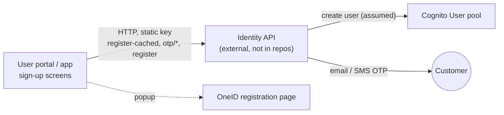

# X-06 · Customer registration

> **Bangla name:** গ্রাহক নিবন্ধন
>
> [← 60 · Cross-cutting](README.md) · [Contents](../README.md) · [Open queries](../99-open-queries.md)

## 1. Name and purpose

**Customer registration.** A new customer creates a GoBCB account on the web portal or in the app. The account is a user in
the **User** Cognito pool, created by the external **identity API** after the customer has proved both the email address and
the phone number with one-time codes. A customer can also register with **OneID** instead, which happens on OneID's own site.

None of the five repositories contains the identity API; the clients' calls are the only evidence of how it behaves
`[UNCONFIRMED: Q-01]`.

## 2. Trigger and actor

| Item | Value |
|---|---|
| Actor | Anonymous visitor |
| Client and screen | Portal `/:lang/auth/register` → `verify-email` → `email-verified` → `verify-phone` → `phone-verified` → `set-password`. App: `signup` → `emailOTP` → `emailVerification` → `phoneNumberOtp` → `phoneNumberVerification` → `setPassword` (`RoutePath` in `lib/presentation/navigation/route_path.dart`) |
| Cognito pool | User (account created by the identity API) |
| Role / program scope | none |

## 3. Business flow

1. The customer enters name, email and 10-digit phone (the client adds `+880`) and accepts the terms.
2. The platform stores the data provisionally and emails a code. The customer enters it ("email verified").
3. The platform sends a code by SMS. The customer enters it ("phone verified").
4. The customer chooses a password. The account is created; the portal opens the login page with a success message.
5. **OneID alternative (portal):** "Register with OneID" opens OneID's registration page in a popup; when OneID redirects back
   to `/:lang/auth/login`, the popup closes and the customer logs in with OneID ([X-08](X-08-oneid-sso.md)). The account in
   GoBCB is created at first OneID login.

## 4. Technical flow

All calls go to the identity API base URL (`environment.services.identity` in the portal, `AUTH_API_BASE_URL` in the app)
with a static header `Authorization: <environment.headerkey | AUTH_API_TOKEN>`. No GoBCB backend service is involved.

| # | From → To | Hop | Request body (as sent by the client) | On success |
|---|---|---|---|---|
| 1 | Client → identity `POST user/register-cached` | **[HTTP, static key]** | Portal: `{ name, email (lower-case), phone, dob: "1900-01-01", address: "n/a", verification_type: "mobile", verification_id: "0123456789" }`. App: `{ name, email, phone, address, verification_type, verification_id, dob }` | Portal stores the payload as `rvl_init_register` and starts step 2 |
| 2 | Client → identity `POST otp/send-otp` | **[HTTP, static key]** | `{ type: "email", destination: <email> }` | Navigate to `verify-email` |
| 3 | Client → identity `POST otp/verify-otp` | **[HTTP, static key]** | `{ type: "email", destination, otp }` | Navigate to `email-verified` |
| 4 | Client → identity `POST otp/send-otp` | **[HTTP, static key]** | `{ type: "sms", destination: <phone> }` | Navigate to `verify-phone` |
| 5 | Client → identity `POST otp/verify-otp` | **[HTTP, static key]** | `{ type: "sms", destination, otp }` | Response `user_id` stored as `rvl_init_id` |
| 6 | Client → identity `POST user/register` | **[HTTP, static key]** | Portal: `{ user_id, password }`. App: `{ user_id, ekyc, address, password }` | Portal clears the stored values and opens `/auth/login` |
| 7 | identity API → Cognito User pool | (outside the repos) | — | User created `[UNCONFIRMED: Q-01]` |

Error codes the clients recognise (from `status_message` / exception text): `user_already_exists`, `passport_or_nid_required`
(register-cached); `user_not_found`, `user_data_incomplete`, `error_getting_verification_information`, `error_creating_user`,
`error_saving_data_to_db`, `server_error` (register).

## 5. Components

| Kind | Component |
|---|---|
| Client (portal) | `UserRegistrationComponent`, `EmailVerificationCodeComponent`, `EmailVerifiedComponent`, `PhoneVerificationCodeComponent`, `SetPasswordComponent`, NgRx `IdentityEffects`, `IdentityApiService` |
| Client (app) | `presentation/feature/auth/signup/*` view models, `AuthRepositoryImpl`, `AuthApiServiceImpl`, `AuthApiClient` |
| External | Identity API `[UNCONFIRMED: Q-01]`; OneID registration page (`environment.aws.oneIdRegisterUrl`) |
| AWS | Cognito User pool |

## 6. API contracts

| Method | Path (identity API) | Auth | Request | Response | Main errors |
|---|---|---|---|---|---|
| POST | `user/register-cached` | static header key | see step 1 | not read by the portal | `user_already_exists`, `passport_or_nid_required` |
| POST | `otp/send-otp` | static header key | `SendOtp { type, destination }` | not read | `status_message` text |
| POST | `otp/verify-otp` | static header key | `VerifyOtp { type, destination, otp }` | `{ user_id }` (phone step) | `invalid_otp` (see [X-09](X-09-user-forgot-password.md)) |
| POST | `user/register` | static header key | `SignUpPayload { user_id, password }` (portal) | not read | list in §4 |

Payload classes: `rvl-gobcb-user-portal/ETP-Web/src/app/modules/core/models/user-auth.ts`. `OtpType` values: `sms`, `email`
(`modules/core/enums/Enums.ts:15-18`).

```json
// POST {identity}/user/register-cached   (portal)
{
  "name": "Rahim Uddin",
  "phone": "+8801711111111",
  "email": "rahim@example.com",
  "dob": "1900-01-01",
  "address": "n/a",
  "verification_type": "mobile",
  "verification_id": "0123456789"
}
```

```json
// POST {identity}/otp/verify-otp   (phone step)
{ "type": "sms", "destination": "+8801711111111", "otp": "482913" }

// 200 (only the field the portal reads)
{ "user_id": "<id issued by the identity API>" }
```

## 7. Data and side effects

- Identity API: provisional registration, OTPs (email and SMS), finally the Cognito user. Where it stores the provisional data
  and the profile is not visible `[UNCONFIRMED: Q-01]`.
- Browser (portal) local storage: `rvl_init_register`, `rvl_init_id`, `email_resend_code_timestamp`, `phone_resend_code_timestamp`;
  removed after success.
- No GoBCB table is written.

## 8. Code references

| What | Where |
|---|---|
| Portal form and OneID register popup | `rvl-gobcb-user-portal/ETP-Web/src/app/modules/featured/auth/components/user-registration/user-registration.component.ts:172-266` |
| Portal effects (steps 1–6) | `rvl-gobcb-user-portal/ETP-Web/src/app/modules/core/modules/identity/store/identity.effects.ts:38-212` |
| Portal identity API client | `rvl-gobcb-user-portal/ETP-Web/src/app/modules/core/services/api/identity-api.service.ts:30-64` |
| App identity API calls | `rvl-gobcb-user-app/data/lib/remote/api_service/auth_api_service/auth_api_service_impl.dart:34-240` |
| App static header | `rvl-gobcb-user-app/data/lib/remote/api_client/auth_api_client.dart` |

## 9. Handover notes

1. **The identity API is a black box.** Registration, OTPs, profiles, password reset and app versions all live there and the
   source is in none of the repos `[UNCONFIRMED: Q-01]`. Ask BS23 for its repository, hosting and owner before go-live.
2. **The static key is shipped to clients.** `environment.headerkey` (portal bundle) and `AUTH_API_TOKEN` (app `.env`, also
   printed by `Logger.debug` at app start, `lib/main/main.dart:55`) are readable by anyone with the client.
3. **The portal sends placeholder identity data** (`dob: "1900-01-01"`, `address: "n/a"`, `verification_id: "0123456789"`).
   The app sends the real values and an `ekyc` field. Whether the identity API needs real NID/passport data is unclear: the
   app handles a `passport_or_nid_required` error `[UNCONFIRMED: Q-01]`.
4. **App `register` hides unknown errors.** `AuthApiServiceImpl.register` catches `BaseException` and rethrows only the six
   known messages; any other error message is swallowed and the flow continues as if it succeeded.
5. **The client trusts `user_id` from the OTP response** and sends it back with the password. Whether the identity API ties
   `user/register` to a verified OTP server-side cannot be seen here.

## 10. Component relationships



**Depends on:** identity API, Cognito User pool. **Affects:** [X-07](X-07-user-password-login.md), [X-08](X-08-oneid-sso.md),
[P-11](../20-user-portal/P-11-profile.md) (profile exists).

## 11. Developer test guide

**Local testability: Not locally.** The identity API has no source; the user-portal proxy answers 503 for everything under
`/p/identity` except a `user/my-profile` stub (`docs/user-portal-local.md` §5), and the mobile gateway answers 503 for
`/identity` (`docs/mobile-local.md` §5). Use the seeded customer `+8801700000011` / `Passw0rd!23` instead of registering.

| Item | Detail |
|---|---|
| Test data and accounts | Seeded User-pool customer `+8801700000011` (`floci/seed-users.ps1`); create more with `aws cognito-idp admin-create-user` against Floci if needed |
| Browser | `http://localhost:4201/en/auth/register` renders; submitting shows the 503 error. DevTools → Network shows `POST /p/identity/user/register-cached` with `Authorization: <headerkey>` (no `Bearer`) |
| Emulator | `pwsh ./scripts/Setup-MobileApps.ps1 -App user -Run`; the sign-up screens open, calls to `http://localhost:5200/identity/...` return 503 |
| Postman | No collection covers the identity API |
| Visual Studio debug | Not applicable (no GoBCB service involved) |
| Verify | On a deployed environment: the new phone number appears in the User pool (`aws cognito-idp list-users --user-pool-id <UserPoolId> --filter "phone_number = \"+880…\""`) |
