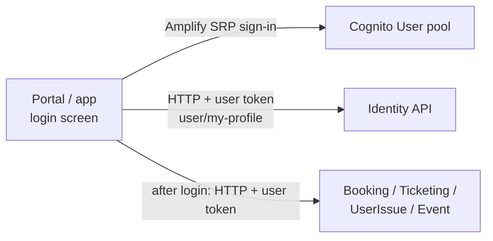

# X-07 · Customer login with phone and password

> **Bangla name:** ফোন ও পাসওয়ার্ড দিয়ে গ্রাহক লগইন
>
> [← 60 · Cross-cutting](README.md) · [Contents](../README.md) · [Open queries](../99-open-queries.md)

## 1. Name and purpose

**Customer login.** A registered customer signs in with phone number and password on the portal or in the app. The client
talks to the **User** Cognito pool directly; afterwards it loads the customer's profile from the identity API. The access token
is then used for booking, tickets and support ([X-10](X-10-user-session.md)).

## 2. Trigger and actor

| Item | Value |
|---|---|
| Actor | Customer with a User-pool account ([X-06](X-06-user-registration.md)) |
| Client and screen | Portal `/:lang/auth/login` (`UserLoginComponent`); app `login` screen (`LoginViewModel.signInUser`) |
| Cognito pool | User |
| Role / program scope | Backend gives every User-pool token the role `user` ([X-14](X-14-authz-pool-policies.md)) |

## 3. Business flow

1. The customer enters the 10-digit phone (first digit 1–9) and the password.
2. On success the portal loads the profile and returns to the page that sent the customer to login (`sessionStorage.returnUrl`),
   or the home page. The app goes back to the booking screen if login was started there, otherwise to Home.
3. On failure the portal shows Cognito's message; the app shows "Incorrect phone number or password".
4. If the profile cannot be found for a password user (`user_not_found`), the portal signs the customer out again and opens
   the login page.

## 4. Technical flow

| # | From → To | Hop | What happens |
|---|---|---|---|
| 1 | Client → Cognito (User pool) | Portal: Amplify JS `Auth.signIn("+880…", password)` (SRP). App: Amplify Flutter `Amplify.Auth.signIn` | Tokens stored by Amplify (portal: `localStorage`; app: Amplify secure storage) |
| 1a | | challenge `NEW_PASSWORD_REQUIRED` (portal) | Completed with the same password, like the admin portal ([X-01](X-01-admin-login.md)) |
| 1b | | challenge `SMS_MFA` | Portal sets `isMFARequired = true`, but the template has no code input, so the login stops. App: `result.isSignedIn == false` → session `null` → "Incorrect phone number or password" |
| 2 | Client → identity API `GET user/my-profile` | **[HTTP + user token]** (portal: the token interceptor replaces the static header with `Bearer`; app: `ProfileApiClient`, query `user_id=`) | Profile stored in the NgRx identity store / app cache |
| 2a | | `status_message == "user_not_found"` | Portal: password login → sign out; SSO login → register ([X-08](X-08-oneid-sso.md)). App: any error → `POST user/register-sso` then retry |
| 3 | Client → Firebase Analytics | — | `logLogin(user_id)` |

The app first signs out any existing session (`AuthRepositoryImpl.login`, `if (await isLoggedIn()) await signOut()`).

## 5. Components

| Kind | Component |
|---|---|
| Client (portal) | `UserLoginComponent`, `CognitoService` (`modules/shared/services/cognito.service.ts`), `IdentityStoreService`, `TokenInterceptor` |
| Client (app) | `LoginViewModel`, `AuthRepositoryImpl`, `AWSAmplifyService`, `ProfileRepositoryImpl` |
| AWS | Cognito User pool (`environment.aws.userPoolId` / `AMPLIFY_CONFIG`) |
| External | Identity API (`user/my-profile`) `[UNCONFIRMED: Q-01]` |

## 6. API contracts

| Method | Path | Auth | Request | Response | Main errors |
|---|---|---|---|---|---|
| — | Cognito `InitiateAuth` (SRP) via Amplify | public client | `+880…`, password | Cognito tokens | `NotAuthorizedException` ("Incorrect username or password."), "User is disabled." |
| GET | `{identity}/user/my-profile` (app adds `?user_id=`) | `Bearer <User-pool access token>` | — | `UserProfile` (`user_data.user_id`, …) | `status_message: "user_not_found"` |

The profile response shape is defined by the client model `modules/core/models/user-profile.ts`; see [P-11](../20-user-portal/P-11-profile.md).

## 7. Data and side effects

- Browser/app: Amplify token storage; portal flags `rvl_cognito_auth = true`.
- Analytics login event with the user id.
- No GoBCB table is written.

## 8. Code references

| What | Where |
|---|---|
| Portal login submit | `rvl-gobcb-user-portal/ETP-Web/src/app/modules/featured/auth/components/user-login/user-login.component.ts:182-224` |
| Portal Cognito sign-in | `rvl-gobcb-user-portal/ETP-Web/src/app/modules/shared/services/cognito.service.ts:49-72` |
| Portal profile fetch and `user_not_found` handling | `rvl-gobcb-user-portal/ETP-Web/src/app/modules/core/modules/identity/store/identity.effects.ts:291-343` |
| App login | `rvl-gobcb-user-app/lib/presentation/feature/auth/login/login_view_model.dart`, `data/lib/repository/auth_repository_impl.dart:26-62`, `data/lib/service/aws_amplify_service.dart:38-66` |
| App profile + SSO fallback | `rvl-gobcb-user-app/data/lib/repository/profile_repository_impl.dart:55-86` |

## 9. Handover notes

1. **SMS MFA is not usable on either client.** If MFA were switched on for the User pool, the portal would hang at the MFA
   state and the app would report a wrong password. Whether MFA is configured is not in the repos `[UNCONFIRMED: Q-03]`.
2. **The app registers SSO users on any profile error.** `getUserPersonInformation` calls `user/register-sso` for every
   `BaseException`, not just `user_not_found`, also for password users.
3. **Phone format.** Both clients send `+880` + 10 digits as the Cognito username; the backend never sees the password.

## 10. Component relationships

**Depends on:** [X-06](X-06-user-registration.md). **Affects:** every `P-xx` / `U-xx` feature that needs a token
([P-05](../20-user-portal/P-05-apply-promo-code.md), [P-06](../20-user-portal/P-06-booking-payment.md), [P-07](../20-user-portal/P-07-my-bookings.md), …).

## 11. Developer test guide

**Local testability: Full in the portal, Not locally in the app.** The portal copy points Amplify at Floci; the app's
Amplify Flutter has no endpoint override and talks to real AWS (`docs/mobile-local.md` §8, known gap 1).

| Item | Detail |
|---|---|
| Test data and accounts | `+8801700000011` / `Passw0rd!23` (User pool, owner of the seeded orders, `docs/local-dev.md` §7) |
| Browser | `pwsh ./scripts/Setup-UserPortal.ps1 -Start`, open `http://localhost:4201/en/auth/login`, phone `1700000011`, password `Passw0rd!23` (`docs/user-portal-local.md` §5). DevTools → Network: `/p/cognito` calls, then `GET /p/identity/user/my-profile` answered by the local stub ("Local User") |
| Emulator | The login screen opens but sign-in fails against real Cognito (known gap) |
| Postman | `postman/etp-login-all-pools.postman_collection.json` folder "User pool", request "Login as user" (USER_PASSWORD_AUTH) stores `access_token_user` for the service collections |
| Visual Studio debug | Attach to `ETP.Booking.Service` and call any `Policy = user` endpoint (e.g. `GET /booking/api/v1/user-booking-order/list`); breakpoint in `OnTokenValidated` of the `user` scheme, `rvl-gobcb-backend/Core/ETP.Core/Configuration/DefaultAuthenticationConfig.cs:46` |
| Verify | The header shows "My Tickets" and "Logout"; `localStorage` holds `CognitoIdentityServiceProvider.<clientId>.LastAuthUser` |
