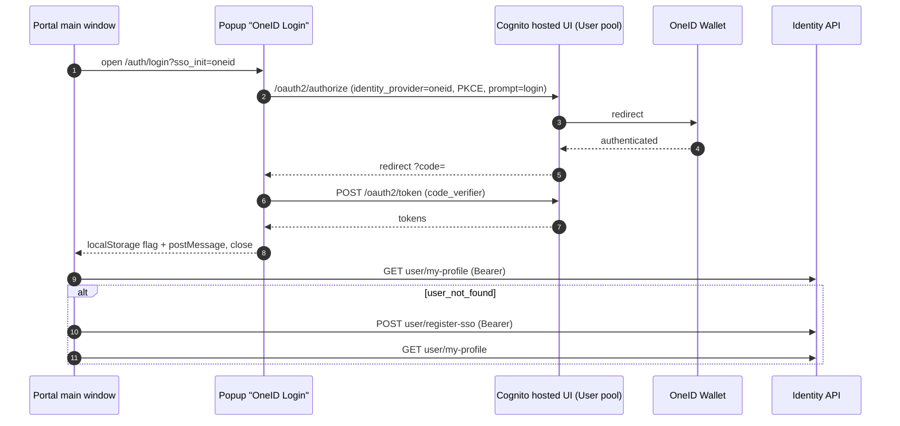

# X-08 · OneID single sign-on

> **Bangla name:** OneID সিঙ্গেল সাইন-অন
>
> [← 60 · Cross-cutting](README.md) · [Contents](../README.md) · [Open queries](../99-open-queries.md)

## 1. Name and purpose

**OneID SSO.** Lets a customer sign in with the OneID Wallet account instead of a GoBCB password. OneID is configured as an
external identity provider named `oneid` in the **User** Cognito pool; the client opens Cognito's hosted sign-in with that
provider and receives normal User-pool tokens. On the first OneID login the client asks the identity API to create the GoBCB
profile (`user/register-sso`). OneID's configuration in Cognito is not in the repos (architecture Q5).

## 2. Trigger and actor

| Item | Value |
|---|---|
| Actor | Customer with a OneID account |
| Client and screen | Portal `/:lang/auth/login` → "Login with OneID Wallet" (popup window named `OneID Login`); app login screen → OneID button (`LoginViewModel.onLoginWithOneIDBtnClicked`) |
| Cognito pool | User, identity provider `oneid` |
| Role / program scope | `user` (as [X-07](X-07-user-password-login.md)) |

## 3. Business flow

1. The customer presses the OneID button.
2. A popup (portal) or the system browser (app) shows OneID's login page; OneID always asks for credentials (`prompt=login`, portal).
3. After OneID approves, the window closes and the customer is signed in.
4. If GoBCB has no profile for this person yet, it is created automatically; then the customer lands on the page they came
   from or on Home.

## 4. Technical flow

**Portal (manual PKCE in a popup)**

| # | From → To | Hop | What happens |
|---|---|---|---|
| 1 | Main window → popup `/:lang/auth/login?sso_init=oneid` | browser | Opens a 500×700 popup named `OneID Login`; sets `sso_login = true` |
| 2 | Popup | browser | Generates a PKCE verifier (32 random bytes), stores it as `localStorage.pkce_key`, computes the S256 challenge |
| 3 | Popup → Cognito hosted UI `https://<oauth.domain>/oauth2/authorize?identity_provider=oneid&redirect_uri=…&response_type=…&client_id=…&scope=…&prompt=login&code_challenge=…&code_challenge_method=S256` | browser redirect | Cognito forwards to OneID |
| 4 | OneID → Cognito → popup `redirectSignIn?code=…` | browser redirect | Authorization code |
| 5 | Popup → Cognito `POST https://<oauth.domain>/oauth2/token` | `fetch`, form-encoded | `grant_type=authorization_code`, `client_id`, `code`, `redirect_uri`, `code_verifier` → id, access, refresh tokens |
| 6 | Popup | browser | Writes the tokens into Amplify's `localStorage` keys (`CognitoIdentityServiceProvider.<clientId>.<username>.idToken`, …) and `amplify-signin-with-hostedUI = true`; sets `sso_auth_complete = true`; `postMessage({type:'sso-login-success'})`; closes itself |
| 7 | Main window | browser | Polls every 300 ms (and listens to `message`); `Auth.currentAuthenticatedUser({ bypassCache: true })` |
| 8 | Main window → identity `GET user/my-profile` | **[HTTP + user token]** | Profile |
| 8a | Main window → identity `POST user/register-sso` | **[HTTP + user token]** | Only when step 8 returned `status_message == "user_not_found"` and `sso_login == true`. Body: the Amplify user object from `Auth.currentAuthenticatedUser()`. Then step 8 again |

**App (Amplify hosted UI)**

| # | From → To | Hop | What happens |
|---|---|---|---|
| 1 | App → Cognito hosted UI → OneID | `Amplify.Auth.signInWithWebUI(provider: AuthProvider.custom('oneid'), isPreferPrivateSession: true)` | System browser session, private |
| 2 | App → identity `GET user/my-profile?user_id=<sub>` | **[HTTP + user token]** | On any error → `POST user/register-sso` with `{ "name": "", "cognito_sub": <sub> }`, then retry |

## 5. Components

| Kind | Component |
|---|---|
| Client (portal) | `UserLoginComponent` (popup, PKCE), `CognitoService.getOAuthUrl / exchangeCodeForTokens / storeTokensInAmplifyFormat`, `IdentityEffects.fetchUserProfile$ / registerSSOUser$` |
| Client (app) | `AWSAmplifyService.loginWithOneID`, `ProfileRepositoryImpl.getUserPersonInformation` |
| AWS | Cognito User pool hosted UI (`environment.aws.oauth.domain`), identity provider `oneid` |
| External | OneID Wallet (architecture Q5); identity API `[UNCONFIRMED: Q-01]` |

## 6. API contracts

| Method | Path | Auth | Request | Response | Main errors |
|---|---|---|---|---|---|
| GET | `https://<oauth.domain>/oauth2/authorize` | — | query as in step 3 | redirect with `code` | OneID / Cognito error page |
| POST | `https://<oauth.domain>/oauth2/token` | — (public client + PKCE) | form fields as in step 5 | `{ id_token, access_token, refresh_token, … }` | `error_description` → "Token exchange failed" |
| GET | `{identity}/user/my-profile` | `Bearer` | — | `UserProfile` | `user_not_found` |
| POST | `{identity}/user/register-sso` | `Bearer` (portal: token interceptor; app: `ProfileApiClient`) | portal: Amplify user object; app: `{ name: "", cognito_sub }` | not read | sign-out on failure (portal) |

```http
POST https://<oauth.domain>/oauth2/token
Content-Type: application/x-www-form-urlencoded

grant_type=authorization_code&client_id=<userPoolWebClientId>&code=<code>&redirect_uri=<redirectSignIn>&code_verifier=<verifier>
```

```json
// POST {identity}/user/register-sso   (app)
{ "name": "", "cognito_sub": "8c1d2f7e-0000-4000-8000-000000000011" }
```

## 7. Data and side effects

- Cognito: on first OneID login Cognito creates a federated user in the User pool (standard Cognito behaviour for external
  providers; attribute mapping not in the repos).
- Identity API: profile created by `register-sso`.
- Portal `localStorage`: `pkce_key` (removed after exchange), Amplify token keys, `amplify-signin-with-hostedUI`,
  `was_sso_login`, `sso_login`, `sso_auth_complete` / `sso_auth_error`.

## 8. Code references

| What | Where |
|---|---|
| Portal popup, PKCE, callback | `rvl-gobcb-user-portal/ETP-Web/src/app/modules/featured/auth/components/user-login/user-login.component.ts:46-73`, `:226-419` |
| Portal OAuth URL, token exchange, Amplify storage | `rvl-gobcb-user-portal/ETP-Web/src/app/modules/shared/services/cognito.service.ts:23-45`, `:302-372` |
| Portal auto-registration | `rvl-gobcb-user-portal/ETP-Web/src/app/modules/core/modules/identity/store/identity.effects.ts:303-320`, `:374-427` |
| Portal Amplify config | `rvl-gobcb-user-portal/ETP-Web/src/app/modules/core/config/awsConfig.ts` |
| App OneID sign-in | `rvl-gobcb-user-app/data/lib/service/aws_amplify_service.dart:68-98` |
| App auto-registration | `rvl-gobcb-user-app/data/lib/repository/profile_repository_impl.dart:55-86`, `data/lib/remote/api_service/profile_api_service/profile_api_service_impl.dart:47-52` |

## 9. Handover notes

1. **Logout does not end the OneID session.** The portal signs out of Cognito locally with `skipFederatedLogout` for SSO users;
   `federatedSignOut()` (which would call OneID's and Cognito's logout endpoints) exists but is never called. The portal relies
   on `prompt=login` to make OneID ask again at the next login.
2. **The portal's `register-sso` body is not a defined DTO.** It is the whole object returned by Amplify's
   `Auth.currentAuthenticatedUser()`, serialised by Angular's `HttpClient`. Inspect the real request in DevTools before you
   change the identity API.
3. **App errors are swallowed.** `loginWithOneID` catches every error and only logs it; the view model then navigates to Home
   whether or not the sign-in succeeded.
4. **Two different registration triggers.** Portal: only on `user_not_found` during an SSO login. App: on any profile error.
5. **The portal configures Amplify twice.** In the popup callback it removes the `oauth` section so Amplify's own hosted-UI
   handler does not consume the code (`cognito.service.ts:24-34`). Keep this if you upgrade Amplify.
6. OneID's identity-provider setup and attribute mapping are open in the architecture document (Q5).

## 10. Component relationships



**Depends on:** Cognito User pool with provider `oneid`, OneID, identity API. **Affects:** same as [X-07](X-07-user-password-login.md);
[P-10](../20-user-portal/P-10-oneid-ticket-sync.md) (OneID wallet sync).

## 11. Developer test guide

**Local testability: Partial (portal only).** The portal proxy hosts a **fake OneID** at `/p/oneid` that auto-approves, checks
the PKCE challenge and returns real Floci tokens for `+8801700000011` (`docs/user-portal-local.md` §5). Real OneID and the app
flow cannot run locally.

| Item | Detail |
|---|---|
| Test data and accounts | The fake always signs in as `+8801700000011`; change `SSO_USER` in the generated `portal-local/user-portal/proxy.conf.js` to test another user |
| Browser | `http://localhost:4201/en/auth/login` → "Login with OneID Wallet" (allow popups for `localhost:4201`). Do not open `?sso_init=oneid` directly: it only works inside the popup. DevTools (popup) → Network: `/p/oneid/oauth2/authorize`, `/p/oneid/oauth2/token`; main window: `GET /p/identity/user/my-profile` (stub) |
| Emulator | Not possible (Amplify Flutter talks to real Cognito, `docs/mobile-local.md` §8) |
| Postman | Not applicable (browser redirect flow) |
| Visual Studio debug | Not applicable for sign-in; the resulting token is validated by the `user` scheme like [X-07](X-07-user-password-login.md) |
| Verify | `localStorage.amplify-signin-with-hostedUI == "true"`, `was_sso_login == "true"`; "My Tickets" lists the seeded orders |
