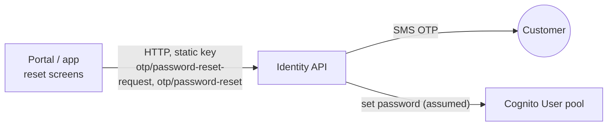

# X-09 · Customer forgot/reset password

> **Bangla name:** গ্রাহকের পাসওয়ার্ড ভুলে যাওয়া/রিসেট
>
> [← 60 · Cross-cutting](README.md) · [Contents](../README.md) · [Open queries](../99-open-queries.md)

## 1. Name and purpose

**Customer password reset.** A customer who forgot the password asks for an SMS code and sets a new password with it. Both
steps go to the external identity API; the GoBCB services are not involved `[UNCONFIRMED: Q-01]`.

## 2. Trigger and actor

| Item | Value |
|---|---|
| Actor | Customer, not signed in |
| Client and screen | Portal `/:lang/auth/phone-reset-password` → `reset-password-code` → `reset-password-verified`. App `forgetPassword` → `confirmNewPassword` → `forgetPasswordSuccess` |
| Cognito pool | User (changed by the identity API, assumed) |

## 3. Business flow

1. The customer enters the phone number and asks for a code.
2. The platform sends an SMS code (the app recognises "maximum OTP generation limit exceeded").
3. The customer enters the code and the new password.
4. A success page leads back to login.

## 4. Technical flow

| # | From → To | Hop | Request body | Result |
|---|---|---|---|---|
| 1 | Client → identity `POST otp/password-reset-request` | **[HTTP, static key]** | `{ phone }` | Portal stores it as `rvl_reset_pass` and opens the code page |
| 2 | Client → identity `POST otp/password-reset` | **[HTTP, static key]** | `{ phone, otp, password }` | Portal clears `rvl_reset_pass` and the resend counters, opens `reset-password-verified` |

## 5. Components

| Kind | Component |
|---|---|
| Client (portal) | `PhoneVerificationResetPasswordComponent`, `ResetPasswordPhoneCodeComponent`, `ResetPasswordSuccessfulComponent`, `IdentityEffects.resetPasswordRequest$ / resetPassword$` |
| Client (app) | `ForgetPassword*` and `ConfirmNewPasswordViewModel`, `AuthRepositoryImpl.passwordResetRequest / passwordReset`, `AuthApiServiceImpl` |
| External | Identity API `[UNCONFIRMED: Q-01]` |

## 6. API contracts

| Method | Path (identity API) | Auth | Request | Response | Main errors (`status_message`) |
|---|---|---|---|---|---|
| POST | `otp/password-reset-request` | static header key | `ResetPasswordRequest { phone }` | not read | `phone_number_not_found`, `user_not_found`, `exceeded_maximum_otp_generation_limit` |
| POST | `otp/password-reset` | static header key | `ResetPassword { phone, otp, password }` | not read | `phone_number_not_found`, `user_not_found`, `invalid_otp` |

```json
// POST {identity}/otp/password-reset
{ "phone": "+8801711111111", "otp": "482913", "password": "N3w!Passw0rd" }
```

## 7. Data and side effects

Identity API: OTP sent and checked; password changed in Cognito (assumed). Portal local storage keys `rvl_reset_pass`,
`pass_reset_resend_code_otpcounter`, `pass_reset_code_timestamp` (cleared on success and when the login page opens).

## 8. Code references

| What | Where |
|---|---|
| Portal effects | `rvl-gobcb-user-portal/ETP-Web/src/app/modules/core/modules/identity/store/identity.effects.ts:214-289` |
| Portal API calls | `rvl-gobcb-user-portal/ETP-Web/src/app/modules/core/services/api/identity-api.service.ts:73-89` |
| App API calls and error mapping | `rvl-gobcb-user-app/data/lib/remote/api_service/auth_api_service/auth_api_service_impl.dart:243-292` |
| App screen | `rvl-gobcb-user-app/lib/presentation/feature/auth/confirm_new_password/confirm_new_password_view_model.dart:110-155` |

## 9. Handover notes

1. The OTP and the password travel in the same request; the identity API must check them together `[UNCONFIRMED: Q-01]`.
2. `CognitoService.forgotPassword(phone, code, newPassword)` in the portal calls `Auth.changePassword` with the wrong
   arguments and is not used; ignore it (Appendix A).
3. Existing sessions on other devices are not revoked by anything visible in the clients.

## 10. Component relationships



**Depends on:** [X-06](X-06-user-registration.md). **Affects:** [X-07](X-07-user-password-login.md).

## 11. Developer test guide

**Local testability: Not locally.** The identity API is a 503 stub locally (`docs/user-portal-local.md` §5, `docs/mobile-local.md` §8).

| Item | Detail |
|---|---|
| Test data and accounts | Not applicable locally. To change a local password use Floci: `aws --endpoint-url http://localhost:4566 cognito-idp admin-set-user-password --user-pool-id <UserPoolId> --username +8801700000011 --password <new> --permanent` |
| Browser | `http://localhost:4201/en/auth/phone-reset-password` renders; the request `POST /p/identity/otp/password-reset-request` returns 503 |
| Emulator | Same 503 through `scripts/mobile-gateway.js` (`/identity`) |
| Postman | No collection covers the identity API |
| Visual Studio debug | Not applicable |
| Verify | On a deployed environment: log in with the new password ([X-07](X-07-user-password-login.md)) |
