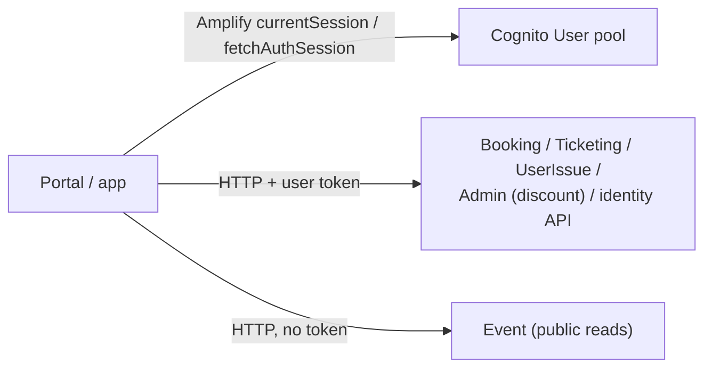

# X-10 · Customer change password, logout and token attach

> **Bangla name:** গ্রাহকের পাসওয়ার্ড পরিবর্তন, লগআউট ও টোকেন সংযুক্তি
>
> [← 60 · Cross-cutting](README.md) · [Contents](../README.md) · [Open queries](../99-open-queries.md)

## 1. Name and purpose

**Customer session handling.** How the user portal and the user app attach the User-pool access token to API calls, what
happens when it expires, and how the customer changes the password and logs out. Every customer feature that needs a
login relies on this.

## 2. Trigger and actor

| Item | Value |
|---|---|
| Actor | Signed-in customer |
| Client and screen | Portal: every HTTP call (`TokenInterceptor`); profile page → change password (`UserProfilePagesComponent`); header → Logout (`DefaultComponent.signOutUser`). App: every call through `TicketBanglaApiClient` / `ProfileApiClient`; Profile → change password / sign out (`ProfileViewModel`) |
| Cognito pool | User |

## 3. Business flow

- **Change password:** current password, new password twice; a success message for 7 seconds (portal). The customer stays signed in.
- **Logout:** the customer is signed out and lands on the login page (portal) or login screen (app).
- **Expired session:** the portal signs the customer out when a call is about to be sent with an expired token.

## 4. Technical flow

**Portal token attach** (`TokenInterceptor`, registered in `app.module.ts`): the token is added **only** when the request URL
contains one of these prefixes; every other request (for example the public Event endpoints) goes without a token:

| URL contains | Used by |
|---|---|
| `${services.bookings}/booking` | booking, capacity, orders ([P-04](../20-user-portal/P-04-seat-selection.md)–[P-08](../20-user-portal/P-08-ticket-generation-request.md)) |
| `${services.bookings}/admin/api/v1/discount` | system discount lookup ([P-04](../20-user-portal/P-04-seat-selection.md)) |
| `${services.bookings}/admin/api/v1/user-issue` | legacy issue endpoints (Appendix A) |
| `${services.userissue}/userissue/api/v1/user-issue` | issues ([P-12](../20-user-portal/P-12-issues-chat.md)) |
| `${services.userissue}/userissue/chathub` | SignalR negotiate |
| `${services.tickets}/ticketing` | tickets ([P-09](../20-user-portal/P-09-ticket-details-downloads.md), [P-10](../20-user-portal/P-10-oneid-ticket-sync.md)) |
| `${services.identity}/user/my-profile`, `/user/register-sso` | profile ([P-11](../20-user-portal/P-11-profile.md), [X-08](X-08-oneid-sso.md)) |
| `${services.bookings}/event/api/v1/events/venue-details` | venue details for the seat map |

Steps: `Auth.currentSession()` (Amplify refreshes with the refresh token when needed) → if the returned token's `exp` has
passed anyway, remove `rvl_cognito_auth`, clear the profile, sign out and fail the request with a synthetic 401 → otherwise add
`Authorization: Bearer`.

**App token attach:** `TicketBanglaApiClient` (base `API_BASE_URL`) and `ProfileApiClient` (base `AUTH_API_BASE_URL`) call
`Amplify.Auth.fetchAuthSession()` before each request and add `Bearer <accessToken>`; with no session they throw
`CognitoUserSessionNotFoundException`. `AuthApiClient` uses the static `AUTH_API_TOKEN` instead.

| # | Action | Calls |
|---|---|---|
| CP | Change password | Portal: Amplify `Auth.changePassword(user, old, new)`. App: `Amplify.Auth.updatePassword`. Both → Cognito `ChangePassword` |
| LO | Logout (portal) | `Auth.signOut({ global: false })`; SSO users with `skipFederatedLogout` (no redirect to Cognito/OneID logout); removes `rvl_cognito_auth`, SSO flags, profile; navigate to `/:lang/auth/login` |
| LO | Logout (app) | `Amplify.Auth.signOut()`; local user data cleared; the call that deletes the FCM token is commented out (`profile_view_model.dart`, `// await firebaseRepository.deleteFCMToken();`) |

## 5. Components

| Kind | Component |
|---|---|
| Client (portal) | `TokenInterceptor`, `CognitoService`, `UserProfilePagesComponent`, `DefaultComponent` |
| Client (app) | `TicketBanglaApiClient`, `ProfileApiClient`, `AuthApiClient`, `AWSAmplifyService`, `ProfileViewModel`, `AuthRepositoryImpl.signOut` |
| AWS | Cognito User pool |

## 6. API contracts

No GoBCB endpoint of its own. Header added: `Authorization: Bearer <User-pool access token>`. Validation on the server side:
[X-14](X-14-authz-pool-policies.md).

## 7. Data and side effects

Cognito password change; local token removal on logout. Device tokens for push stay registered after logout (app), so pushes
for that user can still reach the device ([X-23](X-23-push-firebase.md)).

## 8. Code references

| What | Where |
|---|---|
| Portal interceptor | `rvl-gobcb-user-portal/ETP-Web/src/app/modules/core/interceptors/token.interceptor.ts:133-193` (lines 1-112 are an older commented-out version) |
| Portal change password | `rvl-gobcb-user-portal/ETP-Web/src/app/modules/featured/profile/pages/user-profile-pages.component.ts:299-340`, `modules/shared/services/cognito.service.ts:182-199` |
| Portal logout | `rvl-gobcb-user-portal/ETP-Web/src/app/modules/layout/components/default/default.component.ts:128-142`, `modules/shared/services/cognito.service.ts:96-117` |
| App API clients | `rvl-gobcb-user-app/data/lib/remote/api_client/ticket_bangla_api_client.dart`, `profile_api_client.dart`, `auth_api_client.dart` |
| App change password / sign out | `rvl-gobcb-user-app/data/lib/service/aws_amplify_service.dart:157-189`, `lib/presentation/feature/profile/profile_view_model.dart:343`, `:370-382` |

## 9. Handover notes

1. **Token attach is an allow-list of URL fragments** built from the environment base URLs. A new backend path that needs a
   token must be added to `TokenInterceptor`, otherwise calls go without `Authorization` and get 401.
2. **No retry on 401.** The portal never refreshes after a 401 from the server; it relies on Amplify refreshing before the call.
3. **Logout is local.** Other sessions and the OneID session stay alive ([X-08](X-08-oneid-sso.md)).
4. **App logout keeps the push token** (see §7).

## 10. Component relationships

**Depends on:** [X-07](X-07-user-password-login.md), [X-08](X-08-oneid-sso.md). **Affects:** all token-protected `P-xx` and `U-xx` features.

## 11. Developer test guide

**Local testability: Full in the portal, Not locally in the app** (app sign-in known gap, `docs/mobile-local.md` §8).

| Item | Detail |
|---|---|
| Test data and accounts | `+8801700000011` / `Passw0rd!23` |
| Browser | Log in on `http://localhost:4201`, open My Tickets. DevTools → Network: `GET /p/booking/booking/api/v1/user-booking-order/list` carries `Authorization: Bearer …`; `GET /p/event/event/api/v1/events/...` does not. Logout from the header and check that `localStorage.rvl_cognito_auth` is gone |
| Emulator | Not possible (no sign-in locally) |
| Postman | `postman/etp-login-all-pools.postman_collection.json` "Login as user"; then any `Policy = user` request in `postman/services/etp-booking.postman_collection.json`, e.g. "GET /api/v1/user-booking-order/list" |
| Visual Studio debug | Attach to `ETP.Booking.Service`, breakpoint on the `user` scheme's `OnTokenValidated` (`DefaultAuthenticationConfig.cs:46`) |
| Verify | Calls without the header return 401; with it 200 |
