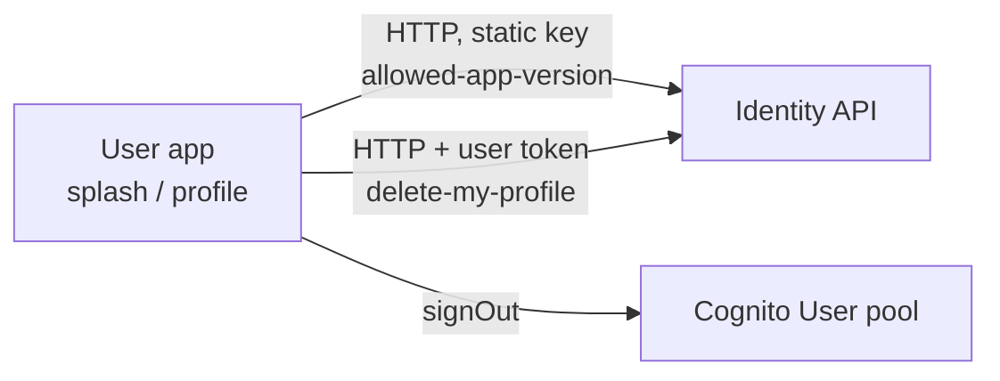

# X-11 · Delete account and app force-update

> **Bangla name:** অ্যাকাউন্ট মুছে ফেলা ও অ্যাপ force-update
>
> [← 60 · Cross-cutting](README.md) · [Contents](../README.md) · [Open queries](../99-open-queries.md)

## 1. Name and purpose

Two app-side controls that depend on the identity API:

- **Delete account** (user app only): the customer deletes the GoBCB profile and is signed out.
- **Force update** (user app and checker app): at start-up the app compares its version with the minimum published version and
  blocks use until the customer updates.

## 2. Trigger and actor

| Item | Value |
|---|---|
| Actor | Customer (delete account, force update); gate staff (force update in the checker app) |
| Client and screen | User app Profile → Delete account (`ProfileViewModel.onDeleteAccount`); splash screen (`SplashViewModel._checkAppVersion`). Checker app: splash ([X-12](X-12-checker-login.md)) |
| Cognito pool | User (delete); none (version check) |

## 3. Business flow

**Delete account:** the customer confirms; the profile is deleted, the app signs out and opens the login screen.
**Force update:** if the published version is newer than the installed one, a non-dismissible sheet "Update required" with an
"Update now" button opens the store link; the app does not continue past the splash screen.

## 4. Technical flow

| # | From → To | Hop | What happens |
|---|---|---|---|
| D1 | App → identity `DELETE user/delete-my-profile` | **[HTTP + user token]** (`ProfileApiClient`) | Profile deleted (identity API) |
| D2 | App | `AuthRepositoryImpl.deleteUser` | `signOut()`, analytics `delete_user`, local data cleared |
| V1 | App → identity `GET user/allowed-app-version` | **[HTTP, static key]** (`AuthApiClient`) | Response `{ message, status, data: { up: { android, ios }, tc: { android, ios } } }`, each `{ version, buildNumber, appLink }` |
| V2 | App | `AppVersionMapper` | User app reads `data.up.<platform>`; the checker app reads its own entry (`tc` = ticket checker, see [X-12](X-12-checker-login.md)) |
| V3 | App | `AppInfo.isUpdateRequired` | Compares dotted version parts; if the remote and local version have a different number of parts, an update is required |

`AWSAmplifyService.deleteUser()` (Cognito self-delete) exists but is not called; the Cognito user is not deleted by the app.

## 5. Components

| Kind | Component |
|---|---|
| Client | User app `ProfileViewModel`, `AuthRepositoryImpl`, `AuthApiServiceImpl.deleteUser`, `SplashViewModel`, `AppRepositoryImpl.getAppInfo`, `AppVersionMapper`, `domain/lib/model/app_info.dart` |
| External | Identity API `[UNCONFIRMED: Q-01]` |

## 6. API contracts

| Method | Path (identity API) | Auth | Request | Response | Main errors |
|---|---|---|---|---|---|
| DELETE | `user/delete-my-profile` | `Bearer` (User pool) | — | not read | rethrown `BaseException` |
| GET | `user/allowed-app-version` | static header key | — | `AppVersionResponse` | mapper throws "Version response is null" if `version` or `buildNumber` is missing; the splash catches it and continues |

```json
// GET {identity}/user/allowed-app-version  (shape from AppVersionResponse)
{
  "message": "…",
  "status": "…",
  "data": {
    "up": { "android": { "version": "1.4.0", "buildNumber": 40, "appLink": "https://play.google.com/…" },
            "ios":     { "version": "1.4.0", "buildNumber": 40, "appLink": "https://apps.apple.com/…" } },
    "tc": { "android": { "version": "1.1.0", "buildNumber": 11, "appLink": "…" },
            "ios":     { "version": "1.1.0", "buildNumber": 11, "appLink": "…" } }
  }
}
```

## 7. Data and side effects

Identity API: profile deleted. Whether GoBCB data owned by the customer (orders, tickets, issues in the `etp` schema) is
deleted or kept is not handled by any GoBCB service `[UNCONFIRMED: Q-01]`.

## 8. Code references

| What | Where |
|---|---|
| Delete account | `rvl-gobcb-user-app/lib/presentation/feature/profile/profile_view_model.dart:385-393`, `data/lib/repository/auth_repository_impl.dart:247-252`, `data/lib/remote/api_service/auth_api_service/auth_api_service_impl.dart:294-300` |
| Version check | `rvl-gobcb-user-app/lib/presentation/feature/splash/splash_view_model.dart`, `data/lib/repository/app_repository_impl.dart:88-115`, `data/lib/mapper/app_version_mapper.dart`, `domain/lib/model/app_info.dart:22` |
| Response model | `rvl-gobcb-user-app/data/lib/remote/response/app_version_response.dart` |

## 9. Handover notes

1. **The portal has `deleteUserProfile()` in `IdentityApiService` and an effect for it**, but no portal screen was found that
   starts it; account deletion is an app feature.
2. **Deleting the profile does not delete the Cognito user** in the app code (`deleteUser()` on Amplify is unused). Whether the
   identity API does it is unknown `[UNCONFIRMED: Q-01]`.
3. **Version check failures are ignored** (the app continues), so an unreachable identity API does not block start-up.

## 10. Component relationships



**Depends on:** [X-07](X-07-user-password-login.md). **Affects:** [U-01](../30-user-app/U-01-splash-onboarding.md), [U-07](../30-user-app/U-07-profile-settings.md).

## 11. Developer test guide

**Local testability: Not locally.** `/identity` is answered with 503 by `scripts/mobile-gateway.js`; the splash catches the
error and continues, so the force-update sheet never appears locally. Delete account needs a signed-in user (known gap 1).

| Item | Detail |
|---|---|
| Test data and accounts | — |
| Browser | Not applicable |
| Emulator | `pwsh ./scripts/Setup-MobileApps.ps1 -App user -Run`; `flutter run` log shows the version call failing and the app continuing to onboarding/Home |
| Postman | No collection covers the identity API |
| Visual Studio debug | Not applicable; use Flutter DevTools (URL printed by `flutter run`) to step through `SplashViewModel._checkAppVersion` |
| Verify | On a deployed environment: publish a higher `version` in the identity API and start the app |
