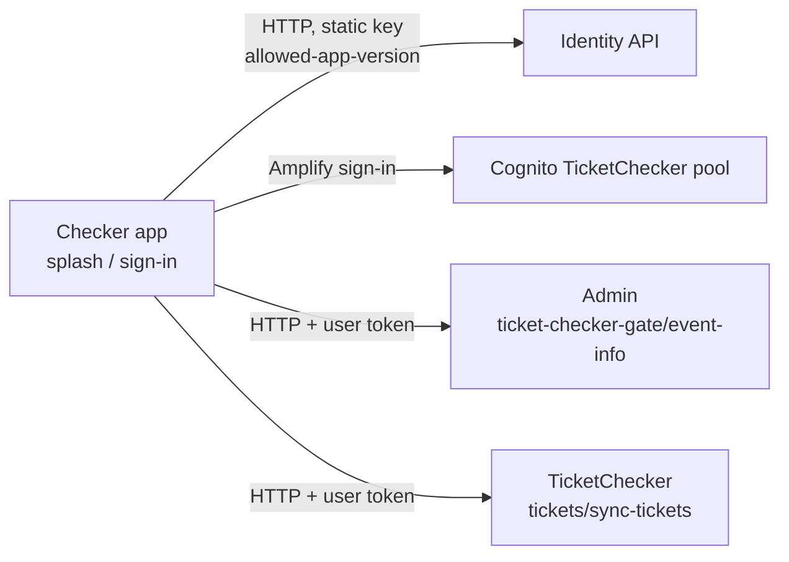

# X-12 · Checker login

> **Bangla name:** চেকার লগইন
>
> [← 60 · Cross-cutting](README.md) · [Contents](../README.md) · [Open queries](../99-open-queries.md)

## 1. Name and purpose

**Checker login.** Gate staff sign in to the checker app with the phone number and password that the admin portal created for
them ([X-05](X-05-admin-provisioning.md), [A-17](../10-admin-portal/A-17-ticket-checker-users.md)). The app uses the
**TicketChecker** Cognito pool. Before signing in it checks that the installed app version is still allowed.

## 2. Trigger and actor

| Item | Value |
|---|---|
| Actor | Gate staff (ticket checker) |
| Client and screen | Checker app `/splash` → `/signIn` (`SignInViewModel.signInUser`) → `/eventPage` |
| Cognito pool | TicketChecker |
| Role / program scope | Backend adds role `ticket-checker` to every token of this pool ([X-14](X-14-authz-pool-policies.md)) |

## 3. Business flow

1. On start the splash screen checks the version and, if a session exists, opens the event page directly.
2. Otherwise the checker types the phone number (without `+880`) and password.
3. The app checks the version again; if an update is required, a blocking "Update required" sheet appears.
4. On success the event page opens and loads the assigned event and gate ([C-01](../40-checker-app/C-01-assigned-event-gate.md)).
5. "Sign out" is on the event page.

## 4. Technical flow

| # | From → To | Hop | What happens |
|---|---|---|---|
| 1 | App → identity `GET user/allowed-app-version` | **[HTTP, static key]** (`AuthApiClient`, header `Authorization: <AUTH_API_TOKEN or empty>`) | Reads `data.tc.android` / `data.tc.ios` (`tc` = this app; the user app reads `up`) |
| 2 | App → Cognito (TicketChecker pool) | Amplify Flutter `Amplify.Auth.signIn("+880…", password)` | If not fully signed in (any challenge), the session is `null` |
| 3 | App → Admin, TicketChecker services | **[HTTP + user token]** (`TicketApiClient`, `Bearer <accessToken>` from `fetchAuthSession`) | First call: `GET /admin/api/v1/ticket-checker-gate/event-info` ([C-01](../40-checker-app/C-01-assigned-event-gate.md)) |
| 4 | Sign out | `Amplify.Auth.signOut()` from the event page | Local |

## 5. Components

| Kind | Component |
|---|---|
| Client | Checker app `SplashViewModel`, `SignInViewModel`, `AuthRepositoryImpl`, `AWSAmplifyService`, `AuthApiClient`, `TicketApiClient`, `EventPageViewModel` (sign out) |
| AWS | Cognito TicketChecker pool (`AMPLIFY_CONFIG`) |
| External | Identity API (app version only) `[UNCONFIRMED: Q-01]` |

## 6. API contracts

| Method | Path | Auth | Request | Response | Main errors |
|---|---|---|---|---|---|
| GET | `{AUTH_API_BASE_URL}/user/allowed-app-version` | static header key | — | `AppVersionResponse` (see [X-11](X-11-delete-account-force-update.md)) | — |
| — | Cognito `InitiateAuth` via Amplify | public client | phone, password | tokens | "Incorrect username or password." |

## 7. Data and side effects

Amplify token storage on the device. Nothing is written by the backend at login.

## 8. Code references

| What | Where |
|---|---|
| Sign-in and version gate | `rvl-gobcb-checker-app/lib/presentation/feature/sign_in/sign_in_view_model.dart` (`signInUser`) |
| Splash | `rvl-gobcb-checker-app/lib/presentation/feature/splash/splash_view_model.dart` |
| Cognito login | `rvl-gobcb-checker-app/data/lib/service/aws_amplify_service.dart:35-62` |
| API clients | `rvl-gobcb-checker-app/data/lib/remote/api_client/auth_api_client.dart`, `ticket_api_client.dart` |
| Version mapping (`tc`) | `rvl-gobcb-checker-app/data/lib/mapper/app_version_mapper.dart:9-11` |
| Required env keys | `rvl-gobcb-checker-app/lib/main/main.dart:14-18` (`VDS_CERTIFICATE`, `AMPLIFY_CONFIG`, `API_BASE_URL`) |

## 9. Handover notes

1. **Debug builds log the password.** `AWSAmplifyService.login` logs `username` and `password` with `Logger.debug`; logging is
   enabled only when `kDebugMode` is true (`main.dart`). Do not share debug-build logs.
2. **`AUTH_API_BASE_URL` is not in the required list** of the checker app; if it is missing the version check cannot run.
3. **No password change or reset in the app.** Checkers get new passwords from an admin ("Set Password" in
   [A-17](../10-admin-portal/A-17-ticket-checker-users.md)); the backend also has `PUT /admin/api/v1/ticket-checker/change-password`
   (body with the checker's access token), which no client calls.
4. **Disabled accounts:** disabling a checker in the admin portal calls `AdminUserGlobalSignOut`; the app keeps working
   offline with already downloaded tickets until it next needs the server ([C-02](../40-checker-app/C-02-offline-ticket-download.md)).

## 10. Component relationships

**Depends on:** [X-05](X-05-admin-provisioning.md), [A-17](../10-admin-portal/A-17-ticket-checker-users.md), [A-18](../10-admin-portal/A-18-gate-assignment.md).
**Affects:** all `C-xx` features.

## 11. Developer test guide

**Local testability: Not locally (sign-in), Partial (backend).** Amplify Flutter cannot be pointed at Floci, so the app cannot
sign in locally (`docs/mobile-local.md` §8, known gap 1). The checker's backend calls can be tested with a Floci token.

| Item | Detail |
|---|---|
| Test data and accounts | TicketChecker-pool user `+8801700000021` / `Passw0rd!23`; seeded gates and gate staff for this user (`docs/local-dev.md` §7, "Match day") |
| Browser | Not applicable |
| Emulator | `pwsh ./scripts/Setup-MobileApps.ps1 -App checker -Run`: the sign-in screen opens; sign-in fails against real Cognito |
| Postman | `postman/etp-login-all-pools.postman_collection.json` folder "Ticketchecker pool", "Login as ticket_checker" → `access_token_ticket_checker`; then `postman/services/etp-ticketchecker.postman_collection.json` "POST /api/v1/tickets/sync-tickets" |
| Visual Studio debug | Attach to `ETP.Admin.Service`; breakpoint in `OnTokenValidated` of the `ticket-checker` scheme (`DefaultAuthenticationConfig.cs:156`) and call `GET /admin/api/v1/ticket-checker-gate/event-info` |
| Verify | 200 from `event-info` with the checker token; 401/403 with an Admin-pool token |
