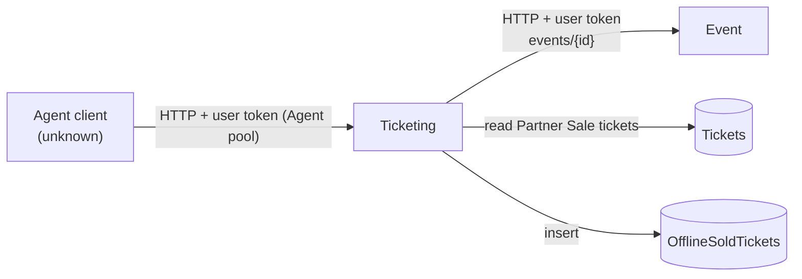

# X-13 · Agent pool and offline-sold tickets

> **Bangla name:** এজেন্ট pool ও অফলাইনে বিক্রি টিকিট
>
> [← 60 · Cross-cutting](README.md) · [Contents](../README.md) · [Open queries](../99-open-queries.md)

## 1. Name and purpose

**Agent pool.** Seller agents (offline ticket sellers) have accounts in a fourth Cognito pool, **Agent**. Their only API records
that pre-printed **partner-sale** tickets were sold, optionally with the buyer's phone number. No client in the five
repositories signs in with the Agent pool or calls this API `[UNCONFIRMED: Q-07]`.

## 2. Trigger and actor

| Item | Value |
|---|---|
| Actor | Seller agent (account created in the admin portal, [A-26](../10-admin-portal/A-26-agent-users.md)) |
| Client | Unknown `[UNCONFIRMED: Q-07]` |
| Cognito pool | Agent |
| Role / program scope | Backend adds role `agent` to tokens of this pool ([X-14](X-14-authz-pool-policies.md)) |

## 3. Business flow

1. Partner tickets are generated for a partner reservation in the admin portal ([A-11](../10-admin-portal/A-11-seat-reservation.md),
   [A-12](../10-admin-portal/A-12-reserved-tickets.md)); their ticket type is `Partner Sale`.
2. An agent sells some of them offline and records the sale with the ticket numbers (scanned QR or typed) and the buyer's
   phone/ID (max 20 characters).
3. The platform refuses tickets that are not partner-sale tickets, that were already recorded, or whose event has passed its
   ticket-selling stop time.

## 4. Technical flow

| # | From → To | Hop | What happens |
|---|---|---|---|
| 1 | Agent client → Ticketing `POST /ticketing/api/v1/offline-sold-ticket` | **[HTTP + user token]** (Agent pool) | `Policy = agent` |
| 2 | Ticketing → database | **[Shared table]** | Reject numbers already in `OfflineSoldTickets`; load `Tickets` where `TicketNumber` in list and `TicketType == "Partner Sale"`; any missing → 400 "Invalid QR \|\| …" |
| 3 | Ticketing → Event `GET /event/api/v1/events/{eventId}` per distinct event | **[HTTP + user token]** (token forwarding) | Reject if `TicketSellingStopDateTime < UtcNow` |
| 4 | Ticketing → database | — | Insert one `OfflineSoldTickets` row per ticket (`UserId` = agent's `sub`) |

## 5. Components

| Kind | Component |
|---|---|
| Service | Ticketing: `OfflineTicketSoldController` → `OfflineSoldTicketManager` → `TicketRepository`, `OfflineSoldTicketRepository`; `IEventClient` |
| Service | Event (event details) |
| AWS | Cognito Agent pool |
| Data | `etp."Tickets"` (read), `etp."OfflineSoldTickets"` (write) |

## 6. API contracts

| Method | Path | Auth | Request DTO | Response | Main errors (400) |
|---|---|---|---|---|---|
| POST | `/ticketing/api/v1/offline-sold-ticket` | `Policy = agent` | `OfflineSoldTicketCreateRequest { TicketNumbers: string[], TicketHolderIdentification?: string }` | `{ "message": "Offline sold tickets created successfully." }` | "The following ticket is already sold: …", "Invalid QR \|\| This ticket can not be sold: …", "Phone no must not exceed 20 characters.", "Ticket requests are no longer available as the ticket selling period of … has ended." |

```json
// POST /ticketing/api/v1/offline-sold-ticket
{ "ticketNumbers": ["BDI-000123", "BDI-000124"], "ticketHolderIdentification": "+8801711111111" }

// 200
{ "message": "Offline sold tickets created successfully." }
```

Ticket numbers above are illustrative of the shape; real numbers use the program's ticket prefix ([A-03](../10-admin-portal/A-03-program-settings.md)).

## 7. Data and side effects

One `OfflineSoldTickets` row per ticket (event, gallery/block/level, reservation id and public id, ticket number, holder id,
agent id, `CreatedAt`). Nothing else changes: the ticket itself and its reservation are not updated.

## 8. Code references

| What | Where |
|---|---|
| Controller | `rvl-gobcb-backend/Services/Ticketing/ETP.Ticketing.Service/Api/OfflineTicketSoldController.cs:30-41` |
| Manager | `rvl-gobcb-backend/Services/Ticketing/ETP.Ticketing.Domain/Managers/OfflineSoldTicketManager.cs:21-132` |
| Partner-sale filter | `rvl-gobcb-backend/Services/Ticketing/ETP.Ticketing.Storage/Repositories/TicketRepository.cs:36-40` |
| Entity | `rvl-gobcb-backend/Services/Ticketing/ETP.Ticketing.Storage/Models/OfflineSoldTicket.cs` |
| Agent pool scheme | `rvl-gobcb-backend/Core/ETP.Core/Configuration/DefaultAuthenticationConfig.cs:173-214` |

## 9. Handover notes

1. **No known client.** Neither portal nor app uses the Agent pool; the architecture document also lists the client as not
   found `[UNCONFIRMED: Q-07]`.
2. **Agent account management is anonymous** in the Admin service ([X-05](X-05-admin-provisioning.md), [X-18](X-18-endpoints-without-auth.md)).
3. **No read API.** Nothing in the backend reads `OfflineSoldTickets` back (no report, no admin screen) `[UNCONFIRMED: Q-07]`.
4. **Token forwarding to Event:** the Event endpoint has no `[Authorize]`, so the forwarded Agent token is not checked there.

## 10. Component relationships



**Depends on:** [A-26](../10-admin-portal/A-26-agent-users.md), [A-11](../10-admin-portal/A-11-seat-reservation.md), [A-12](../10-admin-portal/A-12-reserved-tickets.md).
**Affects:** nothing that reads it back (see notes).

## 11. Developer test guide

**Local testability: Partial.** The endpoint and Agent-pool login work locally; no `Partner Sale` tickets and no agent-sold
tickets are seeded (`docs/local-dev.md` §7, "What this does not cover"), so a successful call needs a partner reservation
created first ([A-11](../10-admin-portal/A-11-seat-reservation.md)).

| Item | Detail |
|---|---|
| Test data and accounts | Agent-pool user `+8801700000031` / `Passw0rd!23` (`scripts/Seed-EtpCognitoUsers.ps1`) |
| Browser | Not applicable |
| Emulator | Not applicable |
| Postman | `postman/etp-login-all-pools.postman_collection.json` "Agent pool" → "Login as agent" (`access_token_agent`); `postman/services/etp-ticketing.postman_collection.json` folder "OfflineTicketSold", "POST /api/v1/offline-sold-ticket" |
| Visual Studio debug | Attach to `ETP.Ticketing.Service`; breakpoint at `OfflineSoldTicketManager.cs:21` |
| Verify | `select "TicketNumber","UserId","TicketHolderIdentification" from etp."OfflineSoldTickets" order by "Id" desc;` |
