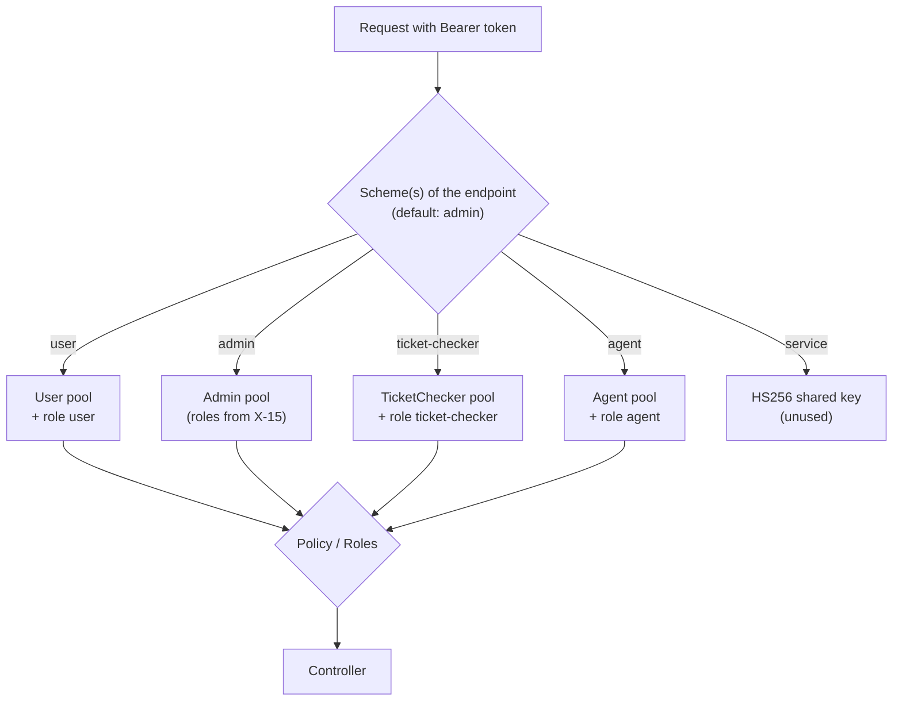

# X-14 · Authorization layer 1: pool schemes and policies

> **Bangla name:** অথরাইজেশন স্তর ১: pool স্কিম ও পলিসি
>
> [← 60 · Cross-cutting](README.md) · [Contents](../README.md) · [Open queries](../99-open-queries.md)

## 1. Name and purpose

**Pool schemes and policies.** Every service validates the bearer token itself. There is one JWT **authentication scheme per
Cognito pool** (`user`, `admin`, `ticket-checker`, `agent`) plus a fifth scheme (`service`) for a shared-key token. An endpoint
says which pool it accepts with `[Authorize(Policy = AuthScheme.X)]`, or implicitly the Admin pool when it only names roles.
This is the first of four authorization layers (architecture §2.4); roles are [X-15](X-15-authz-roles.md), program scope is
[X-16](X-16-authz-program-scope.md).

## 2. Trigger and actor

Every API request with an `Authorization: Bearer …` header, in every service that calls `AddJwtBearerAuthentication` and
`UseAuthentication` (all except Platform, PushNotification and UserAuth, where `UseAuthentication`/`UseAuthorization` are
commented out).

## 3. Business flow

Not visible to users. A customer token cannot open an admin endpoint, a checker token cannot open a customer endpoint, and so on.

## 4. Technical flow

| # | Step | Detail |
|---|---|---|
| 1 | Read token | `JwtBearer` handler of the scheme(s) the endpoint needs. Default scheme (when the endpoint does not name one) is **`admin`** (`DefaultAuthenticateScheme = AuthScheme.Admin`) |
| 2 | Validate | Issuer = `AWS:CognitoPool:<Pool>:Authority`; signature keys from `AWS:CognitoPool:<Pool>:Metadata` (OIDC metadata); lifetime; **audience check on the `client_id` claim** against `AWS:CognitoPool:<Pool>:ClientId` (comma-separated list allowed). Cognito access tokens carry `client_id`, not `aud` |
| 3 | `OnTokenValidated` | Adds claim `AppClaimTypes.AccessToken` (the raw token, used later for token forwarding, [X-19](X-19-service-to-service.md)). Adds a fixed role claim per pool: `user` → `user`, `ticket-checker` → `ticket-checker`, `agent` → `agent`. The `admin` scheme adds **no** role (it comes from [X-15](X-15-authz-roles.md)) |
| 4 | Chat hubs | `user` and `admin` schemes also accept `?access_token=` in the query string, only for paths starting with `/userissue/chathub` or `/admin/chathub` (SignalR WebSockets cannot send headers) |
| 5 | Policy | `AuthorizationConfig`: policy `admin` = authenticated by scheme `admin`; `user` / `ticket-checker` / `agent` = authenticated by that scheme **and** role claim of the same name; `service` = scheme `service` + role `service` |
| 6 | Result | No/invalid token → 401 (empty body). Valid token from another pool → 401 for that scheme (issuer mismatch) or 403 when the policy's role claim is missing |

**Which pool each service's endpoints accept** (from the attributes; full list in [Appendix B](../91-appendix-b-endpoint-index.md)):

| Service | Pools accepted |
|---|---|
| Admin | Admin (role-based, default scheme); TicketChecker on `ticket-checker-gate` (class allows schemes `admin,ticket-checker`); User on the legacy `user-issue` methods (Appendix A); many endpoints none ([X-18](X-18-endpoints-without-auth.md)) |
| Booking | User (`Policy = user`) for customer order endpoints; Admin (`Policy = admin`, no role check) for admin order lookups and two seat-reservation endpoints; the rest none |
| Ticketing | User for ticket actions; Admin for reserved tickets and signed cookie/token; Agent for `offline-sold-ticket`; the rest none |
| UserIssue | User for creating/reading own issues; Admin (no role check) for the support side; chat REST endpoints none; hub: `user` or `admin` scheme |
| TicketChecker | TicketChecker for `tickets/sync-tickets` |
| Event, PushNotification, Scheduler, Utility, Platform | none |

## 5. Components

| Kind | Component |
|---|---|
| Code | `Core/ETP.Core/Configuration/DefaultAuthenticationConfig.cs` (schemes), `Core/ETP.Core/Configuration/AuthorizationConfig.cs` (policies), `Core/ETP.Core/Constant/AppConstant.cs` (`AuthScheme`, `Role`) |
| Config | `AWS:CognitoPool:{User,Admin,TicketChecker,Agent}:{PoolId,ClientId,Authority,Metadata}`, `Authentication:Jwt:{Key,Issuer,Audience}` |
| AWS | Cognito OIDC metadata / JWKS for each pool |

## 6. API contracts

Not an endpoint. Header contract: `Authorization: Bearer <Cognito access token>` (ID tokens are rejected because they carry `aud`,
not `client_id`; the Postman request "ID token instead of access token" demonstrates this). For SignalR: `?access_token=<token>`.

## 7. Data and side effects

None. The validated token is kept as a claim for forwarding.

## 8. Code references

| What | Where |
|---|---|
| Schemes, `client_id` audience check, role claims, chat-hub query token | `rvl-gobcb-backend/Core/ETP.Core/Configuration/DefaultAuthenticationConfig.cs:16-246` |
| Policies | `rvl-gobcb-backend/Core/ETP.Core/Configuration/AuthorizationConfig.cs:13-38` |
| Constants | `rvl-gobcb-backend/Core/ETP.Core/Constant/AppConstant.cs:40-62` |
| Registration example | `rvl-gobcb-backend/Services/Admin/ETP.Admin.Service/Program.cs:38-39`, `:86-87`, `:109-110` |

## 9. Handover notes

1. **`Policy = admin` means "any Admin-pool user".** Booking, Ticketing and UserIssue use it without roles, so for example a
   `customer_support` user can call reserved-ticket endpoints in Ticketing (architecture §2.5, observation 1).
2. **The default scheme is `admin`.** An endpoint with only `[Authorize(Roles = …)]` authenticates with the Admin pool; a User
   token there gets 401, not 403.
3. **`service` scheme is unused.** `GET /admin/api/v1/token` issues HS256 tokens for it, but no endpoint requires
   `Policy = service` ([X-18](X-18-endpoints-without-auth.md), architecture §2.3).
4. Whether API Gateway validates tokens before the services is unverified (architecture Q1, Q1b).
5. Services that do not authenticate (PushNotification, Event, Scheduler, Utility, Platform) cannot know who calls them.

## 10. Component relationships

**Depends on:** Cognito pools, configuration ([X-26](X-26-configuration.md)). **Affects:** every token-protected feature.

## 11. Developer test guide

**Local testability: Full.** Floci provides all four pools; `scripts/Set-EtpSecrets.ps1` writes `Authority`/`Metadata` (HTTPS via
the `etp-floci-tls` proxy, `docs/local-dev.md` Step 3).

| Item | Detail |
|---|---|
| Test data and accounts | One user per pool: admin `…01`–`…05`, user `…11`, checker `…21`, agent `…31` (`scripts/Seed-EtpCognitoUsers.ps1`) |
| Browser | Not needed |
| Emulator | Not needed |
| Postman | `postman/etp-cognito-auth.postman_collection.json` folder "04 - Backend JWT validation (Admin scheme)": "No token", "Malformed bearer token", "Forged token (wrong signing key)", "Tampered signature on real token", "ID token instead of access token", "access_token query string (only honoured on chathub paths)", "Valid admin access token". Cross-pool test: call a `Policy = user` request in `postman/services/etp-booking.postman_collection.json` with `access_token_admin` → 401 |
| Visual Studio debug | Attach to any service; breakpoints in the `AudienceValidator` lambdas and `OnTokenValidated` handlers of `DefaultAuthenticationConfig.cs` |
| Verify | `pwsh ./scripts/Test-EtpLocal.ps1` checks 401 without and 200 with an Admin token |
